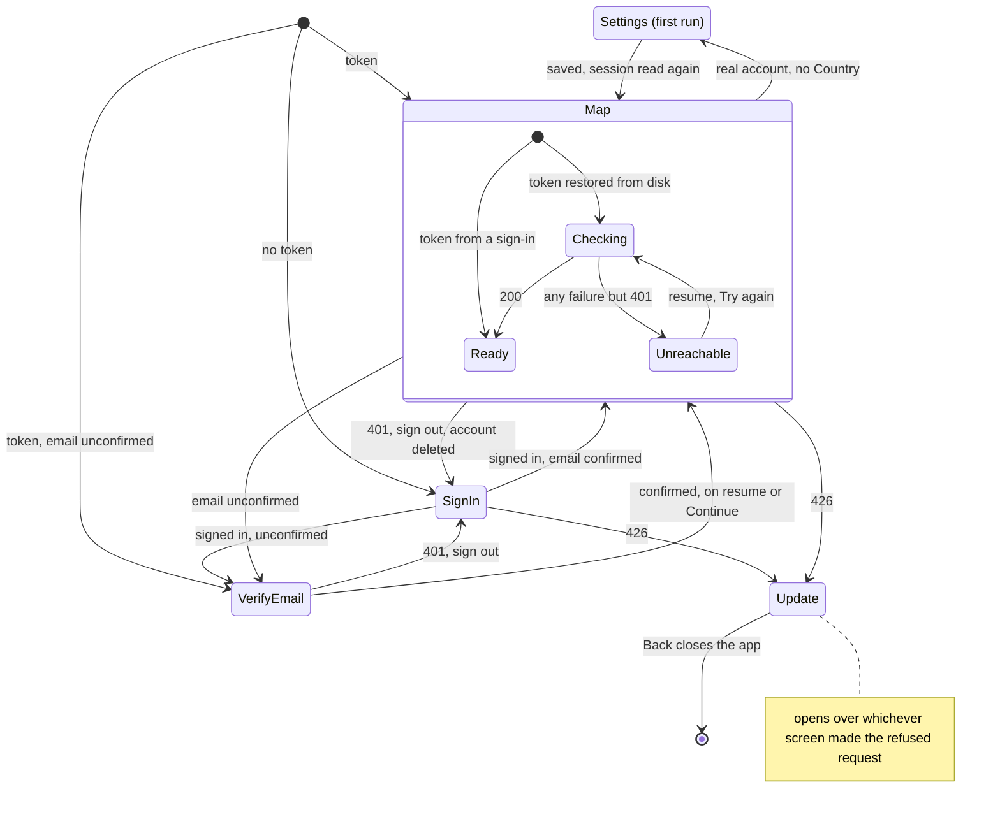

# HoldMyTrack for Android: Implementation

> **Scope note.** How the Android app is built where the code can't say it: flows across files, invariants, reasons for a design that isn't the obvious one, and traps. The app's shape and stack are root `docs/ARCHITECTURE.md` §3, its behavior `apps/android/docs/SPEC.md`, and the server side of every call root `docs/IMPLEMENTATION.md`. Detail confined to one class is in that class's KDoc.

---

## 1. App shell and navigation

### 1.1 Process start

`HoldMyTrackApplication.onCreate` runs in a fixed order: `Session.init` before anything reads the token, `MapLibre.getInstance` before any `MapView` exists, then `HttpRequestUtil.setOkHttpClient(HoldMyTrackApi.client)`. The last call must happen in the `Application`: MapLibre may request as soon as a `MapView` exists, and anything sent before the swap goes out through its own client, without the token. The You tab's Theme is applied here as AppCompat's night mode, which also picks the map's style flavor.

### 1.2 Which screen a session reaches

- **`MapFragment.syncSession()` is the one place session state and map state are reconciled**, from `onResume` and once after the style loads. The basemap style is unauthenticated and loads at once; the account's layers wait for a verified token.
- **Only a `401` clears the session**, on the map and on the verify screen. Any other failure keeps the token, shows a notice and retries on the next resume.
- **`MainActivity` checks the session before `setContentView`**, so a signed-out launch creates no `MapView` and requests no style.
- **Sign-in, verify email and first-run Settings are each the root of a new task**, so no screen that needs a session is left under them and Back leaves the app.
- **Email confirmation and Country are kept on disk** so a cold start routes before `GET /v1/auth/me` answers; that answer refreshes both.
- **The verify screen has no change-email form**: the phone keys its state by email (§2.3), and a change would orphan it. `SyncActivity` checks confirmation too, since Health Connect's rationale intent opens it without the map.

### 1.3 Tabs

Map, Stories and Sync are one `MapFragment` whose panel switches tabs; You is `YouFragment`. `MainActivity` shows and hides them, never replaces them, so the `MapView`, its camera, its layers and a recording survive a trip to You.

What survives a recreation is chosen item by item, and each was a bug: the fragment is added only on a first create; the once-per-process camera fit, the map mode and the logo's and attribution's base margins go into the saved state. Without the mode, the buttons restored their own checked state and showed Heatmap over a map in Normal; without the margins, MapLibre's restored values were lifted a second time.

At `targetSdk` 35+ the system draws edge-to-edge and ignores the opt-out, so the map's chrome adds the bottom inset to each view's padding (`insetSystemBars`) and passes the insets on unconsumed; the side insets are applied once, on the tabs' container.

### 1.4 The web's pages in a WebView

Settings, Activity graph & trends, Sync history and About are the server's pages in `web/WebPageActivity` (ADR-0042); how the server renders a page for the app is root `docs/IMPLEMENTATION.md` §4.19.

- **Signed in by cookie.** WebView requests never pass through the app's `OkHttpClient`, so the session, the in-app marker and the language are written into the WebView's cookie store before every load. A header would reach only the first request; a cookie rides on every link, form POST and redirect.
- **`route` decides where a navigation goes**: the page's own path stays, `/` opens the native map, the sign-in pages finish and leave the map's session check to act, anything else opens in a Custom Tab. Trap: `shouldOverrideUrlLoading` is never offered a POST or reliably the redirect after one, so `route` runs again in `onPageStarted`. That is how first-run Settings' save, redirecting to `/`, reaches the map; `route` reads the session first, because the map gates on a Country only the server has heard of.
- **View on map** is a link to `/` with the activity's id and local day, handed to `MainActivity` (`onNewIntent` when the map exists; ignored when replayed from recents). The map acts once the session is confirmed: inside the range it selects the activity, outside it applies that day as the range first. The fit is padded by the height the sheet is heading to, since fitting to the sheet mid-collapse put the activity at the top of the screen.

## 2. Session and auth

### 2.1 One credential, two HTTP stacks

The app's calls and MapLibre Native's tile fetches both need the session, and MapLibre never sees a cookie jar. So the token is a bearer header added by an interceptor on the one `OkHttpClient` both use (§1.1), and `net/Session` is a process-wide `object`.

The shared client's interceptors apply to the map's requests too:
- **Bearer**, per request, so sign-in, sign-out and expiry apply to the next tile; only to the API's origin, since the basemap is on a domain HoldMyTrack doesn't own.
- **Origin**, the API's, on every request leaving it. The basemap's edge rule refuses a request without one and the satellite key accepts only the deployment's origin (root `docs/IMPLEMENTATION.md` §5.4), so without it the map draws nothing.
- **User-Agent**, carrying the version and commit (§6) the server's minimum-build check reads.
- **Outdated** (`net/AppOutdated`): a `426 app_outdated` on any call opens the Update screen, so no screen checks for it.

**The Update screen opens over the app.** The interceptor runs before the refused call's callback, and clearing the task first would hand that callback a destroyed fragment, so Back calls `finishAffinity` instead. A refused call's callback is never delivered (`HoldMyTrackApi.refusedBuild`), since Back can tear the screens down while another refused call is in flight; suspending callers get their exception, and their scopes end with their screens.

### 2.2 The wire

**Every body is a class in `net/Wire.kt`, held to `services/server/api` by `WireContractTest`**, which walks each class's serial descriptor against the contract's schema: a field the server renames, drops, retypes or sends as null fails CI instead of a decode on a phone. Response classes list only what the app reads and unknown keys are skipped, so a field the server adds breaks no installed version. The test task declares the contract as an input, since it sits outside the Gradle project.

**`ApiException` carries the server's `message` unreworded** (ADR-0045), with `error` as `errorCode` for callers to branch on.

### 2.3 Sign-in and per-account state

- **Sign in and sign up are two modes of one screen**, because the Facebook round trip returns to the screen holding the verifier, whichever mode started it. The app checks only that both fields are filled; every other rule is the server's.
- **Google** asks Credential Manager for an ID token for the server's *web* client id, the audience the server checks. A picker failure in development is almost always a missing Android OAuth client for the debug key's SHA-1, reported only as a generic error.
- **Facebook** runs the server's flow in a Custom Tab (root `docs/IMPLEMENTATION.md` §4.9). The verifier is saved before the tab opens, since the process can die behind it. `OAuthRedirectActivity`, exported and without UI, receives `holdmytrack://oauth` and forwards it with `CLEAR_TOP | SINGLE_TOP`, which closes the tab and keeps `SignInActivity` unexported.

**The phone keys its own state by the account's email**: recordings and the live journal (§5), hidden Sync rows, the Health Connect switch, the last Load (§4.2) and the last recording type. The demo account shares the empty key, harmless since it can't sync. Account deletion clears the recordings, hidden rows, switch and last Load before clearing the session, so a new account with the same address starts clean (`settings/AccountDeletion`).

**The You tab's Language save resends the whole profile**, because the settings endpoint replaces Name, Country and Timezone with Language. How a sign-in applies the account's language is `settings/AppLanguage`.

## 3. Map overlays

### 3.1 Layers and the style

The style is `GET /v1/map/style/{flavor}?lang=`, unmodified (root `docs/ARCHITECTURE.md` §2.1).

**A style reload discards every custom layer and image**, so everything that adds to the style is idempotent and re-adds on each load: `MapOverlays`, `MapPaths`/`MapBikePaths`, `MapSatellite`, `MapSpots` with its badge bitmaps, the Sync candidates and the Private location circles. `syncSession()` attaches them once the session is verified.

**Order, bottom to top, matches the web's layer by layer**: Fog or Heatmap coverage, the trails and tracks lifted out of the basemap's roads, the bike paths, the account's tracks, all under the basemap's first symbol layer; Spots over everything. MapLibre Native has no `moveLayer`, so lifting a layer is remove and re-add, and a coverage refresh re-adds its layers under whatever sat over them.

- **`setMode` changes properties only**, so a switch is instant and a reload re-applies it. Trap: MapLibre Native never redraws a background layer once hidden, so Heatmap's basemap wash is switched by opacity.
- **Only the tracks URL carries a filter**: the date range or the open Story. Type, Distance and the hidden set are layer filters. `VectorSource` can't change its URL, so a range change replaces the layer and source, carrying visibility over.
- **The selected track is two extra layers** filtered to the selected or checked ids, since MapLibre Native Android has no feature-state.

### 3.2 Tile versions

Tiles are cached by URL, so refreshing means a new URL (root `docs/IMPLEMENTATION.md` §4.2.6). The account's tile version is kept on disk: a cold start attaches at the last one and MapLibre's cache draws at once, then the status is read on attach and every resume, and sources are re-pointed only if it moved. The bike-path and Spots sources move with it; without that the app kept tiles cached before an import. Tracks also carry an app-side `v` for an edit the server's version doesn't reflect yet. `map/CoverageWatch` follows a render to its end, also when a resume finds the account rendering, so an import made on the web is followed.

### 3.3 Logic ported from the web

Where the web has a rule, the app ports it as a pure Kotlin class with the web's test cases, and a change to one side needs the other: `PanelState` and `ActivityFacets`, `ActivityDays`, `DateRangeSlider`, `RangeShift`, `ZoomTier`, `TrackBands`, `EditTrackOps`, `BoxUnion`, `CoverageWatch`, `Viewfinder`, the `photos/` rules, `SpotText`, and `sync/Similar`, whose test runs the server's overlap cases both ways round. `MapSession`, `DefaultRange`, `PendingDiff`, `PanelRules` and `PhotoMarkerScope` run the web's own JSON cases (`testdata/map-session`). `MapPaths`' legend colors and dashes must match the web's `style.ts`.

### 3.4 The panel, editors and touches

The split follows the web's: `MapSession` holds the range or Story shown and the camera's next flight, `PanelState` the selection, and `ActivitiesPanel` binds views and redraws from it in one `render()`. `MapFragment` owns the map and composes one controller per feature; `RangeController` binds the session to the slider and the list. Trap: a controller that registers a permission request or the photo picker is created as a fragment field, since registering after the fragment starts throws; Back callbacks are asked last-added first, export's before the editors' before the sheet's.

- **Touch order**: a tap asks `MapSpots.spotAt` first unless an editor holds the map, so a spot's tap never selects a track under it. The track editor's point drags and the Private location handle are taken in a touch listener on the `MapView`, which runs before MapLibre's gestures (the web's `dragPan.disable()`). Photo markers are views, so their taps never reach the map.
- **Edits run one request at a time**: parallel deletes raced each other's coverage re-render. A group edit resends each activity's own name and description, since the endpoint replaces them, and skips saves already sent on a retry.
- **Pending**: a row entering or leaving Pending refetches the tracks and starts the coverage watch, and the list is polled while any row is Pending.
- **A Private location change reprocesses whole activities**, so the editor hands the coverage watch a callback that re-reads tracks, list, days and metrics once the server has drained.

### 3.5 Map image export

The web's design (root `docs/IMPLEMENTATION.md` §4.3.3).

- **The image is drawn on a second, hidden `MapView`**: `MapSnapshotter` takes layers only before its style loads, while the overlays add to a loaded style. `MapFragment.prepareExportStyle` replays the live map's overlay calls on it, so **a change to how the live map attaches its layers has to reach the export too**.
- **It's read on map idle with `TextureView.getBitmap`**: "fully rendered" never comes when a tile fails, and `MapLibreMap.snapshot` never answered for a 4K image.
- **The credit comes from the style document**: a loaded source reports its archive's attribution, which leaves Protomaps out.

## 4. Sync engine

The flow is the sequence diagram in `apps/android/docs/SPEC.md` FR-3. Health Connect hands routes only to a foreground read (root `docs/IMPLEMENTATION.md` §4.0), and the app enforces that by cancelling: the Sync tab's reads and sends run in the map's `lifecycleScope`, and leaving the tab, the app stopping or the You tab covering the map cancels them.

### 4.1 Permissions

- **Three Health Connect permissions are declared, no more**: an unused data type is a documented Play rejection cause. `READ_HEALTH_DATA_IN_BACKGROUND` is left out because it changes nothing for route reads.
- **`SyncActivity` handles Health Connect's rationale intent**; without a handler the permission dialog can fail to appear. An `activity-alias` takes Health Connect's "see how this app used your data" link.
- **Health Connect's settings open on its home screen**: the per-app permission page's API needs a signature permission and its `SecurityException` kills the process, so the app names the path and catches every exception around the launch.
- **The source switch is the app's** (`sync/SyncSources`, ADR-0039), off whatever Health Connect has granted. Turning it off forgets the last Load.

### 4.2 Load

**`sync/WaitingLoader.load` is the only place Health Connect is read**, from a screen's scope. It reads 90 days of sessions with routes, asks `POST /v1/sync/known` which ids the server has (root `docs/IMPLEMENTATION.md` §4.0.3), hands those still processing to `SyncProgress`, prunes hidden sessions only after a read that withheld nothing, and replaces `WaitingStore`'s rows in one transaction. A cancelled or failed read changes nothing, so cancelling needs no cleanup. There is no cursor: each Load asks Health Connect and the server afresh, so a reinstall or second phone agrees and a deleted activity is offered again.

**`sync/WaitingStore` keeps what a Load found**, in a second SQLite database, so the tab opens without reading Health Connect. It keeps each session's drawn line, not its route; a session is read again by id when it's sent.

### 4.3 Sending and landing

- **`sync/SyncRunner.send`** sends sessions in batches below the server's cap, then each recording alone, deleting it from the phone once taken. The JSON is built from the route as read, never the simplified line. A failed request stops the run, leaving the rest ticked.
- **`sync/SyncProgress` is process-wide**: it reads nothing from Health Connect, so it outlives the tab. While it holds anything and has a listener it polls `/v1/sync/known`: still processing stays, known and not processing has landed, neither has failed and a failed recording goes back into the phone's store. **A landing refetches the tracks tile at once**, since the tile version moves only after the coverage render that follows ingest.
- **The candidates on the map**: the account's tracks step aside on the Sync tab. `map/Simplify` thins each route for drawing only, with speeds by the server's track-metrics rule on the coarser line, so a candidate's pace bands are smoother than the synced activity's.

### 4.4 File upload

`imports/FileImports` is process-wide with its own scope, so an upload outlives a rotation or a trip to another app, unlike a Health Connect read. The picker asks for `*/*` and the queue decides by file name, because providers label these files inconsistently; for the same reason the manifest doesn't claim `application/octet-stream`, or the app would be offered for every binary file.

## 5. Recording and crash recovery

The lifecycle is the state diagram in `apps/android/docs/SPEC.md` FR-5, and the wire contract root `docs/IMPLEMENTATION.md` §4.0.4 (ADR-0007). `recording/RecordingService`, a foreground location service, holds the recording; the map binds to it only to watch, which is also how reopening the app mid-recording redraws the track so far. The record button and the notification send intents.

### 5.1 Stop

- **The notification's Stop goes through the map**: the Save screen needs an app window to open over, and a tap in the shade is confirmed there first, where the map's hold is its own confirmation. A Stop that arrives before the map has bound waits for the bind; one replayed from recents is ignored.
- **Stop saves in the service** on an application-lifetime scope, since Stop can come with no screen open and the service may die once it leaves the foreground. The row is inserted in the same transaction that clears the journal; only then does the Save screen open, so Back, or the screen never opening, still leaves the recording stored.
- **`external_id` is a UUID minted at Start**, under the account signed in then. It keys the journal and makes a retried submit idempotent on the server.

### 5.2 The journal

A foreground service survives the screen going away, not the process. So each fix is also appended to `recording/db/LiveRecordingJournal`, one row per fix so a write stays small over a multi-hour recording. Writes go in order through one single-threaded dispatcher on an application-lifetime scope, and a failed write is logged, so a full disk doesn't end the recording.

**Invariant: a journal row with no recording running in this process is a leftover from one that died**, because Stop moves the recording into the saved table and clears the journal in one transaction.

**Recovery is offered, never automatic.** The service is `START_NOT_STICKY`: a sticky restart counts as a start from the background, which gets no while-in-use location, and would resume without the user knowing. The map looks for a leftover when it binds to an idle service, queued behind pending writes so a Stop just made isn't mistaken for one. Resume comes back paused with the last fix cleared, so the dead time adds neither time nor distance. Another account's leftover isn't offered; a Start that finds one saves it first, since the journal holds one recording.

### 5.3 The store

`recording/db/RecordedActivityStore` is a plain `SQLiteOpenHelper`: Room's KSP had no release for this project's Kotlin. Rows are scoped per account (§2.3). Upgrades drop and recreate except tables holding unsynced recordings, the only copy anywhere. The database is in WAL mode, because the journal commits on every fix while screens read.

## 6. Build traps

- **The API base is the one value from outside the build**, a Gradle property per build type, so the Play build can't pick up a dev address. Against a dev stack it must be the stack's `APP_BASE_URL` origin, or the WebView's form POSTs are refused (root `docs/IMPLEMENTATION.md` §4.19). A physical device needs `adb reverse` for the API port and the web dev server's (`apps/android/holdmytrack/README.md`).
- **Cleartext `http://` is allowed in debug only**, by the network security config.
- **Donate is in debug builds only**, the APK the website serves: Play's payments policy forbids linking to payment outside its billing.
- **The version comes from git**: `versionCode` is the commit count, so it rises with every commit as Play requires, and the short SHA is baked in, the same one `/healthz` reports. Outside a checkout the code is 1. `versionName` is bumped by hand.
- **`gradle/libs.versions.toml` gives each pin its reason.** The ones that bite: AGP 9's built-in Kotlin compiles at 2.2, so `googleid` stays at 1.2.0 and `kotlinx.serialization` at 1.9.0, whose newer releases carry metadata it can't read; and applying `org.jetbrains.kotlin.android` beside AGP 9 is an error.
- **Languages are English and Russian** (root `docs/IMPLEMENTATION.md` §4.21). Strings the same in every language are `translatable="false"`, so lint's missing-translation check covers the rest. Russian strings write counts as "label: N" to avoid plural forms. `localeFilters` keeps only `en` and `ru`, so a phone in another language gets all-English, not English mixed with a library's translations.
- **The look is the web's tokens** (`res/values/colors.xml`, `values-night/colors.xml`, `dimens.xml`, value for value, CSS px as dp), so a change to the web's `tokens.css` needs the matching change here.