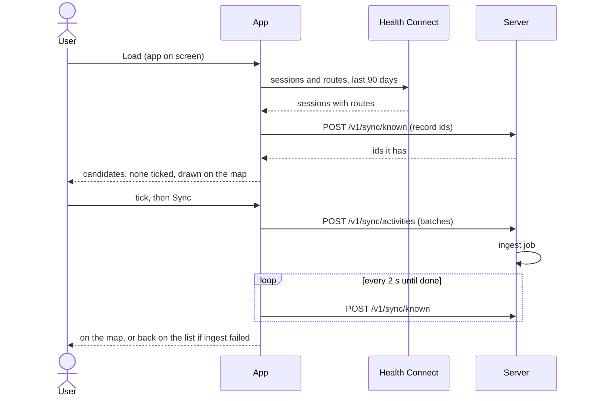
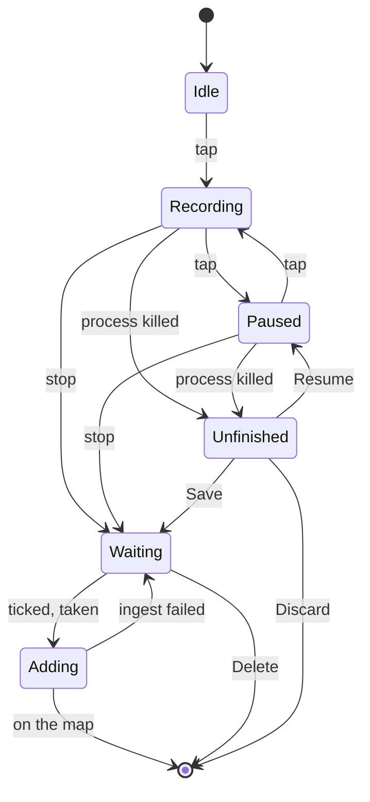

# HoldMyTrack for Android: Spec

| | |
| :-- | :-- |
| **Status** | Current: the app as built |
| **Last updated** | 2026-10-16 |
| **Related documents** | `docs/SPEC.md` (the server and web behavior this app shares), `apps/android/docs/IMPLEMENTATION.md` (how it's built), `apps/android/docs/ROADMAP.md` (open work) |

## 1. Introduction

### 1.1 Purpose

What the Android app does, as a user can rely on it: where it differs from the web, and what only the app does (Health Connect sync, GPS recording, Spot capture). What it shares with the web is in `docs/SPEC.md`, cited by FR. Screen wording and layout live in the code.

### 1.2 Scope

Every built feature of the app; what it won't do is in §9.

### 1.4 Definitions

`docs/SPEC.md` §1.4's terms apply.

| Term | Meaning |
| :-- | :-- |
| **Session record** | A Health Connect exercise session: start and end time, an exercise type and sometimes a route. Not a sign-in session. |
| **Candidate** | A Health Connect session with a readable route, or a recording on this phone, that the account doesn't have yet. "Waiting" means exactly this. |
| **Source** | Where candidates come from: Health Connect, switched on and off in Settings › Sync, or Recorded on this phone, always on (FR-3.1). |
| **Readiness** | Where the user stands in Health Connect's permission sequence, one of six states (FR-3.1). |

## 2. Actors

| Actor | Can |
| :-- | :-- |
| **Anonymous visitor** | See the sign-in screen only: sign in, sign up or start a demo (FR-1.1). The map is never shown without a session. |
| **Demo user** | Read the Demo Customer account (`docs/SPEC.md` FR-2.1) and record on the phone; nothing reaches the server. |
| **Registered user** | Everything in this document, for their own account. |

## 3. FR-1 — Authentication & Session

### FR-1.1 Sign in, sign up, start a demo

One screen signs in, signs up, starts a demo or continues with Google or Facebook, against the web's endpoints (`docs/SPEC.md` FR-1.1, FR-1.2, FR-2.1, FR-1.9, FR-1.10).

- The app checks only that email and password aren't empty. Every other rule is the server's, and its message is shown as sent, so the two never disagree.
- The response's session token is kept with the email (empty for the demo account) and whether it's verified.
- Google and Facebook show only when `GET /v1/auth/providers` reports them configured; when that request fails, neither shows.
- Google sends the system account picker's ID token with the phone's timezone. Facebook runs the server's own flow in a browser tab, not Meta's SDK, started with the S256 hash of a random verifier the app keeps; the code returned to `holdmytrack://oauth` is redeemed with that verifier at `POST /v1/auth/handoff`.
- Forgot password opens the web's page (`docs/SPEC.md` FR-1.5) in a browser tab.
- Without a session this is the first screen. The map is never shown signed out: a base map without the account's layers demonstrates less than the demo does.

### FR-1.2 Session persistence and re-verification

A kept session survives a restart but isn't trusted until the server confirms it (`docs/SPEC.md` FR-1.4).

- On a cold start the map attaches no signed-in layer until `GET /v1/auth/me` answers. A `200` trusts the token for the rest of the process.
- Only a `401` clears the token and opens the sign-in screen. Any other failure keeps it, says the server couldn't be reached and retries on the next resume. The map never sits blank on refused tiles.

### FR-1.3 Sign out

`POST /v1/auth/logout` ends the session on the server; the phone forgets the token whether or not that request succeeded, and opens the sign-in screen with every other screen cleared.

### FR-1.4 Email verification

An unverified account (`docs/SPEC.md` FR-1.8) sees a "check your email" screen instead of the map, whose tiles the server would refuse.

- The screen asks `GET /v1/auth/me` again on every resume and opens the map once the email is verified. A `401` signs out as in FR-1.2.
- Resend shows the server's answer as sent, its hourly limit included.
- Settings › Sync, which Health Connect can open without the map, shows only a notice for such an account.
- Changing the address is web-only: the phone keeps recordings and Sync state by email (FR-5.3), which a change would orphan. A demo account is never gated.

### FR-1.5 Settings

The web's Settings page (`docs/SPEC.md` FR-1.7) shown in the app (`docs/SPEC.md` FR-10.8), in the app's theme and language.

- Theme, Download your data and Delete account are native instead (FR-2.9, FR-1.7).
- Avatar: Android's photo picker (no storage permission), shrunk to at most 512 px on the long side, uploaded as JPEG at once. An image the phone can't read leaves the avatar as it was.
- Country sets the app's units, metric until one is saved; a change applies at the next session check, made whenever the You tab or the map shows.
- Language, set on the You tab, sets the app's per-app language and the account's together; Automatic follows the phone. A sign-in or session check applies the account's language unless it's automatic.
- First run: a real, verified account with no Country opens on Settings instead of the map, and only saving gets past it. A new email-and-password account starts on the phone's timezone.
- The demo account's page is read-only. A link to another page opens in a browser tab.

### FR-1.6 Activity graph & trends

The web's `/profile` page, the activity graph and Trends (`docs/SPEC.md` FR-7, FR-9), shown in the app (`docs/SPEC.md` FR-10.8) and read again each time the screen comes back to the front.

### FR-1.7 Privacy

- Private locations (`docs/SPEC.md` FR-8.1) are read again each time the screen shows; a row or Add opens FR-2.7's editor on the map.
- Download your data (`docs/SPEC.md` FR-1.12), for a real account only: a native screen that checks the request every 10 seconds while it shows and saves each archive to the phone's Downloads through Android's download manager.
- Privacy policy opens `/privacy` in a browser tab.
- The demo account sees its Private locations read-only and no download.

### FR-1.8 Update screen

When any `/v1` request answers `426` `app_outdated` (`docs/SPEC.md` §1.5), signed in or not, the Update screen opens over whatever showed.

- Several refusals at once open it once; a refused request's own screen says nothing.
- Update opens the Play listing for a Play install and the deployment's APK download (`docs/DEPLOY.md` §10) for any other.
- Back closes the app, and it opens on the Update screen for as long as the server refuses the build.
- Nothing on the phone changes: what waits on the Sync tab stays to be sent from the updated app, and a recording under way carries on.

## 4. FR-2 — Map Visualization

### FR-2.1 Base map

- The style comes unauthenticated from `GET /v1/map/style/{flavor}?lang=`: `light` or `dark` by the app's theme (the other flavors aren't offered), labels in the app's language (`docs/SPEC.md` FR-13.1).
- The camera starts on a world view until FR-2.3 frames the account.
- The map is flat at every zoom: MapLibre Native has no globe (`docs/SPEC.md` FR-4.5).

### FR-2.2 Three map modes: Normal, Fog of War, Heatmap

The web's three exclusive modes (`docs/SPEC.md` FR-4.1–FR-4.4), from the same tiles, with Fog's and Heatmap's coverage drawn under the tracks and both under the labels.

- Normal's tracks follow the date range (FR-2.6) through the tile request. The panel's filters, hidden tracks and Pending rows are applied on the phone. Fog and Heatmap are never filtered.
- The map reads only the server. It never reads Health Connect, and an activity appears only once synced and ingested.
- The mode survives a theme or language change.
- While recording (FR-5.1) the mode toggle goes and no mode's layers are drawn, only the recording; the mode comes back when it stops.
- The Layers menu (`docs/SPEC.md` FR-4.13) holds Show layers, Satellite only when the style carries imagery (`docs/SPEC.md` FR-4.14), the bike, shared and mountain-bike paths and the Spot categories (FR-2.8). Each is off by default and kept on the phone, not the account. Layers stays while recording.
- Fog and Heatmap say when coverage is still being updated (`docs/SPEC.md` FR-4.2), checked on every opening of the map, and refresh when the server is done.

### FR-2.3 Initial camera framing

- Once per app session the camera fits the most recent activity with a track, skipping Pending ones (`docs/SPEC.md` FR-4.5), at most zoom 15. A rotation, theme or language change keeps the camera.
- An account with nothing on the map stays on the world view with a pointer to Sync, asked again on every return to the map; the demo account never gets it.

### FR-2.4 Attribution

MapLibre's attribution control stays on and visible above the collapsed sheet: the base map's ODbL credit is required (`docs/IMPLEMENTATION.md` §5.6).

### FR-2.5 Find my location

The web's one-shot locate (`docs/SPEC.md` FR-4.7).

- Nothing is located before the first tap, which asks for location, Precise or Approximate.
- It flies to at least zoom 14 and follows the position until the map is panned.
- Hidden while recording, which follows its own fixes.

### FR-2.6 Date range

The web's date slider (`docs/SPEC.md` FR-6) as the Activities tab's head, in Normal mode only, once the session is verified and the account has an activity day.

- The scrubber shows 12 activity days at a time (the web 15), the most recent on load.
- The default, the 5 most recent activity days, is worked out again on every return to the map until the user picks a range, so a sync or recording lands in view.
- A range applies when a handle or held button is released. Only a range the user picked moves the camera and clears the selection, checked group, hidden tracks and filters (`docs/SPEC.md` FR-6.6). The camera never moves while recording.
- A picked range survives rotation and a return from another tab.

### FR-2.7 Activities panel

The web's Activities panel (`docs/SPEC.md` FR-5) as a sheet over the map, with Activities and Stories tabs. Normal mode only, not while recording.

- Rows, badges, the Type and Distance filters and Pending follow `docs/SPEC.md` FR-5.1–FR-5.3 and FR-5.15. The Distance filter is offered only with two or more distinct distances.
- A tap on a row, or on a track within 14 dp, selects that activity and fits the camera to it; one at a time.
- A tap on a row's tile or a long press checks it. Unlike the web, checking a row flies the camera to it; unchecking doesn't. All, None and Invert reach only the listed rows and never move the camera.
- The toolbar acts on the checked group, else the selected row (`docs/SPEC.md` FR-5.1). Hide lasts for this app session. Delete is disabled while any target is Pending.
- The list is read for each range and on every return to the map, keeping what of the selection, group and hidden set still exists; every 2 seconds while any row is Pending.
- Edit (`docs/SPEC.md` FR-5.10) writes only what changed, one activity at a time. A group of mixed types starts with Type empty, and leaving it empty keeps each its own.
- Delete (`docs/SPEC.md` FR-5.11) asks first; on a failure, what was already deleted is reported as gone.
- The selected activity is drawn in pace bands (`docs/SPEC.md` FR-4.8), unless hidden, filtered out or Pending.
- Track editing (`docs/SPEC.md` FR-5.14, FR-5.17), for one activity with a finished track, has Chop, Cut, Split, Move point, Delete point, Undo and Reset. A split leaving a part inside a Private location asks first.
- The Private location editor (`docs/SPEC.md` FR-8.1) switches the map to Normal and draws every circle. A new one is 200 m at the map's centre; the radius moves in 10 m steps. Cancel, Back, a mode change or a recording starting drops the draft.
- The Stories tab (`docs/SPEC.md` FR-14.6) opens the newest Story. Taking an activity out needs no confirmation; deleting a Story asks first. Leaving the tab restores the Activities range. Copies others sent wait at its top to be accepted or declined (`docs/SPEC.md` FR-14.7, FR-14.8).
- Add to story (`docs/SPEC.md` FR-14.2, FR-14.3) adds the toolbar's target to a Story, or a new one, in one request.
- The demo account can't edit, delete or change a Story.

### FR-2.8 Spots

The web's points of interest (`docs/SPEC.md` FR-15.2–FR-15.5) on the same tiles, and, in the app only, capturing a place by going there (`docs/SPEC.md` FR-15.6).

- One Layers entry per category, off until ticked, kept on the phone; drawn in every mode and while recording, hidden while a track is edited.
- From zoom 13 ticked places show with their areas; from 10 to 13 on request. A captured place's badge is filled, and a retired place shows only to an account that captured it.
- A place's popup offers Capture, except on a captured place or to the demo account.
- **Capture rule**: 30 seconds inside the place, counting only fixes accurate to 25 m. A fix outside starts the count again. In the background nothing is read and the count waits.
- Capture asks for precise location first; without it nothing starts. Location is read only while capture runs and only in the foreground, and the screen stays on meanwhile.
- The server checks the position (`docs/SPEC.md` FR-15.6): refused, the count starts again; unsent, it's retried every 5 seconds. A place retired since the map loaded it ends capture.
- Capture ends on success, Stop, Back, a track edit starting, unticking the category or leaving the account.

### FR-2.9 The bottom bar

Map, Stories, the record button (FR-5.1), Sync and You.

- Each tab keeps its state: the map's camera, mode, range, selection and a recording are as they were on coming back. Back from another tab goes to Map, and from Map leaves the app.
- Stories counts copies waiting to be answered. Starting a recording from another tab moves to Map.
- The You tab leads to Settings (FR-1.5), Activity graph & trends (FR-1.6), Settings › Sync (FR-3.1) and Privacy (FR-1.7), and shows the app's version and commit.
- Theme belongs to the phone, not the account (`docs/SPEC.md` FR-4.12), so the demo account can change it. Language (FR-1.5) does nothing for the demo account.
- About opens in the app (`docs/SPEC.md` FR-10.8); Help, Contacts and Donate in a browser tab, in the browser's language. Donate is only in the APK the website offers: Play doesn't allow pointing to payment outside its billing.
- Delete account (`docs/SPEC.md` FR-1.11), for a real account, is confirmed by typing the email. On success the app also deletes that account's unsynced recordings, hidden Sync rows, Health Connect switch and last Load, since a new account could take the same email, then signs out.

### FR-2.10 Photos

The web's photos (`docs/SPEC.md` FR-16, ADR-0024) on the map and in the Edit window's Photos tab, against the same endpoints.

- The map shows, in Normal mode, the photos of the activity being edited, else the selected one, else the open Story's. None in Fog or Heatmap, on a hidden route, on the Track tab or while recording. Smaller below zoom 10, none below 4 (`docs/SPEC.md` FR-4.15).
- Photos that would overlap share a marker; a tap zooms in to separate them (up to zoom 19) when they lie more than 15 m apart, else steps through them.
- The Photos tab is for one activity with a track. Added photos come from Android's photo picker, are redrawn upright at most 2,048 px with a 320 px thumbnail and placed by the server's placement check. One it can't place waits for the user to place it on the route, and Save is refused while any waits.
- Nothing is written until Save, which writes the fields, then uploads, changes and deletes one at a time, then a track edit. A failure keeps the window open, and Save again carries on from the first unwritten change. Back asks before throwing photo changes away.
- The demo account has no Edit window, so no Photos tab.

### FR-2.11 Map image export

The web's export (`docs/SPEC.md` FR-4.10) as a viewfinder over the map, not offered while recording.

- A platform preset keeps its shape when cropped; Custom fixes the long side at 1,920, 2,560 or 3,840 px.
- The image is exactly the window at the current zoom, rotation, theme, mode, paths, Satellite, range or open Story, filters and hidden activities. Spots, photos and pace bands aren't drawn; the map's credit and the HoldMyTrack mark are.
- It's saved to Pictures/HoldMyTrack and offered to Android's share sheet. A failure keeps the viewfinder as it was.

## 5. FR-3 — Sync and Imports

Sync needs a verified session; the demo account can't send. **The gate rule** (ADR-0039, `docs/SPEC.md` FR-3.6): nothing is ticked when the list shows, only ticked candidates are sent, and nothing is hidden, merged or changed on the user's behalf.

### FR-3.1 Settings › Sync — the sources and Health Connect's setup

- Health Connect's switch starts off, also on an install that granted its permissions before the switch existed, and is kept per account (FR-5.3). Off, Health Connect is read nowhere in the app.
- Turning it on with nothing granted opens Health Connect's dialog for sessions and history; once readable, it's read once without Load. Turning it off forgets the last Load and leaves the grants alone.
- Only exercise sessions and their routes are asked for; no heart rate or other health permission is declared (ADR-0017).
- Readiness is worked out again on every resume:
  1. **Unavailable**: no Health Connect; the switch can't turn on.
  2. **Update required**: opens Health Connect to update.
  3. **Needs exercise permission**: asks for sessions and history.
  4. **Needs routes permission**: Android offers no request for it, so the app names the path in Health Connect's settings.
  5. **Needs history permission**: not blocking; the list reaches back 30 days instead of 90.
  6. **Ready**.
- Recorded on this phone is always on. Location and notifications are asked on the first recording (FR-5.1).
- Health Connect's rationale request opens the app's own rationale, with the privacy policy (`docs/SPEC.md` FR-10.6).
- Signed out, unverified or demo, the screen only says why nothing can sync.

### FR-3.2 What's waiting — the list

The Sync sheet lists every candidate and draws it on the map.

- **Load** reads Health Connect, and nothing else does except the first read after switching it on. What it finds is kept on the phone per account until the next Load; opening the sheet shows that and the recordings without reading Health Connect. A failed read keeps what was kept.
- Health Connect: sessions started in the last 90 days, read 100 at a time. A session is a candidate when its route is readable with at least 2 points. One with no route isn't listed and isn't an error. One whose route Health Connect withholds is counted with advice to keep the app on screen and check the routes permission.
- The record ids go to `POST /v1/sync/known`; what the account has, in any state, is left out, so a reinstall or second phone agrees and a deleted activity is offered again. One still processing shows as on its way.
- Every recording on the phone is listed, whatever its age.
- A row's distance is worked out from its route; no distance is read from Health Connect.
- A row overlapping another candidate or an account activity (`docs/SPEC.md` FR-3.7) is marked, as a hint only. Hidden and on-their-way rows aren't compared.
- **Foreground only**: a read runs only while its screen shows. Leaving the tab, the app going to the background or the You tab covering the map cancels it, since Health Connect withholds routes from a background read whatever was granted. Nothing schedules a read or a send.
- The map draws the candidates from the phone's data, and none of the account's tracks.
- Load sends the server only the record ids; showing the list sends only the spans for the overlap check.

### FR-3.4 Ticking, sending and the run's feedback

- Sync sends the ticked rows shown, and only them: Health Connect's in batches of at most 25 activities or 20,000 points under `healthconnect`, then each recording on its own under `recorded` (FR-5.2).
- Health Connect types map onto HoldMyTrack's (`biking` becomes `cycling`, `running_treadmill` becomes `running`), so the Type filter matches across sources.
- The route sent is the one Health Connect holds, read again by id, never the line drawn. A session gone from Health Connect, or whose route it withholds, is refused with the reason. Elevation goes only where a point has it. A route over 50,000 points is refused by the app.
- What the server took or already had is unticked (a recording leaves the phone) and stays listed as being added, not tickable, until its ingest ends; the app asks every 2 seconds on any tab. Landed, it leaves the list and the map refreshes; failed, it's back on the list, a recording back on the phone, pointing to Sync history.
- Each refused row is listed with its reason and stays ticked. A run cut short leaves what wasn't confirmed ticked. Ticked rows that overlap don't stop a send.
- Leaving the tab or the app cancels a run safely: the server is idempotent on each activity's id (`docs/SPEC.md` FR-3.6), and the next Load knows what it took.

### FR-3.5 The Sync sheet — sending what's on the phone

The bottom bar's Sync is the map in Normal mode with the sheet on its Sync tab, also while recording.

- Leaving it takes its lines off the map.
- The demo account sees its recordings, to edit and delete, with nothing to tick, no Load and no upload.
- Swiping a row hides it from the list, kept on the phone per account and undoable. A hidden row is forgotten once its candidate is gone (synced, deleted or out of the window); a hidden session is forgotten only after a Load that withheld nothing, so a route unreadable once keeps its place.
- It leads to Upload (FR-3.6), Sync history (FR-4.1) and Settings › Sync (FR-3.1).

### FR-3.6 Upload

The web's upload (`docs/SPEC.md` FR-3.1, FR-3.4) as a screen, for a verified, non-demo account.

- Files come from Android's picker, or are opened or shared from another app (§9).
- The web's limits apply: `.gpx`, `.fit` or `.tcx`, up to 16 MB each, 20 at a time (more are refused whole) and 100 an hour; a `.zip` is refused by name.
- Files go one at a time and carry on when the screen is left. Finished imports are in Sync history.

## 6. FR-4 — Sync History

### FR-4.1 Sync history

The web's `/sync` page (`docs/SPEC.md` FR-3.9) shown in the app (`docs/SPEC.md` FR-10.8), read again each time it comes to the front.

- View on map opens the app's map in Normal mode with the activity selected. When its day is outside the range, the range becomes that day, as if picked.

## 7. FR-5 — In-App GPS Recording

Recording is separate from Health Connect sync: a finished recording goes straight to `POST /v1/sync/activities` under `recorded` (ADR-0007, `docs/SPEC.md` FR-3.8), so Health Connect's foreground rule doesn't apply. Recording and sending are two explicit steps.

Waiting: saved on the phone, on the Sync tab. Adding: taken by the server, gone from the phone. A stop under 60 seconds of moving time, or with fewer than 2 points, saves nothing.

### FR-5.1 Record — one button on the map

The record button, on every tab, records a casual GPS-only track in one tap and asks nothing about it.

- Recording needs precise location; notifications are asked for but not required. Denied, nothing starts.
- Positions come from the GPS provider only; no sensor or health data is read.
- A foreground location service keeps recording with the screen off and the app swiped from recents.
- A tap pauses and resumes. No point is recorded while paused, and the first fix after a pause starts afresh, so a stop adds no distance. There is no automatic pause.
- Holding the button 2 seconds stops; letting go sooner stops nothing.
- While recording the map shows only the recording. An unsynced recording is never drawn after it stops.
- A notification shows while recording, with Pause or Resume and Stop. Its Stop asks first, since a tap in the shade is easy to make by mistake.
- Stop saves the recording on the phone with no name and the type last set in Edit on this account (`unknown` at first), then opens it for naming; Discard asks and deletes it. Nothing is sent.
- **Crash recovery**: every fix is written to disk as it arrives. If the process dies while recording or paused, everything up to the last fix is kept, and the next time the map opens under that account it asks to Resume (paused, the gap adding no time or distance), Save (as Stop) or Discard. Nothing restarts on its own. Without location access, Resume is refused until the next prompt. A leftover from another account waits for that account; starting a new recording first saves it under its own account.

### FR-5.2 Recorded activities — review, edit, tick, sync

Recordings are candidates on the Sync tab (FR-3.2), sent only when ticked.

- They never age out of the list: the phone holds the only copy.
- Any type syncs, `unknown` included; the overlap hint compares time, not type.
- Edit sets name, description and type. The type picker lists the account's types, most used first, server's and phone's together, then the common ones not yet used; a new type is kept as typed, up to 50 characters. The type set becomes the account's default for the next recording.
- Download GPX saves the track as GPX 1.1, with no storage permission.
- A recording the server takes is deleted from the phone; a refused one stays listed and ticked.
- Delete asks first, since the copy is the only one.
- The demo account can record, edit and delete, not send.

### FR-5.3 Local storage is scoped per signed-in account

Recordings belong to the account signed in when they began (the demo account has a key of its own). Hidden Sync rows, the Health Connect switch and the last Load are kept the same way. One account never sees, or sends, another's recordings on a shared phone.

## 8. Non-Functional Requirements (summary)

| Concern | Behavior |
| :-- | :-- |
| **Credentials** | The session token goes as `Authorization: Bearer` to HoldMyTrack's own API origin only, never to a base-map asset origin (FR-1.2). |
| **Session security** | A kept token is confirmed before any signed-in layer; sign-out ends the session on the server (FR-1.2, FR-1.3). |
| **Foreground-only Health Connect** | No background service or scheduled job reads Health Connect (FR-3.2). |
| **Safe interruption** | A cancelled read leaves what was kept; a cancelled run is known to the server at the next Load (FR-3.2, FR-3.4). |
| **Nothing sent unasked** | Only ticked candidates reach the server; none is ticked when the list shows (FR-3.4). |
| **Idempotency** | Syncing a Health Connect record or a recording twice makes one activity, keyed on its own id (`docs/SPEC.md` FR-3.6). |
| **Language** | English or Russian by the per-app language, else the phone's, else English; sent as `Accept-Language` (`docs/SPEC.md` FR-13.1). |
| **Accessibility** | Every control is labelled for TalkBack and at least 48 dp; at 1.3× font size and up, rows that no longer fit stack. |
| **Orientation** | Works in landscape with no control under the navigation bar or a cutout; the camera survives rotation (FR-2.3). |

## 9. Known Limitations & Out-of-Scope Items

- **An import in processing isn't shown.** Sync history lists finished imports and Upload shows only queued and uploading files, so a file between the two is in neither.
- **A `.gpx` or `.fit` can't be opened with the app from most other apps**, which hand them over as generic binary; pick them on Upload. A `.tcx` can.
- **A touch and hold stands in for hover** where the web reads a value on hover.
- **A picked photo's position rarely arrives**: Android's photo picker strips location, so photos are placed by capture time or by hand (FR-2.10).
- **Samsung Galaxy Watch is unsupported**: Samsung gives Health Connect no routes, so its sessions are never candidates.
- **Background Health Connect sync will never be built**: Health Connect withholds routes from background reads.
- **No iOS app**, and so no iOS recording; the plan is in `docs/ROADMAP.md`.