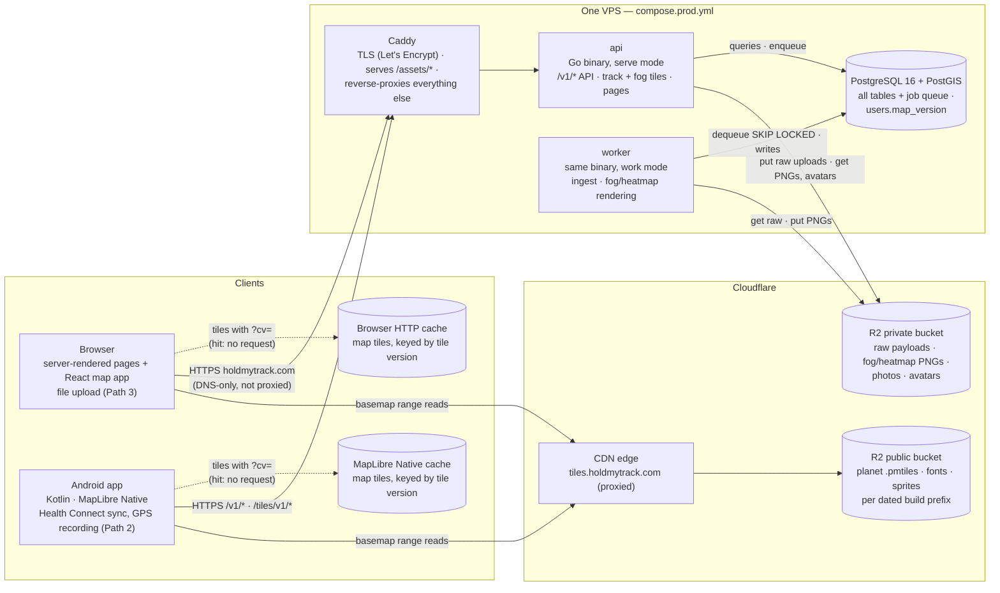

# HoldMyTrack: Architecture

How the system is put together: the top-level shape, the key decisions behind it, the stack, and what is not built yet. `docs/IMPLEMENTATION.md` picks up from here with the schema and how each feature is built; the Android app's own implementation is `apps/android/docs/IMPLEMENTATION.md`.

> **Scope note.** Besides ingesting activities it didn't record, HoldMyTrack records casual GPS-only tracks in the mobile app (`SPEC.md` FR-3.8); a stopped recording submits through the same ingest pipeline as every other source.

---

## 1. Architecture Overview

HoldMyTrack is a **modular monolith** on PostgreSQL/PostGIS, fed by three independent ingest paths. Coverage is precomputed on ingest instead of assembled per request.

**The service is free and community-funded** (`VISION.md` §6), so per-user cost is bounded by design in the schema, the retention policy and the tile strategy (`IMPLEMENTATION.md` §5.7).

### 1.1 Key decisions and their reasons

| Decision | Reason |
| :--- | :--- |
| One language, one deployable | Two stacks means two pipelines and two dependency trees for one maintainer, with no measured need |
| Precomputed **raster fog pyramid**, not per-request `ST_Union()` | A union of thousands of polygons per user per viewport is the first scaling bottleneck; raster also gives smooth edges instead of hexagon serration — [ADR-0003](adr/0003-precomputed-raster-fog-pyramid.md) |
| Coverage stored as **slippy tiles**, not H3 | H3 res 10 is ~130–150 m across, far coarser than the fog needs; slippy tiles align 1:1 with the MVT/raster grid — [ADR-0003](adr/0003-precomputed-raster-fog-pyramid.md) |
| **Index raw points; simplify only for display** | Douglas-Peucker deletes intermediate points, leaving gaps in the fog trail |
| **Segment-rasterized** coverage, not point-sampled | 1 Hz at 40 km/h is ~11 m between fixes, gappy at fine resolution |
| Postgres job queue, no broker | Premature at this scale, and a broker is a recurring bill a free service should not carry |
| Privacy applied **at ingest** | Fog maps point at people's homes; render-time filtering leaks through any downstream bug — [ADR-0002](adr/0002-privacy-applied-at-ingest.md); hidden areas are user-chosen Private locations — `VISION.md` §7, `SPEC.md` FR-8.1 |
| **Three independent ingest paths** | No single provider can revoke the product (`VISION.md` §4.1) — [ADR-0001](adr/0001-three-independent-ingest-paths.md) |
| **Planet-wide basemap**, not a regional extract | Users are everywhere; a regional extract makes a blank map the default outside one metro |
| **Country/Region zoom tiers are live vector tiles**, not a second raster pyramid | Their cost scales with a fixed ~250-country/~4,600-region boundary set, not with a user's history — `IMPLEMENTATION.md` §4.2.4 |
| **Heatmap stored as pass counts, drawn by the clients** | A server raster needed every tile's neighbours, baked its look into storage and blurred past z14 — [ADR-0046](adr/0046-heatmap-drawn-by-the-clients.md) |
| **Web pages are server-rendered HTML**; React only for the map page | Each page is a layout with a few per-user values; every page gets a real URL, one shared header and no map bundle to load — [ADR-0012](adr/0012-server-rendered-pages-react-for-the-map.md) |
| **The mobile apps show the site's own pages** where nothing native is needed | A native copy of a server-rendered page is a second implementation kept in step by hand — [ADR-0042](adr/0042-mobile-apps-show-the-sites-pages.md) |
| **One OpenAPI file is the JSON API's contract**, held to by the server's tests | The server, the web and Android each wrote the same shapes by hand with nothing checking them; tests check the JSON sent, which generated server types can't — `IMPLEMENTATION.md` §4.31 |
| **Admin panel in the app**, granted only from the server's CLI | Operators see accounts without raw SQL on production; a flag only the server's shell sets keeps the web from being an escalation path — `IMPLEMENTATION.md` §4.20 |
| **One visual language for every client**: the web's `--fm-*` tokens, Inter and Fraunces (Source Serif 4 for Russian headings), Lucide icons | Two clients that each chose their own look would not read as one product |
| **Localization**: in-house catalogs, the language decided by the server | Two languages and a few hundred strings don't need i18n libraries; the server picks one language per request and the map app reads it from `<html lang>` — `IMPLEMENTATION.md` §4.21 |

### 1.2 System architecture

Everything server-side runs as one binary in two modes (`serve` and `work`) against one database, deployed on a single VPS at `https://holdmytrack.com`, not yet publicly launched (`docs/ROADMAP.md`, "Before launch"; `IMPLEMENTATION.md` §5.8).

The API, track and fog tiles and every page come from one origin through Caddy. That origin is not proxied through Cloudflare, whose proxy caps uploads at 100 MB, so each browser or phone caches the app's tiles itself under a per-account version that moves whenever any of them may have changed (`IMPLEMENTATION.md` §4.2.6). The CDN serves only the basemap, and its free plan edge-caches only fonts and sprites; range reads into the archive reach R2 (`IMPLEMENTATION.md` §5.4). Postgres stores keys for object-storage items, never their bytes. Local dev reads the same planet basemap, with RustFS standing in for the private bucket (`docs/DEVELOPMENT.md`).

**All ingest paths converge on one pipeline.** They differ only in how bytes arrive; from `IMPLEMENTATION.md` §4.1 step 2 on the code is shared, so each added path is cheap to maintain. Path 1 cloud connectors and the iOS app are not built yet (`docs/ROADMAP.md`).

### 1.3 Deferred

| Component | Add it when |
| :--- | :--- |
| Redis | Measurements show per-device tile caching (`IMPLEMENTATION.md` §4.2.6) leaves too many first-view tile requests |
| Dedicated queue (SQS/RabbitMQ) | Postgres `FOR UPDATE SKIP LOCKED` throughput becomes the bottleneck |
| Separate render service | Export rendering starves the API of CPU |
| Read replicas | Read load, not write load, saturates the primary |
| Social graph (public pages, followers) | Milestone 3 decides to build it (`VISION.md` §5.7) |

---

## 2. Technical Stack

* **Backend**: **Go** for the API and the workers. The deciding factor is the `.FIT` parser: Path 3 is the unconditional ingest path (`VISION.md` §4.1), and it needs streaming binary decode of tens of thousands of records per file. Go also carries PostGIS tile serving under concurrency and the raster fog pipeline from one static binary. Routing is stdlib `net/http`'s `ServeMux`. Postgres access is `pgx/v5` with no ORM, because the PostGIS geometry queries would fight one. Migrations run through a small embedded runner (`services/server/internal/db`); `services/server/README.md` says why not a library.
* **Database**: PostgreSQL 16 + PostGIS 3.4.
* **Job queue**: Postgres table with `FOR UPDATE SKIP LOCKED`.
* **Frontend (web)**: server-rendered pages with Go's `html/template` (`services/server/internal/web`), one layout and header, `
` menus and plain form POSTs, no JavaScript by default (ADR-0012). The map page is the one React app: React 19, TypeScript, Vite 8, **MapLibre GL JS** driven directly because the layer stack is imperatively ordered; no SSR framework, since the map has no SEO surface. Verified versions (2026-09): `maplibre-gl` 6.9.0, `pmtiles` 4.5.0, `@protomaps/basemaps` 5.7.2. The web app is also an ingest client: it owns Path 3 and the no-signup demo.
* **Mobile**: native **Kotlin** on Android (§3) and **Swift** on iOS, not started. Health Connect's and HealthKit's route APIs are native-only, so a cross-platform framework would need native modules for the one thing that matters. Android came first as the more constrained platform (foreground-only route reads, no Samsung routes, `VISION.md` §4.1), so the sync contract iOS inherits is designed against the harder case.
* **Basemap**: self-hosted **Protomaps** planet build, served from `tiles.holdmytrack.com` to Production and local dev alike (`IMPLEMENTATION.md` §5.4, `docs/DEPLOY.md` §5). Self-hosting is three artifacts: the `.pmtiles` archive, the font glyph PBFs and the sprite sheet; production must not hotlink the last two from `protomaps.github.io`. **Satellite imagery** is the one tile source not self-hosted: optional, off unless a deployment configures a provider (`IMPLEMENTATION.md` §4.26).
* **Object storage**: Cloudflare **R2**, for zero egress: the basemap and its assets, raw ingest payloads, fog rasters, avatars, and photos as a resized copy and a thumbnail, never the original (ADR-0024). Locally **RustFS** stands in, reached through `minio-go/v7`, which is built for S3-compatible endpoints and pulls in far less than the AWS SDK.

### 2.1 One style document, three renderers

`buildStyle()` in the web client (`apps/web/src/map/style.ts`) is pure and DOM-free, and is the single definition of the map style. It drives MapLibre GL JS on the web, MapLibre Native on mobile, and a headless export renderer if one is ever built (`IMPLEMENTATION.md` §5.5). **The API serves it as a document** instead of each client reimplementing it, since three hand-kept copies of a 71-layer style would diverge.

`GET /v1/map/style/{flavor}` (`services/server/internal/mapstyle`) answers with that document. The Go side holds no style definition: `apps/web/scripts/build-style.mjs` renders `buildStyle()` to one JSON file per label language and flavor, embedded with `go:embed` and picked by `?lang=`, and `npm run verify:style` fails if the committed JSON has drifted from `style.ts`. Asset URLs carry a placeholder origin the server fills from `BASEMAP_ORIGIN` per request, so one artifact serves a deployment that bundles the archive and one that reads it from a CDN. The satellite source is filled from `SATELLITE_*` or removed. The endpoint is unauthenticated, since the document carries no per-user data, and answers `If-None-Match` with `304`, so a phone re-fetches ~100 KB only when the document changed. The web client calls `buildStyle()` in-process, since it has the function and a round trip before first paint buys nothing.

The fog inversion is baked server-side (`IMPLEMENTATION.md` §4.2) for the same reason: a custom WebGL shader would be written twice, against two MapLibre bindings, and kept pixel-identical.

---

## 3. Android app

The Android app is Path 2 (ADR-0001), reading Health Connect in the foreground; a map viewer on the same accounts and style document as the web; and GPS recording that submits straight to the server (ADR-0007). It is one Gradle module on the platform SDK: Views styled with Material 3 and hand-built `OkHttp` calls, with no Compose, Retrofit, ORM or dependency-injection library. A handful of screens and endpoints don't amortize a framework. How it is built is `apps/android/docs/IMPLEMENTATION.md`.

**Sync and display are separate one-way pipes.** The sync engine reads Health Connect and posts to `POST /v1/sync/activities`; the map draws the account from the server's tiles. The only lines drawn from the phone's own data are the Sync tab's candidates and a recording in progress, and once synced an activity carries no trace of its source. The phone holds two things the server lacks: unsynced recordings, deleted once the server takes them, and what the last Health Connect read found.

### 3.1 Key decisions

| Decision | Reason |
| :--- | :--- |
| Material 3 on Views, not Compose, without dynamic color | Compose would rewrite every screen and host the `MapView` through `AndroidView` with its lifecycle forwarded by hand. Material supplies the color and type roles the web's tokens map onto, 48 dp targets and TalkBack support. Dynamic color would replace the brand palette with the wallpaper's |
| Main screens are tabs of one Activity | Tabs are shown and hidden, so the map's camera and layers survive a trip to another tab; an Activity per tab makes every switch a window change and splits the bar's state across windows |
| Bearer token, not a cookie jar | MapLibre Native's tile fetcher never sees a cookie jar; one interceptor on the `OkHttpClient` the app shares with MapLibre reaches both |
| The web's Settings, Activity graph, Sync history and About in a WebView | ADR-0042; signed in by cookie, since WebView requests skip the app's client |
| Foreground-only Health Connect sync, no background job | A background read gets no routes whatever was granted (`IMPLEMENTATION.md` §4.0), so it would send activities with nothing to draw |
| Session token in plain `SharedPreferences` | The file is private to the app, and an attacker who can read it has everything else the app holds. Revocation bounds a leaked token: sign-out deletes the server's row |
| API calls use OkHttp's callbacks; only sync and upload calls suspend | Health Connect's API is `suspend` and each sync or upload request waits for the last; elsewhere a coroutine layer over OkHttp's async API buys nothing |
| `minSdk` 34 | Health Connect is part of the platform from Android 14; below it, it is a Play-installed app to detect and install, a second state machine never measured on a device |

### 3.2 Stack

* **Build**: Kotlin through AGP 9.4.0's built-in support (compiler 2.2), Gradle 9.7.1 through the wrapper, JDK 17 or 21, `compileSdk` and `targetSdk` 37. On the host, not in a container: the SDK, `adb` and the physical device Health Connect testing needs live there (`apps/android/README.md`).
* **Map**: MapLibre Native 13.6.1, which reads `pmtiles://` natively (since 11.8.0), so the served style (§2.1) is consumed unmodified, archive URL included, with no client-side PMTiles reader. Fog arrives as veil polygons the server traced (`IMPLEMENTATION.md` §4.2), so this client has no shader either.
* **Network**: OkHttp 4.12.0, declared directly because the app hands its own client to MapLibre, and pinned to what MapLibre resolves. Bodies are `kotlinx.serialization` classes held to the API contract by a unit test.
* **Health data**: `androidx.health.connect:connect-client` 1.1.0, the version the device measurements ran against.
* **UI**: Material Components 1.13.0.
* **Local storage**: `SharedPreferences`, two SQLite databases (unsynced recordings with the live journal, and the last Health Connect read) and MapLibre's tile cache.

### 3.3 Deferred

| Component | Add it when |
| :--- | :--- |
| Compose | The app outgrows a handful of screens; Views/Compose interop allows moving one screen at a time |
| An encrypted token store | A threat beyond access to the device's private storage is identified |
| Instrumentation tests | Manual device checks stop being enough; JUnit covers the pure logic (`docs/DEVELOPMENT.md`) |