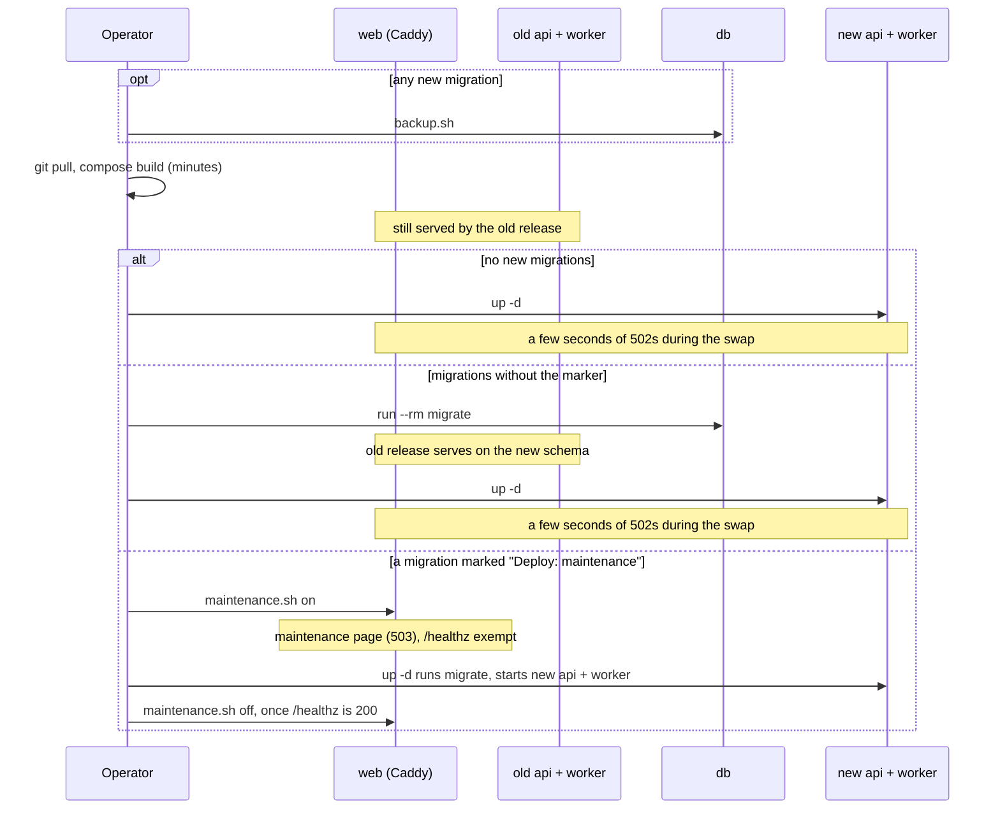

# Deploying HoldMyTrack — minimal single-VPS setup

One small VPS runs `compose.prod.yml` (Postgres+PostGIS, `api`, `worker`, and Caddy in front of the built frontend), with Cloudflare R2 for object storage. The cost model is `docs/VISION.md` §4.3; the launch compliance work is `docs/ROADMAP.md`'s "Before launch". Why each piece is configured as it is lives in the header comments of `compose.prod.yml`, `.env.prod.example` and `scripts/*.sh`. Redeploying holdmytrack.com is `/deploy` in Claude Code (`.claude/skills/deploy/SKILL.md`), which walks §6–§8 and §10 for the commits since the running version.

Every compose command below is `docker compose -f compose.prod.yml --env-file .env.prod …`, run in the repository checkout on the server (`/srv/holdmytrack`); `…` in a command stands for that prefix. Never drop `--env-file`.

## 1. Provision the VPS

1. Create a Docker-capable VPS; 2 vCPU / 4 GB RAM is comfortable at low traffic.
2. Install Docker and the Compose plugin. Check: `docker compose version`.
3. Clone this repository to `/srv/holdmytrack`.

## 2. Create the Cloudflare R2 bucket

1. Create an R2 bucket in the Cloudflare dashboard.
2. Under **Account → R2 → Manage API Tokens**, create a token scoped to that bucket. Note its access key, secret key and the S3 endpoint `https://<account-id>.r2.cloudflarestorage.com`. A Cloudflare account-wide API token is a different thing and won't work.

## 3. Point DNS at the server

1. Add an `A` record for the domain (or a subdomain) pointing at the VPS's public IP. It must resolve before Caddy first starts (§6), or the Let's Encrypt request fails.
2. Point `www.<your-domain>` at the same server (a `CNAME` to the apex is enough), and every retired domain listed in `REDIRECT_DOMAINS`: Caddy requests a certificate for each.
3. With the zone on Cloudflare, keep these records DNS-only (grey cloud): Cloudflare's proxy caps uploads at 100 MB.

## 4. Fill in the production env file

1. `cp .env.prod.example .env.prod` and fill in every value; the file's comments say what each is. Nothing in it is safe to leave as a placeholder.
2. `APP_BASE_URL` and `DOMAIN` take the domain from §3. `APP_BASE_URL` must start with `https://`: the session cookie's `Secure` flag and the password-reset links come from it.
3. `chmod 600 .env.prod` (§12).

The tuning values have defaults to leave alone. A change to one needs `… up -d` for the services named:

| Value | Default | Raise it when | Recreate |
| :-- | --: | :-- | :-- |
| `WORKER_CONCURRENCY` | 4 | jobs queue up and memory allows; each unit adds 4 database connections (`IMPLEMENTATION.md` §4.1) | `worker` |
| `WORKER_RENDER_CONCURRENCY` | 2 | renders queue up; each unit adds 4 database connections | `worker` |
| `UPLOADS_PER_HOUR` | 100 | a load test's `seed` or `import` runs (`docs/PERFORMANCE.md`, `SPEC.md` FR-3.1); recreating also resets every count | `api` |
| `TILES_PER_MINUTE` | 1200 | a load test's `browse` runs (`SPEC.md` FR-4.15) | `api` |
| `SIGNUPS_PER_HOUR` | 5 | a load test's `signup` runs (`SPEC.md` FR-1.1) | `api` |
| `R2_DAILY_BUDGET_USD` | 2 | the R2 alerts (§13) show real use nearing it, or a load test runs (`SPEC.md` FR-17, ADR-0044); a raise lifts the stages at once if the day's spend is under it | `api`, `worker` |
| `MIN_ANDROID_BUILD` | empty | older Android builds must go (§10, `SPEC.md` §1.5) | `api` |

Put a load test's raised values back afterwards.

**Sign in with Google (optional).** Leave `GOOGLE_CLIENT_ID` empty to run without it. To turn it on:

1. In the Google Cloud console, create or reuse a project. Set up the OAuth consent screen: user type External, app name HoldMyTrack, the §3 domain as an authorized domain, and only the `openid`, `email` and `profile` scopes (none needs app verification). Publish it ("In production"); in "Testing" only listed test users can sign in.
2. Under Credentials, create an OAuth client ID of type **Web application** with the redirect URI `https://<your-domain>/v1/auth/google/callback`, exactly `APP_BASE_URL` plus that path. No JavaScript origins.
3. Set `GOOGLE_CLIENT_ID`/`GOOGLE_CLIENT_SECRET` in `.env.prod`, leave `GOOGLE_REDIRECT_URL` empty, and run `… up -d api`. No rebuild: the web client asks the API whether to show the button.
4. For the Android app (`IMPLEMENTATION.md` §4.9), create a second OAuth client ID in the same project, type **Android**, package `dev.holdmytrack.android`, with the SHA-1 of the signing key. Create one per key: the release key and each developer's debug key (`apps/android/holdmytrack/README.md` shows how to get the SHA-1). Nothing goes into `.env.prod`: the app requests tokens for the web client ID it reads from `GET /v1/auth/providers`. Without it, the app's account picker fails with a generic error.

**Sign in with Facebook (optional).** Leave `FACEBOOK_APP_ID` empty to run without it. SMTP must work first: a new Facebook account verifies its email by mail (`SPEC.md` FR-1.10, ADR-0015). Taking the app Live needs a Meta-verified business portfolio (step 6), so without one leave it off; holdmytrack.com does (`ROADMAP.md`). Meta renames dashboard labels; search the dashboard when one below doesn't match.

1. At developers.facebook.com, register as a developer, then **My Apps → Create App**: name HoldMyTrack, a contact email, use case "Authenticate and request data from users with Facebook Login".
2. Under the use case's **Customize**, make sure `email` is added beside `public_profile`. Neither needs App Review.
3. In **Facebook Login → Settings**, keep Client OAuth login, Web OAuth login and Enforce HTTPS on. Add `https://<your-domain>/v1/auth/facebook/callback` to **Valid OAuth Redirect URIs**, exactly `APP_BASE_URL` plus that path; for local dev also `http://localhost:<API_PORT>/v1/auth/facebook/callback`.
4. In **App settings → Basic**, copy the **App ID** and the **App secret** (a password: `.env.prod` only; **Reset** it if it leaks). Fill in App domains (the §3 domain), a Privacy Policy URL, "Data deletion instructions URL" `https://<your-domain>/help#delete-account`, a 1024×1024 icon and a category. Save.
5. Set `FACEBOOK_APP_ID`/`FACEBOOK_APP_SECRET`, leave `FACEBOOK_REDIRECT_URL` empty, and run `… up -d api`. The Android app needs nothing more (`IMPLEMENTATION.md` §4.9).
6. In Development mode only people under **App roles → Roles** can sign in; test with one. Then **Publish** to go Live. Meta checks step 4's fields and requires Business Verification of a portfolio connected to the app, whatever permissions it uses. Removing the portfolio doesn't lift this, and there is no individual-developer route. Verification takes one business document whose name matches the portfolio's; in the US, an IRS 147C letter, a business bank statement, a business tax document or a DBA filing. Until it's Live, keep `FACEBOOK_APP_ID` empty on the public site.

## 5. Basemap

The basemap is the Protomaps planet build (z0–15, ~138 GB), served unmodified from a public R2 bucket. `apps/web/.dockerignore` keeps it out of every image.

1. Create a second R2 bucket (e.g. `holdmytrack-basemap`) and connect a custom domain to it (e.g. `tiles.<your-domain>`; the zone must be on Cloudflare). The custom domain puts Cloudflare's CDN in front; the `r2.dev` URL is rate-limited and only for trying things out.
2. Add a CORS rule to the bucket: origins `https://<your-domain>` (plus `http://localhost:5173` for local dev, `docs/DEVELOPMENT.md`), methods `GET, HEAD`, allowed headers `range, if-match`, exposed headers `etag` (`IMPLEMENTATION.md` §5.4).
3. Add a response header rule on the zone (**Rules → Overview → Create rule → Response Header Transform Rule**): when Hostname equals `tiles.<your-domain>`, set static `Access-Control-Allow-Origin` to `*` and `Access-Control-Expose-Headers` to `etag`. Without it, Cloudflare's one cached copy carries whichever `Origin` filled the cache, and loads from every other origin fail until it expires. `*` is safe: nothing sends credentials to the basemap (`apps/web/src/map/requestCredentials.ts`), and the custom rule below refuses every other origin.
4. Pick a dated build from `https://build-metadata.protomaps.dev/builds.json`, download it with `curl -C - -o planet.pmtiles https://build.protomaps.com/<YYYYMMDD>.pmtiles`, and check its md5 against the listed `md5sum`.
5. Upload it with a token that can write to the bucket:
   ```
   aws s3 cp planet.pmtiles s3://holdmytrack-basemap/<YYYYMMDD>/basemap/basemap.pmtiles --endpoint-url https://<account-id>.r2.cloudflarestorage.com
   aws s3 cp --recursive apps/web/public/basemap/fonts s3://holdmytrack-basemap/<YYYYMMDD>/basemap/fonts --endpoint-url ...
   aws s3 cp --recursive apps/web/public/basemap/sprites s3://holdmytrack-basemap/<YYYYMMDD>/basemap/sprites --endpoint-url ...
   ```
6. Set `VITE_BASEMAP_ORIGIN` to the public origin plus the prefix, no trailing slash (e.g. `https://tiles.holdmytrack.com/20260922`). It is build-time: a change needs `… build web` and `… up -d`.

A newer build repeats steps 4–6 under a new prefix; keep the old prefix until open tabs have reloaded. Without R2, leave `VITE_BASEMAP_ORIGIN` empty and uncomment `compose.prod.yml`'s `web` volume line, with the whole archive on the VPS's disk.

**Protect it at the edge.** Every range read is a billed R2 request the app never sees. Under **Domains → <your-domain> → Security → Security rules** (the zone's rules on the free plan):

1. A **custom rule**, action **Block**, placed first. Choose **Edit expression** and paste the rule below; leave out `http://localhost:5173` if local dev shouldn't read this archive. Browsers and the Android app (`OriginInterceptor`) always send an `Origin`, so a request without one is a script.
   ```
   (http.host eq "tiles.<your-domain>" and not any(http.request.headers["origin"][*] in {"https://<your-domain>" "http://localhost:5173"}))
   ```
2. A **rate limiting rule** on `(http.request.uri.path contains "/basemap/")`, per IP: 300 requests per 10 seconds, then **Block** for 10 seconds. A path match is enough while `tiles.<your-domain>` is the zone's only proxied host.
3. **Budget alerts** under **Manage account → Billing → Billable Usage**, e.g. $5 and $20 a month. They only email; nothing caps R2 spend.

Check from any machine: `curl -s -o /dev/null -w '%{http_code}\n' -H 'Range: bytes=0-126' https://tiles.<your-domain>/<YYYYMMDD>/basemap/basemap.pmtiles` prints `403`, and with `-H 'Origin: https://<your-domain>'` added, `206`.

**Satellite imagery (optional).** Leave `VITE_SATELLITE_TILES` empty to run without it (`SPEC.md` FR-4.14). holdmytrack.com uses MapTiler Satellite on the Free plan, which pauses the imagery past 100k tiles a month instead of billing (`IMPLEMENTATION.md` §4.26):

1. Create a MapTiler Cloud account on the Free plan, with no payment method.
2. Under **API keys**, create a key and add `https://<your-domain>` to **Allowed HTTP origins** (plus `http://localhost:5173` for local dev). The key is public in the bundle; the origin list is what protects the quota. The Android app sends the deployment's origin, so the same key serves it.
3. Set in `.env.prod`, then `… build web` and `… up -d`:
   ```
   VITE_SATELLITE_TILES=https://api.maptiler.com/tiles/satellite-v2/{z}/{x}/{y}.jpg?key=<key>
   VITE_SATELLITE_TILE_SIZE=512
   VITE_SATELLITE_MAXZOOM=18
   VITE_SATELLITE_ATTRIBUTION=<a href="https://www.maptiler.com/copyright/">© MapTiler</a>
   ```
   Keep the tile size at 512: at 256 the map fetches four times as many tiles against the quota.
4. Watch MapTiler's usage page during the first weeks. Another provider means changing these four values (Esri's tiles are 256).

## 6. Bring it up

1. Start the stack:
   ```
   GIT_SHA=$(git rev-parse --short HEAD) docker compose -f compose.prod.yml --env-file .env.prod up -d --build
   ```
   `GIT_SHA` is per invocation, never in `.env.prod`; without it the stale-tab banner can't work. This builds the images, runs `migrate` once, and starts `db`, `api`, `worker` and `web`.
2. If the site isn't up within a couple of minutes, read `… logs web` for Caddy's certificate request.
3. Make your own account an admin, to open `/admin` (`SPEC.md` FR-12): sign up on the site, then `… run --rm api set-admin you@example.com true` (`false` revokes). Nothing on the web can grant it.

Container logs rotate at 5 × 10 MB per container (`compose.prod.yml`), so `… logs` reaches back only that far. Postgres's memory is set for a 4 GB droplet in `compose.prod.yml`'s `db` command: scale both values on another size, and change them only under maintenance mode (§7), since it restarts `db`.

**Seed a new or recreated database.** `migrate` creates the Demo Customer's account but no data, and `up` runs no seed. Without the seeds, "Try it now" opens an empty account (`SPEC.md` FR-2.2), Fog's Country/Region tiers draw nothing, and every activity shows its account's timezone. All three are idempotent.

1. Make the country and region outlines (ADR-0034) off the server, with the duckdb CLI, then copy the file into the app bucket under the key `geo.BoundariesKey` names:
   ```
   scripts/boundaries-extract.sh ~/boundaries
   scp ~/boundaries/overture-2026-09-23.0-boundaries.csv.gz holdmytrack:/tmp/
   … run --rm -v /tmp:/in:ro rclone copyto /in/overture-2026-09-23.0-boundaries.csv.gz data:boundaries/overture-2026-09-23.0-boundaries.csv.gz
   ```
   Check the counts it prints (272 countries and 3,922 regions for 2026-09-23.0).
2. Copy the timezone polygons (ADR-0035), timezone-boundary-builder's release asset renamed to carry its release, into the bucket under the key `geo.TimezonesKey` names:
   ```
   ssh holdmytrack 'curl -sSfL -o /tmp/timezones-with-oceans-2026d.geojson.zip https://github.com/evansiroky/timezone-boundary-builder/releases/download/2026d/timezones-with-oceans.geojson.zip'
   … run --rm -v /tmp:/in:ro rclone copyto /in/timezones-with-oceans-2026d.geojson.zip data:timezones/timezones-with-oceans-2026d.geojson.zip
   ```
3. Seed, in this order, so the demo's activities are matched as they're ingested (`docs/DEVELOPMENT.md`'s "Seeding a fresh database"):
   ```
   … run --rm api seed-admin-boundaries
   … run --rm api seed-timezones
   … run --rm api seed-demo-customer
   ```
4. Delete the copies in `/tmp`.

**One-time steps a deploy can bring.** The deploy skill's plan finds these:

- A new `geo.BoundariesKey`: steps 1, 3's `seed-admin-boundaries` and 4. On a database with users, take a backup and turn maintenance mode on first (§7, §11): it re-matches every activity in one transaction for several minutes, and ingest waits on it. It also empties the Country/Region tile cache (`IMPLEMENTATION.md` §4.2.4), which refills on request.
- A new `geo.TimezonesKey`: steps 2, 3's `seed-timezones` and 4; a couple of minutes. It logs and skips any zone the database's tz data doesn't know yet: after a newer `postgis/postgis` image, `seed-timezones --force` brings those in. Check: `select count(*) from tz_parts` is non-zero.
- A change to `services/server/internal/httpapi/demo_data/`: `… run --rm api seed-demo-customer --reset`. A plain re-run leaves seeded activities as they were.
- A change to how Fog/Heatmap tiles are drawn (`internal/fog`, `IMPLEMENTATION.md` §4.2): `… run --rm api rerender-coverage`. Add `--masks` when the stroke width, `fog.TileSize` or which tiles a track reaches (`internal/tilemath`) changed; that redraws every stored mask first and takes a while. It only queues renders, so the worker must be up.
- Migration 0033: `… run --rm api backfill-recorded-spans` once after `up -d`, a few minutes (`IMPLEMENTATION.md` §4.6). Until then the Sync tab's overlap hint misses activities a Private location cut.
- Migration 0039: `… run --rm api backfill-object-bytes` once after `up -d` (`IMPLEMENTATION.md` §4.32); safe beside the worker. Check: the next snapshot's `storage_bytes_unmeasured_rows` reads 0.

**Copy demo activities out of a deployment.** With activity ids from the admin panel:

```
mkdir -p /tmp/demo-export && chmod 777 /tmp/demo-export
… run --rm -v /tmp/demo-export:/out api export-demo-activities /out <activity-id> <activity-id> ...
```

Copy the GPX files into `demo_data/`, `photos/` into `demo_data/photos/`, and merge `manifest.json`'s `activities` into the one there (`httpapi.ExportDemoActivities` says what it writes). Review every track and photo before committing: the repository is public.

**Load or refresh Spots** (`SPEC.md` FR-15), about once a quarter; until the first load the Layers menu shows no points of interest.

1. Off the server, with osmium-tool and ~100 GB free (the planet download is ~95 GB, about 1.5 hours; a re-run resumes it):
   ```
   scripts/spots-extract.sh ~/spots-work    # result: ~/spots-work/spots.geojsonseq
   ```
   A [Geofabrik](https://download.geofabrik.de/) URL as a second argument makes a regional file instead, imported without `--planet`.
2. Compare the printed total with the last run's.
3. On the server, take a backup (`./scripts/backup.sh`, §11), copy the file to `/tmp/spots` and import it inside `tmux`:
   ```
   mkdir -p /tmp/spots && chmod 755 /tmp/spots   # put spots.geojsonseq here, world-readable
   … run --rm -v /tmp/spots:/data:ro api import-spots --planet /data/spots.geojsonseq
   ```
   Never pass `--planet` with a regional file: it retires every place the file lacks (`IMPLEMENTATION.md` §4.25). If it stops with `the file is missing too many places to be the whole planet`, it retired nothing; check the file's line count against the last run's. The last log line counts `imported`, `changed`, `retired` and `skipped`.
4. Delete `/tmp/spots`.

**Load or refresh bike paths** (`SPEC.md` FR-4.13), right after Spots; until the first load Bike paths, Shared paths and Mountain bike trails draw nothing.

1. Off the server, with the same work directory so it reuses the planet download:
   ```
   scripts/bike-paths-extract.sh ~/spots-work    # result: ~/spots-work/bike-paths.geojsonseq
   ```
2. Compare the printed counts with the last run's and take a backup.
3. On the server, inside `tmux`:
   ```
   mkdir -p /tmp/bike-paths && chmod 755 /tmp/bike-paths   # put bike-paths.geojsonseq here, world-readable
   … run --rm -v /tmp/bike-paths:/data:ro api import-bike-paths --planet /data/bike-paths.geojsonseq
   ```
   With `--planet` it deletes every way the file lacks, so never pass it with a regional file. The same guard stops it with `the file is missing too many ways to be the whole planet`, deleting nothing.
4. Delete `/tmp/bike-paths`.

## 7. Maintenance mode

Build first in every case: the running containers don't mount the source, so the old release serves through the build. Which path follows depends on the new migrations (`DEVELOPMENT.md`'s "Writing a migration").

**No new migrations:**

```
GIT_SHA=$(git rev-parse --short HEAD) docker compose -f compose.prod.yml --env-file .env.prod build
GIT_SHA=$(git rev-parse --short HEAD) docker compose -f compose.prod.yml --env-file .env.prod up -d
```

**New migrations, none marked:** the site stays up.

```
./scripts/backup.sh
GIT_SHA=$(git rev-parse --short HEAD) docker compose -f compose.prod.yml --env-file .env.prod build
docker compose -f compose.prod.yml --env-file .env.prod run --rm migrate
GIT_SHA=$(git rev-parse --short HEAD) docker compose -f compose.prod.yml --env-file .env.prod up -d
```

Never leave the migration to `up -d`: it stops `api` and `worker` while `migrate` runs. If `run --rm migrate` fails, nothing has been swapped.

**A migration whose first line is `-- Deploy: maintenance — <why>`, or manual database work:**

```
./scripts/backup.sh
GIT_SHA=$(git rev-parse --short HEAD) docker compose -f compose.prod.yml --env-file .env.prod build
./scripts/maintenance.sh on
GIT_SHA=$(git rev-parse --short HEAD) docker compose -f compose.prod.yml --env-file .env.prod up -d
./scripts/maintenance.sh off
```

Before `off`, check that `migrate` is `Exited (0)` (`… ps -a`) and `curl https://<your-domain>/healthz` returns `200`; `/healthz` is exempt from the maintenance page. If `migrate` failed, leave maintenance on and restore from the backup (§11). `./scripts/maintenance.sh status` prints the current mode.



## 8. Verify

1. `curl https://<your-domain>/healthz` returns `200`, with `version` equal to the deployed short SHA.
2. In a browser, sign up, upload a `.gpx` file and confirm it appears on the map.
3. Switch to Fog and zoom out below city zoom: countries with an activity show clear. A uniformly fogged world means the outlines are empty: run §6's `seed-admin-boundaries` and hard-refresh.
4. If satellite imagery is configured, choose Satellite under Overlays: imagery under the roads, with MapTiler's credit. Land and water gone with no imagery means refused tiles: look for a `403` in the network tab (the key or its origins), and check `curl https://<your-domain>/v1/map/style/light` has a `satellite` source.
5. If Google sign-in is configured, "Continue with Google" lands on the map. `redirect_uri_mismatch` means §4 step 2's URI doesn't match `APP_BASE_URL` + `/v1/auth/google/callback`; "Couldn't sign in with Google" means the callback failed, and `… logs api | grep "google sign-in"` says why.
6. Sign-in that silently returns to the sign-in screen means `APP_BASE_URL`'s scheme doesn't match the browser's connection (§4).

## 9. Before upgrading the Postgres image

Before moving `db` to an image on Debian 13 or later, rewrite the old time zone names some older accounts still store (the reason is in `compose.prod.yml`'s `db` comment). While the old image still runs:

1. Open `psql`:
   ```bash
   docker compose -f compose.prod.yml --env-file .env.prod exec db sh -c 'psql -U "$POSTGRES_USER" -d "$POSTGRES_DB"'
   ```
2. Run the rewrite. The list is `timezoneRenames` in `services/server/internal/web/timezones_data.go` at tzdata 2026d; if that table has been regenerated, rebuild the list from it.
   ```sql
   UPDATE users u SET timezone = r.current
   FROM (VALUES
     ('Africa/Asmera', 'Africa/Asmara'),
     ('America/Buenos_Aires', 'America/Argentina/Buenos_Aires'),
     ('America/Catamarca', 'America/Argentina/Catamarca'),
     ('America/Cordoba', 'America/Argentina/Cordoba'),
     ('America/Godthab', 'America/Nuuk'),
     ('America/Indianapolis', 'America/Indiana/Indianapolis'),
     ('America/Jujuy', 'America/Argentina/Jujuy'),
     ('America/Knox_IN', 'America/Indiana/Knox'),
     ('America/Louisville', 'America/Kentucky/Louisville'),
     ('America/Mendoza', 'America/Argentina/Mendoza'),
     ('America/Virgin', 'America/St_Thomas'),
     ('Asia/Ashkhabad', 'Asia/Ashgabat'),
     ('Asia/Calcutta', 'Asia/Kolkata'),
     ('Asia/Chungking', 'Asia/Chongqing'),
     ('Asia/Dacca', 'Asia/Dhaka'),
     ('Asia/Istanbul', 'Europe/Istanbul'),
     ('Asia/Katmandu', 'Asia/Kathmandu'),
     ('Asia/Macao', 'Asia/Macau'),
     ('Asia/Rangoon', 'Asia/Yangon'),
     ('Asia/Saigon', 'Asia/Ho_Chi_Minh'),
     ('Asia/Thimbu', 'Asia/Thimphu'),
     ('Asia/Ujung_Pandang', 'Asia/Makassar'),
     ('Asia/Ulan_Bator', 'Asia/Ulaanbaatar'),
     ('Atlantic/Faeroe', 'Atlantic/Faroe'),
     ('Europe/Kiev', 'Europe/Kyiv'),
     ('Europe/Nicosia', 'Asia/Nicosia'),
     ('HST', 'Pacific/Honolulu'),
     ('Pacific/Ponape', 'Pacific/Pohnpei'),
     ('Pacific/Samoa', 'Pacific/Pago_Pago'),
     ('Pacific/Truk', 'Pacific/Chuuk')
   ) AS r(old, current)
   WHERE u.timezone = r.old;
   ```
3. Check: every value of `SELECT DISTINCT timezone FROM users` is in the new image's `pg_timezone_names`.

## 10. Publishing the Android APK

`https://<your-domain>/download/*` serves `/srv/holdmytrack/downloads/` on the host (`compose.prod.yml`), so publishing is a copy with no restart. From the deployed commit, so the app's SHA matches `/healthz`:

```
cd apps/android/holdmytrack
./gradlew :app:assembleDebug -Pholdmytrack.apiBaseUrl=https://<your-domain>
scp app/build/outputs/apk/debug/app-debug.apk <vps>:/srv/holdmytrack/downloads/holdmytrack.apk
```

Check: `curl -sI https://<your-domain>/download/holdmytrack.apk` (singular `/download/`) returns `200`.

No page links to it; it's for testers handed the URL, while the public route is Google Play's closed test. It is debug-signed and keeps Donate; the Play build is the release-signed bundle (`apps/android/holdmytrack/README.md`, Release build), and the two don't install over each other. Google sign-in works in it only if its debug key has an Android OAuth client (§4). The `versionCode` is the commit count, so a newer build installs over an older one (`apps/android/docs/IMPLEMENTATION.md` §6).

**Turning away older builds.** Only once the release that needs it is live on Google Play and at `/download/`:

1. Set `MIN_ANDROID_BUILD` in `.env.prod` to its `versionCode`, `git rev-list --count <sha>` of the commit both were built from.
2. `docker compose -f compose.prod.yml --env-file .env.prod up -d api`
3. Check: `curl -s -o /dev/null -w '%{http_code}\n' -A 'HoldMyTrack-Android/0.1 (x; 1)' https://<your-domain>/v1/auth/providers` prints `426`.

## 11. Backups and the restore drill

`scripts/backup.sh` runs nightly and before each deploy with migrations; `scripts/restore-drill.sh` runs monthly and proves the copies restore. Their header comments say what each dump holds and leaves out, how reference tables are dumped apart, and the backup bucket's layout and retention. An account deleted on request stays in the backups for up to 8 weeks.

**Set up.**

1. Create a second private R2 bucket (e.g. `holdmytrack-backups`) and a token with **Object Read & Write** on it alone. Never reuse the app's token, and never give this one the app bucket.
2. Fill in `.env.prod`'s `BACKUP_*` values. Leave `BACKUP_S3_ENDPOINT` empty when both buckets are in one Cloudflare account.
3. Run `./scripts/backup.sh --nightly`, then `./scripts/restore-drill.sh`. The drill restores the newest nightly dump, so the first run needs `--nightly`. The first backup copies every object and takes longest.
4. Schedule both in `/etc/cron.d/holdmytrack-backup`:
   ```
   17 3 * * * root /srv/holdmytrack/scripts/backup.sh --nightly >> /var/log/holdmytrack-backup.log 2>&1
   47 4 1 * * root /srv/holdmytrack/scripts/restore-drill.sh >> /var/log/holdmytrack-backup.log 2>&1
   ```
5. Rotate the log in `/etc/logrotate.d/holdmytrack-backup`. On Ubuntu, `su` is required, or logrotate skips the file as insecure. Check with `logrotate -d /etc/logrotate.d/holdmytrack-backup`.
   ```
   /var/log/holdmytrack-backup.log {
       su root root
       monthly
       rotate 6
       compress
       missingok
       notifempty
   }
   ```

After changing a reference table by hand (one `backup.sh` lists), run `./scripts/backup.sh` by hand: a `TRUNCATE` doesn't trigger a new reference dump. Run the drill by hand after changing `backup.sh` or adding a new kind of stored object.

**Restoring for real.**

1. If the live database still runs, take a manual `./scripts/backup.sh` first.
2. Stop the site and restore, in four steps so every foreign key finds its rows:
   ```
   ./scripts/maintenance.sh on
   docker compose -f compose.prod.yml --env-file .env.prod stop api worker
   # The newest local dump, or fetch one: … run --rm rclone copyto backup:postgres/daily/<name> /backups/postgres/<name> (or manual/, for a deploy's)
   # and its reference dump, the newest with a stamp no later than the dump's: … backup:postgres/reference/<ref> /backups/postgres/reference/<ref>
   dump=/srv/holdmytrack-backups/postgres/<name>; ref=/srv/holdmytrack-backups/postgres/reference/<ref>
   restore() { docker compose -f compose.prod.yml --env-file .env.prod exec -T db sh -c 'pg_restore -U "$POSTGRES_USER" -d "$POSTGRES_DB" --exit-on-error --no-owner "$@"' sh "$@"; }
   docker compose -f compose.prod.yml --env-file .env.prod exec -T db sh -c 'dropdb -U "$POSTGRES_USER" "$POSTGRES_DB" && createdb -U "$POSTGRES_USER" -T template0 "$POSTGRES_DB"'
   restore --section=pre-data < "$dump"
   restore --data-only < "$ref"
   restore --section=data < "$dump"
   restore --section=post-data < "$dump"
   ```
   On a new server, run `… up -d db` alone first. The reference dump must be the one paired with the dump: re-running the imports would renumber ids user tables point at.
3. If objects were lost, `… run --rm rclone copy backup:objects data:`. Use `copy`, never `sync`, which would delete from the app bucket. An object removed by mistake in the last 30 days is in `objects-deleted/`, under the stamp of the first backup after its removal.
4. `GIT_SHA=$(git rev-parse --short HEAD) docker compose -f compose.prod.yml --env-file .env.prod up -d`, which runs any newer migrations.
5. `… run --rm api rerender-coverage --masks` (§6): the dump has no activity masks, so Fog and Heatmap show none of the restored activities until it has run.
6. Check `/healthz` and the map, then `./scripts/maintenance.sh off`.

## 12. Host hardening

Only 22, 80 and 443 reachable, SSH by key only, security updates automatic. DigitalOcean's Ubuntu 24.04 image already has password login off and `unattended-upgrades` on.

1. **Firewall at the provider, never `ufw`**: Docker's iptables rules bypass `ufw` for published ports. On DigitalOcean, **Networking → Firewalls → Create Firewall**: inbound SSH (TCP 22), HTTP (TCP 80) and HTTPS (TCP 443) from all IPv4 and IPv6; delete every other inbound rule the form starts with (an "All TCP" rule opens everything); keep the default outbound rules; apply it to the droplet. Check from another machine, one port per call (macOS `nc` checks only the first): `nc -z -w 3 <your-domain> <port>` connects on 22, 80 and 443, and on 5432 waits the full 3 seconds. An instant `Connection refused` means the firewall isn't applied. Restricting 22 to your own address is tighter, but a home address changes and the only fallback is the provider's web console; with keys only, an open 22 is a small risk.
2. **SSH keys only, root included.** The `00-` prefix makes this file win over cloud-init's `50-`:
   ```
   printf 'PermitRootLogin prohibit-password\nPasswordAuthentication no\nKbdInteractiveAuthentication no\n' > /etc/ssh/sshd_config.d/00-holdmytrack.conf
   sshd -t && systemctl reload ssh
   sshd -T | grep -Ei '^(permitrootlogin|passwordauthentication|kbdinteractiveauthentication) '
   ```
   The last command prints `without-password`, `no` and `no`. Keep the session open until a new `ssh` gets in.
3. **Reboot when an update needs it**, at 05:30, after the backup (03:17) and the drill (04:47). The stack restarts on its own.
   ```
   printf 'Unattended-Upgrade::Automatic-Reboot "true";\nUnattended-Upgrade::Automatic-Reboot-Time "05:30";\n' > /etc/apt/apt.conf.d/52holdmytrack-reboot
   apt-config dump | grep Automatic-Reboot
   ```
4. **Prune Docker's build cache weekly**, keeping the newest 5 GB for the next deploy; every deploy builds here and the cache grows without bound. It touches no container, volume or tagged image. In `/etc/cron.d/holdmytrack-docker-prune`:
   ```
   17 4 * * 0 root (docker builder prune -f --keep-storage 5GB && docker image prune -f) >> /var/log/holdmytrack-docker-prune.log 2>&1
   ```
   `docker system df` shows the cache's size.
5. **Secrets readable by root only**: `chmod 600 .env.prod`. `backup.sh` keeps its own files private.

## 13. Monitoring

Grafana Cloud's free tier holds the logs, metrics, dashboard and alerts. The `alloy` service feeds it; `ops/alloy/config.alloy` says what it ships and what it scrubs first (email recipients, IP addresses). Every series and stream carries `deployment="<your-domain>"`. The stack sends about 1,400 series, plus a few hundred `holdmytrack_stat` ones, against the free tier's 10,000.

**Set it up.**

1. At grafana.com, create a free account and a stack in the region closest to the server; it can't move later. Under **Alerting → Contact points**, test the default contact point, or add one that reaches you.
2. Under your organisation's **Security → Access Policies**, create a policy for the stack with only `metrics:write` and `logs:write`, and add a token. It is shown once; it goes into `.env.prod` only.
3. From the stack's details page, note the **Prometheus** remote-write URL (ending in `/api/prom/push`) with its username, and the **Loki** URL (ending in `/loki/api/v1/push`) with its username; the two differ.
4. Fill in `.env.prod`'s monitoring values, including `COMPOSE_PROFILES=monitoring`.
5. `GIT_SHA=$(git rev-parse --short HEAD) docker compose -f compose.prod.yml --env-file .env.prod up -d`
6. Check: after its first minute, `… logs alloy | grep -E 'level=(error|warn)'` shows nothing but a `diskstats` note about `/run/udev/data`. In **Explore**, Loki's `{deployment="<your-domain>"}` shows recent lines and Prometheus's `holdmytrack_jobs_runnable` four series at 0.

**An uptime check from outside**, on `/healthz`, covers the droplet, Caddy and the certificate. Create it before running `apply.py`, whose "Site down from outside" rule fires while the check reports nothing:

1. In the stack, **Testing & synthetics → Synthetics → Checks**; the first visit offers **Get started**. If that fails with "data source with the same name already exists", find the broken `Synthetic Monitoring` data source's uid in `GET /api/datasources`, delete it with `DELETE /api/datasources/uid/<uid>` using a service account token (step below), and retry. Then **Add new check**, type **HTTP**.
2. **Job name** `healthz` (the rule matches it), **Target** `https://<your-domain>/healthz`.
3. Valid status code `200`, and a body regex match on `"status":"ok"`.
4. Two or three **probe locations**, near the server and elsewhere, every 2 minutes: about 22,000 runs a month per location, so check the free tier's limit before adding more.
5. Leave the check's own alerting off, and **Save**. Through a deploy it stays green unless `api` is down, since `/healthz` is exempt from maintenance mode (§7).

**Alerts and the dashboard** live in the repository: the rules in `ops/grafana/apply.py`, the dashboard in `ops/grafana/dashboard.json`. Edits made in Grafana's UI are overwritten by the next run.

1. In the stack, create a service account (**Administration → Users and access → Service accounts**, role **Admin**) and a token for it.
2. From any machine with Python 3:
   ```
   GRAFANA_URL=https://<stack>.grafana.net GRAFANA_TOKEN=<service account token> ALERT_EMAIL=<address> ops/grafana/apply.py
   ```
   `ALERT_EMAIL` takes several addresses separated by `;`. It prints the dashboard's link.
3. Start the two backup alerts by running `./scripts/backup.sh --nightly` and `./scripts/restore-drill.sh` once by hand if they haven't run since: they fire until each has recorded a success.

## What this doesn't cover

The compliance work a public launch needs (DPIA, EU-region hosting) is `docs/ROADMAP.md`'s "Before launch". This document gets a deployment live, not ready for the public.