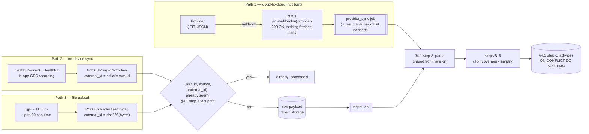
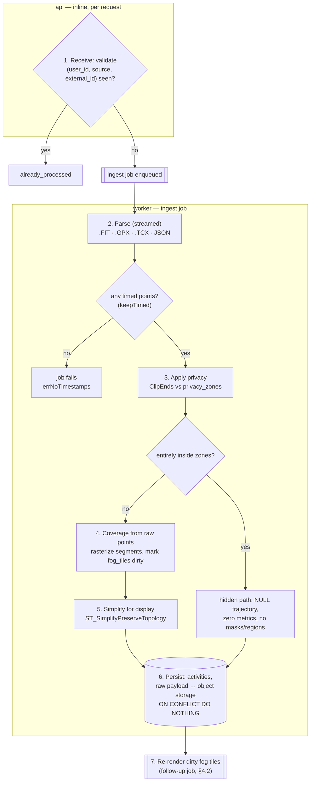

# HoldMyTrack: Implementation

> **Scope note.** Besides ingesting activities it didn't record, HoldMyTrack records casual GPS-only tracks in the Android app (FR-3.8), which submit through the same ingest pipeline as everything else. This document covers the database schema and each feature's own implementation detail (ingest, storage, analysis, fog rendering, tile serving) — see `docs/ARCHITECTURE.md` first for the system-level shape and the stack this all runs on.

---

## 3. Database Schema

The schema lives in `services/server/migrations/`, and the migrations are the authority on every table's columns; this section says what each table means and why its keys, constraints and indexes are the way they are. The base files are `0001_users_and_auth.sql` (§3.1, §3.9, §3.10, §3.16–§3.18), `0002_activities.sql` (§3.2, §3.3, §3.7), `0003_tiles.sql` (§3.6, §3.11), `0004_admin_boundaries.sql` (§3.12–§3.15), `0005_jobs.sql` (§3.8), `0006_demo_customer.sql` (the Demo Customer's row and Private locations, §4.10), `0007_map_version.sql` (`users.map_version`, §4.2.6) and `0008_stories.sql` (§3.19). **A schema change is a new numbered file, never an edit to an existing one**; each later file's header comment says which section it serves.

### 3.1 `users`

**No `tier` column.** There are no tiers; every account has every feature (`VISION.md` §6.2, ADR-0031). §4.10's no-signup demo is a real row in this same table, recognized by its fixed id (`httpapi.DemoCustomerUserID`) rather than a column. External sign-in identities live in §3.17's `user_identities`, not here (ADR-0015), so `password_hash` is NULL for an account that signs in only through one. `last_seen_at` is what counts an account as active for cost per active user (§5.7). What NULL means: `country` unset (the first-run gate, §4.12), `locale` "automatic" (Accept-Language, §4.21). `map_version` is §4.2.6's tile cache key and only ever goes up, so a key once used never names different content. `is_admin` is written only by the `set-admin` subcommand (§4.20). `deleted_at` marks an account its owner deleted, for the few minutes until the worker's sweep removes the row and its cascade takes everything else (§4.28).

### 3.2 `connections` — Path 1 OAuth state

**`UNIQUE (provider, provider_user_id)` matters:** without it, two HoldMyTrack accounts could connect the same Wahoo account and each receive the same webhook, doubling both storage and fog. `last_record_at` is the watermark of the newest activity already ingested. Tokens are encrypted at rest with a key outside the database and never logged. Deauthorization deletion (§7) is a hard requirement of both activity providers, so disconnecting must delete the synced data, not merely this row.

### 3.3 `activities`

**Idempotency is `idx_activities_dedupe`**, a unique index on `(user_id, source, external_id) WHERE external_id IS NOT NULL`, with an upsert-on-conflict at persist time (§4.1); `external_id` is the provider's activity id or the HealthKit/Health Connect record UID. `source` is the ingest path and `source_detail` the origin within it (a provider, an Android package, an uploaded filename). `activity_type` is whatever the source reports, verbatim, not a controlled vocabulary (§4.7.2).

**`trajectory` is display geometry only.** It is simplified for rendering, and coverage is never derived from it (§4.1). Its M dimension carries epoch seconds, which photos rely on (§3.22), and longitudes continue past ±180 across the antimeridian rather than jumping back (§4.1). **A NULL trajectory has one cause:** fewer than two points survived Private locations, an activity entirely inside them; every reader copes with it. The metric columns (distance, duration, moving time) are nullable for the same kind of reason: a file that carried no distance is not a zero-distance activity, so nothing coerces them to 0. `moving_seconds` excludes stops and is the basis for real pace (§4.5).

**What the other nullable and flag columns mean:**
- `timezone` is the IANA name of the zone the activity was recorded in, never an offset, so `started_at AT TIME ZONE timezone` is the offset in force on that date; the account's zone where none is known (§4.30).
- `raw_payload_key` is the object-storage key of the raw ingest payload, from any path; everything else about the activity can be rebuilt from it (§4.1 step 6).
- `ingest_complete` is false from the insert until every step after it has run, so a job cut off in between, or a re-upload after a failure, resumes the activity instead of finding it "already processed" (§4.1 step 6).
- `name` and `description` are NULL until the user sets them; no file or Health sync fills them, and Path 2's JSON wire format (in-app recording, §4.0.4) is the only ingest path that can set them at creation (§4.7.4).
- `track_edit` is the Edit track spec, replayed over the privacy-clipped raw points on every reprocess, NULL when never edited or reset; `edit_pending` is true while an `edit_track` job is queued or running (§4.7.7).
- `split_group`/`split_from`/`split_to` give a piece of a split activity its stretch of the raw points; `split_group` is the id of the row first split and has no foreign key, since the group outlives that row (§4.7.8).
- `recorded_started_at`/`recorded_ended_at` are the span the upload (or split piece) covers as recorded, before Private locations clip its ends and before any track edit; the overlap hint compares these, falling back to `started_at` while they are NULL (§4.6). `idx_activities_user_recorded_start` is that lookup's range scan.
- `origin_id` is the original a copied Story's activity descends from (§3.25).

**No bbox column.** `CREATE INDEX … USING GIST` on a `BOX2D` column fails, since PostGIS has no default GiST operator class for `box2d`, and one is redundant anyway: the GiST index on `trajectory` is a bounding-box index, so `trajectory && ST_TileEnvelope(...)` is already index-backed, and `ST_XMin` and friends read the box cached in the geometry's header. The same applies to adding one back.

**No heart rate, anywhere.** HoldMyTrack keeps no health data (ADR-0017, `VISION.md` §1.1): the parsers skip GPX's `gpxtpx:hr`, TCX's `HeartRateBpm` and FIT's `heart_rate`, and the sync wire format doesn't carry it. A reading survives only inside a stored raw upload, which nothing reads it out of. Elevation stays: it is route data, for elevation gain and GPX export, present whenever the source records it.

### 3.6 `fog_tiles`

The cached "whole history, nothing hidden" composite per account and z14 tile, built by compositing §3.11's masks. `heatmap_object_key` (§4.2.2) shares the row rather than a separate table because both rasters go dirty from exactly the same events. `idx_fog_dirty` is partial on `dirty` so the render's scan touches only stale tiles.

**`dirty_gen` keeps a render from clearing a newer mark.** Every write that marks a tile dirty also increments it. A render reads `dirty_gen` before gathering what it draws, and clears `dirty` only if it is unchanged when the tile is stored (`fog.upsertTileRendered`): a change landing mid-render, such as an activity deleted while its mask was being composited in, leaves the tile dirty for the render that change enqueued rather than keeping the deleted track on the map.

### 3.7 `privacy_zones`

Shown to users as **Private locations** (FR-8.1); the table keeps its older name. `radius_m`'s 50–2000 range is enforced by the API (`private_locations.go`), not the schema. There is no fixed endpoint trim; see §7.

### 3.8 `jobs`

The Postgres queue that §4.1 and `ARCHITECTURE.md` §2 depend on; there is no broker. `jobs` keeps its finished history (`finished_at`, set on `done` or `failed`), so the indexes are what keep reads cheap: `idx_jobs_runnable`, partial on `state = 'pending'`, makes the `FOR UPDATE SKIP LOCKED` scan touch only runnable rows; `idx_jobs_user` serves every other read, which is always one account's (upload history, the Upload menu, a job's status); `idx_jobs_user_locked` serves the claim's fairness order. `last_error` is an English diagnostic; `error_code` is a failed ingest's reason, which the apps translate (§4.21). `raw` holds a pending ingest's raw payload so the request can answer at once, until the worker stores it (§4.1 step 1); it's a column of its own because the import queries read `payload` on every row.

**A running job is still `pending`; `locked_at` marks it taken** (`internal/worker/worker.go`). The claim takes a runnable row whose `locked_at` is unset or older than `claimLease` (30 minutes), stamps `locked_at` and increments `attempts` in one short transaction, then runs the job outside it. The row lock ends at that commit, so a fresh `locked_at` is what keeps a second worker off a running job, and a stale one means its worker died and the job is claimable again. Long jobs (renders, exports) refresh their claim (`keepClaimed`) so they aren't taken for abandoned.
- **Attempts count at claim**, so a job claimed `maxAttempts` (3) times without finishing is failed on its next claim rather than handed out first on every restart. A failed job is not retried.
- **A panic fails that job alone** (`runJobSafely`), including one inside `internal/parallel`'s `ForEach` goroutines, which `ForEach` returns as the call's error since no caller could recover it.
- **Shutdown releases a running job**: `locked_at` cleared and its attempt given back, so the next start picks it up at once. Outcomes are written on a context that outlives the shutdown.

**Three lanes** (`worker.Run`), each a list of kinds passed to `claimQuery` as a `text[]`. The render lane runs `render_fog` alone (`WORKER_RENDER_CONCURRENCY` loops, default 2), so a big import's minutes-long renders never hold up a new upload; the long lane runs `export` alone in one loop (§4.29); the main lane runs every other kind (`WORKER_CONCURRENCY`, default 4; `docs/DEPLOY.md` §4). The worker's pool is sized to match (`db.OpenSized`, 4 connections per main or render loop), since a job can render 16 tiles side by side (§4.2).

**The claim is fair across accounts, per lane** (`claimQuery`):
- Each claim considers one job per account, the account's next runnable job of that lane by `run_after` then `id`, and none from an account that already has one of that lane claimed. An account's jobs stay in order and one account can't hold every loop.
- Accounts go in order of when each was last served on that lane (its latest `locked_at`), never-served first, so a new user's single upload goes ahead of the thousandth file of someone else's import, and two queued accounts alternate.
- One account's jobs in different lanes run side by side (its render beside its own ingest). That's safe because a tile marked dirty mid-render stays dirty (`dirty_gen`, §3.6), `EnqueueRenderFog` queues a new render behind a claimed one, and a Pending activity stays out of composites (`edit_pending`, §4.7.7). Track edit and reprivacy render inline (`fog.RenderUser`), so one account's render passes take a Postgres advisory lock (`lockRenders`) and run one at a time: a stale pass storing its tile after a fresher one cleared the dirty flag would leave that tile stale.
- **Trap:** the outer query repeats the "pending, not freshly locked" checks on `jobs` itself, not only inside its CTEs. Under READ COMMITTED, `FOR UPDATE` re-checks only those against a row another loop claimed after the statement's snapshot, which is what keeps two loops off one job.
- A deleted account's jobs are never claimed (§4.28).

A claim stays at about 11 ms against a 5,000-job backlog (`PERFORMANCE.md`, 2026-10-09 dev). The fairness, ordering and lane rules are pinned by `worker_test.go`.

### 3.9 `sessions`

**The row's own primary key is the session cookie's value**, a `gen_random_uuid()`, with no separate hash-of-token layer. Judged sufficient for the current threat model (§4.9); revisit the day that changes. Expiry is enforced in SQL (`expires_at > NOW()`) at read time, not left to the browser dropping an expired cookie.

### 3.10 `password_resets`

§4.11's reset tokens: the same shape and reasoning as `sessions`, for a much shorter-lived token.

### 3.11 `activity_tile_masks`

One crisp, unblurred contribution mask per activity per z14 tile it touches, rendered once at ingest (§4.2.3). This is what lets Fog and Heatmap answer a date-range or hidden-activity filter by compositing a handful of small masks instead of re-parsing raw files per request. `zoom` is always 14, kept for symmetry with `fog_tiles`; `idx_activity_tile_masks_tile` answers "which activities touch this tile".

**A mask's PNG is in `activity_tile_mask_data`, not object storage** (`0030_activity_tile_mask_data.sql`). A table of its own keeps `activity_tile_masks` the narrow index a render scans, and lets the backups leave the bytes out (`scripts/backup.sh`, `docs/DEPLOY.md` §11), since `rerender-coverage --masks` redraws them from raw uploads. Its foreign key cascades from the mask row, so the bytes go with their activity (§4.7.5). Why not elsewhere:
- R2 left a render almost all round trip (`PERFORMANCE.md`, 2026-10-09 production), and a worker cache would still leave the cold render after an import or deploy paying it.
- Files on a volume: a 4 KB block for a few hundred bytes, no transaction shared with `activities`, one volume for `api`, `worker` and one-off containers, and a store outside the backups.

At 128 px a mask is about 600 bytes, under Postgres's ~2 KB inline threshold, so it stays out of TOAST; an activity's masks come to about 5 KB, some 5 GB at a million activities. Mask reads share Postgres's CPU and cache with the map's queries; SQLite on the worker is the fallback if they start competing.

### 3.12 `admin_countries`

Overture Maps' land-clipped countries and dependencies (OpenStreetMap's borders, ADR-0034), loaded by `seed-admin-boundaries` (§4.2.4) and never derived from user data. `code` is the ISO 3166-1 alpha-2 code, or Overture's own `X`-prefixed one for a disputed area (`XW` West Bank), unique across countries and dependencies alike.

**Each outline is kept twice.** `geom` is simplified, for the Country tiles that draw it on every request. The full detail is only in `admin_country_parts`, cut by `ST_Subdivide` into pieces of at most 256 vertices, and that is what matching tests (§4.2.4): a track crossing Norway's coast is an index lookup over a few small polygons rather than a test against the whole country.

### 3.13 `admin_regions`

Overture's land-clipped regions (its `region` subtype: a country's first level below the national one), kept the same two ways: `geom` simplified for the Region tiles, the full detail in `admin_region_parts`. **`overture_id` is the key, not `code`,** since not every region has an ISO 3166-2 code (Puerto Rico's municipalities have none); `code` holds one where it exists. A country or dependency with no region of its own (Aruba, Antarctica, a disputed area) gets one row that is the whole country, `overture_id` `country:<code>`, so the Region tier veils and reveals it too. `admin_boundaries_source` is one row naming the loaded extract, so re-running the seed with the same one skips the reload and the re-match of every activity.

### 3.14 `activity_country` / 3.15 `activity_region`

One row per (activity, country/region) its trajectory touches, computed once by `internal/geo.MatchActivity` from `ingest.Process` right after the activity is persisted, and redone for every activity whenever `seed-admin-boundaries` loads new outlines (§4.2.4). The Country/Region tile queries then do an indexed lookup instead of a geometry test per request.

**`ON DELETE CASCADE` on `activity_id` is the whole cleanup:** a deleted activity's rows go with it, and since the tiles read this table live rather than a cached aggregate, the country or region re-locks on the next request with nothing to invalidate.

**Matching reads `activities.trajectory`**, the simplified display geometry, not the raw points the masks use. Polygons are kilometers across, so `simplifyToleranceDeg`'s ~3 m tolerance can't plausibly change which one a segment intersects, and reading the persisted column saves a second geometry pass in Go. Any crossing, however brief, gets a row: a visit's size or duration doesn't matter, only whether it happened.

### 3.16 `email_verifications`

Email verification (FR-1.8, §4.9): the same shape and reasoning as `password_resets`, with a longer TTL (`auth.go`'s `emailVerificationTTL`), since confirming a signup is less time-sensitive than resetting a credential. **`email` is the address the link confirms**, not whatever the account's address is when it's clicked: an email change is pending on this row until then, and verifying applies it. `users.email_verified` is the flag; demo accounts never read it (`httpapi.requireVerified`).

### 3.17 `user_identities`

The external identities an account signs in with (§4.15's Google, §4.22's Facebook), a row per provider rather than a column (ADR-0015). **`subject` is the provider's stable account id** (Google's `sub`, Facebook's app-scoped user id), never the email, so either side can change its address without breaking the link. The primary key `(provider, subject)` maps one external account to one HoldMyTrack account; `UNIQUE (user_id, provider)` limits an account to one identity per provider and doubles as the index for "which identities does this account have" (`sendPasswordReset`, §4.11; §4.15's unverified-account case). Cascade-deleted with the user.

### 3.18 `auth_handoffs`

One-time sign-in codes for a native app. When the Android app runs §4.22's Facebook flow in a browser tab, the callback stores a row here instead of setting a cookie in that tab, and redirects to `holdmytrack://oauth?code=<id>`. `challenge` is the S256 hash of a verifier only the app holds; `POST /v1/auth/handoff` deletes the row in the same statement that reads it, so a code redeems once, and starts a session only if the verifier matches within `expires_at` (two minutes). Unredeemed rows are purged on the next insert (`createHandoff`), so there's no sweeper. Cascade-deleted with the user.

### 3.19 `stories` / `story_activities`

Stories (§4.23, FR-14). A Story is the account's own, cascade-deleted with the user; `name`'s 1–200 characters is a `CHECK` behind the handler's own validation. `updated_at` moves on a rename, a new description or a membership change. **`story_activities` cascades from both sides:** deleting an activity takes it out of every Story, a Story left empty stays, and deleting a Story deletes no activity. The primary key serves "a Story's activities"; `idx_story_activities_activity` serves the activity-delete cascade.

### 3.20 `spots`

Spots (§4.25, FR-15, ADR-0021): outdoor places from OpenStreetMap, the same for every account, filled by `import-spots` and **upserted on `(osm_type, osm_id)`**. The text columns are OSM's own tags, each NULL when the place has none (`address` built from `addr:*`, §4.25). `geom` is always a `MultiPolygon` in 4326, like `admin_countries.geom`: the OSM outline, or a 30 m circle around a place mapped as a single node. **A place a planet import no longer sees is retired (`retired_at`), never deleted**, so the captures that refer to it stay; `last_seen_import` is when the run that last had it started (`0017_spots_retired.sql`).

### 3.21 `spot_captures`

Spot captures (§4.25, FR-15.6): one row per account and place captured with the Android app's capture mode. The primary key keeps the first capture; a row goes with its account or its place.

### 3.22 `activity_photos`

Activity photos (§4.27, FR-16, ADR-0024). The images are in object storage at `image_key` and `image_key || '-thumb'`. **Several rows can name the same files:** an upload's key is `photos/{user_id}/{id}`, but a copied Story's photo (§4.23, ADR-0036) is a row of the recipient's that keeps the original's key, so a file is removed only with the last row naming it (`idx_activity_photos_image_key`). A row goes with its account or its activity.

**No position column.** `route_at` is a moment on the activity's `trajectory`, whose M dimension is epoch seconds (§3.3), and the position is worked out from the track on every read. A stored point would go stale when Edit track (§4.7.7) or a Private location change (§7) rebuilds the track, and would keep a position a Private location added later should hide. `taken_at` (EXIF, NULL when absent) is kept apart from `route_at` because moving a photo by hand changes where it sits, not when it was taken.

### 3.23 `exports`

Downloading your data (§4.29, FR-1.12): one row per request, its zip parts in object storage at `exports/{user_id}/{id}/{n}.zip`. A row goes with its account, or with the hourly sweep once `expires_at` passes; `job_id` is `ON DELETE SET NULL`. **No state column.** Until `ready_at` is set, where a request stands is its job's: pending is "preparing", failed (or gone) is "failed". Ready lasts until `expires_at`.

### 3.24 `tz_parts`

The world's timezone polygons from timezone-boundary-builder's `timezones-with-oceans` release (ADR-0035), loaded by `seed-timezones` (§4.30) and never derived from user data. Each is cut by `ST_Subdivide` into pieces of at most 256 vertices, as `admin_country_parts` is (§3.12), so a point's zone is an index lookup; at sea it's an `Etc/GMT±N` zone. `tz_boundaries_source` holds the loaded file's name, as `admin_boundaries_source` does, so a re-run with the same file is skipped. Until the seed has run every activity keeps its account's zone.

### 3.25 `story_sends` / `story_copies` / `received_origins`

Sending a copy of a Story (§4.23, FR-14.7, ADR-0036).
- `story_sends` is the recipient's inbox: a copy offered and not yet answered, **one row per Story and recipient however often it's sent** (`UNIQUE (story_id, recipient_id)`), gone with the Story or either account.
- `story_copies` records, per sent Story and recipient, the Story the copy made, so the next accepted send of the same Story adds to it; it goes with either Story.
- `activities.origin_id` is the original activity a copy descends from, however many copies removed, NULL on an original. **No foreign key**, since the original may be deleted while its copies stay.
- `received_origins` is every original an account has received a copy of, kept after the copy is deleted, so an account receives each original once, ever.

### 3.26 `admin_tile_geoms` / `admin_tiles_built`

The Country and Region tiles' outlines, each already transformed and clipped to one tile in `ST_AsMVTGeom`'s 4096-unit grid (§4.2.4, `0031_admin_tile_geoms.sql`), so serving a tile is a lookup rather than drawing every outline in it again. The same for every account (only which outlines a tile shows is the account's own), built on a tile's first request and emptied by `seed-admin-boundaries`. **`admin_tiles_built` marks a tile as built, including one with no outline in it**, so an empty tile isn't rebuilt on every request.

### 3.27 `bike_paths`

Bike paths, Shared paths and Mountain bike trails (§4.24, FR-4.13): OpenStreetMap's cycleways, bike-designated paths and singletrack, the same for every account, filled by `import-bike-paths` and **upserted on `osm_id`**, one row per OSM way. `kind` is `cycleway`, `shared` or `mtb`, as `bikepaths.Kind` sorts them. **The line is stored in Web Mercator (3857)**, the tiles' own projection, so a tile clips, simplifies and measures it with nothing to reproject per request. Nothing refers to a row, so a planet import deletes the ways it didn't see (by `last_seen_import`) rather than retiring them as Spots does (§3.20).

## 4. Core Technical Workflows

### 4.0 The three ingest paths

They differ only in how bytes arrive. All converge on §4.1 step 2.



**Path 1 — cloud-to-cloud. Not built yet** (`docs/ROADMAP.md`, "Path 1"); this is the design it is to follow, and only its `connections` table (§3.2) exists. OAuth connect, then webhook-driven where the provider supports it, never polling on a schedule: a webhook returns `200 OK` in milliseconds and enqueues a `provider_sync` job, fetching nothing inline. Providers deliver a file (such as `.FIT`) or structured JSON, so the parse step is per-provider and everything after it is shared. Backfill of history at connect time is a separate, rate-limited, resumable job — the largest single fetch the system ever performs.

**Path 2 — on-device sync.** A native app reads the platform health store and uploads normalized points (§4.0.3).

* **iOS/HealthKit** exposes `HKWorkoutRoute`; full geometry is available to a native app.
* **Android/Health Connect** is constrained in three ways, each verified on a device rather than taken from documentation: `READ_EXERCISE_ROUTES` cannot be requested programmatically (the user grants it in Health Connect settings); **routes written by other apps cannot be read in the background** — `ExerciseRouteResult.ConsentRequired` comes back even with "Always allow" (on a Pixel 10a against a Fitbit-fed store, the same 46 sessions read as 23 routes in the foreground and none in the background, while the other 23, indoor workouts, read `NoData` both times, so "no route" and "not readable now" never have to be conflated); and **only the last 30 days are readable** unless `READ_HEALTH_DATA_HISTORY` is granted (a time window over data types already declared, not a further data type). Android sync is therefore **foreground-only**, and **Samsung Health exposes no route geometry at all**, so Galaxy Watch sync yields summary metrics and no map.

  Do not build a background route sync for Android; it cannot work. A sync that fetches everything except the map is worse than none: the routes it couldn't read would arrive as activities with nothing to draw.

**Path 3 — file upload.** `.GPX`, `.FIT` and `.TCX` files, up to 20 at a time; a `.zip` is refused (ADR-0039). Unconditional: it needs no API terms, licence or permission model.

**All three are idempotent on `(user_id, source, external_id)` — a hard invariant, not an optimization.** Retries are normal: mobile uploads get interrupted, providers redeliver webhooks, a file is uploaded twice. Whatever arrives twice must be processed at most once, under concurrent duplicates as well as sequential ones. The receive-time existence check (§4.1 step 1) is only a fast path; the guarantee is `idx_activities_dedupe` (§3.3) plus the upsert-on-conflict at persist time (§4.1 step 6), so two copies racing through two jobs still land as one row.

#### 4.0.1 Import UI: the header's Upload menu, the `/sync` page, and "View on map"

**Two halves, one per question**: the header's **Upload** menu is what's being imported right now, on every page, and `/sync` is what every finished import came to (SPEC FR-3.4, FR-3.9, which state what each shows). Both read the `jobs` table directly (`kind = 'ingest'`) rather than a dedicated uploads table: every import, file or phone sync, already is an `ingest` job carrying its filename (`payload->>'source_detail'`), external id, source, state, error and times, so a Health Connect sync and a file upload are one history, not two.

**Uploading**: each file is its own `XMLHttpRequest` (`static/upload.js`), for the upload-progress event `fetch` doesn't reliably have. `handleUpload` refuses before reading the body wherever it can: the hourly limit (SPEC FR-3.1) is `Server.uploadLimiter`, the same in-memory `fixedWindowLimiter` as the auth and Story-send limits (`auth.go`), so a restart resets it and `UPLOADS_PER_HOUR` overrides it for a load test (`docs/DEPLOY.md` §4); a file over `maxUploadBytes` is refused rather than read up to the limit.

**The map's refresh waits for the import to finish, not for the upload request.** The request resolving only means the job was *enqueued*; the worker hasn't inserted the row yet. So the Upload menu fires `hmt:imports-changed` on `window` both when an upload lands and when an import it follows finishes, and `MapView.tsx` refreshes on each.

**Polling, deliberately not WebSockets or SSE**: the menu polls `GET /v1/uploads/active`. `GET /v1/activities/status/{external_id}` still exists but answers only from the caller's own jobs (`unknown` otherwise): an upload's `external_id` is its file's SHA-256, so anyone holding a file could otherwise learn whether someone had uploaded it. Nothing on the web calls it.

**Imports in progress, grouped by batch** (`internal/httpapi/imports.go`). A request that enqueues several jobs at once (`handleSyncActivities`) stamps them with one random `ingest.Job.Batch`; `activeImportsQuery` groups pending `ingest` jobs by it (a job without one is its own group) and counts each group's finished and total jobs, so a phone sync of 34 activities stays one row, "12 of 34", across a reload. The same response carries `unseen_failures`: failed jobs whose `finished_at` is after `users.imports_seen_at`, which rendering `/sync` moves to now (`markImportsSeen`, skipped for a demo session). `migrations/0010_imports.sql` started every existing account at the time it ran, so no older failure reads as unseen. Covered by `imports_test.go`.

**A phone sync's title can't be its filename.** `syncItem` (§4.0.3) sets `source_detail` to `external_id + ".json"` — a Health Connect session UUID or a recording's UUID, never meant to be read. `importTitle` names such an import after its source instead, for the menu and `/sync` alike.

**The full history, `GET /v1/uploads?limit=&offset=&source=`** (`uploads.go`, the Android app's Sync screen). `LIMIT`/`OFFSET` pagination — the one place in the upload flow it's justified, unlike §4.7's list. A `LEFT JOIN` to `activities` on `(user_id, source, external_id)`, with `source` read from the job's own payload rather than hardcoded to `'upload'` so a phone sync's row joins its activity too, gives a finished row its activity. The `processing` count (`uploadsProcessingCountQuery`) is account-wide regardless of page or `source` filter, since the Android Sync screen needs the true number.

**The Upload menu is one plain script both page shells load** (`layout.html`, `app/app.html`), so it works the same on the map and on every server-rendered page; its words come from the server's catalog (`upload.*`), phrased so the script needs no plural rules. Files dropped on the map reach it as an `hmt:upload-files` event from `MapView`, whose drop cover counts dragenter/dragleave, since each child the drag crosses fires its own.

**The `/sync` page** (`internal/httpapi/sync_page.go`, `templates/pages/sync.html`) is server-rendered (§4.19) from finished jobs only (`syncHistoryQuery`), so it needs no polling and no script. A Ready row's date is the activity's day in its own timezone (§4.30), computed in the query, and its **View on map** link, `/?activity=<id>&day=<YYYY-MM-DD>`, carries that day so the map can narrow to it without a lookup. Covered by `sync_page_test.go`.

**"View on map"** — `App.tsx`'s `takeActivityParam` reads and strips both parameters once at load, and `MapView.tsx`'s `viewActivityOnDay` reuses `focusActivity` (§4.7.3's row focus) rather than a second fly-to. What a row click never has to handle is the activity being outside the selected range (an old upload, a Health Connect backfill), so it first replaces the selection with that one day via `changeSelectedRange` — the activity's own local day, which is how the server reads a bare `from`/`to` (§4.7); a UTC day would put an evening activity west of Greenwich a day late and the list would come back empty. Traps:
- The focus waits (`pendingFocusIdRef`) until the narrowed range's refetch has landed the id *and* the map has loaded: on arrival the list can come back before the map exists, and a fly then has nothing to move.
- The first list's usual fly to the most recent activity stands aside (`hasFlownToActivitiesRef` starts true).
- Normal map mode is restored first if Fog or Heatmap was on, since neither has a per-track focus.

#### 4.0.3 `POST /v1/sync/activities` — Path 2's batched sync endpoint

`internal/httpapi/sync_activities.go`. The wire shape is `{source, activities: [{external_id, activity_type, points: [{lat, lon, elevation_m, time}], name, description}]}`, answered with one result per activity (`enqueued` / `already_processed` / `rejected` with a reason): a batch is not all-or-nothing, so one bad entry doesn't abort the rest. `source` is an allowlist (`syncSources`: `healthconnect`, `healthkit`, `recorded`); other paths have their own endpoints and `source` values.

**Validation guards what the worker can't recover from cleanly.** `activity_type`, `name` and `description` are checked against the same `maxActivity*Len` bounds `handleUpdateActivity` (§4.7.4) enforces — matters for §4.0.4, the one client that can send an arbitrary type. `external_id` must match `syncExternalIDPattern` (letters, digits, `.`, `_`, `-`, not starting with `.`, at most 200) because it goes into the raw payload's object key and two `VARCHAR(255)` columns: a `/` or `..` would nest or escape the key, and an over-long id was accepted only for the worker's insert to fail.

**No Path-2-specific branch in `ingest.Process`.** `internal/parse`'s `ParseJSON`, dispatched by `ByExtension` like `.gpx`/`.tcx`/`.fit`, decodes the wire shape straight into the same `Activity`/`Point` structs — the phone already read raw samples, so there's only a reshape. Each activity is persisted to object storage like a Path 3 file and read back through the same parse call, so §4.0's "converge on §4.1 step 2" holds literally.

**Idempotency uses the caller's own id, not a content hash.** A file upload hashes its bytes (`ingest.EnqueueRaw`) because it has no better identity. A synced activity carries its platform record's id (a Health Connect session UUID), which *is* its identity; hashing the JSON would mint a new activity on every retry that reserialized a field differently. `ingest.RawItem.ExternalID` carries it, and the storage key is then scoped by source (`raw/{userID}/{source}/{externalID}{ext}` rather than `raw/{userID}/{hash}{ext}`), since a caller's id is unique only within its source.

**Bounds, capped before the body is fully read** (§5.1): `maxSyncBatchActivities` (100 per request — a page of a sync run, not a claim histories are smaller), `maxSyncPointsPerActivity` (50,000, §5.2's file ceiling), `maxSyncBodyBytes` (64 MiB). At least 2 points is a coarse pre-check only; the worker's deeper check can still fail an activity asynchronously, as for Path 3.

**`POST /v1/sync/known` — what the account already has.** `handleSyncKnown` takes `{source, external_ids}` and returns `{known, processing}`: the ids the account has from that source, and of those the ones whose `ingest` job is still `pending`, which the Android Sync sheet shows as on their way and re-asks about every 2 s (`apps/android/docs/IMPLEMENTATION.md` §5.1). The phone keeps no cursor (SPEC FR-3.6), so the server is the one record of what was sent and a reinstall or second phone agrees with it. `ingest.KnownExternalIDs` counts an id as known when an `activities` row carries it in any state, or a `pending` job carries it in its payload, so a session sent a moment ago doesn't come back while the worker catches up. A failed job that made no row, or a deleted activity, isn't known, so the phone offers it again. Same `source` allowlist and id pattern; at most `maxKnownIDs` (5,000) ids, under the default 1 MiB JSON limit; demo accounts get `403` (`requireNotDemo`), as for the sync itself.

#### 4.0.4 In-app GPS recording (Android)

**No new endpoint and no schema change** ([ADR-0007](adr/0007-in-app-gps-recording-submits-directly.md)): a finished recording is posted in §4.0.3's wire shape to `POST /v1/sync/activities` under `source = "recorded"`, the only server change being that value in `syncSources`. The client side is `apps/android/docs/IMPLEMENTATION.md` §7.

**`external_id` is a UUID the app mints at recording start**, since no platform store gives the activity an identity. Idempotency works the same: a retried submit is recognized, not duplicated.

**The one ingest path that sets `name`/`description` at creation.** They ride in the batch entry `parse.JSONActivity` already carries, so the activity is titled from its first insert rather than through a later `PATCH` (§4.7.4). Health Connect/HealthKit leave both empty.

**`activity_type` is free text here**, not Health Connect's normalized vocabulary — there's no platform type to map from. That is why `syncItem` checks its length against `maxActivityTypeLen` (50, the `VARCHAR(50)` column): unchecked, an over-long custom type would fail as a column-width error deep in the worker instead of a clean rejection.

### 4.1 Ingestion pipeline

The order of these steps matters.



1. **Receive** — via any of §4.0's paths. Validate, check `(user_id, source, external_id)` as a fast path (§4.0's invariant — an optimization, not the guarantee; see step 6), enqueue an `ingest` job, return. Nothing heavy happens inline. The raw payload travels inside the job, in `jobs.raw` (`ingest.EnqueueRaw`, `internal/ingest/enqueue.go`), so a request makes one existence query and one multi-row insert and never writes to object storage: a 100-activity sync batch answers as fast as a single file. The bytes get their own column rather than a place in `payload`, which the Upload menu's and `/sync`'s queries read on every row. Before step 2 the worker writes them to the job's `raw_payload_key` and clears the column (`ingest.PromoteRaw`); a retry after a failed write finds them still there. A job whose payload is already in storage (the demo presets') has nothing inline, and this is a no-op.
2. **Parse** — stream `.FIT` binary or `.GPX`/`.TCX` XML, or map JSON. **Never load a whole file into memory**: a 100-mile ride at 1 Hz is 36,000+ points across a dozen channels. No parser checks ranges, so the pipeline filters what it gets:
   - `keepValid` drops points no place on Earth has (NaN or infinite, latitude beyond ±90, longitude beyond ±180) and clears a non-finite elevation. One such point broke the tracks tile query for every tile its bounding box covered, drew masks to the edge of the world, made the stats responses unencodable, and as an end point escaped Private-location clipping.
   - `keepTimed` drops untimed points (every parser leaves a missing timestamp as the zero `time.Time`) and fails the job with `errNoTimestamps` when none is left — otherwise a planned-route GPX was persisted as starting on 0001-01-01, outside every date range, so nothing could ever show it.
   - `ParseFIT` treats a field narrower than its type, and FIT's per-type "invalid" value (`0x7FFFFFFF` for a position before GPS lock), as absent, rather than reading past the field or placing a point near (180, 180).
   - `ParseGPX` reads only the recorded line, in time order, because step 3 clips from whichever points come first and last: `<wpt>` is never a point, `<rtept>` is used only when there's no `<trkpt>`, `<trkseg>`s are kept whole and ordered by first timestamp, and a point with an unreadable `lat`/`lon` is skipped rather than read as 0.
3. **Apply privacy** — clip the raw points against the account's `privacy_zones` (§7) **before anything is persisted or indexed**. Privacy applied at render time leaks through any bug in the render path; privacy applied at ingest cannot.
4. **Compute coverage from the raw points** — rasterize each *line segment*, not each point, into the coverage mask (§4.2), and mark touched `fog_tiles` dirty. `computeTouchedTiles` fails the job (`too_large`) once a track touches more than `maxActivityTiles` (20,000) z14 tiles, checked as it walks: a track zigzagging between far-apart points could otherwise reach millions of masks, held in memory and rendered one by one on the single worker. A 10,000 km road trip is around 12,000.
5. **Simplify for display only** — `ST_SimplifyPreserveTopology`, stored in `activities.trajectory`.
6. **Persist** — summary metrics and the simplified `trajectory` to `activities`, and the raw payload (Path 3's file, Path 1's push, Path 2's point batch) to object storage under `activities.raw_payload_key`. The raw payload is the only place full-resolution points survive this job, and what makes retroactive re-clipping possible (§7). The insert is `ON CONFLICT (user_id, source, external_id) DO NOTHING` against `idx_activities_dedupe` (§3.3) — this, not step 1, enforces §4.0's invariant under concurrent duplicates. **The row commits first and is completed after**: it's inserted with `ingest_complete = false`, the rest of the job (masks, region matching, dirty tiles) runs, and the flag goes `true` at the end (a track entirely inside Private locations is complete as inserted). A conflict on a row still `false` is an earlier run of the same ingest cut off partway, not a repeat: the job carries on with that row, every step being safe to re-run, and step 1's fast path doesn't count such a row, so uploading the file again resumes it.
7. **Re-render dirty fog tiles** — a follow-up job (§4.2), one per account: `EnqueueRenderFog` adds none while the account already has a `render_fog` job waiting *unclaimed*, since that job reads the dirty flags only once claimed, after this ingest's marks have committed (a claimed one may have read them already, so it doesn't count). A bulk import queues one render behind its ingests, not one per activity.

**Step 3 is `ClipEnds` (`internal/ingest/clip.go`), and it's point-density-independent.** `LoadZones` reads the zones when the job *runs*, not when it's enqueued, so a location saved while an upload waits still applies. Leading points inside any zone are dropped and replaced by one point on the zone's edge, found by bisecting the leaving segment against "inside any zone" (so overlapping circles need no special case), with time and elevation interpolated; trailing points likewise. Interpolating rather than snapping to the nearest real point matters for sparse recordings (a drive logged every 100+ m), which would otherwise leave far more than the radius unclipped. A track that only passes *through* a zone is left whole by design: it reveals neither end, which is what a zone protects, and splitting would force a multi-part trajectory on every consumer. A track entirely inside zones is persisted with a NULL `trajectory`, zero metrics, and no masks or region matches (`Process`'s `hidden` path) rather than dropped, which would lose it for good even after the hiding location is deleted. Covered by `clip_test.go`.

**A track across the antimeridian is stored continuing past ±180.** `loadClippedPoints` runs `unwrapLons` (`internal/ingest/antimeridian.go`) first: each longitude moves by whole turns to within 180° of the one before, the first into −180…180, so 179.95 → −179.98 becomes 179.95 → 180.02. Otherwise the segment ran back across every longitude — drawn round the world, with masks in every one of z14's 16,384 columns (a four-point track kept the worker busy over a minute). The stored trajectory keeps this form, so its plain bbox is the short one (§4.7) and both clients draw it the short way (§4.3.1). Everything that meets the world's own −180…180 must wrap it back:
- masks: `tilemath.SegmentTilesBuffered` wraps a column past the edge, and `fog.projectToTile` draws from the copy a world's width away when that's the one reaching the tile;
- tracks tiles (§4.3) and Country/Region matching (§4.2.4): `geo.WrappedSQL` (`ST_WrapX` twice, a part each side);
- written GPX (the data export, §4.29, and the demo's, §4.10): `parse.WrapLon` per point;
- track edits (§4.7.7): a moved point may come from either side, so `TrackEdit.Apply` unwraps again and `Validate` accepts longitudes up to ±540.

Haversine distances and a Private location's distance test already take the short way. `migrations/0024_antimeridian_reprocess.sql` queued a `reprivacy` job (§7) for every older activity still spanning the long way. Tested in `internal/ingest` and `internal/fog` (`antimeridian_test.go`) and `internal/geo`'s `TestMatchAcrossTheAntimeridian`.

### 4.2 Fog of War — precomputed raster mask

**Storage.** Coverage is a **bitmap**, not a set of cells — a per-user, per-viewport `ST_Union()` of thousands of polygons on every tile request would be a hard scaling wall a bitmap avoids entirely. For each z14 tile the user has touched, render a 128×128 single-channel PNG (`fog.TileSize`). At z14 (~2,446 m across) a 128 px tile is **~19 m/px**; the clients draw it at 512 px, so a pixel is about 4 screen pixels wide at every zoom below 14, where they draw it as a square, and grows from there, where they smooth it (`raster-resampling` stepped at `PIXELS_MAX_ZOOM` = 14). Not 512 px (~4.8 m/px): pixels were most of a render's work and of an account's stored bytes, and 512 px looks hardly different at the zooms people browse at, for 16 times the pixels. Not 64 px (~38 m/px): from zoom 13 out it merges tracks a few hundred metres apart, draws a diagonal road as a staircase and thickens Heatmap lines into blocks. Not 256 px: it would double the masks' bytes in Postgres (§3.11) for detail finer than a GPS track holds (`PERFORMANCE.md`, the 2026-10-09 resolution and 128 px sessions). Masks and served tiles share the one size, so compositing stays a plain per-pixel max or sum with no resampling. Squares from afar and smoothing close in, rather than one look at every zoom: smoothing blurs the thin lines most coverage is at a distance, and squares close up grow into blocks as wide as a street.

**Rendering a tile.** Every trajectory is clipped to the tile and stroked at the reveal radius (`strokeRadiusPx` = 2.5 px at z14, ~48 m either side) into the alpha channel, anti-aliased (`gg`). Nothing blurs it afterwards: references feather a reveal's edge over roughly 1–4 px at display resolution, and at 128 px the stroke's anti-aliased edge is that edge. Points within half a pixel of the last one drawn are skipped (`minStepPx`): GPS jitter while standing still makes segments a hundredth of a pixel long, and `gg`'s stroker then draws nothing for the whole track (`TestActivityMaskSurvivesJitter`). Half a pixel is about 10 m, a tenth of the stroke's width, so it changes nothing visible. The stroke needs the *raw* points, not `activities.trajectory`'s simplified display geometry (`ARCHITECTURE.md` §1.1), which is why masks are rendered per activity at ingest (§4.2.3) rather than per request.

**The radius is ~48 m either side**, wider than the references' road-hugging ~20–40 m (§4.2.1). The narrower reveal left a daily-walked neighbourhood still fogged between the streets walked, since blocks are often 100–150 m deep; ~100 m of band opens it while streets a block apart stay separable, and much wider merges parallel streets into one blob. Heatmap draws from the same masks, so a heat line is the same width. Changing the radius changes every stored mask, so it takes `rerender-coverage --masks` (below).

**Pyramid.** z13 down to z0 come from successive 2×2 downsampling of z14 (`fog.downsampleQuadrants`, Fog and Heatmap alike), each parent pixel the **brightest** of its four children, not their mean. A mean dimmed a track once it was thinner than a pixel, so a small place far from home read as a faint hair at the zoom that fits both; with the max, anywhere visited stays fully clear (Heatmap keeps its hottest pixel) at every level. Above z14 the client overzooms the z14 raster; the mask is a soft alpha channel, so magnification looks better than hexagon edges.

**Re-rendering after a drawing change.** A change to how tiles are drawn (pyramid, stroke, Heatmap coloring) doesn't reach tiles already rendered or browsers that cached them. `rerender-coverage [--masks] [--user <id>]` (`ingest.RerenderCoverage`) marks every account's z14 tiles dirty and queues one `render_fog` job per account, rather than rendering in the command, so it never races the worker over the same tiles; run it once per such deploy (`docs/DEPLOY.md`). A change to the stroke itself, or to which tiles a track reaches (`tilemath.SegmentTilesBuffered`), also needs every activity's stored masks redrawn: `--masks` first runs `ingest.RerenderActivityMasks` for each activity, from the points it's shown with (`DisplayedPoints`: the upload clipped to Private locations, its track edit applied), dropping masks for tiles it no longer reaches and marking old and new tiles dirty. It re-parses every upload, eight activities at a time (`rerenderParallelism`); `MarkFogTilesDirty` takes its rows in tile order, so activities redrawn together never deadlock on tiles they share. Pending activities, and any without a stored upload, are logged and left for their own reprocess. A change to `TileSize` needs `--masks` too, and until it has run a tile or mask of the old size is refused when read (`decodeGray`, `errTileSize`): a pyramid render with such a child fails, and a z14 render skips such a mask, rather than reading past a smaller tile's end or drawing it squashed into a corner.

**Invalidation.** Ingest marks touched tiles `dirty`; storing a tile marks its parent dirty in the same transaction, and `RenderUser` renders every dirty tile at z14, then each level up to z0. A tile's dirty flag clears only if its `dirty_gen` is unchanged since the render read it (`upsertTileRendered`), so a change landing mid-render — an activity deleted while its mask was being composited in — leaves the tile dirty for the next pass. A level's tiles render up to 16 at a time (`renderParallelism`, `internal/parallel`'s `ForEach`), and the next level up starts only once they're all stored, since it's built from them; `RenderActivityMasks`' per-tile drawing runs side by side the same way. Within a tile, its Fog and Heatmap PUTs go together (`storeTilePair`), and a pyramid tile reads its four children's keys in one query and fetches their up to eight images together (`loadChildren`), so a z14 tile costs a query and one round of PUTs, a pyramid tile a query, one round of GETs and one of PUTs. With up to about 128 requests in flight per render, the object-store client keeps 128 idle connections rather than minio's 16 (`storage.New`), so none pays a fresh TLS handshake to R2. The work is mostly object-storage round trips, so running side by side, not CPU, is what makes a render fast (`PERFORMANCE.md`, the 2026-10-08 baseline and the 2026-10-09 and 2026-10-10 dev measurements). A pass cut off partway leaves the parents of what it rendered dirty, so the next one finishes the pyramid. A new activity dirties a handful of z14 tiles, so incremental cost is near-constant regardless of history size.

**Touched-tile membership is buffered by the stroke's drawn width, not just where a bare coordinate floors to.** `ingest.computeTouchedTiles` and `fog.RenderActivityMasks` (§4.2.3) both walk `tilemath.SegmentTilesBuffered`: a point or segment within `fog.TileMarginPx` (the stroke radius) of a tile boundary adds the neighbouring tile too. Without it, a route running along a z14 boundary had part of its stroke inside a tile no mask was rendered for, and `gg` silently clipped that overflow at the canvas edge instead of drawing it next door (found on the Demo Customer account). The walk uses the segment's exact pixel coordinates a tile column at a time, taking every row the in-column part spans (widened by the margin); a Bresenham line between tile indices skipped tiles a long slanted segment clips near a corner, which broke a sparse drive's cleared route at tile edges. Covered by `internal/tilemath/tilemath_test.go` and `internal/ingest/touched_tiles_test.go`.

**Volume.** A city's worth of coverage touches a few hundred z14 tiles, a well-travelled user a few thousand; mostly-empty single-channel PNGs compress to a few KB, so per-user storage is megabytes.

**Serving.** The stored mask is a coverage alpha channel, but MapLibre cannot invert or colourise it at render time, so the tile route emits a **ready-to-draw PNG**: the veil's colour in RGB, `alpha = veil opacity × (255 - coverage)`. It does that without decoding the mask (`internal/fog/tint.go`): an 8-bit grayscale PNG and an 8-bit palette PNG store pixels the same way, one byte each, so the route rewrites the stored bytes as a palette PNG — header colour type changed, a 256-entry `PLTE` and its `tRNS` alphas inserted, image data copied untouched. The palette (the veil colour at each mask value's alpha) is built once per veil, and a tile with no stored mask uses an all-zero mask encoded once. Decoding, colouring and encoding an RGBA PNG per request had saturated the API's CPUs; the rewrite costs under a microsecond a tile (`BenchmarkFogTile`; `PERFORMANCE.md`, 2026-10-08 and 2026-10-09 dev), and `tint_test.go` checks it against the per-pixel formula for all 256 values, both veils and the heat ramp. The veil is picked per request by `?theme=` (`fog.VeilForTheme`: `dark` gets the dark-basemap veil, anything else the light one); theme is in the URL so a cache keeps one variant per theme while storage holds only the single-channel master. Clients keep each tile under the account's tile version (§4.2.6).

**Two veils, each the opposite of its basemap** (`fog.LightVeil`, `fog.DarkVeil`): the app's dark ink over the light basemap, a cream mist in the app's light background over the dark one. A veil close in lightness to its basemap barely reads as covered — white over the cream basemap, or the dark veil over the dark basemap, was hardly distinguishable. The web map (`fog.ts`) and the Android app (`MapOverlays.kt`) ask for `theme=dark` on the dark and black flavors and draw the Country/Region fills (§4.2.4) in the same colour/opacity pairs, so the two must change together.

```http
GET /tiles/v1/fog/{z}/{x}/{y}.png?theme=dark
```

Authorization follows §7 — the user is derived from the session, never from a parameter.

**Client compositing**, identical on MapLibre GL JS and MapLibre Native (Fog mode; §4.2.2 covers Heatmap):
1. Base layer — the self-hosted Protomaps basemap, in a **rich, saturated flavor**: a washed-out base leaves the least to reveal once fog covers the rest.
2. Fog layer — a plain `raster` source inserted **beneath the basemap's first symbol layer** so place labels stay legible on top. At full strength those labels pull the eye off the cleared ground, so Fog mode dims every symbol layer's `text-opacity`/`icon-opacity` (`mapMode.ts`'s `setMapMode`) and resets both to unset on leaving it, since the Protomaps style never sets either.
3. Track layer — vector tracks from `/tiles/v1/tracks/{z}/{x}/{y}.mvt`, over cleared regions.

> **Why the inversion is server-side.** A full-viewport veil whose alpha is driven by the *inverse* of the coverage raster can't be expressed in MapLibre: `paint_raster` offers only opacity, hue-rotate, brightness, saturation, contrast, resampling and fade (checked against `@maplibre/maplibre-gl-style-spec` 26.4.2); there is no `raster-color` (Mapbox GL has it; MapLibre issue #4479 is open). Baking the inversion server-side keeps every client on a stock `raster` layer and avoids writing a shader twice against two bindings.

#### 4.2.1 Reference implementations — measured, and where we deviate

Three Fog of World screenshots (`reference/fog-of-war-example*.{webp,jpg}`) were sampled to pin these numbers down rather than guess them.

| Property | Measured | Decision |
| :--- | :--- | :--- |
| Fog colour | White. Fogged ≈ RGB (193, 192, 188); revealed ≈ (63, 66, 58) | Not white: a veil opposite to the basemap in lightness (above) |
| Fog opacity | ~0.66, consistent to ±0.02 across all three | `0.82` for the dark veil, `0.6` for the cream one |
| Desaturation | Saturation falls 0.15 → 0.03 under fog | **Not a separate effect.** A 66% white blend produces exactly this arithmetically |
| Edge softness | 1–4 px transition at display resolution | Adopt — the anti-aliased stroke edge at 128 px, drawn larger by the client |
| Reveal radius | Hugs the road centreline, ~2–3 lane widths | Deviate — ~48 m either side (§4.2) |
| Label handling | Labels drawn **over** the fog | Adopt — fog below the first symbol layer |

**Where we deliberately deviate: vector by default.** All three references composite fog over *aerial* imagery, and that is where their impact comes from. Protomaps is vector-only, and metered imagery is a per-request bill a free product can't leave open-ended, so **the fog is designed over the vector basemap** — a flavor with strong landuse, water and road-casing colour, the fogged state reading as "the same map, drained of colour" rather than "the map, hidden". Satellite imagery is only the optional base map of §4.26, and over it Fog takes the cream veil, since imagery reads dark.

**These references set the mechanic, not the visual bar.** Matching the table reaches parity on behaviour; the differentiation comes from render quality on top of it.

#### 4.2.2 Heatmap mode

The third of the map's three modes (`VISION.md` §4.2) reuses fog's raster pipeline rather than building a second one: both answer "how much of this tile's ground has this user's history touched," two different ways.

**Fog answers a binary question per pixel; heatmap a graded one, which is why heatmap can't recolour the fog mask.** Fog's composite is a max, so a well-travelled street and a once-ridden one look identical — the reveal mechanic depends on that. Heatmap needs additive accumulation, so a daily commute glows brighter than a road ridden once. Each track renders to its own crisp mask (the same stroke as fog, so the two agree on how wide a route is), the masks sum into a float accumulator, and the sum is normalized against **`users.heatmap_cap`** and compressed with **sqrt** — not log, so a single pass already reads as visibly warm — down to the 8-bit PNG stored. Same z14 grid, resolution and ingest-time masks as fog (§4.2.3).

**A second object key on the same row, not a second pipeline.** `fog_tiles.heatmap_object_key` (§3.6) sits beside `object_key`, sharing the `(user_id, zoom, tile_x, tile_y)` row, the `dirty` flag and the re-render job, since every event that dirties one raster dirties the other. A separate `heatmap_tiles` table would duplicate the whole dirty-tracking scheme for data invalidated by exactly the same events. Unlike `object_key`, it isn't an all-time aggregate: it's built from a rolling window (§4.2.3) that has to move on a schedule, not just on ingest.

**Serving: a baked colour ramp, for the same reason fog's inversion is baked** (§4.2's note — MapLibre has no `raster-color`). The ramp is the palette of the same byte rewrite fog's veil uses (`fog.HeatmapTile`; `heatmapRamp`/`heatmapNRGBA` give the 256 entries):

```http
GET /tiles/v1/heatmap/{z}/{x}/{y}.png
```

Same authorization rule as fog and tracks: the user comes from the session, never a parameter (§7).

**The ramp runs deep red → orange → bright yellow, with a visibility floor at 2%.** With the cap at the account's busiest tile, a place crossed once stores an intensity of about 5–20, which a ramp starting from transparent drew about 15% opaque — a remote place visited once all but disappeared on the cream basemap. The floor makes anywhere visited plainly visible, with frequency changing the colour; only the faintest fringe of the anti-aliased edge stays below it, keeping the edge soft. Red through yellow stands off the cream land and yellow roads, which a rust-to-yellow ramp sat too close to.

**One mode at a time, not a fourth layer.** Normal is basemap + tracks; Fog is basemap + fog raster; Heatmap is basemap + heatmap raster in the fog layer's place. Both coverage modes hide the track layer: the raster already encodes where (and how much), and lines on top read as noise rather than adding to it. **Heatmap quiets the basemap under the heat**, the way Fog dims its labels: `heatmap.ts` adds a `background` layer (`heatmap-dim`) beneath the heat layers, lighter on light flavors and darker on dark ones and satellite (`isDarkBase`), shown by `setMapMode` in Heatmap only. The export (`exportMap.ts`) builds it the same way, so an exported Heatmap looks like the screen.

**Privacy is unaffected, not just inherited.** Both rasters are computed from the same privacy-clipped points (§4.1 step 3 runs before step 4), and the `reprivacy` job (§7) re-renders both together, for the same reason they share a row.

**`heatmap_cap` is the account's own single most-touched z14 tile** (`fog.RecomputeHeatmapCap`): how many in-window, non-Pending activities cross it (`COUNT(DISTINCT activity_id)` per tile over `activity_tile_masks`). A percentile was rejected against the Demo Customer account: of its 1,140 touched z14 tiles, 1,100 are touched exactly once and the two genuinely hot ones (591 and 498 touches) are under 0.2% of them, so any percentile up to the 99.7th lands in the once-touched mass. The max makes the account's busiest spot the one place that reads fully hot, everything else scaled to it, and it's hard to inflate: the count is per activity, not per point, so one activity idling in place can't raise it. Two guards: below `minTouchedTilesForAdaptiveCap` (20) touched tiles the cap is left alone, so two early activities sharing a tile can't set it to 2; and since the cap is baked into the stored PNGs, changing it means re-rendering every tile, so a change under `heatmapCapChangeThreshold` (15%) is skipped. A fresh account starts at 8.0 (`migrations/0001_users_and_auth.sql`).

**The cap sweep runs daily and at worker start** (`internal/worker`'s `recomputeHeatmapCaps`), independently of `ageOutHeatmapWindow` (§4.2.3): whichever runs first, the other self-corrects on its next tick from the `in_heatmap_window` state it finds, so there's no ordering between them. A changed cap updates `users.heatmap_cap`, marks every one of the account's `fog_tiles` rows dirty and enqueues `render_fog`; Fog's tiles get rebuilt alongside, the cost of the shared dirty flag.

#### 4.2.3 Per-activity masks: the ingest-time building block behind both rasters

Fog shows the account's all-time coverage and Heatmap a fixed rolling window ending now (`fog.HeatmapWindowDays`, 365), so a route no longer visited cools off; neither reads the Activities panel's filters (FR-4.2, FR-4.3).

**Both are composited from a crisp mask per activity per z14 tile it touches** (`activity_tile_masks`, bytes in `activity_tile_mask_data`, §3.11), rendered once at ingest from the points already in memory (`fog.RenderActivityMasks`, called from `ingest.Process` after the activity is persisted) and upserted in one transaction, with no object-storage write. Ingest cost is then proportional to that activity's own tiles, however many other activities share them. `renderAndStoreTile` reads a tile's masks and their bytes in one query (`LEFT JOIN activity_tile_mask_data`); a mask that can't be read (no bytes, as after a restore until `rerender-coverage --masks`, or bytes that don't decode) is left out of the tile rather than failing it, and `RenderUser` logs once per pass how many it skipped (`mask_data_db_test.go`). **This is what makes a delete cheap and correct:** a dirty tile is always fully recomposited from whichever mask rows still reference non-Pending activities, never incrementally subtracted, so a delete is one fewer row feeding the composite — not a re-parse of every other activity sharing the tile, whose payloads may already have expired.

**Both tile routes are a plain lookup** of `object_key`/`heatmap_object_key` on the `fog_tiles` row, with no per-request compositing. They differ only in what `renderAndStoreTile` fed each: Fog every non-Pending activity's mask, Heatmap only those whose activity is `in_heatmap_window` as of that render. A map cancels in-flight tile requests as it's panned or zoomed past them, so when the lookup or fetch fails because the client has gone (`clientGone`, `tile_mask.go`) the handler answers `499` without logging, keeping routine panning out of the error logs and the metrics' `5xx` class. The vector-tile handlers — tracks, Country/Region (§4.2.4) and Spots (§4.25) — do the same.

**Heatmap is a lookup because compositing the window live is too slow.** On the Demo Customer's home tile (591 of 611 activities) a per-request composite took ~12.6 s, ~56.5 s at low zoom, and no short-lived cache absorbs it: a window ending at `time.Now()` is a new key every request. The cost of the lookup is that the window moves daily rather than continuously.

**Window membership is a stored fact, `activities.in_heatmap_window`, not computed against "now" at render time.** An activity entering the window is an upload, handled by ingest's ordinary dirty-marking; ingest sets the flag from `started_at`, so an import of years-old history starts outside it. One *leaving* is pure passage of time, which no event notices, so `internal/worker`'s `ageOutHeatmapWindow` runs daily (`heatmapAgingInterval`) and once at worker start — a ticker's first tick is a whole interval away, and a worker restarted on every deploy might never reach it. It flips the flag on activities that just crossed the boundary and re-renders only *their* tiles (`ingest.ActivityTiles`), never a whole account: activities age out on scattered days, so the daily load is small and spread out without staggering. An aged-out activity can take up to a day to cool off, which nothing watches closely enough to matter.

**A Private location change re-renders masks from freshly clipped points.** Nothing reading the stored masks notices a location changed underneath them, so the `reprivacy` job (§7) runs each affected activity through `ingest.reprocessActivity` — the same function Edit track uses (§4.7.7) — which re-renders its masks, drops those of tiles it no longer touches and dirties old ∪ new tiles; `fog.RenderUser` runs for the whole batch, twice, around the reprocessing (§4.2.5).

**Refreshing an open page.** Coverage tile URLs change only with the account's tile version (§4.2.6), so MapLibre never re-asks on its own; the client re-points every coverage source (Fog, Heatmap and their Country/Region tiers) at `…?cv=<tile version>` when coverage changed (`apps/web/src/map/coverageVersion.ts`). The hard part is knowing *when*, since an upload or delete only enqueues the re-render. `GET /v1/coverage/status` (`internal/httpapi/coverage.go`) answers `rendering: true` while the account has any `ingest`, `edit_track`, `reprivacy`, `story_copy` or `render_fog` job still `pending` (a claimed job stays `pending` until done or failed, so running jobs count). `ingest` is in the list because the client's watch starts as soon as an upload is accepted, before the `render_fog` job it will enqueue exists. `useCoverageRefresh.ts` starts the watch after an upload or delete, when a row enters or leaves Pending (§4.2.5), and once when the map opens, so a page opened while jobs are still draining gets its final refetch too. Rules of the watch:
- Reads go every 2 s for about 3 minutes, then every 10 s (`coveragePoll.ts`), failed reads included, until one reads false; a large import can keep the worker busy far longer than 3 minutes, so it never gives up.
- Every call restarts the watch rather than joining one in flight, so a second change landing just after a read came back "done" can't be missed.
- The response also carries `version` (`users.map_version`) and `tile_version` (§4.2.6), and the client refetches whenever `version` moves, not only at the end: a reprocess renders twice inside its job (§4.2.5), and the first render is only ever shown if picked up mid-job. The first read after a page load only sets the baseline, and refetches nothing if nothing is pending and the page's version is current.
- The latest `rendering` drives the "still being updated" pill under the mode toggle in Fog and Heatmap (FR-4.2 behavior 6).

#### 4.2.4 Country/Region zoom tiers

Below a threshold zoom, Fog and Heatmap's per-pixel raster (§4.2, §4.2.2) is replaced entirely by a coarser whole-polygon reveal: a country or state/region renders as fully "unlocked" the moment the account has a single activity anywhere inside it, however small or brief. The tiers are switched purely by MapLibre `minzoom`/`maxzoom` on the layers (`apps/web/src/map/zoomTiers.ts`; Android's `MapOverlays.kt` mirrors the same four constants, and the two must change together) — never layered together and never reconciled: at country/region zoom there's no fine-grained detail visible to contradict, so the coarse reveal already is the whole truth at that scale. A layer draws at `minzoom` ≤ zoom < `maxzoom`, so the bands are:

| Zoom | Normal | Fog | Heatmap |
| :-- | :-- | :-- | :-- |
| below 3 | basemap only | **Country tier**: every country the account has never been in is veiled (§4.2's veil); a country with even one activity is fully clear | **Country tier**: every country with an activity in the last 365 days is a flat fill in the ramp's single-visit red, not graded |
| 3 to under 4 | basemap only | **Region tier**: the same, by state/province | **Region tier**: the same, by state/province |
| 4 to under 7 | tracks | Region tier | Region tier |
| 7 and up | tracks | **Per-pixel tier**: the fog raster — clear exactly where a track has passed | **Per-pixel tier**: the heatmap raster, graded by how often a place was crossed |

**The level in view is named on screen** (`ui/ZoomLevelNotice.tsx`; Android's `map/ZoomLevelNotice` mirrors it): a Country or Region fill with no label read as a bug to someone who didn't know that zoom draws whole countries. `zoomTier(zoom)` maps a zoom to the same three bands the layers switch on, and the notice reads it on `zoomend`, not mid-gesture, so a pinch through two levels names only where it lands. What it says is FR-4.2 behavior 4 and FR-4.3 behavior 5.

**Boundary data**: `admin_countries`/`admin_regions` (§3.12–§3.13) hold Overture Maps' land-clipped countries, dependencies and regions — OpenStreetMap's borders, ADR-0034 for the choice. The flow:
- `scripts/boundaries-extract.sh` cuts them out of one pinned Overture release with DuckDB (`boundaries-extract.sql`), off the server, into a gzipped CSV in the column order the seed's `COPY` takes: the land outline of every `country`/`dependency`/`region`, its English name where Overture has one, and no region that is the code-less second drawing of a disputed one (a region with no ISO 3166-2 code lying more than half inside one with a code — Aksai Chin and Western Sahara among them).
- The file goes into the app bucket under `geo.BoundariesKey` by hand (`docs/DEPLOY.md` §6).
- `seed-admin-boundaries` (`internal/geo/seed.go`) reads it from there or `--file` and, in one transaction, replaces every outline and membership row, re-matches every activity, records the file in `admin_boundaries_source` (a re-run with the same file does nothing, unless `--force`) and bumps every account's tile version (§4.2.6). It refuses a file with fewer than 250 countries or 3,500 regions, since a cut-short file would otherwise erase the rest of the world.
- Each outline is stored twice: simplified for the tiles (`ST_Simplify` then made valid again: 0.05°, about 5 km, for countries, drawn below z3; 0.01°, about 1 km, for regions, drawn to z6 — each under a pixel where it's drawn, and a country it would erase whole, like Vatican City, keeps its full outline), and in full detail cut into `ST_Subdivide` pieces of at most 256 vertices for matching. A country with no region gets one region that is all of it.

**Matching**: `internal/geo.MatchActivity` runs once per activity, from `ingest.Process` right after the row is persisted, inserting into `activity_country`/`activity_region` (§3.14–§3.15) the country or region of every full-detail piece the trajectory intersects, the trajectory wrapped into −180…180 first (`geo.WrappedSQL`, §4.1) — never the simplified outlines the tiles draw. `seed-admin-boundaries` runs the same two queries over every activity at once.

**What it costs**, on the 2026-09-23.0 extract (272 countries, 3,922 regions): the seed takes about 6 minutes on a laptop, almost all in `ST_MakeValid` and `ST_Subdivide`, and re-matches 1,682 activities in under a second. The four tables hold about 660 MB, nearly all of it the matching pieces; the simplified outlines are 1.4 MB and 13 MB. The world's z0 Country Fog tile draws live in 230 ms and a z3 Region tile over Europe in 150 ms; simplifying to 200 m instead had made the z0 tile take 1.4 s.

**Serving**: vector tiles (MVT), not a precomputed raster. The Fog/Heatmap raster is precomputed because its cost grows with an account's history; these tiers' doesn't, since the geometry test runs once per activity at ingest (**Matching**) and a request only joins the account's membership rows against a fixed set of outlines, so there is no dirty-tile or pyramid machinery to keep current. A vector fill also keeps a border crisp at every zoom and takes its colour from MapLibre's own `fill-color`/`fill-opacity`, with nothing baked into a PNG. Testing `ST_Intersects` against `activities.trajectory` per request instead would bring back the cost-grows-with-history shape the raster is precomputed to avoid. Four endpoints, mirroring `handleTracksTile`'s query-per-request shape:

```http
GET /tiles/v1/country-fog/{z}/{x}/{y}.mvt
GET /tiles/v1/country-heatmap/{z}/{x}/{y}.mvt
GET /tiles/v1/region-fog/{z}/{x}/{y}.mvt
GET /tiles/v1/region-heatmap/{z}/{x}/{y}.mvt
```

**Fog's query returns the locked set, Heatmap's the unlocked set.** Fog's is every country/region with no non-Pending (§4.2.5) membership row for the user, filled in the raster tier's own veil colour and opacity, so nothing shifts hue crossing the zoom boundary; unlocked polygons are simply absent, the same "no veil = revealed" semantic as the raster. Heatmap's is those with a matching row *and* `in_heatmap_window`, so a country visited only long ago cools off here exactly as at city zoom, filled flat in the ramp's single-visit colour on both clients: "you've been here," not graded — a whole-country intensity gradient would be a second scoring dimension nobody asked for.

**The outlines are clipped once per tile, for every account** (`serveAdminTile`, `admin_tile_geoms`/`admin_tiles_built`, §3.26). Transforming and clipping the outlines (`ST_Transform`, `ST_AsMVTGeom`) is most of a tile's cost and the same for every account — 85 of 86 ms for the world's z0 Country tile, 29 of 30 ms for a z4 Region tile (`PERFORMANCE.md`, 2026-10-09 dev). So the first request for a tile stores its clipped outlines and marks the tile built (`buildAdminTile`), and later requests read them back, about 1–2 ms. The mark goes in first, in the same transaction, `ON CONFLICT DO NOTHING`, so a second request building the same tile waits for the first and leaves it be. Only tiles up to each source's maxzoom are kept — z3 for Countries, z7 for Regions (`cacheMaxZoom`, matching `zoomTiers.ts`); a deeper one, which no client asks for, is drawn live, so requests can't fill the table with tiles nothing draws.

**Which outlines a tile shows is the account's own**, chosen per request by one `visited` CTE over the account's non-Pending activities' membership rows (in-window ones for Heatmap). It starts from the account's own activities, not every account's matches in the tile, so its cost is that account's history alone, and never runs the `ST_Intersects` test, which only runs at ingest. Features come in outline order, so a built tile is byte for byte the live one (`admin_tiles_test.go`).

**`seed-admin-boundaries` empties both tables** (`TRUNCATE`) last thing in its transaction. Its lock holds tile requests back only until the commit, and a tile built meanwhile is drawn from the new outlines, since `buildAdminTile` reads them in a statement after its mark.

**Deletion**: `ON DELETE CASCADE` on `activity_country`/`activity_region` removes a deleted activity's membership rows with it, so the next tile request simply sees a different `visited` set; the kept outlines aren't anyone's, so nothing in them changes.

#### 4.2.5 Pending activities drop out of every map read (FR-5.15)

An activity is Pending (`activities.edit_pending`) while an Edit track (§4.7.7) or Private location (§7) reprocess is queued or running. Its geometry and masks are the pre-reprocess ones, or half-rewritten, so every map read leaves it out with `AND NOT edit_pending`: the tracks tile (§4.3), `renderAndStoreTile`'s composite (Fog and Heatmap, every pyramid level), the heatmap cap, and the four Country/Region queries (§4.2.4). The Activities list still returns it, with `pending: true`. A new map read must carry the same filter.

**Two renders per reprocess, in the job.** `EnqueueTrackEdit` and `EnqueueReprivacy` set the flag and, in the same transaction, mark every z14 tile the activities' current masks cover dirty (`markPendingTilesDirty`). The job then runs `fog.RenderUser` (dropping them from Fog/Heatmap), reprocesses, clears `edit_pending` (not while a later `reprivacy` job still covers the activity), and runs `fog.RenderUser` again (bringing them back with their new masks). A failed track edit clears the flag and renders too, so the activity returns with its old masks. Both renders run inside the job rather than as `render_fog` jobs, so each is done before the next step. A `render_fog` job from an earlier upload can still run beside it in the render lane (§3.8); `fog.RenderUser` takes the account's advisory lock, so the two passes run one after the other rather than racing over the same dirty flags. The cost is one extra render of the affected tiles per reprocess.

**Pending clears a moment before the rasters are current**, so the badge clearing is not the client's signal to refetch Fog/Heatmap: `/v1/coverage/status` is (§4.2.3), since the reprocess job stays `pending` in `jobs` until its second render has finished.

**The web client hides a Pending track itself** the moment the list shows it (`pendingIds` joins `mapHiddenIds` in `MapView.tsx`) rather than waiting for a tracks refetch, so every fly-to fit skips it too. The user's own hidden set is left alone, so an activity hidden before it went Pending stays hidden afterwards. A row entering or leaving Pending refreshes the tracks layer (and, on leaving, totals, histogram and bands) and starts the coverage watch; none of it moves the camera (§4.7).

#### 4.2.6 Caching: one tile version per account

Every per-user tile route — Fog, Heatmap, their Country/Region tiers (§4.2.4), tracks (§4.3) and Spots (§4.25) — can be kept by the browser or the app for good, keyed on the account's **tile version**. None of them go through a shared cache: the app's origin isn't behind Cloudflare (`docs/ARCHITECTURE.md` §1.2), and a tile is the account's own coverage, which points at where they live, so only that account's own browser or phone may keep it.

**The version is a counter, `users.map_version`, bumped by `fog.BumpMapVersion` whenever what any of those tiles would return may have changed.** Not a timestamp, because it must never repeat: the latest `fog_tiles.rendered_at` goes backwards when an account's tiles are deleted (the Demo Customer's reset does), and a key once used for one tile's content must never return for different content. Every change to tile content must be followed by a bump:
- The worker bumps at the end of every `fog.RenderUser` pass that stored anything, a failed one included, since its tiles are already overwritten. That covers ingest, delete, Edit track, Private locations, heatmap aging and the heatmap cap.
- What changes at request time without a render right behind it bumps itself: `EnqueueTrackEdit` and `EnqueueReprivacy` (Pending drops tracks at once), deleting an activity, editing one (`activity_type` is in the tracks tile), a Settings save that changes the timezone (a tracks URL's `from`/`to` then stand for different instants), a change to a Story's activities (a tracks URL's `story`, §4.23), and the Demo Customer's reset.
- The Spots import (§4.25) and `seed-admin-boundaries` (§4.2.4) bump every account at once.

Every change happens before its bump, so a tile fetched between the two is just newer than its label, never older.

**On the wire.** `fog.TileVersion` is the first 8 characters of the account's id, a dot, then `map_version` (`6892cb72.5`); the prefix keeps two accounts signed in one after the other on one device from sharing a key. A request carrying the caller's own version as `cv` is answered `Cache-Control: private, max-age=31536000, immutable`; without one, or with another account's, `private, no-cache` (`httpapi/tile_cache.go`'s `setTileCacheControl`). The server doesn't check that `cv` is current: a stale one only caches what it asked for under that stale key.

**Where clients get it.** The web's app shell renders it as `<meta name="tile-version">` (`web.AppPage.TileVersion`), so the first tiles are cacheable with no status round trip, and `GET /v1/coverage/status` returns it as `tile_version` after that (§4.2.3). `coverageVersion.ts` holds it for every coverage URL, and `tracks.ts` adds it beside its own per-page `v`, which still tells refreshes apart within the page so a refresh after a change the page hasn't read a new version for yet (a type edit) doesn't reuse the cached tile. `v` carries the page's load time ahead of its counter: with a bare counter, a second tab that had cached `cv=X&v=2` before the change would serve that tile to the first tab's own `v=2` after it. Android keeps the last version read in `Session.tileVersion`, attaches the overlays at it on a cold start so what MapLibre Native already holds draws at once, then reads the status and refetches only if it moved (`MapFragment.checkTileVersion`).

What this doesn't remove is the first request for each tile per device and version: Fog/Heatmap still read the stored tile from object storage per request (recoloured by a byte rewrite, §4.2's "Serving"), and one upload invalidates every tile the account has. A per-tile rather than per-account key is the next step if that shows up in measurements.

### 4.3 Track vector tiles

Tracks — unlike fog — remain a live query, because they must respond to filters that cannot be precomputed.

```http
GET /tiles/v1/tracks/{z}/{x}/{y}.mvt?from=2025-01-01&to=2025-12-31&types=run,ride
```

```sql
SELECT ST_AsMVT(t, 'tracks', 4096, 'geom')
FROM (
    SELECT id,
           activity_type,
           ST_AsMVTGeom(
               ST_Transform(ST_Force2D(trajectory), 3857),
               ST_TileEnvelope($1, $2, $3),
               4096, 64, true
           ) AS geom
    FROM activities
    WHERE user_id = $4
      AND NOT edit_pending
      AND trajectory && ST_Transform(ST_TileEnvelope($1, $2, $3), 4326)
      AND started_at BETWEEN $5 AND $6
      AND activity_type = ANY($7)
) t;
```

Apply zoom-dependent simplification inside `ST_AsMVTGeom` and keep tiles under ~50 KB. **A track stored continuing past ±180 (§4.1) is drawn through `geo.WrappedSQL`**, a part each side of the antimeridian, since PROJ wraps a longitude past 180 when projecting to 3857 and would otherwise join the parts round the world again; a tile on the far side matches it through the tile's envelope moved 360° either way (`trajectory && ST_Translate(env, ±360, 0)`), each an index lookup. Clients keep each tile keyed by the full query string, which carries the tile version as `cv` (§4.2.6); filter combinations are few in practice.

**The filter is shared with the Activities list and must stay in step with it.** `handleTracksTile` applies `parseActivityFilter`, the same parser as §4.7's list. An absent filter means "no restriction" (§4.0), so the tracks layer always sends `from`/`to` explicitly, or it would draw more than the list beside it. `types`, like DISTANCE, is applied client-side (`activityFacets.ts`/`setHiddenTracks`).

**Every refresh gets a new tile URL.** `MapView.tsx` calls `refreshTrackLayer` when the range changes (`ensureTrackLayer`'s `addSource` runs only once), and each refresh bumps a module-level `v` the handler ignores. Beyond the source's maxzoom (14), MapLibre slices overzoomed tiles out of their z14 parent and caches each slice keyed on tile id and request URL (`_getOverzoomTile`, maplibre-gl 6.9.0); with an unchanged URL it fetched the new z14 tile and kept serving the old slices, so an edited track kept its pre-edit shape close in until a zoom change.

#### 4.3.1 Pace-colored segments

**A separate GeoJSON layer over the MVT tracks layer** (`apps/web/src/map/trackBands.ts`), drawn for the single focused activity, since a vector-tile source can't carry the per-vertex colour this needs. `GET /v1/activities/track-metrics/{id}` (`internal/httpapi/activities.go`) computes it at read time from `trajectory`'s own simplified vertices (`ST_DumpPoints`): position, a timestamp from the M ordinate in whole seconds, and speed as haversine distance from the vertex before over the seconds between them (`ingest.HaversineM`). It carries no heart rate (ADR-0017). The client bins speeds against the activity's own min/max into 5 bands and draws one merged `LineString` per run of same-band vertex pairs, each carrying its resolved colour, so no `line-gradient` is needed. The Android app draws the same bands the same way (`map/TrackBands.kt`), from the same rule.

**One hit-test decides both select and click-away.** A single plain `map.on('click')` handler in `tracks.ts` queries the tracks layer and calls either `onSelect(id)` or `onClickAway` (clearing focus, and with it the bands). A layer-scoped select listener plus a separate click-away listener would each run their own query and could disagree. The query is a **small box around the click** (`CLICK_TOLERANCE_PX` = 4), not the bare pixel: with lines 2.5 px wide, a click a few pixels off a second track while a first is focused would otherwise miss it and clear the first instead.

**Known limitation: the bands are only as fine as the simplified line.** Douglas-Peucker keeps vertices by geometric deviation, not speed change, so a straight or short stretch can keep very few vertices however much its speed varied — a synthetic slow-then-fast activity kept 8 vertices, all from the fast part. Recomputing colours against raw points alone wouldn't fix it, since a band can only be as fine as the line it colours: the fix is re-parsing the raw payload from object storage on request (as Edit track and Private locations do, §4.1) and drawing the bands along that full-resolution polyline instead of `trajectory`, for the focused activity only. Not done: a few thousand points is cheap to re-parse per focus click, but it's still a real added cost for a limitation only geometrically simple tracks show.

#### 4.3.3 Interactive frame-and-capture map export

`VISION.md` §4.2's "Export" pillar, first slice — see §5.5 for why this is client-side rather than a server-side render. The user frames a region of the live map rather than exporting whatever happens to be on screen; what the frame does is FR-4.10. `ExportControl.tsx`, a map control, toggles `ExportFrame.tsx`. Shapes and their output sizes come from `apps/web/src/map/exportPresets.ts` (curated from Hootsuite's social-media-image-sizes guide); the Custom option's label and a Custom capture both use `customOutputSize`, so the label always matches what Capture produces.

**The frame is anchored to the map, not the screen.** Its state (`FrameGeometry`) is a map position for its center plus a CSS-pixel size that never changes with zoom. `ExportFrame.tsx` re-projects the center with `map.project` on every `move` (which also fires for zoom and rotate) and `resize`, and writes it straight onto its root element as CSS variables rather than through React state, so panning never re-renders the component. Capture doesn't depend on the frame being visible, so it may be panned off screen.

**It blocks nothing on the map.** The frame and its interior are `pointer-events: none`, so pan, zoom and clicks reach the map inside it; the only hit targets are the border strips (move), the corner handles (resize, a preset's aspect ratio locked since its output size is fixed) and the toolbar. Drags use pointer capture with start state in a ref, `DateRangeSlider.tsx`'s pattern, which handles mouse and touch alike; comfortable touch-target sizing and small-screen toolbar layout aren't done yet.

Capture calls `exportFramedImage` (`apps/web/src/map/exportMap.ts`), which:

1. Builds a second, hidden `MapLibreMap` (`renderOffscreen`) in an off-screen container (`position: fixed; left: -99999px` — not `display: none`, which leaves no layout box for WebGL to size a canvas against). The container *is* the frame: its CSS size, centred on its map position, at the live map's zoom/bearing/pitch, so labels and line widths keep their on-screen proportions whether or not the frame is still in view. Resolution comes from MapLibre's `pixelRatio`, set to output width ÷ frame width (1 for Custom); outputs stay under the default 4096 px `maxCanvasSize`. Only this instance gets `canvasContextAttributes: { preserveDrawingBuffer: true }` (nested there, not a top-level option, in maplibre-gl 6.9.0), keeping that cost off the live map.
2. On `'load'`, replays the same calls `MapView.tsx`'s `reattachOverlays` makes against the live map — `ensureFogLayer`/`ensureHeatmapLayer`/`ensureTrackLayer`, `setMapMode`, `setHiddenTracks` — so every mode and filter exports with no rendering logic of its own; a change to how the live map attaches overlays has to reach both. It then waits for `'idle'` plus a 150 ms settle (`docs/DEVELOPMENT.md`'s `isStyleLoaded()` gotcha). A hidden browser tab doesn't render, so a capture started in a background tab completes only once the tab is visible again.
3. Redraws the offscreen canvas onto a 2D canvas of the exact output size and bakes attribution (§5.6), then the watermark, into it. Both go on this *final* canvas, not the offscreen one, because the scale to exact output dimensions happens here, and a mark drawn earlier could land a pixel off.
4. Reads `toBlob('image/png')` and tears the offscreen instance down; `MapView.tsx` downloads it through a blob URL, so there's no server round trip and nothing to rate-limit.

**The HoldMyTrack watermark is always drawn, with no toggle, on purpose:** free brand exposure on images that get shared fits `VISION.md` §6's no-ad-budget model. `drawWatermark` draws the header's brand — its mark (a bundled PNG per base, rendered by `brand/make_icons.py`) and the "HoldMy"/"Track" wordmark in Fraunces — bottom-left, opposite the attribution. Both size off one shared `stripMetrics`, and `drawAttribution` returns its plate's bottom edge so the watermark ends on the same line. Unlike attribution it has no backing plate, drawn at 0.7 alpha as a signature rather than a banner, so its colours follow the export's basemap flavor instead. Traps:
- Canvas `fillText` doesn't wait for a web font, so `document.fonts.load` is awaited for both weights first.
- Neither a font that won't load nor a logo that won't `decode()` fails the export: the text falls back to `serif`, and the wordmark is drawn alone.
- The logo is a same-origin Vite asset, so drawing it doesn't taint the canvas `toBlob()` reads.

### 4.5 Per-activity pace, and distance trends

Deliberately narrow: pace as route context on a single activity (§4.3.1's bands, from the display trajectory), and a plain distance/time rollup per period. Anything further is the fitness-advisor territory `VISION.md` §1.1 rules out.

**Moving time comes from ingest, in the one pass that sums distance.** `internal/ingest`'s `computeMetrics` yields `moving_seconds` (§3.3; a segment below ~1.8 km/h doesn't count as moving) without a second scan, and Trends reads it.

**Trends** (`GET /v1/activities/trends`, SPEC FR-9.1) is drawn server-side on the Profile page under the activity grid (§4.8), by `activityTrends` running the same query as the endpoint and reusing §4.8's stat-query shape, so it needed no schema change. `activityTrendsQuery` left-joins the per-bucket sums onto a `generate_series` of every bucket in the window, so empty periods come back as zeroes and a one-bar-per-period chart spans the whole window with its gaps visible, rather than stretching the active periods across the width. The window is a year, so its two ends share a month and day and the axis labels must carry the year. Bars are log-scaled against the busiest so one huge week doesn't flatten the rest. A touch screen never shows a native hover tooltip, so a few lines of script show the tapped bar's breakdown under the chart (§5.9).

### 4.6 Overlapping activities

The same ride can reach an account by more than one path — synced from a watch through Health Connect, then uploaded as the watch's own `.fit` — with a different `external_id` each time, so §3.3's unique index doesn't catch it. Nothing on ingest does either (ADR-0039): the user picks what comes in, and a hint says when a candidate would be a second copy (SPEC FR-3.7). Built in `internal/ingest/overlap.go`.

**The rule is time overlap**: the two ranges overlap by at least 80% of the *longer* one's duration (`overlapMinShare`). One person isn't on two rides at once, so the stretch of time is the one thing every copy agrees on. Type and distance are deliberately not compared, since sources disagree on both for the same ride. The overlap fraction absorbs start-time drift (a late GPS lock, trimmed auto-pause); measuring against the longer duration keeps back-to-back recordings with clock skew, or a short walk inside a long hike, apart. `overlapMatches` is the rule in Go, for tests.

**An activity is compared as recorded, not as shown.** `started_at` and `duration_seconds` describe the track after Private locations clip its ends (§4.1 step 3), while another source's copy still covers those minutes, so a short walk from home could lose more than the 20% the rule allows. Each activity therefore stores `recorded_started_at`/`recorded_ended_at` (§3.3, `migrations/0033_activity_recorded_span.sql`): the first and last point of the parsed upload, narrowed to its split range (§4.7.8) but before clipping and track edits (`recordedSpan`, `internal/ingest/recorded_span.go`). `Process` sets them on insert and `reprocessActivity` on every edit, split, merge and reprivacy pass; a fully hidden track has them too. Rows from before 0033 are filled by `backfill-recorded-spans` (`ingest.BackfillRecordedSpans`); until then, or if its upload can't be read, a row falls back to `started_at` and `duration_seconds`.

**`POST /v1/activities/overlaps`** (`internal/httpapi/overlaps.go`) answers up to 5,000 spans in one query (`ingest.Overlaps`): the spans are `unnest`ed and joined to `activities` on a *range* of the recorded start, so the lookup stays a range scan on `idx_activities_user_recorded_start`. The range follows from the rule: an overlap needs ≥ f·max and ≤ max − |Δstart|, so |Δstart| ≤ (1−f)·max, and since min ≥ f·max the longer one is at most D/f for the span's duration D — together |Δstart| ≤ (1−f)/f · D (`overlapStartSlack`, a quarter of D at f = 0.8). The exact test is then applied in SQL. The Android Sync tab compares its own rows with each other by the same rule, ported as `sync/Similar.kt` and tested against the same cases (`apps/android/docs/IMPLEMENTATION.md` §5.1) — change one, change both.

### 4.7 Activity listing and filtering

The Activities panel, the date slider and the header's badge read three endpoints in `internal/httpapi/activities.go`: the list (`GET /v1/activities`), the range's totals (`GET /v1/activities/summary`) and the per-day histogram (`GET /v1/activities/histogram`). What each shows is FR-5 and FR-6.

**One filter parser for the list, the totals and the map.** `parseActivityFilter` reads `from`/`to` (inclusive local dates), `types` and `story` (§4.23) for the list, the summary and §4.3's tracks tiles, so what the panel lists, what its totals add up and what the map draws can't disagree. An absent filter means no restriction.

**No pagination.** The TYPE and DISTANCE filters are computed client-side over the whole range (their counts and the slider's bounds), and the map draws every matching track regardless, so a page would save nothing. If it's ever needed, the cursor has to be `(started_at, id)`, not `started_at` alone: the same ride synced from two sources is two rows with one start time, and a timestamp-only cursor drops or repeats one at a page boundary.

**A row's `bbox` is computed, not stored, and goes the short way round.** PostGIS keeps a geometry's bounding box in its header, so `ST_XMin` and friends cost nothing like a scan (§3.3 on why there's no stored box). A box wider than 180° is read again from `ST_ShiftLongitude(trajectory)` and the narrower one kept, so a track across the antimeridian is 179.9…180.1, east past 180, rather than the whole globe — the form MapLibre and Android's `LatLngBounds.from` both take. The clients frame a group the same way (`unionBBox` on the web, `BoxUnion` on Android), so New Zealand and Hawaii frame the Pacific between them.

**Null means unknown; zero means zero.** A row's metrics stay null when the file carried none, and the clients show a dash, while the summary's sums `COALESCE` to 0, since "these add up to nothing" is a real zero. The list carries `duration_seconds` rather than `moving_seconds`, which is null for activities ingested before it existed. `private` is `trajectory IS NULL`: an activity entirely inside Private locations, whose stored metrics are zeros from an empty point list, so the clients show a badge in their place and the Distance filter treats it as having none.

**A name is only ever typed by a person.** No parser reads one from a file (GPX `<name>`, TCX `<Notes>` and FIT strings are ignored); it comes from the Edit window (§4.7.4) or a recording saved on the phone (§4.0.4). A row without one shows its start time. Sorting never reads it: `started_at DESC, id DESC`.

**Every day is the activity's own local day.** Every bucketing query — the histogram, its day pages, the activity graph, streaks, trends — groups by `started_at AT TIME ZONE timezone` (§4.30), and every date bound, the list's `from`/`to` included, is a local date compared against it. The account's own zone decides only what "today" is.

**The histogram pages by activity-day.** The date slider has one slot per day *with* activity, packed, so a page has to be "the N most recent activity-days before D" — `?days=&before=` — which a calendar window can't express without guessing a width and widening it over several round trips. Only days with activity come back, and `earliest`, the account's first local day independent of the window, tells a client where paging back stops. There's no `after=`: a client starts at the newest end and only walks back. The calendar mode (`?from=&to=`, the trailing twelve months by default) stays for §4.8's year grid. It takes no `types`, since it is the history a range is picked from.

**The web keeps the selected range in one place**, `MapView`'s `selectedRange`, read by the list, the badge and the slider. Its default is the five most recent activity-days. Three traps, each found live:
- Until the user picks a range, the default re-derives whenever new data lands — keyed on `useActivityDays`' reload `generation`, not on its visible days, which paging changes too. Guarding it on "a range is set" instead froze a new account's empty `{today, today}` through its first upload. It holds still while the Edit window is open, or a long upload slides the range past the activity being edited and the window, its activity gone from the list, closes itself.
- The camera flies once per range the user picks — keyed on the query the list was fetched for — not on every reload of the list, which happens on each Pending poll, upload and Private location change.
- Changing the range clears the selection, the focused row, hidden tracks and the TYPE/DISTANCE filters, which could otherwise describe activities the new range doesn't list; a stale distance band could exclude everything.

**The slider is hand-rolled pointer handling, not two stacked range inputs**, which hand every drag to whichever input is on top, so with the knobs close together the wrong one moved. Knobs sit on slot boundaries and stay at least one slot apart, which is what makes a one-day selection reachable. A drag or a held button renders a local draft and commits on release, so the list refetches once per gesture. Range shift (FR-6.7) moves by the selection's own length in activity-days (`rangeShift.ts`, unit-tested); when it needs days not loaded yet, that press does nothing while the next page loads.

#### 4.7.1 TYPE and DISTANCE filters

Both are client-side (`activityFacets.ts`) over the list the panel already holds, so they need no endpoint and "Reset filters" no refetch. What they filter out is hidden on the map through the same layer filter as Hide. The Distance slider's inputs use `step="any"`: distances carry centimeters, and the default step of 1, counted from the minimum, can't land on the maximum, so a knob dragged back to the end kept the longest activity filtered out.

#### 4.7.2 `activity_type` is not a controlled vocabulary

`activity_type` is whatever the source reports — FIT's `sport`/`sub_sport`, TCX's `Sport`, GPX's optional `<type>` — and "Gravel" next to "Ride" is real data, not an error. Nothing normalizes it: the TYPE filter and the Type picker list the values an account's own activities contain, and display only humanizes them (`snake_case` spaced and title-cased). FIT's numeric enums are resolved by `internal/parse/fit_sport.go`'s tables, generated from python-fitparse's `profile.py` (itself generated from Garmin's FIT SDK) rather than typed by hand, since a wrong mapping among ~110 values can't be caught by reading it. `sub_sport` wins when it says more (`gravel_cycling` over `cycling`), and `sport` is used when it's 0 ("generic") or unset.

#### 4.7.3 Selection and focus

**The checkbox group and the focused row are two separate pieces of state.** Clicking a row's text focuses it — the one track emphasized on the map, the one whose pace bands draw, and the camera flies to it. Checking a box only adds it to the group the toolbar acts on (§4.7.6): emphasizing a group or flying on every tick reads as N selections at once. So no checkbox action moves the camera — not a box, not All, None or Invert; Focus on map is the one way to fly to a group, and every fly skips hidden tracks, since flying to something not drawn looks like flying to empty water.

**Hover goes through one function**, `tracks.ts`'s `setHoveredTrack`, fed by both a row's hover and the map's own, so the two sources can't overwrite each other's idea of what is hovered. The selected track's halo is dark, not white, because tracks mostly run along the basemap's white streets.

**The panel's resize handle sits inside the panel's box** (`right: 0`): the panel has `overflow: hidden` for its scrolling list, which clips — and makes unclickable — anything placed past its edge.

#### 4.7.4 Edit activity type, name, and description (FR-5.10)

**`PATCH /v1/activities/{id}` replaces all three fields at once**, scoped to the owner (a non-owned id is the same `404` as a missing one). An empty name or description clears it; an empty `activity_type` is a `400`, since the column is `NOT NULL`. Length limits match the columns and are mirrored in the client, so the limit shows before a request is refused. A user-typed type is no different from what ingest writes (§4.7.2), and nothing reads it but the list: Fog, Heatmap and trends never do, so a rename triggers no recompute. Uploading the same file again stays a no-op on the existing row (`ON CONFLICT … DO NOTHING`), so a re-sync can never overwrite an edit.

**A group edit changes Type only, one request per activity.** Several activities have no shared name or description to set, so those fields are disabled. Because the endpoint is a full replace, each request resends that activity's own name and description, or they'd be cleared. A group whose types differ starts its Type field empty ("Mixed types"), meaning "keep each one's own" — seeded from the first activity instead, a Save made only for the Stories tab would retype the whole group. Requests go one at a time and a retry sends only the ones not yet written.

**The Edit window isn't a modal dialog**: its Track tab (§4.7.7) edits on the map, and a modal makes the map inert. Instead the Activities panel is made inert while it's open, so the range or selection can't change underneath it, and the window closes itself if a reload no longer lists its activities. After a save the list is simply reloaded, as after an upload — it's small enough that refetching is simpler than patching it.

#### 4.7.5 Delete an activity — a full purge, not a soft delete (FR-5.11)

**The cascade does most of it.** `activity_tile_masks` (bytes included, §3.11), region rows and photo rows all cascade from `activities.id`, and trends are aggregated live, so `DELETE FROM activities WHERE id = $1 AND user_id = $2` removes nearly everything. Object storage has no foreign keys, so three things need explicit work:
- **The raw upload.** `raw_payload_key` is content-addressed, so two activities can share one — the same file in a copied Story, or both pieces of a split (§4.7.8). The blob is removed only when no other row references it.
- **The photos' images**, read before the `DELETE` and removed after it, keeping any key another account's copied Story still names (§3.22).
- **Fog and Heatmap.** Only ingest marks tiles dirty, and the cascade removes the masks without telling the rendered tiles anything, which would keep showing the deleted track forever. So the activity's z14 tiles are read from its masks *before* the cascade removes them, then marked dirty and a `render_fog` job enqueued, exactly as an upload does. Rendering re-derives a tile from whatever masks remain (§4.2.3), so both rasters come out right with no delete-specific logic.

**A group is deleted one request at a time, then refreshed once.** Sequential rather than parallel, so several deletes don't each mark the same account's tiles at once. The refresh runs with whichever ids succeeded, so a failure partway still drops those, and the confirmation dialog's retry deletes only the rest.

#### 4.7.6 Filter row and header toolbar (FR-5.2, FR-5.7, FR-5.12, FR-5.13)

**Every action is in the header toolbar; rows have none.** The toolbar acts on a *target*: the checked group when anything is checked, otherwise the focused row. Checked wins rather than the two being unioned, because a group is built deliberately one tick at a time while a row gets focused just by looking at it, so a union would sweep whatever was last clicked into a Delete. Since the focused row can then differ from what the toolbar acts on, every button's label names its target, and the footer's summary and the Delete confirmation describe the same one. A checked row filtered out by TYPE/DISTANCE isn't part of the target.

**Show/hide is a toggle over the target, not "show only these"**: if any of it is hidden, all of it is shown; otherwise all of it is hidden. An isolate would change unchecked rows too. Only the tracks layer reads the hidden set; Fog and Heatmap always show every activity (§4.2.3).

#### 4.7.7 Edit track — chop, cut, delete and move points (FR-5.14)

**The edit is a spec replayed over the raw payload, never a rewrite of it.** `activities.track_edit` holds `{keep: [t0, t1], remove: [[a, b], …], drop: [t, …], move: {"t": [lon, lat], …}}`, every point named by its unix-ms timestamp (`ingest.TrackEdit`, `internal/ingest/edit.go`). A point survives inside `keep`, outside every `remove` and not in `drop`; a survivor in `move` then takes that position, keeping its time and elevation. Moves apply after filtering, so moving a point the rest of the spec removes is inert rather than an error. The raw payload is untouched, so "Reset to original track" is a NULL spec and a reprocess.

**Timestamps, not indices**, because indices into the clipped point list shift whenever a Private location changes, and the `reprivacy` job (§7) replays the same stored edit over a differently clipped list. That needs timestamps that never run backwards and span some time (`ingest.EditableTimestamps`): an untimed route or a clock that jumps backwards is refused with a `409` rather than edited ambiguously. Repeated timestamps are kept or dropped together.

**Reprocessing is ingest's own pipeline with an UPDATE at the end, not a second implementation.** `loadClippedPoints` (§4.1 steps 2–3) and `prepareTrack` (metrics, simplification) serve both `ingest.Process` and `reprocessActivity`, which the `edit_track` and `reprivacy` jobs share. It clips the raw points against the owner's *current* Private locations, applies the spec, and **clips the ends again**: `ClipEnds` trims only the run inside a location at each end, so deleting or chopping away the first point outside one — a stray fix by the front door — would otherwise put the points behind it on show. (A spec moving a point into a location is clipped the same way.) In one transaction it updates the row's metrics, `started_at` (a Chop can move it), `trajectory`, `track_edit` and `in_heatmap_window`, and clears the activity's country and region rows, since `geo.MatchActivity` only inserts and would otherwise keep a region the edit removed. After the commit it renders the masks for every tile the new points touch, overwriting in place so a tile the track still crosses never lacks one, removes masks the new track no longer covers, re-matches regions and marks old ∪ new tiles dirty; the callers render around it in the order §4.2.5 describes. A Cut's join counts as walked distance, and the time it spans falls below the moving-speed threshold, so it counts toward duration, not moving time.

**`edit_pending` is set in the same transaction as the enqueue, and cleared on any failure.** `POST /v1/activities/track-edit/{id}` validates the spec, then `ingest.EnqueueTrackEdit` flips the flag, marks the tiles dirty (§4.2.5) and inserts the job together, `WHERE … AND NOT edit_pending`, so an already-pending activity and someone else's get the same `409`. If the job fails — including an edit that leaves fewer than two points, reachable only through the API — the flag clears and the previous track, spec and coverage stay. A job whose activity was deleted meanwhile succeeds as a no-op.

**The editor's points are clipped the way the job will clip them.** `GET /v1/activities/track-points/{id}` re-parses the raw payload and clips it against the current Private locations before returning full-resolution `[lon, lat, t_ms]` points with the stored spec unapplied — the raw payload still holds the hidden ends, and returning them would hand the client exactly what FR-8.1 hides. `activities.trajectory` can't serve this (it's simplified). The routes are `/activities/track-*/{id}` rather than `/activities/{id}/…` because Go's `ServeMux` rejects the latter as conflicting with `/activities/track-metrics/{id}`.

**The web's editing session is a stack of ops replayed over the original points** (`editTrackOps.ts`, unit-tested). What's drawn is always `applyEdit(points, foldEdit(base, ops))`, the same predicate as the server's `TrackEdit.Apply`, so Undo is popping an op and nothing is snapshotted; Save sends the folded spec once. A drag of a point ends on the document's `pointerup`, `pointercancel` or the window's `blur`, not only the map's own events, as the Private locations handle does (§7).

**Noticing that a reprocess finished.** While any listed row is Pending the list is re-read every 2 s. A reprocess counts as finished when a row seen Pending no longer is, *or* when an activity saved from this window first appears not Pending in a list fetched after the Save — usually the second: the job often finishes before the reload Save triggers comes back, so the row is never seen Pending at all, and detecting only the first left a focused activity's bands drawing its old shape (found live). On completion the tracks, totals and histogram reload, and Fog and Heatmap follow the account's tile version (§4.2.6). A Pending activity's pace bands aren't drawn, since the metrics in hand describe its old points.

#### 4.7.8 Split an activity, and merge it back (FR-5.17)

**A piece is a row over the same raw payload, narrowed to a stretch of it — not a copy of its points.** `split_group`, `split_from` and `split_to` on `activities` (§3.3) give each piece its stretch; the original row keeps the part up to the split point and a new row takes the rest, both on one `raw_payload_key`. `ingest.SplitRange` (`internal/ingest/split.go`) is inclusive at both ends, so the pieces share the point they meet at and the track has no gap. Everything that turns the raw payload into points narrows through it, right after the Private location clip and before the track edit — the reprocess, `DisplayedPoints` (so the data export, the demo export and `rerender-coverage` see each piece's own points) and the editor's track-points, all via `LoadPiecePoints` — and clips the narrowed ends again, since a split made at home leaves a new end inside a Private location the way a Chop does. The range sits outside `track_edit`, so Reset returns a piece to its own stretch, not the whole recording, and a later reprivacy pass keeps it. Deleting a piece keeps the shared raw file while the other references it (§4.7.5).

**Split rides on the track edit.** `POST /v1/activities/track-edit/{id}` takes an optional `split_at` beside `edit`. Each side is worked out the way the job will (narrowed, clipped, edited, clipped again): fewer than two points on a side is a `400`; a side the Private location clips would leave with nothing is a `422` warning (`split_hides_part`) unless the request says `allow_hidden`, and that part is then kept with no geometry, like an activity entirely inside Private locations. `EnqueueTrackEdit` makes the split in its own transaction, after flipping the row Pending: it checks `split_at` is strictly inside the row's range (`409` otherwise), inserts the new piece Pending with the original's source, raw payload, type, name, description and spec, copies its Story memberships and moves the photos taken after the split point. The new piece's `external_id` is the original's with `#split:<ms>` appended, so a re-import still matches the original row (§4.6, FR-3.5) and stays a no-op, and pieces never collide. One `edit_track` job carries both ids and clears both rows' Pending either way; if it fails, the new piece is left with no geometry, which Merge can always fold back in.

**Merge is `POST /v1/activities/track-merge` with `{ids}`**, one transaction (`ingest.MergePieces`). The pieces must be the account's own, live, not Pending, in one group, and meet end to end; anything else is a `409`. The earliest piece survives — the group's first row whenever it's included, so the original `external_id` stays — and takes the others' photos and Story memberships. Every piece's tiles are marked dirty while their masks still exist, the others are deleted, and the survivor takes the joined range, NULL at both ends making it an ordinary activity again, and goes Pending with an `edit_track` job for the merged spec. Neither client has a control for Merge.

**`MergeEdits` folds the pieces' specs into one that shows exactly what they showed.** Each piece's spec only ever acted inside its own range, and a split copies the whole spec onto both pieces, so each part is narrowed to its piece's range first: a Remove is clipped to it, and a Drop or Move outside it is left out. A piece's Keep becomes Remove ranges over the stretch it cut away, except at the merged range's outer ends, where it stays a Keep (open ends become 0 and 2⁵³−1, JavaScript's largest exact integer, since the browser replays the stored spec). The shared point at a split survives only if neither piece removed it. `split_test.go` checks this by applying each piece's spec over its range and comparing with the merged spec over the whole track; `TestSplitAndMerge` covers the API path.

**The overlap hint (§4.6) knows nothing about splits.** A whole copy of a split ride synced again from another source overlaps neither piece by 80% of the longer one, so it isn't marked (`KNOWN_ISSUES.md`); a later copy of just one piece is.

### 4.8 Activity graph — a private, per-user contribution grid

The Profile page at `/profile`: a GitHub-style daily grid, one block per calendar year, with four stat cards all-time and per year, and Trends (§4.5) below. What it shows is FR-7. It is a retrospective, not a control: unlike §4.7's date slider, nothing here filters the map.

**Shading is count or distance, never a composite "effort" score.** The `?shade=` toggle switches the whole grid between the two (`profile_page.go`'s `shadeLevel`). A blended score would mean inventing a "load" formula just to pick a color, for a training-load concept that isn't built or planned. Count's levels are the legend's literal "one, two, three or more"; distance has no natural small-integer scale, so its levels are quantile thresholds (`distanceThresholds`) over that year's own active days, so a walker's busy day and a cyclist's both read as busy.

**The page is server-rendered from three queries however many years it shows** (`internal/httpapi/profile_page.go`, `templates/pages/profile.html`, ADR-0012). `buildProfile` runs the histogram's calendar-window query (`dailyTotals`, §4.7) once, from January 1 of the first activity's year to the end of this one, and derives every year's cards and the all-time ones in Go (`statsOf`); the other two are the earliest activity, which bounds how many year blocks render so no history-less year is drawn, and Trends. A bucket is exactly the local day the SQL stat queries group by (§4.30), so the Go sums give the same answers they do. Numbers go through `internal/web/format.go`, a port of the web app's `format.ts`/`units.ts`, which has to change with them.

**`GET /v1/activities/graph-stats?year=` stays for API clients**, though this page doesn't call it, and the Android app shows this page (SPEC FR-10.8). It runs a `COUNT`/`SUM`/`COUNT(DISTINCT day)` aggregate (`activityStatsAggregateQuery`) and a gaps-and-islands longest-streak query (`activityLongestStreakQuery`): `day` minus its own `ROW_NUMBER() OVER (ORDER BY day)` is constant across a run of consecutive dates and changes at every gap, so grouping by it groups exactly the runs. Each runs twice, for the year and unbounded for all-time, rather than as one combined query, since the streak needs its own CTE anyway.

**No avatar, "Account since", sources count or Edit profile here.** The page holds the grid, its cards and Trends; drawing profile chrome with nothing real behind it would be the same dishonesty already rejected for Donate and the account menu. Like the map, it sends an account that shouldn't be there where it belongs (`pageAccount.home()`: sign-in, verify-email, or first-run Settings).

### 4.9 Real accounts — simple email+password

**Email+password with server-side sessions, owned end to end by this server**, for the same reason Path 3 avoids a vendor who can revoke it (§4.0). Google and Facebook (§4.15, §4.22) are optional second ways into the same accounts and sessions, never a dependency. `internal/httpapi/auth.go` holds this with §4.10's demo and §4.11's recovery; what each endpoint does is FR-1.

**`requireAuth` puts the user id in the request context** (`userIDFromContext`) rather than into every handler's signature. `requireVerified` wraps every route that needs a confirmed email (`403 email_not_verified`; a demo session always passes, §4.10). `POST /v1/auth/resend-verification` and `PATCH /v1/auth/email` are deliberately only `requireAuth`: they exist to help an account that hasn't verified.

**Sessions are an opaque cookie, not a JWT.** The `sessions` row's own random UUID primary key is the cookie value, with no hash-of-token layer — judged sufficient for the current single-user threat model; revisit when that changes. Expiry (30 days) is checked in SQL (`expires_at > NOW()`), not trusted from the cookie, so a replayed stale cookie fails, and logout deletes the row, so a captured unexpired token dies at once.

**Signup always inserts a new account.** No seeded row is ever claimed and a demo session is never converted (FR-2.3).

**An email change is pending until the new address is proven.** `changeEmail` leaves `users.email` and `email_verified` alone and sends a link whose `email_verifications` row carries the new address; `verifyEmail` applies it in one transaction with the account row locked. Applying it at once let any account take an address nobody had proven — blocking its real owner's signup and, after that owner's password reset, handing them an account whose Google or Facebook link still belonged to whoever made the change — and a link sent to the old address could race a change and verify the new one. Verification links mint a fresh session like a reset does (§4.11), so they work from any browser; their TTL (24 h) is longer than a reset's because confirming a signup is less time-sensitive.

**Rate limits cover what sends mail, creates accounts or guesses passwords.** The demo start (§4.10) and forgot-password (§4.11) are per IP; resend and change-email share `resendVerificationLimiter`, per account. Sign-in counts only failures (`signInFailuresByEmail`, 10 per 15 minutes; `signInFailuresByIP`, 50, keyed by `clientIP`, §4.10), checked before the password is compared: guessing one account's password from many addresses stays near a thousand tries a day, while its owner keeps Forgot password and Google/Facebook for the at most 15 minutes password sign-in is locked.

**Credentialed CORS needs an explicit allow-list.** Credentials forbid `Access-Control-Allow-Origin: *`, so `corsAllowedOrigins` (`server.go`) reflects specific origins with `Allow-Credentials` and `Vary: Origin` — the dev server and the two ports the web test suites spawn. A deployment needs no entry: it serves app and API from one origin (§5.8).

**MapLibre's tile fetches bypass `api.ts`, so they get credentials separately.** `useMapInstance.ts` and the export's offscreen map (`exportMap.ts`) pass a `transformRequest` that adds `credentials: 'include'` only for the API's own origin (`map/requestCredentials.ts`, compared as origins, since a production build's API base is `""`). Everything else goes without the cookie: the basemap CDN and satellite imagery send no `Access-Control-Allow-Credentials`, and the browser refuses a credentialed request to them (`tests/requestCredentials.test.mjs`).

**The web's auth screens are server-rendered pages** (§4.19). The React app keeps only the session check in `App.tsx` — `'checking'` renders nothing rather than flashing a screen — and `AuthContext`, so distance formatting needn't have the user prop-drilled; `SessionUser` is a union, not an `isDemo` flag (§4.10).

**Test suites sign in a fixture account, which needs two concessions.** `smoke.mjs`/`build.mjs` sign up or log in `smoke-test@holdmytrack.local` before navigating, and `SKIP_EMAIL_VERIFICATION` (config.go) defaults `true` in dev's `compose.yaml` because CI has no mailbox to fetch a token from; `compose.prod.yml` never sets it. Docker trap: reaching `api` as `http://api:8080` is *cross-site* from the test's `http://localhost:5180` for `SameSite=Lax`, so the browser silently drops the session cookie and the suite hangs on a map that never authenticates. `test` therefore runs with `network_mode: "service:api"`, both on `localhost` at different ports, and those ports are in `corsAllowedOrigins`.

### 4.10 The no-signup demo

**A real, read-only account behind §4.9's ordinary sessions, not a client-side imitation.** `VISION.md` §8.2's demo (FR-2) reuses the whole auth, upload, ingest and fog pipeline; a from-scratch in-browser parse-and-render path would mean a second GPX/FIT/TCX parser and fog rasterizer, in another language, kept in sync forever.

**One shared account, recognized by its fixed id.** `POST /v1/auth/demo` (`handleDemoStart`, auth.go) opens a 24-hour session (`demoSessionTTL`) against `DemoCustomerUserID` (`demo_presets.go`), never a fresh row per visitor; any number of visitors share it and see identical data. That id is what makes an account the demo: `requireAuth` and the page session lookup set `authInfo.isDemo` by comparing against it, which makes it read-only (`requireNotDemo`) and exempt from verification (`requireVerified`), and every query that must skip the demo — password reset, Google's email match, a Story's recipient, `set-admin` — excludes the same id. Nothing ever deletes the account. Its email is a synthetic `.invalid` placeholder that `handleMe` blanks before it reaches a client.

**`requireNotDemo` is the enforcement; the disabled controls are a courtesy.** It rejects upload, sync, edit, delete, avatar and settings for a demo session whatever a client sends. The web disables those controls rather than hiding them, with a tooltip saying why, so a visitor sees that they exist.

**The history is seeded once at deploy, out of band, through the real ingest.** The `seed-demo-customer` subcommand (`SeedDemoCustomer`) walks the embedded `demo_data/` and runs each file through `ingest.Process`; any format `parse.ByExtension` reads is accepted and anything else fails the seed up front. `ON CONFLICT (user_id, source, external_id) DO NOTHING` (§4.1) makes a re-run a no-op that only fills gaps. Seeding per visitor was rejected: hundreds of sequential parse, write and fog-render steps would make "Try Demo" take minutes.

**`demo_data/manifest.json` carries what a raw file can't, and the seed applies it on every run.**
- `activities`, by filename: the name (no parser reads one, §4.7) and type (a synced activity's type travels in the sync request, not the payload), applied after every `Process` call, including a no-op, so re-runs keep them; and its `photos` (§4.27), whose images sit in `demo_data/photos/`, a subdirectory `demoFiles` skips. A photo's id is `md5('demo-photo/' || user_id || '/' || file)::uuid`, so a re-run updates it rather than adding another.
- `stories` (§4.23): matched by name and set to exactly the manifest's description and activities, so a re-run fixes drift; dated the day after their last activity ends, since Stories list newest first and would otherwise read in reverse manifest order. A changed Story bumps the tile version (§4.2.6); one the manifest doesn't name is left alone.
- `spot_captures` (§4.25): keyed by the place's `osm_type`/`osm_id`, the import's upsert key and the same on every deployment that loaded the place, where `spots.id` isn't. A place the deployment hasn't loaded is logged and skipped, since a dev stack often has none.

**A manifest entry the API would refuse, or that names a missing file, fails the seed**; `demo_presets_test.go` holds the committed directory to that, and `TestSeedDemoStories`, `TestDemoPhotosRoundTrip` and `TestDemoCapturesRoundTrip` cover re-runs and the export round trip.

**Changing the history needs `--reset`, since the skip that makes re-runs safe also makes them blind to edits.** `resetDemoCustomer` first quiesces the worker for the account: a `render_fog` job left queued by a previous seed, or one already running, rewrote `fog_tiles` right after they'd been deleted. Queued ones are dropped and a running one is waited out (a claim only sets `locked_at`, so running means pending with a `locked_at` under 10 minutes old). It then sweeps the account's `raw/`, `fog/`, `heatmap/` and `photos/` prefixes and in one transaction deletes its pending jobs, activities (cascading the rest), Stories, captures and `fog_tiles` rows — per user, not per activity, so they'd otherwise keep tiles only the old history reached — and resets `users.heatmap_cap`, or the old history's cap would scale the new heatmap until the daily sweep.

**The history is real activities exported from a live deployment, and the export must leave nothing private in the file.** `export-demo-activities` (`demo_export.go`) writes each activity as GPX of `ingest.DisplayedPoints` — the raw upload clipped by the owner's Private locations with their track edit applied — never the original upload, because `demo_data/` is committed to a public repository: what zones and edits removed must be absent from the file, not just hidden by the demo account's own zones or a replayed edit. The GPX (`export.WriteGPX`, shared with §4.29) keeps position, elevation and millisecond time and nothing else, no heart rate, so the demo re-derives the same metrics. Photos are copied as the stored, EXIF-stripped resizes (§4.27), never originals. Captures belong to the account, not an activity, so `exportDemoCaptures` takes every capture between the run's first and last exported point — export a trip in one run — leaving out any place that reaches into one of the owner's Private locations, which would give away a home. An activity with an edit pending, or hidden entirely, fails the export. Traps when choosing what to export:
- The demo account's own Private locations clip again at ingest, so check no exported track ends inside one.
- Two people's recordings of one outing both stay when seeded together (§4.6), so export only one.

**The account's profile is preset in `migrations/0006_demo_customer.sql`**, with its row: name, `US`, `America/New_York`, matching where the history was recorded so a visitor doesn't see it in metric on UTC days, and three Private locations where it starts and ends, `radius_m = 305` (the nearest whole meters to 1000 ft).

**`demoLimiter` (5 starts per IP per hour) exists because the endpoint needs no credentials at all.** It's a plain in-memory fixed-window counter with lazy eviction. It's keyed by `clientIP`, not `r.RemoteAddr`: behind Caddy every request's peer is Caddy, so a limit on the peer was one limit for the whole site. `clientIP` takes the last `X-Forwarded-For` entry — Caddy, trusting no proxy ahead of it, replaces a client's own value — but believes the header only from a private or loopback peer, so a direct caller can't claim another's address. `forgotPasswordLimiter` (§4.11) and the sign-in failure counters (§4.9) key the same way. The sign-in page's "Try it now" posts to `POST /demo` (§4.19), which shares `allowDemo` with the JSON endpoint and so the same limit.

**Leaving the demo is an ordinary new signup** (FR-2.3). The account menu's "Create your own account" opens the normal `/signup` page — not a "save this" prompt, since nothing done in the shared account is the visitor's — and a successful signup replaces the demo cookie.

**`SessionUser` is `AuthUser | DemoUser` (`api.ts`), not `AuthUser` plus an `isDemo` flag.** `DemoUser` is deliberately empty, which is what lets `'email' in user` narrow it with no tag; the wire format's `isDemo` is read only inside `api.ts` to pick the shape. A demo session lands on a bare `/` like every sign-in, so it never inherits a camera position from the URL (§4.13).

### 4.11 Password recovery

What the flow does is FR-1.5/FR-1.6; the pages are `/forgot` and `/reset` (§4.19), with the old `/?reset_token=` email links forwarded to `/reset`.

**`internal/mail` is a generic SMTP client, not a vendor's HTTP API.** Any SMTP service works from env vars alone, a personal Gmail app password included, and stdlib `net/smtp` + `crypto/tls` (the manual STARTTLS) add no dependency. `SMTP_HOST` unset selects a `logSender`, a deliberate dev mode: the emailed link can be read back out of `docker compose logs api` with no credentials. On a real deployment (an `https://` `APP_BASE_URL`) it logs only that a message wasn't sent, with recipient and subject but never the body — a live reset or verification link in the logs opens the account to anyone who can read them — and `serve` warns at start that mail is off.

**The token is the `password_resets` row's own random UUID**, like `sessions` (§4.9), with a 1-hour TTL (`passwordResetTTL`), much shorter than a session's because the link usually sits somewhere less secure than the cookie it stands in for.

**`forgot-password` never reveals whether an account exists.** It always answers `200` with the same body, as login never says which half of a credential was wrong. It matches only non-demo accounts with a password or a linked identity (`password_hash IS NOT NULL OR EXISTS (… user_identities …)`), so a Google- or Facebook-only account can set a first password this way (§4.15, §4.22), while the unclaimed placeholder row and the demo account stay excluded. `forgotPasswordLimiter` (per IP, keyed by `clientIP` like §4.10's `demoLimiter`) exists because this is the other credential-free endpoint with a real-world side effect: mail-bombing an arbitrary address through the app.

**`reset-password` retires everything the old password might have handed out.** A missing or expired token gets the same generic error. On success it sets the password, deletes *every* outstanding reset row for the account and *every* session — a reset is exactly when an already-compromised session should stop working — then starts one fresh session for the browser completing it.

### 4.12 Account settings (Avatar, Name, Country, Timezone, Language)

Name, Country, Timezone and the avatar live on `users` (§3.1); Language is `users.locale`, written by the header's language menu and the Android app (§4.21) and left untouched by the web's Settings form. Private locations are edited on the map (§7), not here. What the page shows is FR-1.7.

**One core per action, two front doors.** `PATCH /v1/account/settings`, `POST/DELETE /v1/account/avatar` and the server-rendered Settings page's forms (§4.19) all call the same `saveSettings`, `setAvatar` and `removeAvatar` (`internal/httpapi/account.go`), so validation and storage can't drift between the JSON API and the page. Saving is a full replace of Name, Country and Timezone together. `GET /v1/account/settings/options` gives the Android app the page's lists from the same functions the page renders them with, so the app can only offer what saving accepts. A demo session reads everything and can save nothing.

**One builder for the account's response.** Signup, sign-in, demo start, password reset and `GET /v1/auth/me` all build their account body with `loadAuthResponse`, one extra query each. Hand-built from whatever each handler had at hand, a fresh signup reported Go zero values instead of the real column defaults, which read as settings that had been cleared.

**The first-run gate is derived, not stored.** Saving refuses an empty Country, so an empty one can only mean Settings has never been saved: a real, verified account with no Country is sent to Settings before the map, Profile or anything else, and the page's form is in onboarding mode until the first save. No "onboarded" column to keep in step. A demo account is never gated.

**Timezone decides what "today" is** for the day queries (§4.7) and is the fallback for an activity whose own zone isn't known (§4.30). `requireAuth` loads it into the request context with the session, so no handler queries `users` for it again. It's taken from the browser at signup and falls back to UTC when missing or unloadable, rather than refusing a signup over a browser quirk; there's no unset state, so Settings refuses an empty one. Three traps:
- `time/tzdata` is blank-imported in `cmd/holdmytrack/main.go`, so `time.LoadLocation` works on an image with no `/usr/share/zoneinfo`.
- Go can load zones but not list them, so the Settings list is generated (`internal/web/gentimezones` into `timezones_data.go`) from CLDR's list, the zones browsers know, with `UTC` and the account's own saved zone always added.
- Browsers report the first spelling CLDR adopted (`Europe/Kiev`, `Asia/Calcutta`), so `normalizeTimezone` passes every zone, from every entry path, through IANA's current names before storing it. The rename table comes from tzdata's `backward` file, but only its two sections that rename one location: the others merge distinct places with identical clocks into a neighbour (`Europe/Vaduz` → `Europe/Zurich`), which would relabel a country, or map abbreviations to arbitrary cities. Where a link carries a `#= TARGET` note, that's the real new name. An account saved before keeps its old spelling until it next saves; both load identically.

**The avatar's content type is sniffed, never trusted.** Upload checks the bytes with `http.DetectContentType` against PNG, JPEG and WebP, ignoring the filename and the declared type, since `GET /v1/account/avatar` serves the file back as whatever type was stored. It lives at a fixed key per account (`avatars/{userID}`), so a new upload overwrites the old and nothing is left to clean up. It's served with a week's `Cache-Control`, safe because the avatar URL in the account body carries `?v=<avatar_updated_at>` and changes with every upload.

**Units follow Country.** The US, Liberia and Myanmar get miles and feet, everyone else metric. On the web every distance reads the unit through `useUnitSystem()` (`units.ts`), and the formatters in `format.ts` return their own suffix rather than a bare number callers append to, so the map's scale bar and every number on screen always agree, and change together when Country is saved.

**The Settings page's pickers are a second copy of the map app's.** `static/search-picker.js` is a plain-script port of `SearchPicker.tsx` with the same markup, keys and ranking, layered over native `<select>`s that stay in the form as the value's holder, so the page works without script. A change to the ranking or keys has to be made in both.

### 4.13 Map opening view and camera position (FR-4.5)

`MapView.tsx` resolves the opening camera in FR-4.5's order — URL position, most recent activity, Country, `WORLD_VIEW` (`config.ts`) — each step a one-shot effect guarded by its own ref. It never asks for geolocation; that stays with FR-4.7's user-clicked control.

**The URL hash is read once per mount, not once per page load.** A module-level read would let a fresh session remounting `MapView` in the same tab inherit the previous session's camera and skip its own fly-to, since "a URL position wins." So it's a `useState` lazy initializer. The other half is structural: every sign-in, sign-up, demo start and sign-out is a server-rendered page or form that redirects to a bare `/` (§4.19), so there's no hash to inherit — which matters most for the shared demo account (§4.10).

**"No history at all" is `useActivityDays()`'s `earliest`, not an empty list.** `activities` is scoped to the selected range, which is `{today, today}` for a new account whether or not it has history (§4.7's same trap); only `earliest` stays `null` for an account with no activities ever.

**`countryView.ts` is a generated table, with hand overrides.** It was built once, offline, from Natural Earth's Admin-0 polygons: `ST_PointOnSurface` per ISO code (not `ST_Centroid`, which can land outside a concave or archipelago shape) and a zoom from the polygon's bbox extent. Overridden by hand: every antimeridian-crossing country (Russia, the US, Fiji, Kiribati, New Zealand, Antarctica), whose bbox breaks at ±180°, and France, the Netherlands and Norway, whose polygons bundle a far-flung dependency (an oversized zoom, or Norway's point on Svalbard). It covers exactly the codes the Settings Country list (`internal/web/places_data.go`) can store; a territory with no polygon has no entry and falls through to `WORLD_VIEW`, as an unset Country does.

**`WORLD_VIEW` is the one fallback**, both for the chain's last step and for no hash at all, zoomed out to keep every continent in frame.

**Signed-out, there is no map.** `App.tsx` sends a signed-out visitor to `/signin` before `MapView` mounts; anonymous browsing is deliberately not offered in favor of the one-tap demo (`VISION.md` §8.2), which shows the product rather than a bare basemap. Android follows the same rule (`apps/android/docs/IMPLEMENTATION.md` §1.2).

---

### 4.14 Public About, Help, Contacts and Privacy policy pages, and the Android test suite (FR-10)

Server-rendered pages (§4.19) with no script, so a crawler reads them as served and a visitor doesn't download the map bundle to read text. Their content is the same for everyone; only the header differs. What each page says is FR-10.

**About is also the front page.** A visit to `/` with no session gets About's content rather than a redirect to `/signin`: `/` is the URL people type and share and the one search engines weigh most, and a sign-in form is the wrong thing for it to rank as. `/about` stays for signed-in accounts, for whom `/` is the map, with its canonical link pointing at `/` so the two are one page to a search engine. `/signup` is `noindex`, so results show `/signin`.

**"Try the demo" links to `/signin`; it doesn't start a demo.** A link that opened a demo session on page load would be followed by any crawler that runs JavaScript and spend `demoLimiter`'s per-IP budget (§4.10) for nothing.

**Pages that quote other parts of the system, and have to change with them:**
- Help's numbers are the product's own — the 365-day Heatmap window, the zoom tiers (`zoomTiers.ts`, described by what's on screen, since users never see a zoom number), the upload limits, the Private-location radius range, the photo limit.
- The privacy policy restates the processors (`DEPLOY.md`'s providers and §13), the cookies (§4.19), the session lifetimes (`sessionTTL`, `demoSessionTTL`), the backup window (`DEPLOY.md` §11) and what the Android app reads. A new third party the browser loads from, a new cookie or a moved region is a change to both `privacy` templates, with their "Last updated" date. It names DigitalOcean and the US as where the data is; a deployment elsewhere edits those lines.
- The Android test suite (`testing.html`) quotes the app's `res/values/strings.xml` and the server's catalog (`ingest_error.*`, `error.upload_empty`) word for word.

**The export guides' screenshots ship in a public repository**, so anything identifying is painted over before they're saved: the account photo in an app's top bar, the account menu's name and email, and any file list (save into an empty folder). They were taken on a real phone with the status bar's demo mode on, cropped and scaled to 540 px. Retaking one means doing the same again, and looking at the result before committing it.

**The test suite's sample files are generated and checked.** `cmd/make-testing-files` writes `static/testing/` from the Demo Customer's `demo_data/` (§4.10): its GPX as they are, its tracks re-encoded as TCX and FIT (the FIT one by a small encoder of its own), broken files cut or hand-written, and its photos re-encoded as JPEG with only the capture-time EXIF. Its `main_test.go` regenerates everything and fails if a byte differs from what's committed, and checks each file fails, or doesn't, the way the page says. The page is unlisted and `noindex`; each sample is linked with a `download` attribute, since a phone's browser would otherwise open a `.gpx` as text.

### 4.15 Sign in with Google (FR-1.9)

**The authorization-code flow with PKCE, run entirely server-side**, in `internal/httpapi/google_auth.go`, with what it shares with §4.22's Facebook flow — the round-trip cookie, the callback's checks, the session start — in `oauth.go`. `GET /v1/auth/google/start` redirects to Google, `GET /v1/auth/google/callback` ends in the same `startSession` as every other sign-in, so nothing downstream knows how the account signed in. Why server-side rather than Google's JS button, and why no library: ADR-0009. The sign-in pages' button is a plain link (the shared `providers` partial in `templates/auth.html`) with no Google script on the page; a one-line script appends `?tz=`, and without it a new account starts on UTC.

**Empty config turns it off.** With no `GOOGLE_CLIENT_ID`, `GET /v1/auth/providers` reports `google: false`, both routes `404` and no button renders — the same "empty is a working default" as `SMTP_HOST` (§4.11). `GOOGLE_REDIRECT_URL` defaults to `APP_BASE_URL + /v1/auth/google/callback`, right wherever app and API share an origin (§5.8); dev overrides it to the API's own port, and the session cookie still reaches the app, since cookies are scoped by host, not port.

**Round-trip state is one cookie, not a table** (`beginOAuth`/`readOAuthCallback`). `holdmytrack_oauth` holds `state.verifier.tz.challenge`: the random `state` and PKCE verifier (32 random bytes each), the browser's timezone for a new account, and a native app's `app_challenge` (§4.22; empty for a browser, and a three-part cookie still reads as a browser's). It is `HttpOnly`, `Path=/v1/auth/google`, 10 minutes, `Secure` as the session cookie is, and `SameSite=Lax`, because the callback is a top-level cross-site navigation from Google that `Strict` would strip it from. The callback deletes it before anything else — with `MaxAge: -1`; a `-1ns` duration rounds to 0 and overwrites the cookie with an empty value instead — and compares `state` in constant time.

**The web flow's `id_token` needs no signature check.** It comes straight from Google's token endpoint over TLS, which OpenID Connect Core §3.1.3.7 accepts in place of verifying it, so there's no JWKS or JWT library. `parseGoogleIDToken` still checks `iss`, `aud` (this client id), `exp`, a present `sub`, and `email_verified` true (a boolean or the string `"true"`). The access token is discarded; nothing calls a Google API for the user.

**Account resolution (`resolveGoogleUser`) is one transaction, in this order:**
1. A `('google', sub)` row in `user_identities` (§3.17) → that account. By sub, not email, since either side can change its address (FR-1.8) without breaking the link.
2. A non-demo account with the same email (`FOR UPDATE`) → linked. If its email was unverified, the same transaction marks it verified, clears `password_hash`, and deletes its other identities, sessions, reset and verification rows. This closes pre-account takeover: someone who registered the victim's address with a password, or a Facebook-linked account (§4.22 creates those unverified), before the victim arrived proved nothing about the mailbox and must not keep a way in. A verified account keeps its password. An account already linked to a *different* sub is refused, never relinked.
3. Otherwise a new, verified account, its name from the `name` claim (truncated to the column) and its timezone from the cookie through `normalizeTimezone`, falling back to UTC.

Two simultaneous first callbacks for one Google account lose on the unique index; one gets the generic error and works on retry.

**Every failure is the same `/signin?error=google`**, the cause only in the log, as `checkPassword` never says which half of a credential was wrong. A Google-only account has a `NULL` password, which login already treats as a mismatch, and can set one through Forgot password (§4.11).

**Android uses Credential Manager and `POST /v1/auth/google/token`** rather than §4.22's browser-tab handoff, since Credential Manager is the platform's own one-tap picker. The app requests an ID token for the *web* client id (its `serverClientId`, read from `/v1/auth/providers`' `google_client_id`), so `aud` is what `parseGoogleIDToken` already checks, and gets `writeSession`'s session JSON back. Google Cloud also needs an Android OAuth client (package plus signing-key SHA-1), or Credential Manager fails with a generic error (`docs/DEPLOY.md`).

**That token comes from a client, so its signature is checked** (`verifyGoogleIDToken`, `google_idtoken.go`, standard library only) before the same claim checks and `resolveGoogleUser`: `alg` must be `RS256` (never `none` or `HS256`), `kid` must name a key from Google's certs endpoint, and `rsa.VerifyPKCS1v15` verifies `header.payload`. `googleKeySet` caches keys for the response's `max-age` (an hour without one); an unknown `kid` refetches, since Google publishes a key before signing with it, but at most once a minute, so forged tokens can't make every request cost a fetch. Failures are a `401` with the sign-in page's text. If Google's keys can't be fetched, Android sign-in fails; the web flow doesn't depend on them. `google_idtoken_test.go` signs tokens with generated keys behind an `httptest` certs endpoint, covering a foreign key, `alg: none`, `HS256`, a swapped payload, a wrong audience and rotation after the refetch gap.

### 4.16 Donate button — Open Collective (FR-11)

**A link out, not a payment integration.** Donate (`templates/header.html`) links to the collective's Open Collective page, which handles amounts, recurrence, payment and receipts and publishes every contribution and expense on its public ledger — the verifiable accounting `VISION.md` §6.1 asks for — so there is no endpoint, webhook, schema or payment data anywhere in this system. The fiscal host is Open Source Collective (US). On a phone the button is the heart alone, because with the word the header no longer fit a 390px screen.

**The slug is a code constant, `web.OpenCollectiveSlug`, not config**: which collective funds the project is a fact about the project, not a deployment. While it's `""` (until the host approves the collective) Donate links to About's funding section instead of a 404. Launching means setting it and, by hand, editing About's "donations are not open yet" line.

### 4.17 Icons — Lucide

**Every UI icon is Lucide** (`lucide-react`, imported per icon), so they share one geometry: a 24-unit grid and a 2-unit `currentColor` stroke with round caps and joins. **CSS never sets `stroke`, `stroke-width` or `fill` on an icon** — that is what made the old hand-drawn set drift apart — and color comes from the element's `color`. Two exceptions: Google's sign-in mark, which Google's branding rules require unmodified, and MapLibre's own zoom and geolocate controls. The Android app converts the same set from `lucide-static` at the same version (`apps/android/docs/IMPLEMENTATION.md` §1.3), so a new icon here is the same Lucide name there, and a Lucide upgrade is both.

### 4.18 Design tokens — spacing, radius, type, weight, elevation

**`tokens.css` (`internal/web/static/`) is the source of every value**: the palette and a scale each for spacing, radius, type, weight and elevation. Every declaration draws from a scale; a value not on one is a design decision — add a step or take the nearest — not a literal to drop in. Deliberate literals: 1px hairlines, layout dimensions, shadows that aren't elevation, and sizes set to a shape rather than read as text. `pages.css` keeps its own larger type scale for long-form reading pages.

**One copy, for every page.** `templates/layout.html` and the map's shell (`templates/app/app.html`) both load `tokens.css` first, and `index.css`, `header.css` and `pages.css` define no tokens of their own; the React app therefore takes its tokens from the Go server's shell it mounts into, in dev (through Vite's proxy) as in production (§4.19). The Android theme carries the same palette, fonts and scales (`apps/android/docs/IMPLEMENTATION.md` §1.3), so a change here needs the matching change in its `res/values`.

**Every color is a token with two values, light and dark (FR-4.12); a literal color in a stylesheet or drawable is a bug in one of the two themes.** Only colors change between palettes. The dark palette is defined twice with identical values — under `:root[data-theme='dark']` (chosen) and under `prefers-color-scheme: dark` for `:root:not([data-theme='light'])` (System) — with `color-scheme` set to match so native controls follow; Android's `res/values-night/colors.xml` carries it under the same names. Ink tints (`rgb(var(--fm-ink-rgb) / N%)`) flip with the palette, as text and hover tints should, while shadows and backdrops use `--fm-shadow-rgb`, dark in both, since a light shadow would glow. Dark-palette text and accent colors keep at least 4.5:1 against its surfaces. Map overlays other than the fog veil (track gold, selection halo, heatmap ramp) are the same in both, tuned on the light one.

**The theme choice is per device, applied by a script before paint.** `templates/theme.html` runs in `<head>`, ahead of the stylesheets so a dark choice never flashes light, and sets `data-theme` from the `hmt_theme` localStorage key that Settings' Theme control (`static/theme.js`) sets or clears. Per device, because the right theme depends on the screen and the room; a script, not a server-rendered cookie, because `RenderPublic`'s pages are one cached copy for everyone. The map never shares a page with the control, so a pinned choice reaches it at load; while open, `useTheme` follows the OS and `MapView.tsx` swaps the basemap flavor with `setStyle(…, { diff: false })`, overlays coming back through the `styledata` reattach (§4.2). The URL's `&theme=` pins only `white`, `black` or `grayscale` (`viewState.ts`'s `pinnedFlavor`), until the theme next changes.

### 4.19 Server-rendered pages (ADR-0012)

Every page is Go `html/template` output with one shared header: About, Help and Contacts (§4.14), the auth pages (below), Settings (§4.12), Profile (§4.8), the admin panel (§4.20) and the React app's own shell (below). React is the map page alone.

**Rendering is its own package, session lookup is not.** `internal/web` (`web.go`) parses every page with the shared layout, header and partials into one template set per page at startup (plus one for the app shell, its own root), so a template error fails `serve` on start rather than a request later. `Render` executes into a buffer first, so a template error is a clean 500 rather than half a page, and sends `Cache-Control: no-store`, since the header names the signed-in account. Which page, user and language is `httpapi`'s job: `pageAccount` (`auth_pages.go`) is an optional-auth lookup — `requireAuth`'s session query plus `loadAuthResponse` — returning nil instead of a 401 and counting an unverified account as signed in, since the header only needs a name; `pageLang` turns it into the page's language (§4.21). Routes are `server.go`'s `registerPages`, outside `/v1`.

**Signed-out pages are cached.** A page with no session and nothing request-specific (the front page, About, Help, Contacts) goes through `RenderPublic`, which renders it once per page, path and language per deploy (never in dev, where templates reload) and sends `public, max-age=300` with `Vary: Cookie, Accept-Language`. `Vary: Cookie` stops a browser reusing its signed-out copy after signing in; `Accept-Language` stops a shared cache handing one language's copy to another. The cost is a shared cache keeping a copy per distinct header value, which grows with traffic once a CDN sits in front.

**One header for every page, the app's shell included.** `header.css` holds only rules under the header's own class names, because the shell loads it above the React app and it mustn't restyle anything below; page content is `pages.css`, and both draw on `tokens.css` (§4.18). The menus are `<details>` dropdowns, so they work with no script — and so don't close on an outside click. The map page has no header of its own: Import is in the Activities panel (§4.0.1), Export a map control (§4.3.3).

**Sign out is a form POST, `POST /logout`**, not a link: a GET that ended a session could be triggered from any other site. It shares `endSession` with `POST /v1/auth/logout`.

**Every `/v1/` request body is bounded.** `ServeHTTP` caps a body at `maxJSONBodyBytes` (1 MiB) unless its handler sets a larger limit (multipart uploads, a phone sync, §4.0.3). Handlers decode JSON straight from the body and check lengths afterwards, so without the cap one huge field was held whole in memory first; the largest legitimate JSON body, a Story's 10,000 activity ids or a 10,000-entry track edit, is a few hundred KB.

**No page may be framed.** `setSecurityHeaders` sends `frame-ancestors 'none'` and `X-Frame-Options: DENY` (plus `nosniff` and a `Referrer-Policy`) on every response: framed invisibly by another site, a signed-in page's buttons could be clicked through, and that click is same-origin, so neither `SameSite` nor the origin checks below would stop it. Caddy adds HSTS, since it terminates TLS.

**Forms are checked for same origin.** A plain form POST is exactly what a hostile page can send, so every page form sits behind `sameOrigin`: `Origin` — or, from a browser that omits it, `Referer` — must match `APP_BASE_URL`'s origin, and a request with neither is a 403. The JSON API's writes get a looser check (`crossSiteAPIWrite`): a foreign `Origin` is refused, and none at all passes, since the native apps send none. `SameSite=Lax` keeps the session cookie off a cross-site request but not off its response: an auto-submitted `enctype="text/plain"` form shaped into a JSON body could sign a victim's browser into an attacker's account through `/v1/auth/login`. For the same reason the emailed `/verify` link doesn't replace a session the browser already holds for another account.

**The auth pages** (`auth_pages.go`; SPEC FR-1's page table) share their behavior with the JSON endpoints the Android app calls by calling the same account cores (`createAccount`, `checkPassword`, `resetPassword`, `verifyEmail` and the rest in `auth.go`). A core returns an `accountError` (a status plus a catalog key, §4.21) for anything the person should see and a plain error for infrastructure failures; the JSON side writes it as plain text, the page side re-renders the form at that status with the typed email kept, and an infrastructure failure shows a generic message. A non-UUID token is the ordinary "invalid or expired" 400, never a Postgres type error. A successful form redirects (`signIn`) to `/verify-pending` for an unverified real account, else to `/`; `pageAccount`'s `home()` is where `/signin`, `/signup` and `/verify-pending` send an account that shouldn't be on them. `GET /verify` has an effect, being the link people click in their inbox, so it is idempotent and its token single-use. The only script on these pages fills in the browser's timezone (the sign-up form's hidden field, the provider links' `?tz=`), which the server can't know; without it an account starts on UTC. The old `/?verify_token=`, `/?reset_token=` and `/?auth_error=` link forms are forwarded to their pages by the shell (`legacyLanding`).

**The React app's shell** (`templates/app/app.html`, `pages.go`'s `appShell`) is what `/` is: the shared header and the `<div id="root">` the app mounts into, `noindex`. The handler redirects before rendering — legacy link forms to their pages, no session to `/signin`, an unverified account to `/verify-pending`, and through `home()` a real account with no Country to `/settings` (§4.12) — so the first-run gate is the server's; `App.tsx` keeps the session checks only as a fallback for a session that ends while the page is open.

**The shell loads the app without the build's manifest.** The Go image never sees `apps/web`'s build, so it can't read Vite's manifest for hashed names. Instead `vite.config.ts` names the entry and its stylesheet fixed (`assets/app.js`, `assets/app.css`; everything they pull in stays hashed), the shell links them with `?v=<build version>`, and Caddy serves those two `no-cache`, so a deploy is never masked by a cached copy. In dev the shell loads the app from Vite's dev server instead, when the request carries `X-HoldMyTrack-Vite: dev` — added only by Vite's dev proxy and honoured only by a dev server (`WEB_DEV_DIR` set). `vite preview` doesn't add it, so `tests/build.mjs` exercises the bundle exactly as production loads it.

**Nothing inside the app knows about the header.** Its links are ordinary navigations, so the app has no sign-out or navigation code and `AuthContext` carries just the user; a change in Settings reaches the app the only way back to it, a page load.

**A page for the Android app is the same page, marked by a cookie** (SPEC FR-10.8). The app shows Settings, Profile, the Sync page and About in a WebView rather than as native copies of them (ADR-0042), so the page has to know it's in an app: no header or footer, no Back to map, and none of what the app keeps as screens of its own (`PageData.InApp`, `inApp` in `auth_pages.go`). The marker is the `hmt_app` cookie, which the app writes into its WebView's own cookie store with the session (`apps/android/docs/IMPLEMENTATION.md` §2.5), not a header or a query parameter: a header reaches only the first request the app makes, and a parameter would have to survive every link, form and redirect on the page, where a cookie rides on all of them without the templates knowing. Traps:
- `RenderPublic`'s cache key includes it, or whichever of a signed-out page's two copies was rendered first after a deploy would be sent to everyone; a shared cache already keeps them apart through `Vary: Cookie`.
- A form POST from the WebView carries the API's origin, which `sameOrigin` checks against `APP_BASE_URL`: the app's `API_BASE_URL` has to be that same origin, as it is in production, or every in-app form is a 403 (`docs/DEVELOPMENT.md`).
- Settings for an app leaves out the web's Theme control too: what it writes to the WebView's `localStorage` would override the app's own Theme, which the WebView otherwise follows through `prefers-color-scheme`.

**Static files** under `/static/` are embedded and referenced through the `asset` template func, which appends `?v=<build version>`, so they're sent with a year's `immutable` max-age and still change on every deploy.

**Serving.** In production Caddy serves the build's and `public/`'s files itself, plus `/download/*` for the Android APK (`docs/DEPLOY.md` §10), and sends everything else — the API, the tiles, every page — to `api` (§5.8). The mux's fallback is the 404 page, except under `/v1/` and `/tiles/`, where a client expects no HTML. In dev, Vite proxies the page paths to Go (`vite.config.ts`'s `pageRoutes`) so pages and app share one origin, as the same-origin check expects; the setup is `docs/DEVELOPMENT.md`'s. Keep in step:
- A new page path goes in both `registerPages` and `pageRoutes`; a path missing from the latter gets Vite's own 404 in dev.
- `pageRoutes` patterns end in `(\?|$)`, because Vite matches them against the URL *with* its query string: a plain `$` sent `/reset?token=…` to the React app.

**Tested** in `in_app_pages_test.go` (each in-app page without the site's chrome, Settings without what the app keeps, and the signed-out cache keeping the two copies apart), and without a database in `pages_test.go` (each page signed out, the auth forms' validation and origin checks, `POST /logout`'s origin check, the security headers, the body cap and foreign-origin API writes, the shell's redirects and the 404s), `web_test.go` (the shell built and dev, a demo session's menu) and `places_test.go` (Settings' Timezone and Country lists).

### 4.20 Admin panel (FR-12)

**In the app, not a separate service or an off-the-shelf database UI.** It reuses the sessions, header, renderer and formatting, and shows the product's own view of an account (its timezone, units, what's hidden) rather than raw tables with write access to everything. It can still move behind its own hostname in Caddy with no code change. What the pages show is FR-12.

**The role is one column, written only from the shell.** `users.is_admin` is set only by `holdmytrack set-admin <email> true|false` (`httpapi.SetAdmin`, which normalizes the email like signup and refuses the demo account). No HTTP route writes it, so the web is never an escalation path, and granting the first admin needs shell access, which is the trust boundary anyway. Rejected: an email allowlist in config, which silently makes admin whoever registers that address first, and a promotion page, which turns a stolen admin session into an escalation. If every admin loses access there's no self-service recovery, by design. One role is a boolean, not a roles table.

**Access is checked per page from the session, and fails as a 404.** `pageAccount` (`auth_pages.go`) reads `is_admin`; `requireAuth` doesn't, since no JSON endpoint is admin-only. `adminAccount` (`admin_pages.go`) renders the ordinary 404 page for no session, a non-admin or a demo session, so a probe can't tell the panel exists. Read on every request, a revoked flag takes effect on the next page load with no session invalidation.

**A few queries per page, unpaged or offset-paged for today's sizes.** The accounts list is one `users LEFT JOIN activities … GROUP BY u.id`, unpaged (search or keyset paging once accounts number in the thousands); an account's page reuses it for the header and lists activities 100 at a time with `LIMIT/OFFSET` (keyset if deep pages ever get slow), with correlated `string_agg` subqueries over `activity_country`/`activity_region` (§4.2.4). Unlike every user-facing list it includes activities with `trajectory IS NULL`, since the point is to see what's stored. Dates use the listed account's or the activity's own zone (§4.30); distances the admin's units via `internal/web/format.go`. `admin_pages_test.go` covers the 404s, the templates and the Admin menu item without a database.

### 4.21 Localization (FR-13)

English and Russian, on every surface: the server's pages, emails and user-facing errors, the map app, and the Android app. What a person gets is FR-13.

**No i18n library anywhere.** i18next or react-intl on the web and go-i18n on the server would be three dependencies, two message formats and a larger client bundle for two languages and a few hundred strings. A language whose grammar outgrows `{name}` plus plural forms (gender agreement, nested selects) is when to swap one in. Each surface has flat `key → message` catalogs, `{name}` placeholders, and a count's plural forms as sibling keys (`count.days.one`, `.few`, `.many`, `.other`). English is the source of truth, and a test on each surface checks every other catalog against it: same keys, the plural forms its language needs, the same placeholders.

**The language is decided once, by the server.** `i18n.Resolve` gives the account's `users.locale`, else the `hmt_lang` cookie, else the best `Accept-Language` match on the primary subtag, else English. Pages get it through `pageLang` (`auth_pages.go`), JSON handlers through `requestLang` (`auth.go`, from what `requireAuth` loaded); everything else — the map app, its style, the emails — takes it from one of those rather than working it out again, so no two parts of a page can disagree.

**One URL per page, in every language.** A `?lang=` would split each public page into several for search engines and need `hreflang`. So crawlers, which send no cookie and no or an English `Accept-Language`, index the English pages only — acceptable while search traffic isn't a goal (`BRAINSTORM.md`).

**The language menu: `POST /language` (`language.go`).** It sets `hmt_lang` and, for a signed-in real account, writes `users.locale` too, since the setting outranks the cookie; a demo account gets the cookie alone, and Automatic clears both. It redirects back to the page it was on, keeping only the `Referer`'s path and query (`languageReturnPath`), so a reset link's token survives and the redirect can't leave the site. It's the web's only language control: Settings has no Language field, so the two can't disagree, and `PATCH /v1/account/settings` writes `locale` from the Android app without touching the cookie, which Android never holds. Three reasons behind it:
- **A cookie, not `localStorage`**, because the server picks the language before sending the page, so the choice must arrive with the request.
- **No consent banner**: the ePrivacy Directive's Art. 5(3) exempts storage strictly necessary for a service the user asked for, and the Article 29 Working Party's Opinion 04/2012 names a cookie remembering a chosen language as an example.
- **Sign-up doesn't copy the cookie into `users.locale`**: it keeps applying on that browser, and copying it would turn a browser preference into an account setting the person never chose.

**Automatic is never shown checked.** A signed-out page is cached per language, not per cookie (§4.19), so the header can't know whether its language came from a choice or the browser.

**Go: `internal/i18n`.** The catalogs are embedded and parsed at init, so a malformed one panics (the tests catch it first). Plural forms are CLDR's integer rules for the two languages written out; number formatting matches what browsers' `Intl.NumberFormat` does, so the server's and the app's numbers look alike. A missing key falls back to English, then to the key itself, which the page tests look for.

**Pages** are parsed once per language, each set binding that language's catalog into the template funcs; `th` takes a message carrying its own markup, trusting the catalog and escaping the arguments. About and Help have whole-page translations beside them (`about.ru.html`), since their prose would otherwise be hundreds of single-use keys: a change to an English section needs the same change in the Russian file. The formatting helpers in `web/format.go` take the page's `Localizer`, so units and dates come from the catalog. The Country list is per language (`places_ru_data.go`, generated from `places_data.go`'s codes with Node's `Intl.DisplayNames('ru')`); timezone place names stay IANA's.

**Errors and emails.** `accountError` holds a catalog key and arguments, not an English string; `Error()` is its English message, for logs. `httpErrorT` is `http.Error` with a catalog message, for the plain-text errors a person can cause and an app shows as they are (upload refusals, track-edit conflicts, edit and Private-location validation); internal errors and developer diagnostics stay English. An email goes in the account's `locale`, else the language of the request that caused it — sign-up has no setting yet, so it uses the browser's. `mail.message` RFC 2047-encodes the subject, since a header may only carry ASCII.

**Messages written before their reader is known.** An import's failure reason is written by the worker long before anyone reads it, so `jobs.last_error` can only be an English diagnostic, kept for the logs. The worker also stores `jobs.error_code` (`migrations/0005_jobs.sql`), classified by `ingest.FailureCode` from the parse and ingest sentinel errors with `errors.Is`/`errors.As`, and `GET /v1/uploads` and the status endpoint render `ingest_error.<code>` in the reader's language at read time (`jobErrorMessage`, `uploads.go`). Only `ingest` jobs get a code, since no other kind's failure is shown to anyone. A new user-visible failure needs its own code and `ingest_error.<code>` in every catalog; `TestFailureCode` runs the real parsers. Failures stored before the column existed were classified from their English text by the migration. Sync's per-activity rejections come from the catalog directly, since that request's language is known.

**The map app: `apps/web/src/i18n`.** `ru.ts` is typed `Record<MessageKey, string>` over `en.ts`'s keys, so a missing translation fails `tsc`. The language is read from `<html lang>`, the value the server wrote into the shell, and is a constant for the page's lifetime — a choice in the menu is a form POST and a fresh page load — so the header and the app always agree and nothing re-renders when a request resolves. `lang` goes to every `toLocale*String` and to MapLibre's `locale` option. Activity types are free-form, so the common ones are translated through `tMaybe` and anything else shows as recorded. `SearchPicker`'s empty state is a function prop (`noMatches(query)`), since "No {noun} matches" doesn't translate word by word. The app sends no `Accept-Language` of its own: the browser's is the one the server already matched.

**Map labels** come from `@protomaps/basemaps`' `lang` option, which reads OSM's `name:<lang>` already in the planet archive, so no tile changes. The served style (§4.26, `ARCHITECTURE.md` §2.1) has one document per language and flavor (`build-style.mjs`, over `src/i18n`'s `LANGS`), picked by `GET /v1/map/style/{flavor}?lang=` on the primary subtag, English for any other. It's a query parameter rather than `Accept-Language` so that MapLibre's cache, keyed by URL, never answers one language with another; Android's `MapFragment.styleUrl` sends the app's language. `mapstyle_test.go` holds `mapstyle.Languages` to `i18n.Supported`, so adding a language means building its style documents too.

**Russian headings.** Fraunces, the heading font, has no Cyrillic, so a Russian heading would fall back to the browser's default serif. `tokens.css` points `--fm-font-serif` at Source Serif 4 under `:root:lang(ru)` — the whole heading, so one with a Latin word in it stays in one typeface; it was chosen for an optical-size axis like Fraunces and every weight the headings use. The wordmark is Latin in every language, so it reads its own `--fm-font-wordmark` token, always Fraunces, and the export's watermark (§4.3) names Fraunces directly. A browser downloads a font file only when a rendered rule uses it, so English pages download no Source Serif.

**Android** keeps its text in resources (`apps/android/docs/IMPLEMENTATION.md`). The one thing it shares with the server is the language header: `LanguageInterceptor` sends the app's locale as `Accept-Language` on API requests, so sign-in and sync errors come back in the app's language. Its map-mode toggle has less room than the web's, so its Russian Heatmap label is «Тепловая» where the web's is «Тепловая карта»: the longer label pushed the locate button off a 1080px-wide screen.

**Tested**: `internal/i18n`'s catalog parity, plural rules and `Resolve`; `web_test.go` renders the public pages in both languages, looks for leftover keys and checks a Russian render after an English one isn't served the cached English copy; `pages_test.go` covers `Accept-Language`, `TestLanguageMenu` and `TestLanguageReturnPath`; `format_test.go`, `profile_page_test.go` and `mail_test.go` the Russian formatting and subject; `map_style_test.go` the `?lang=` parameter; on the web, `tests/i18n.test.mjs` the catalogs; on Android, lint's missing-translation check.

### 4.22 Sign in with Facebook (FR-1.10, ADR-0015)

**Facebook Login's manual code flow, server-side like §4.15's and sharing `oauth.go` with it** (`internal/httpapi/facebook_auth.go`), with no Facebook JS SDK and no library, for ADR-0009's reasons. The dialog asks for `email,public_profile` with `auth_type=rerequest`, so someone who once unticked email is asked again rather than refused forever. The Graph API version is one constant, `facebookGraphVersion`; Meta retires each about two years after release, so bumping it is periodic maintenance. Config mirrors §4.15's three variables (`FACEBOOK_APP_ID` empty turns it off; the secret is required once the id is set); the Meta app setup is `docs/DEPLOY.md`'s.

**No PKCE, since Facebook's manual web flow doesn't document `code_challenge`.** `beginOAuth` runs with `withPKCE = false` (the cookie is `state..tz.`). The code can only be redeemed with the app secret, which never leaves the server, and `state` still binds the callback to the browser that started it.

**A profile call, not an ID token.** `fetchFacebookProfile` exchanges the code for an access token, then calls `/me` with the token in the `Authorization` header, never the URL, plus `appsecret_proof` (HMAC-SHA256 of the token keyed with the secret), so it keeps working if "Require App Secret" is switched on. The token came from Facebook over TLS in exchange for the secret, so it gets no `debug_token` check, and it's discarded after `/me`.

**Never linked by email** (`resolveFacebookUser`, one transaction). Facebook's `/me` carries no `email_verified`, and Meta doesn't document that the email is confirmed, so §4.15's auto-link would let anyone who can get an unconfirmed address onto a Facebook account into the HoldMyTrack account with that address. So:
1. A `('facebook', id)` row in `user_identities` → that account.
2. No usable email (a phone-registered account, the permission declined, or one `normalizeEmail` rejects) → `errFacebookNoEmail`.
3. Any account with that email → `errFacebookEmailInUse`, nothing written.
4. Otherwise a new account, `email_verified = SKIP_EMAIL_VERIFICATION` (false in production), with its identity row; after commit the callback sends the FR-1.8 verification email as `createAccount` does, and the session lands on `/verify-pending`. A concurrent first sign-in loses on a unique index and works on retry.

Someone creating a Facebook-linked account under a victim's address first is handled on Google's side: §4.15's unverified-account branch drops every non-Google identity. Through a password sign-up, it's the existing FR-1.8 risk, unchanged.

**Failures are generic, except the two a person can act on.** Everything goes to `/signin?error=facebook` with the cause in the log, except `facebook_no_email` and `facebook_email_in_use`. The second reveals that the address has an account, which signup's `409` already does.

**Android runs the same flow in a Chrome Custom Tab, handed back to the app with a one-time code — RFC 8252's pattern: external browser, PKCE, redirect into the app.** The app opens `/v1/auth/facebook/start?tz=…&app_challenge=…`, the S256 hash of a verifier it keeps; `beginOAuth` refuses a challenge that isn't 43 base64url characters (`400`) and stores it as the cookie's fourth part. After account resolution, `finishOAuth` branches on the challenge: `createHandoff` stores an `auth_handoffs` row (§3.18) and redirects the tab to `holdmytrack://oauth?code=<id>` instead of setting a cookie; `failOAuth` sends failures to `holdmytrack://oauth?error=<code>` whenever the cookie was readable (without it, nothing says an app started the round trip, so the tab lands on `/signin?error=facebook`). The app posts `{code, verifier}` to `POST /v1/auth/handoff` (`handleAuthHandoff`):
- A malformed code or verifier is refused before touching the database.
- `DELETE … RETURNING` makes the code single-use whatever happens next, so a wrong guess burns it; an expired code or a verifier whose SHA-256 doesn't match the challenge (compared in constant time) is a `401` (`error.handoff_invalid`).
- The redirect carries a code, not the session token, because any app registered for `holdmytrack://` can read the redirect and the browser's history keeps it; without the verifier an intercepted code is worthless. An `https://` App Link would keep other apps from receiving it at all, but needs `assetlinks.json` per domain and can't work against a local stack.
- Nothing changes on Meta's side: the callback URL is the web's.

**Meta's Facebook Login SDK was rejected**: it logs app events and collects the advertising ID by default, at odds with a product that promises no tracking; it needs each signing key registered with Meta, a second server path checking a client-supplied token with `debug_token`, and Meta's iOS SDK for an iOS app, where the tab works unchanged. The cost is that Android signs in through Chrome, not the Facebook app.

**Meta's data-deletion requirement** is met with a deletion-instructions URL, Help's `#delete-account` section (`help.html`, `help.ru.html`): delete the account in Settings (§4.28), or email Contacts without a way to sign in, and revoke access on Facebook's or Google's side.

**Tests**: `facebook_auth_test.go` (the redirect, cookie, every callback failure, the token and `/me` requests with header token and `appsecret_proof`), `oauth_test.go` (the app round trip and malformed handoffs) and `pages_test.go` (buttons and error messages). `resolveFacebookUser`, `resolveGoogleUser` and the handoff SQL have no automated test, since this package has no database harness; they were checked by hand against Postgres.

### 4.23 Stories (FR-14)

`internal/httpapi/stories.go`, over §3.19's two tables, with the web's Stories tab, Add to story and the Story badge; the Android app's side is `apps/android/docs/IMPLEMENTATION.md` §3.2. Reads are `requireVerified`, so a demo session sees the Demo Customer's Stories; every write is `requireNotDemo`.

**Ownership is the `user_id` scope, and a Story only ever holds its owner's activities.** Another account's Story matches no row and is the same `404` as a missing one. Adding activities reads the caller's own rows among `activity_ids` `FOR KEY SHARE` and fails unless it found every one, so nothing is added from a request naming someone else's activity; the row lock also makes a concurrent activity delete wait for the commit rather than fail the insert's foreign key. Creating with `activity_ids` is one transaction, so a rejected id creates no Story.

**Membership changes** lock the Story row `FOR UPDATE` and bump `updated_at` only when a row actually changed. `activity_ids` is capped at 10,000 (`maxStoryActivityIDs`): Add to story sends every checked activity, which with select-all can be a whole history. Reading (`loadStories`) is three queries whatever the number of Stories — Stories, members, and per-type statistics that Go sums — and every write reads back through it inside its own transaction.

**The `story` filter needs no ownership check.** `parseActivityFilter`'s `story=<id>` narrows the list, the summary and the tracks tiles (§4.3, §4.7), and every one of those queries is already scoped to the caller's activities, so another account's Story matches nothing, exactly like an empty one. The histogram ignores the shared filter on purpose (§4.7), so `handleActivityHistogram` parses `story` alone, for the Android app's footer inside a Story. The condition is written out in each query rather than built, so the queries stay constants.

**Every membership change bumps the tile version** (§4.2.6) in its own transaction, since a `?story=` tracks tile's content depends on it: an add or remove that changed a row, a create with activities, and deleting a Story that had any (its `DELETE … RETURNING EXISTS (…)` reads the snapshot before the cascade). A rename doesn't; an activity delete already bumps (§4.7.5). On the web, `watchCoverage` brings the new version to the page after an add or a remove, so the tracks aren't redrawn from tiles cached before the change.

**Add to story** (FR-5.16, `AddToStoryMenu.tsx`) acts on the toolbar's target like Edit and Delete (§4.7.6). Its menu is anchored to the toolbar, not the icon: the panel is `overflow: hidden` and can be 260px wide, so a menu hanging off a mid-toolbar icon would be clipped. A new Story is one `POST /v1/stories` with its activities, then opened on the Stories tab.

**The open Story is `MapView` state kept in the URL** (`?story=`), not a second page; `enterStory` and `exitStory` move it with `push`, `replace` (the open Story was deleted) or nothing (from `popstate`), always keeping the camera hash. Things to keep:
- An effect opens the newest Story whenever the tab shows, nothing is open and `useStories` is `ready` for this opening — which is what keeps exactly one open. So a delete drops the Story from the list in hand (`useStories`' `remove`) rather than refetching: a refetch would leave the old list, deleted Story included, ready for a render, and the effect would open it again.
- While a Story is open, `activityQuery` is `story` alone, with no dates, so the list, totals, tracks tiles and an export are the whole Story's. `selectedRange` is never touched, so leaving the tab finds the range as it was.
- `enterStory` and `exitStory` reset the checked group, focus, hidden set and filters, as a range change does (§4.7). Opening from the tab flies once through the same fly-once-per-query effect a picked range uses; `exitStory` clears it, so the camera stays.

**Sending a copy** (FR-14.7, ADR-0036, `story_sends.go` over §3.25's tables) **never reveals whether an address has an account.** The inbox row is inserted by an `INSERT … SELECT` from `users` matching only a verified, non-demo, non-deleted account other than the caller's, so an address with no such account inserts nothing and the answer is `204` either way. A failed notification email is logged and still `204`, since anything else would tell the sender the address has an account. `storySendLimiter` (30 an hour) counts only once the Story is known to be the caller's. A repeat send refreshes the row's `sent_at` (`ON CONFLICT (story_id, recipient_id)`). Accept and decline both take the row out, scoped to the recipient; accept enqueues the `story_copy` job in the same transaction and answers `202`. The inbox's `copying` is read from `jobs` by the payload's `story_id`, so a client can show a copy until it arrives.

**The copy is the recipient's own data, made the way an upload is — not a view of the sender's** (ADR-0036). `internal/storycopy`, the `story_copy` job, is its own package because it writes with `export.WriteGPX` and reads back through `ingest.Process`, and `export` imports `ingest`. For each activity, `ingest.DisplayedPoints` gives the sender's points as the sender sees them (Private locations and track edit applied, narrowed to a split piece), written to `raw/{recipient}/story/{origin}.gpx` and ingested as the recipient's (`source = 'story'`, `external_id` = the origin), so the recipient's own Private locations, masks, tiles and region matching run as for an upload. Then, in one transaction, the copy's `origin_id`, name and description, the photo rows (the recipient's own, sharing the original's `image_key`, §3.22, read `FOR KEY SHARE` so a racing photo delete finds the copy's row naming its files), the membership and the `received_origins` row. Rules it keeps:
- **Each original arrives once, ever.** `sourcesToCopy` leaves out every activity whose original — `COALESCE(origin_id, id)` — the recipient has received, recorded or holds a copy of.
- **Every step is idempotent** (the ingest on `(user_id, source, external_id)`, the rest on what's there), so a job cut off partway finishes on its next run.
- An activity whose owner has an edit pending is skipped and the job re-enqueues itself a minute later (`retryAfter`). A deleted Story, or one whose owner is being deleted, copies nothing.
- A copy that added anything bumps the recipient's tile version.

**The inbox on the web** (`useStoryInbox`) is read once on mount whichever tab is open — until a read succeeds, so a Strict Mode abort doesn't skip it — then as the tab opens and after every answer, and polls every 3 s only while `copying` is non-empty. When `copying` shrinks, `handleCopyArrived` reloads the Stories and runs the import refresh, Fog and Heatmap included.

**The Story badge** (FR-5.1): every row of `GET /v1/activities`, and `PATCH /v1/activities/{id}`'s answer, which shares `scanActivityRow`, carries the Stories it's in, from `activityStoriesColumn`'s one `json_agg` subquery per row. Every change to a Story's activities already reloads the list, so the badge follows.

**Tested**: `stories_test.go` against a real database (`docs/DEVELOPMENT.md`) — the CRUD, statistics and ordering, `404`s for another account's Story and activities, demo reads and `403`s, and an activity delete; `TestActivityListNamesStories`; `stories_filter_test.go` — the filter on every endpoint and which changes move the tile version; `story_sends_test.go` (including `TestSendAStoryCopyRevealsNoAccount`) and `story_copy_test.go` the sending and the copy. The web's Stories tab has no automated suite: the Playwright suites check the basemap only and have no activities.

### 4.24 Trails and bike paths (FR-4.13)

Two sources: trails and dirt tracks are already in the basemap and only need styling; the three bike kinds come from an OSM import of their own, served as tiles. What each draws, and from which zoom, is FR-4.13.

**Trails and tracks are in the basemap; only the stock style hides them.** Protomaps puts every OSM path in the `roads` layer as `kind=path` with the `highway` value in `kind_detail` — tracks from z12, everything else from z13 — and `@protomaps/basemaps` draws them all as one faint `roads_other` line from z14. `buildStyle` (`apps/web/src/map/style.ts`) splices `PATH_LAYER_IDS` over the stock layers, right after `roads_other` and `roads_bridges_other`, so bridges, casings and labels keep stacking over them; `roads_other` itself is left alone, so there's no filter to undo. Tracks are a layer of their own under the trails: vehicle-width roads a rider picks or avoids on purpose, and where OSM maps every field and forestry road (much of Europe), far more numerous than trails. Sidewalks, crossings, steps and pedestrian areas are left out, since in a city they outnumber real paths.

**The trail and track layers are always on.** With four entries in the Layers menu starting at two zooms, nothing on screen said why Trails and Tracks stayed blank where Bike paths drew; as part of the map they show wherever the archive has them, and the menu holds only entries that behave alike. They set no `visibility`, so the served style documents (`/v1/map/style/{flavor}`) draw them too. Their layer ids are part of the served style's contract: both clients find them by id to lift them over Fog's veil (below).

**The bike kinds come from an OSM import, not the basemap.** The basemap has no paths below z13, and the point of the bike entries is seeing a region's worth at once. `import-bike-paths [--planet] <file>` (`internal/bikepaths`, `docs/DEPLOY.md` §6) loads `bike_paths` (§3.27) from what `scripts/bike-paths-extract.sh` cuts with osmium off the server (sharing its download step with Spots' extract). `Kind` takes the first that fits:
- `mtb`: a cycleway, path, footway or bridleway with a mountain-bike rating, or a cycleway or bike-designated path whose `surface` is in `roughSurfaces`. Singletrack is often mapped as a cycleway (the East Rim trails in Cuyahoga Valley are, with `surface=ground`). Gravel, compacted and crushed stone and boardwalk stay out of that list, since rail-trails and towpaths are made of them.
- `cycleway`, then `shared` (`path`, `footway` or `bridleway` with `bicycle=designated`). Anything else — a road with a bike lane, a rated forest road — is skipped.

The extract keeps every way with one of those tags and `Kind` narrows it, so a new kind needs the script's filter and `Kind` changed together. Each run stamps `last_seen_import`; a `--planet` run then deletes the rows it didn't stamp, unless that's more than 1% of them (`ErrTooManyDeleted`, the same guard as Spots', §4.25). Any change bumps every account's `map_version`, so clients fetch new tiles.

**The tiles** (`GET /tiles/v1/bike-paths/{z}/{x}/{y}.mvt`, `bike_paths_tiles.go`) are empty below z9; `bikePathsMinZoom` must match the web's `BIKE_PATHS_MIN_ZOOM` and Android's `MapBikePaths.MIN_ZOOM`. Lines are simplified to half a pixel, and below z13 a way shorter than a pixel is left out: a connector or a stub to a bike rack draws as a dot at best, and a city has thousands. Storing the lines already in Web Mercator is what keeps a z9 tile cheap, with nothing reprojected per request (`PERFORMANCE.md`, 2026-10-10). The tiles go to z14, clients overzoom past it, and they're cached under the account's tile version like the spots tiles.

**The overlay on the web** (`map/bikePaths.ts`): three line layers on the `bike-paths` source, all solid, since zoomed out to a region a dash breaks a thin line into noise and hue alone tells them apart; only the monochrome flavors, with no hue to spare, dash two of them (`style.ts`'s `pathDash`, which the trail layers and the menu's legend share). On the light flavors the colors are dark so they hold up on Fog's veil. The layers are re-added on every style swap, taking the new flavor's colors.

**The choice** lives in `map/overlays.ts`'s `Overlays` with the Spots categories (§4.25), the Layers checkbox and the Satellite button (§4.26), in `localStorage` as `hmt.overlays`. It reads the older keys it replaced (`hmt.showPaths`, `hmt.showPoi`) when there's no `hmt.overlays` yet, and treats a saved one missing a newer field as FR-4.13 says. `MapView` ANDs the Layers checkbox (`enabled`) into what it passes the layers and the export, so everything follows it while the picks themselves are kept. `setBikePathsVisible` diffs against the current `visibility` first, like `mapMode.ts`'s `setVisible`, because `reattachOverlays` calls it on every `styledata` (`docs/DEVELOPMENT.md`'s `setLayoutProperty` gotcha). Android keeps the same choice in SharedPreferences and applies it to its own copies of the layers (`map/MapPaths.kt`, `apps/android/docs/IMPLEMENTATION.md`).

**Every path paints over Fog and Heatmap.** The trail and track layers are basemap layers, so the overlays' insertion point (`layers.ts`, under the labels) would put the 82%-opaque veil over them, and unridden paths — the very ones a rider opens Fog to find — came through at under a fifth of their color. `paths.ts`'s `raisePathLayers` moves each of `PATH_LAYER_IDS` to that insertion point after Fog and Heatmap are added, then the bike layers and the activity tracks go in after it: basemap → Fog/Heatmap → trails and tracks → bike paths → activity tracks → labels, in every mode, the export's included. It moves only a layer still below `fog-raster`, since it runs on every `styledata` and a needless `moveLayer` would fire another; a theme's `setStyle` puts the layers back among the roads and the next call lifts them again. The cost is that a path now paints over a road bridge crossing it.

**Tested** by `tests/smoke.mjs` step 8 against the Ohio extract: the layers' zooms and visibility, each entry showing only its own layer, the layer order relative to `fog-raster` and `tracks-casing`, the Layers checkbox and the choice surviving a reload. What the bike-path tiles hold isn't checked there, since CI's database has no bike paths imported; `bike_paths_tiles_test.go` covers the tile query.

### 4.25 Spots (FR-15, ADR-0021)

Outdoor places from OpenStreetMap, on the web and in the Android app over the same tiles and endpoints; what each place shows and when is FR-15. A place's only mark is a capture (**Captures**, below).

**The import** (`internal/spots/import.go`, `import-spots <file>`) reads the GeoJSON Text Sequence `osmium export -f geojsonseq -u type_id` writes. Its area ids are osmium's — a way's id times two, a relation's times two plus one — which `parseOSMID` maps back, so the upsert key `(osm_type, osm_id)` is OSM's own and a re-run on a newer extract updates places in place. The extract is made off-box (`docs/DEPLOY.md` §6): the 80 GB server can't filter the planet. `spots.Category`, `spots.Address` and `spots.PlaceText` turn the tags into FR-15.1's fields; an address needs a street or `addr:place`, since without one there's nothing a navigator could find, and the popup copies coordinates instead. Batches of 1,000 go in one statement with `DISTINCT ON (osm_type, osm_id)`, so one batch never upserts a row twice. An area is made valid and kept as polygons; anything else becomes a 30 m geography buffer (`pointRadiusM`) around a point on it.

**Refresh: retire, never delete** (migration `0017_spots_retired.sql`). Each run stamps every row it writes with `clock_timestamp()` — not `now()`, which is the transaction's start, so two runs in one transaction would share it — and clears `retired_at`, so a place back in OSM is live again. With `--planet`, `retireUnseen` retires the live places without the run's stamp (a `NULL` stamp counts as unseen), unless they're more than `maxRetiredShare` (1%) of the live places: then it retires none and ends with `ErrTooManyRetired`. No row is ever deleted, so `spot_captures`' `ON DELETE CASCADE` never fires on a refresh: a gone place must stop sending people to it without taking anyone's capture with it. It's hidden from everyone else rather than shown as gone, because a greyed badge for a demolished playground is noise on a map for finding places to go. The table only grows — a few percent a year at OSM's churn, not worth a cleanup that would need its own rule about captures.

**A refresh with nothing new costs the clients nothing.** The upsert counts what it changed in the same statement: a `changed` CTE compares the batch to the stored rows with `IS DISTINCT FROM` over every column, geometry included (PostGIS `=` is exact equality, and a re-run rebuilds byte-identical areas). Every part of one statement sees the same snapshot, so the CTE reads the rows as they were before the `INSERT` beside it. Every row is still written, for the stamp. Every account's tile version (§4.2.6) is bumped only if something changed or was retired — even when retiring was refused, since the changed places are already written.

**How much text there is.** Little, in North America: of the 1,082 places in a greater-Cleveland extract, 10 have a description, 5 an inscription, 53 a memorial type, 7 a start date and 2 a Wikipedia article. Historic places in Europe carry `wikipedia` far more often.

**The tiles** (`httpapi/spots_tiles.go`, `spotsQuery`) are empty below z13 (`spotsMinZoom`), where a city's places would be one pile of badges and the basemap has no trails yet (§4.24). From z13 one pass writes two `ST_AsMVT` layers, concatenated: `spots`, one point per spot whose `ST_PointOnSurface` falls in the tile, so a spot spanning tiles gets one badge; and `spot_areas`, each area clipped with a 64-unit buffer so edges meet. The tiles are the same for every account — one cache under each account's tile version — so nothing per-account goes in them: a retired place stays in, flagged `retired`, and each map hides it unless the account captured it, and the captured badge is styled client-side from the account's capture list rather than baked in, which would need a tile version bump per capture. An account's list is its own few places, small enough for a `literal` in a style expression.

**The web map** (`apps/web/src/map/spots.ts`) is five layers over the tiles and the Show in this area GeoJSON source, added last in `reattachOverlays` — over everything, basemap labels included, since a spot is there to be found — and left out of Fog's label dimming (`mapMode.ts`). Traps:
- Each layer is inserted under whichever of those above it already exists (`layerAbove`), so one missing after a style swap comes back in its place.
- The badge images are kept module-level and re-added after a theme swap, which drops a style's images. Their drawing starts on a microtask: `ensureSpotsLayer` runs inside a React effect, where `flushSync` can't render, and the first icon came out blank.
- `setSpotsCaptured` keeps the captured ids per map, for layers re-added after a swap, and re-runs `setSpotsVisible` so the tile layers' retired clause (`retired` false or the id captured) follows the new list. The Show in this area layer needs no such clause: the server already left the rest out.
- Captures are made on the phone, often while a desktop browser stays open beside it, so MapView reloads them on every `visibilitychange` to visible and window `focus`.
- One map-wide click handler decides the popup (`SpotPopup.tsx`): a click on a spot (`spotAt`) opens it, anywhere else closes it. The popup's own `closeOnClick` is off — with it, a second spot clicked while a popup was open opened and closed in one go — and `tracks.ts`'s click handler asks `spotAt` first, so a click on a spot doesn't select or clear a track underneath.

**Show in this area** (`ui/ShowInArea.tsx`, `httpapi/spots_area.go`, FR-15.5) covers z10–13, where a view holds too many places to load on every pan. Nothing below z10: a 1280 px view is about 100 km across there, a metro area, but at z8 it's ~390 km, a state, where the categories run into the cap and what loads is too small to tell apart. `parseBBox` turns the view into one box within −180…180, or two when it crosses the antimeridian — taken unwrapped (east past 180, as MapLibre's web bounds give it) or wrapped (west past east, as Android's do) — and each box is its own `&&` test, since one envelope around both would span the world. A retired place is left out unless the caller captured it, in the count too. Results are ordered named places first, then by `md5(id)` — stable, and spread evenly over the area, so the cut at `spotsAreaLimit` (2,000) leaves a thinner map rather than an empty corner. Measured on the Cleveland extract, a z10 view over the city holds 912 of its 1,082 places.

**Android** (`apps/android/docs/IMPLEMENTATION.md` §3.3) draws the same five layers from the same sources, versioned by `cv` like every tile, and calls the same endpoints.

**Captures** (`httpapi/spot_captures.go`, FR-15.6). The Android app captures a place by keeping its user inside it for 30 s; the server stores it, so a reinstall or a new phone keeps it, and both maps draw it. The web doesn't capture: a desktop browser's position is too coarse, and a phone's browser can't be relied on to keep reading it. `GET /v1/spots/{id}` is what capture mode measures against — the whole outline, which the tiles only have clipped per tile — and answers a retired place only to whoever captured it. `POST /v1/spots/{id}/captures` checks the phone's last position against the area with `ST_DWithin` on geography within `spotCaptureSlackM` (10 m) — the phone counts only fixes inside, but a fix is a few metres off either way — so a capture can't be sent from across town; a retired place is a `410` first. `INSERT … ON CONFLICT DO NOTHING RETURNING` makes a repeat answer `200` with the first time.

**Tested**: `internal/spots/import_test.go` (parsing, osmium ids, categories, addresses, the `wikipedia` forms dropped) and `import_db_test.go` (the refresh, in a rolled-back transaction with `spots` locked and every existing place retired first, so a planet run sees only the test's places: changed counts and the tile version, retiring, coming back and the 1% refusal); `internal/httpapi`'s `spots_tiles_test.go`, `spots_area_test.go` (antimeridian in both forms), `spot_captures_test.go` (55 m out refused, 11 m in taken) and `spots_retired_test.go`.

### 4.26 Satellite mode (FR-4.14)

**The imagery belongs to the deployment, not the style.** It is an XYZ template with the provider's key in it, a tile size, a max zoom and an HTML credit: the web reads them at build time (`VITE_SATELLITE_*`, `config.ts`'s `satelliteSource()`, `null` when unset) and the API at run time (`SATELLITE_*`, `config.go`); `compose.prod.yml` feeds both from `.env.prod`'s `VITE_SATELLITE_*`, so the two can't disagree in production. holdmytrack.com uses MapTiler Satellite on the Free plan's 100k tiles a month, after which MapTiler pauses it rather than billing (`docs/DEPLOY.md` §5): a month without imagery after heavy use is the accepted price of a bill that can't grow (§5.4). Sentinel-2 cloudless (EOX) is free and keyless, but at 10 m a pixel it is a blur at street level, which is where people look at a track.

**Hybrid over our own style, one style with a layer switch.** `buildStyle`, given `satellite`, adds a raster source and layer right after `background`, so every basemap layer and every overlay draws over it. Hybrid over our Protomaps style rather than a second style on the OpenMapTiles schema (gpx.studio's Liberty Satellite): that would take a second planet archive or a third-party vector host, and the trails, tracks and bike-path layers rewritten for another schema, all for roads and labels already drawn — and imagery alone, without them, is hard to find your way in. A layer switch rather than a style per mode, since `setStyle` would reload every overlay on each switch.

**What satellite hides and dims is derived, and published in the style's metadata.** `satelliteHiddenLayerIds` is `background` plus every `fill` on the basemap source, derived from layer type so a `@protomaps/basemaps` upgrade that adds a fill doesn't cover the imagery; lines and symbols stay. Roads are dimmed to `SATELLITE_ROAD_OPACITY` (0.4) because the flavors' road colors are made for a flat background and at full opacity cover much of the photo. `satelliteDimmedLayerIds` takes only `roads_*` lines that set no `line-opacity` of their own (leaving out `roads_rail`), so switching back is a reset to the default. Both lists and the opacity go into `metadata` (`holdmytrack:satellite-hides`, `-dims`, `-road-opacity`), which Android and the web's own switch read. Keep in step: a client must take the dimmed list from the metadata, not from `satelliteDimmedLayerIds` over a live style — a road already dimmed has an opacity, which is exactly what that function leaves out.

**The served document** (`internal/mapstyle`). `build-style.mjs` renders every flavor with placeholder source values; `Document` edits the JSON structurally after substituting the origin — replacing the source with the configured one, encoded so quotes and ampersands in a URL or credit survive, or deleting source, layer and metadata when no imagery is configured. The ETag is over the result, so it changes with the imagery config.

**Web** (`ui/BasemapToggle.tsx`, `map/satellite.ts`). The button renders only when `satelliteSource()` isn't null, and a saved `true` is ignored without imagery. `setSatelliteVisible` runs in `reattachOverlays` and in its own effect, so switching costs no `setStyle`; the initial style and a theme's `setStyle` are built with the current choice, so neither flashes the vector map first. `isDarkBase(flavor, satellite)` picks the fog veil and the export's veil and watermark colors. An export appends the provider's credit, stripped of HTML, to the baked attribution (§5.6). Imagery tiles never taint the export canvas: MapLibre CORS-fetches them anyway, since WebGL can't draw a tainted image.

**Android.** The imagery key is restricted to the deployment's origin (`docs/DEPLOY.md` §5), so the app's HTTP client sends `Origin: <API origin>` on every request leaving the API, as a browser would (`OriginInterceptor`, `apps/android/docs/IMPLEMENTATION.md` §2.2); without it MapTiler answers `403`. `map/MapSatellite.kt` applies the metadata's lists the same way.

**Tested**: `internal/mapstyle/mapstyle_test.go` (with and without imagery: placeholders gone, a credit with quotes intact, the metadata lists, the ETag differing); `tests/smoke.mjs` step 9 (no button without `VITE_SATELLITE_TILES`; with it, fills hidden, roads at 0.4 and `roads_rail` at its own 0.5, surviving a reload, and back again).

### 4.27 Photos (FR-16, ADR-0024)

**Server** — `internal/httpapi/photos.go`, over §3.22's `activity_photos`; what each route takes and answers is FR-16.1–FR-16.4. The routes live under `/v1/photos`, not `/v1/activities/{id}/photos`: the mux would refuse that pattern as conflicting with `/v1/activities/track-points/{id}` and the other fixed segments there.

- **Upload: the row never points at a missing image.** Each image's type is sniffed (`http.DetectContentType`, as `setAvatar` does, §4.12) and confirmed by `image.DecodeConfig`, whose dimensions are checked against `maxPhotoSide` (2560) and `maxPhotoThumbSide` (640) — well over what the web sends (2048/320), but enough to refuse an original. The row goes in first, in a transaction, for its id and `image_key` (`photos/{userID}/{id}`); both images are stored; only then does the transaction commit.
- **Placement is one function, run before upload too.** `placeFromFields` parses the fields, places the photo (`placePhoto`: the order is FR-16.2) and writes every refusal. A zoneless `taken_local` is resolved with `resolveWallClock` in the activity's own zone (§4.30), or the account's if that one can't be loaded. `POST /v1/photos/place` runs the same function and stores nothing, so the Edit window settles each new photo's place as it's picked and uploads them all on Save, each with the `route_at` the check gave, which wins at upload so it lands exactly there. The `422 photo_needs_place` refusal has the shape `requireNotDemo`'s do, so the client branches on the code. `route_at` is `NOT NULL`: no photo exists without a place.
- **A photo's position is computed on every read, never stored.** `photoSelect` takes `ST_LocateAlong` at `route_at` clamped to the trajectory's first and last M, so a moment Edit track or a Private location has since cut away sits at the visible track's nearest end, and the photo returns to its moment if the track does. No Private location check is needed: cut ends are gone from the trajectory, and a track merely passing through one is drawn whole (§7), so a photo on it shows nothing the track doesn't. The display track is simplified (§3.3), so the point is on the drawn line the marker sits on.
- **The slider's track** is `GET /v1/activities/track-metrics/{id}` (§4.3.1), whose points carry their M as `time_s`; the web turns a slider position into a `route_at` from it.
- **Lists** check the activity or Story is the caller's (`ownsActivity`, `ownsStory`), so another account's answers `404` rather than an empty list. A request cancelled because the client has gone answers `499` without logging (`clientGone`, as the tile handlers do, §4.2.3).
- **Images** are cached `private, max-age=31536000, immutable`: a photo's images never change under its id.
- **Delete** removes the row, then both objects only if no other row names them (`ingest.RemoveUnreferencedPhotoFiles`) — a copied Story's photos share files (§3.22) — best-effort, as the avatar's (§4.12).

**Web — preparing a photo** (`apps/web/src/ui/photoPrep.ts`). The original never leaves the browser; it's resized there (ADR-0024).
- `readExif` is a small JPEG EXIF reader rather than a library, since four tags are all it needs. With `OffsetTimeOriginal` the capture time is `taken_at`; with none but a GPS clock (UTC), the camera's wall clock minus the GPS time, rounded to 15 minutes, is its zone — keeping the camera's own seconds, since a phone can leave the fix a minute or two stale; with neither, it's `taken_local`. A zero position or all-zero date is a camera writing nothing. Only the file's first 1 MB is read: a JPEG's metadata precedes its image data.
- The picture is drawn upright per its EXIF orientation (the redraw drops that tag) and encoded as WebP, or JPEG where `toBlob` hands back something else — Safari returns a PNG for WebP, which the server refuses.
- **A large photo must not be decoded at full size**: at 4 bytes a pixel a 100–200 MP panorama needs 400–800 MB, enough to kill a phone's tab and the unsaved Edit window with it. `createImageBitmap` decodes the whole picture in every engine even with `resizeWidth`, so it isn't used. The file loads into an ``, which reads its size from the header without decoding. Over 2048 px, `decodeAt` asks WebCodecs' `ImageDecoder` for the target size and keeps the frame only if it comes back exactly that size (Firefox decodes straight at it; Chromium treats it as a hint). Otherwise the `` is drawn straight onto the target-size canvas, which Chromium decodes a JPEG for at a reduced scale and Safari subsamples. `img.decode()` isn't called first: it decodes at full size in Safari. A large PNG still decodes whole in Chromium (`KNOWN_ISSUES.md`).

**Web — which photos.** MapView's `photoScope` is the activity the Edit window is open on, else the focused activity, else the open Story (§4.23). `ui/usePhotos.ts` refetches whenever its `version` moves: `trackMetricsVersion`, bumped when an Edit track or Private location reprocess finishes (either can move a photo along its track), and the open Story's members.

**Web — the Photos tab** (`ui/PhotosTab.tsx`) **edits a draft written by the Edit window's one Save** (`ui/photoDraft.ts`: added, changed, deleted). The window owns the draft, as it owns the pending track edit.
- **Save is resumable.** `savePhotos` goes one request at a time — uploads, then changes, then deletes — removing each from the draft as it lands, so a retry after a failure picks up where it stopped, as the fields-then-track sequence does. `photosSaved` makes MapView refetch even after a Cancel that follows a partial save.
- **Two guards stand between a reflex and a lost draft.** Escape opens a Discard / Keep editing confirmation while anything is unsaved, and calls `preventDefault` on that keydown — otherwise the browser's own Escape handling runs after the listener and closes the confirmation, by then the topmost dialog, the moment it opens. A `beforeunload` listener is attached only while the draft isn't empty or Save is running. The Cancel button stays a plain cancel: it's a deliberate click.
- While Add is still preparing photos, Save, Cancel and Escape are disabled, so a batch isn't cut off halfway; the Add loop stops if the tab unmounts, rather than preparing photos and object URLs nothing would save or free.
- **The slider walks the track by distance** (`ui/photoTrack.ts`), so a stop takes up none of it. A waiting photo's slider starts just after the photo picked before it (`startFraction`), worked out when its turn comes, since the one before may only just have been placed.
- The list's order is frozen while a row is open (`frozenOrder`): re-sorting under a slider being dragged would move the row out from under the pointer.
- The map shows the draft: the tab reports a `PhotoMarkerOverlay` that MapView merges over the saved photos' markers.

**Web — markers, popup and viewer.**
- **HTML markers rather than a symbol layer** (`map/photos.ts`): there are tens of them and each shows its own image, which a symbol layer would need added to the style as an icon, again after every `setStyle`; markers live outside the style, so `reattachOverlays` has nothing to restore.
- **Grouping** (`map/photoClusters.ts`) runs over screen positions after every `moveend`, since what overlaps depends on the zoom: greedy, in route order, each point joining the first group whose first point is within `CLUSTER_RADIUS_PX`. Anchoring on a real point rather than a centroid keeps the marker on the route and stops a long run of close photos chaining into one group. The photo in hand in the Photos tab is never grouped, so the slider's preview stays in sight. A group's click zooms to it when its photos are more than `GROUP_SPREAD_M` (15 m) apart, and otherwise — photos at one spot, which no zoom separates — opens the popup.
- `tracks.ts`'s map-wide click handler ignores a click inside a `.photo-marker`, as it does a spot, so opening a photo doesn't clear the selected track.
- **The popup** (`ui/PhotoPopup.tsx`) is a MapLibre `Popup` with React portaled into it, as `SpotPopup` is. MapLibre picks its side from its size when placed, which is empty before the portal renders, so `reanchor` places it again once the content is in and when the picture loads; otherwise one opened near the top of the map went off it.
- **The viewer** (`ui/PhotoViewer.tsx`, FR-16.8) is a `<dialog>` opened with `showModal()` for Escape and a focus trap, portaled to `document.body` so no event reaches the map. Focus goes to Close, not the first button, where Enter would step to the next photo. The zoom math is plain functions in `ui/photoZoom.ts`, testable without a browser; the scale stops at `MAX_SCALE` (8), past which the 2048 px copy is only blur. Wheel input needs a non-passive `wheel` listener, since React's `onWheel` is passive and can't stop the page scrolling.

**Android** — the same endpoints and rules, with the photo picker and views over the map: `apps/android/docs/IMPLEMENTATION.md` §3.4.

**Tested**: `photos_test.go` against a real database and an in-memory object store (`memS3`, which also strips minio-go's chunked-upload framing) — placement in every order and its refusals with nothing stored, a zoneless time in the activity's zone (`TestPhotoWallClockInTheActivitysZone`), a cut track, captions, deletes, activity deletes (`TestPhotosGoWithTheirActivity`), Stories (`TestStoryPhotos`), the place check (`TestPhotoPlaceCheck`) and every refusal. `tests/photoPrep.test.mjs`, `photoTrack.test.mjs`, `photoClusters.test.mjs` and `photoZoom.test.mjs` (`npm run test:unit`) cover the EXIF reader, the slider's walk and start, the grouping and the viewer's math. Run in Chromium, Firefox and Safari and on a Pixel 10a, the decode path took a 192 MP JPEG's peak memory from 0.6–1.6 GB to under 200 MB.

### 4.28 Account deletion (FR-1.11)

**Two steps: close at once, purge in the worker.** `closeAccount` (`internal/httpapi/account_delete.go`, behind `DELETE /v1/account` and the Settings form's `POST /settings/delete`) checks the typed email, then in one transaction deletes every way back in — `sessions`, `user_identities`, `password_resets`, `email_verifications`, `auth_handoffs` — clears `password_hash`, renames the email to `deleted-{id}@holdmytrack.invalid` and stamps `users.deleted_at` (migration `0018_account_deletion.sql`). From then on no sign-in path can reach the row without each of them having to check `deleted_at`, and the address can sign up again straight away. Behind `requireAuth` alone, so an unverified account can delete itself. The admin panel's list leaves such rows out.

**The purge** (`internal/worker/account_purge.go`) runs on a one-minute ticker in `runSweeps`, beside the job loop rather than in it, so a queue that never empties can't hold it back. From the moment `deleted_at` is set the job claim passes over the account's jobs. Per account, oldest first, 20 a tick:
- Drop its unclaimed (or abandoned, past `claimLease`) jobs; if one is still running, wait for the next tick — a running ingest or render could write a raw file, tile or mask after the purge had listed them.
- Remove its objects, prefixes side by side (`purgeParallelism`), since each is a listing and a bulk delete: `raw/`, `fog/`, `heatmap/`, `exports/`, `imports/` (archives uploaded before `.zip` import was removed, ADR-0039), its avatar, and `photos/{id}/` except files another account's rows still name (a copy of its Story, §3.22; `storage.Store.RemoveByPrefixExcept`).
- `DELETE FROM users`, whose cascade takes every other row; then the files of photos the account itself received in copies, if no remaining row names them.
- A failed removal is logged and the row deleted anyway, as an activity delete does.

Keep in step: a new per-account object prefix needs adding to the purge, or it outlives the account.

**Backups** still hold the account for up to 8 weeks (`docs/DEPLOY.md` §11), which the privacy policy says.

**Tested** against a real database: `account_delete_test.go` (the endpoint and the Settings form), `account_purge_test.go` over `storagetest.MemS3` (a running job holds the purge off; then every object of the account goes and nobody else's), and `worker_test.go` (the claim skipping a deleted account's job).

### 4.29 Downloading your data (FR-1.12)

**A request is an `exports` row and an `export` job** (§3.23), made under a lock on the account's `users` row so repeated taps while one is being prepared return that one. A new request expires the previous ready export, which the sweep then removes. The request handler (`internal/httpapi/exports.go`) does nothing else; the archive is built by the worker (`internal/export`), the email sent from the worker, and the parts downloaded through the API.

**Exports run in a worker lane of their own** (§3.8). Building an archive takes minutes for a large account, so the main lane never claims `export` jobs and a separate loop polls for them alone, and nobody's file upload or phone sync waits behind one. A long job refreshes its claim every 5 minutes; without that, a build running past `claimLease` would be taken for abandoned and handed to a second worker.

**Building the archive.** It first waits up to 2 minutes for the account's pending track edits, since a track can't be rebuilt mid-edit. Each activity's track is written from `ingest.DisplayedPoints`, the points its map shows (Private locations cut away, edits applied), and its original is written once per raw payload key, since several activities can share one (a split, a copied Story). Each part is written to a temporary file and uploaded with its size known: given an unknown length, minio-go buffers about 537 MB per part in memory. A retried build first removes what an earlier attempt left. The GPX writer is shared with the demo export (§4.10).

**The archive is never reachable by a link alone.** The ready email links to the Settings page, which needs a session, and `GET /v1/account/exports/{id}/parts/{n}` serves only the requesting account's own, ready, unexpired part. It streams with `http.ServeContent` over a seekable object, so a dropped download of a 2 GB part resumes with a Range request. A failed email is logged, not retried: the archive is on the Settings page either way.

**The sweep** (`sweepExports`, hourly and at worker start) removes every export past `expires_at`, its parts before its row, and any request whose job failed or vanished more than 7 days ago. Deleting the account removes `exports/{id}/` with everything else (§4.28).

**Once a week counts from `users.last_export_ready_at`, not from `exports`.** The worker stamps it in the same statement that marks an export ready, so a failed build never starts the week, and `requestExport` reads it under the lock it already takes on the account's row. It can't be read back from `exports`: a new request expires the earlier row at once and the sweep deletes it. The wait equals the download window (`export.Lifetime`), so the next copy can be asked for as the last expires (`exportAvailableFrom`).

### 4.30 Each activity's own timezone (ADR-0035)

**Stored as a zone name, never an offset.** `activities.timezone` (§3.3) is an IANA name: the tz database keeps each zone's history, so `started_at AT TIME ZONE timezone` gives the offset in force on the activity's own date (Moscow: UTC+4 in summer 2010 and 2013, UTC+3 in 2015).

**Looked up at ingest, from the first recorded point, before Private locations clip it**, so a track they hide entirely still has one. `ingest.Process` sets it in the row's own `INSERT` with `geo.TimezoneAtSQL`: the `tzid` of the `tz_parts` piece (§3.24) containing the point, or the account's `users.timezone` where none does. A reprocess (`reprocessActivity`) looks it up again from its piece's first recorded point, which only changes for a piece of a split (§4.7.8); a new piece starts with its original's zone and gets its own when its reprocess runs.

**The polygons** are timezone-boundary-builder's `timezones-with-oceans` set: its ocean zones (`Etc/GMT±N`) give a point at sea a zone, and its `-now` variant would merge zones whose clocks agree only today, giving an older activity the wrong offset. `seed-timezones` (`internal/geo/timezones.go`) reads the release zip from the app bucket (`geo.TimezonesKey`, put there by hand, `docs/DEPLOY.md` §6) or `--file`, and in one transaction streams it into a temporary table, refuses a file of fewer than 400 zones, replaces `tz_parts` (made valid, cut by `ST_Subdivide`), re-matches every activity with a track and records the file in `tz_boundaries_source`; the same file again does nothing without `--force`. Until it has run, every activity has its account's zone. Traps:
- A zone the database's own tz data doesn't know (`pg_timezone_names`) is left out and logged, since any query converting to it would fail. The development database's Debian `tzdata` 2024a didn't know `America/Coyhaique` (2025b), so that area takes the account's zone until the image's `tzdata` is updated.
- The seed's time is almost all `ST_MakeValid` and `ST_Subdivide`: under 2 minutes for release 2026d's 444 zones.

**Every grouping and filter reads it through `localStartedAt`** (`internal/httpapi/activities.go`), computed per row: the date slider's days, the list's, summary's and tiles' `from`/`to`, the activity graph and Trends (§4.7, §4.8, §4.5). No local-time column is stored — one would freeze each offset at write time — and none is needed: an account's hundreds to low thousands of rows are already narrowed by `idx_activities_user_time`. The account's own zone decides only today's date. `ORDER BY started_at` stays: the list is in the order things happened, which a trip across zones can make differ from the order of their local times.

**Shown in the same zone.** Every activity row (§4.7), photo (§4.27) and upload-history row carries `timezone`, and the web's `formatStartedAt`/`formatClockTime` (`ui/format.ts`) take it. `knownTimeZone` (`ui/timeZone.ts`) passes a zone only when the browser's tz data knows it, so a zone newer than the browser shows the browser's time rather than throwing. A Spot's capture date belongs to no activity and is shown in the account's zone.

**Tested**: `internal/geo`'s `TestLoadTimezones` (a point at sea, an unknown zone and an uncovered point falling back to the account's zone, the same file skipped, a short one refused) and `TestTimezoneHistory` (Moscow's 2011 and 2014 changes); `internal/httpapi`'s `TestActivitiesGroupByTheirOwnTimezone` (a Tokyo run on its Tokyo date for a New York account, across every grouping).

### 4.31 The API contract (`services/server/api/openapi.yaml`)

**One file states the JSON the server and its clients exchange, and the server's tests hold the server to it.** The web's `api.ts` and Android's `HoldMyTrackApi.kt` each parse responses by hand, so nothing else notices when a handler renames a field, drops one or starts sending `null` where a client expects an array. The file describes some of the `/v1` endpoints so far; a path it doesn't describe goes unchecked, so it can grow one endpoint at a time. A change to the request or response of a described endpoint changes the file in the same change.

**Enforced by tests, not by generating handlers from it.** `dbTest.do` (`internal/httpapi/dbtest_test.go`) passes every exchange a database test makes to `checkContract` (`contract_test.go`), which matches it to the file with kin-openapi and fails the test on a mismatch. That checks the bytes actually sent, which generated Go types can't: a nil slice encoded as `null`, an `omitempty` dropping a required field, a time in another format. It also leaves the handlers and their middleware as they are. The cost is that only exchanges some test makes are checked: a status or a shape no test reaches can drift unnoticed. kin-openapi is imported only by test files, so it isn't in the server binary. Traps:
- The response is always checked, the request only when the server accepted it (a status below 400): a test that sends a bad body to get its 400 isn't a contract violation.
- The file has to describe what the Go decoder actually accepts, not what the clients happen to send. `encoding/json` takes a missing field as its zero value, so a field the handler doesn't insist on is optional in the file (a Private location's `name`).
- `format: uuid` is the handlers' own `uuidPattern`, any hex UUID, not kin-openapi's RFC 4122 one, which would refuse ids with other version bits.
- The file's `servers` entry (`/v1`) is for readers; the router can't match a relative one, so `checkContract` cuts `apiPrefix` itself and the loaded copy has no servers. A path outside `/v1` (tiles, pages) is never checked.
- `TestContractIsValid` loads and validates the file without a database, so a malformed file fails even a bare `go test ./...`.

## 5. Engineering Risks & Mitigations

### 5.1 Ingest path risk, per path

Three paths means three different failure modes, and the mitigation is that they are independent (`VISION.md` §4.1, ADR-0001).

**Path 1 — provider terms.** No connector is built yet (`docs/ROADMAP.md`'s Path 1). The engineering rules any connector must keep: webhook receivers only, never polling, answering `200 OK` in milliseconds and enqueuing; a token-bucket limiter per provider shared across workers, since a backfill on connect is thousands of activities; deletion on deauthorization built with the connector, not after (§7); and everything working with zero providers connected.

**Path 2 — platform route access.** The constraints are verified, not assumed (`VISION.md` §4.1): Android route reads are foreground-only and can't be requested programmatically, and Samsung Health exposes no route at all. **Degrade honestly**: a session with no route isn't offered, and routes Health Connect wouldn't hand over are counted and explained on the Sync tab, so a user expecting 400 activities never sees an empty list with no explanation.

**Path 3 — malformed input.** The unconditional path is also the one fed arbitrary user files, so assume hostile input: cap file size before reading the body fully (`maxUploadBytes`, `httpapi/server.go`), reject non-conforming FIT gracefully, refuse archives outright (ADR-0039), and never let one bad file in a batch of 20 abort the rest.

### 5.2 Parsing overhead

* **Stream, don't buffer the whole file.** The parsers read `.FIT` records as they come (`internal/parse`).
* **Bound concurrency by memory, not CPU count.** The worker's jobs mostly wait on object storage, and the constraint is the point buffer, not the decode (`WORKER_CONCURRENCY`, `config.go`). A fog render's own parallelism (§4.2's 16 tiles at a time) is bounded for the same reason: each tile in flight holds a few decoded masks.
* **Many jobs from one account are the stress case** — a first sync of three months, a Story copied in, a connector's backfill. Each is its own queued job, and the claim takes accounts in turn, one job each at a time (§3.8), so one account's backlog can't starve everyone else's uploads.

### 5.3 Tile payload at low zoom

**Solved by construction, not by rollup jobs.** Fog is a downsampled raster pyramid, so a z3 fog tile is the same handful of KB as a z14 one. Track MVTs stay bounded because `ST_AsMVTGeom` snaps every track to the tile's 4096-unit grid, so a zoomed-out tile carries no more vertices per track than a zoomed-in one — there is no separate simplification step. Measured with 611 activities and no date filter, the track tile over Cleveland is 40KB at z4 and 44KB at z8 (7ms either way); with a two-week range it's ~1.4KB at any zoom.

**So tracks draw from z4** (`TRACKS_MIN_ZOOM`, `tracks.ts`, mirrored in Android's `MapOverlays.kt`), not from Fog/Heatmap's `CITY_MIN_ZOOM` (z7): Normal mode has no fog to show instead, so hiding them would leave an empty map, and focusing a road trip too long to fit at z7 would fly to a view with nothing on it. Below z7 Fog/Heatmap's raster gives way to the Country/Region tiers (§4.2.4), each tile a handful of whole-polygon fills from a fixed dataset rather than per-user geometry.

### 5.4 Basemap cost and build

**Self-hosted Protomaps, the planet build served unmodified (z0–15).** Metered tile providers charge per request, and an exploration product exists to provoke pan and zoom. A regional extract would leave every user outside the region a blank map; the full planet build is ~138 GB (the 2026-09-10 build, version 4.15.2), a couple of dollars a month on R2 with no egress charge, which retires the coverage problem rather than managing it. With no area outside coverage, the web client reads no header bounds and shows no out-of-coverage notice (`SPEC.md` FR-4.6).

**Pin a dated build, never "latest".** Protomaps publishes daily builds at `https://build.protomaps.com/{YYYYMMDD}.pmtiles` (indexed at `https://build-metadata.protomaps.dev/builds.json`) and keeps roughly the past week, so a pinned key ages out and must be refreshed deliberately.

**Serving needs range requests and CORS, nothing else** — allowed methods `GET, HEAD`, headers `range, if-match`, exposed `etag`; the client reads the archive directly, with no proxy or tile server. Behind Cloudflare the bucket's per-origin CORS answer isn't enough, since one cached copy of each file serves every origin, so a zone response header rule sets `Access-Control-Allow-Origin: *` on every basemap response (`docs/DEPLOY.md` §5).

**Each build lives under its own dated prefix** — `<origin>/basemap/basemap.pmtiles`, the origin like `https://tiles.holdmytrack.com/20260922`, with its own copy of `fonts/` and `sprites/` — rather than overwriting in place, so in-flight clients are never served a half-swapped archive. The file name is fixed (`config.ts`'s `PMTILES_PATH`) in every environment, so moving to a new build changes only `VITE_BASEMAP_ORIGIN`/`BASEMAP_ORIGIN`, never code. Local dev reads the same planet archive (`docs/DEVELOPMENT.md`); a small Ohio extract under the same name (`apps/web/scripts/build-basemap.sh`) exists only for the `test` service's Playwright suites, so CI never makes production R2 requests.

**Every tile read is a separately billed GET** — that, not storage, is the cost that scales. The public origin is the bucket's custom domain behind Cloudflare, not its rate-limited `r2.dev` URL, but the free plan edge-caches only the small fonts and sprites, not objects as large as the archive, so range reads into the archive still reach R2 every time and cost request fees. Real edge caching of the archive would mean splitting it into cacheable pieces or a plan with a higher cacheable-size limit. **So the archive is guarded at Cloudflare's edge rather than by the app**, which never sees these requests: a custom rule refuses any `Origin` but the site's and local dev's, a missing one included, and a per-IP rate rule caps bursts (`docs/DEPLOY.md` §5). Matching on `Origin` works for every real client because browsers send it on these cross-origin reads and the Android app sets it on every request outside the API; it keeps other sites from using the archive as a free basemap, not a determined script, which the rate rule and a budget alert are for.

**Satellite imagery is the one metered tile source**, optional and quota-capped rather than billed (§4.26).

### 5.5 Export rendering

**The map image export (§4.3.3) renders in the browser, not on a server.** The map is already drawn by MapLibre GL JS in the visitor's browser, so a headless server-side renderer would be new infrastructure built to reproduce it, and every per-export server cost is one a free, community-funded product keeps paying (`VISION.md` §4.3). A second, temporary, hidden `Map` is pointed at a container the size of the export frame, rendered at a higher pixel ratio, and its canvas captured — `apps/web/src/map/exportMap.ts`'s doc comment has the mechanism. It costs the server nothing, so there's nothing to rate-limit.

**Its ceiling:** it can only export what one browser tab's canvas, GPU and memory can hold for one temporary map — generously larger than a screenshot, but not a calibrated print DPI against a known physical output size. If a print product or output that large ever needs it, the design to build is a headless MapLibre render at print DPI in the worker pool, not the API process, delivered asynchronously and driven by the shared style document (`ARCHITECTURE.md` §2.1) rather than an upscaled screenshot. Exports are free, so it would be used more than a paid one, and it would be the most expensive thing one user can trigger on demand with no payment step in front: rate-limit it per user.

### 5.6 Attribution

**OSM credit is a license requirement on everything that shows the map, exports included.** The Protomaps basemap is an ODbL "Produced Work": OSM attribution is mandatory and must be visible, and an exported image is a distributed Produced Work too. The bundled Noto Sans glyphs are SIL Open Font License, shipped with `OFL.txt`.

```
<a href="https://protomaps.com">Protomaps</a> © <a href="https://openstreetmap.org">OpenStreetMap</a>
```

Satellite imagery (§4.26) carries its provider's credit as its source's `attribution` (MapTiler's terms require `© MapTiler` alongside OSM's), and MapLibre's attribution control lists every visible source's credit, so the live map shows it on both clients while the imagery is on.

**Android adds no attribution code and must not disable the control.** MapLibre Native doesn't show the control in every configuration, so it was checked on a device: `MapView` shows it on its own, with the credit the served style's `protomaps` source carries.

**The web export bakes its own copy, since the DOM control never reaches it.** `exportFramedImage` (§5.5) produces its PNG with `canvas.toBlob()`, which captures only the WebGL canvas's pixels. `drawAttribution` draws `style.ts`'s `ATTRIBUTION_TEXT` — derived from `ATTRIBUTION` by stripping its HTML, so the two can't drift — then the imagery credit when satellite is on, onto the *final* canvas after the scale-to-output step, so it lands at the output's own size and position. It sits on a translucent plate sized from the text's measured metrics, so it reads over any flavor or overlay, with font size and margin scaled from the canvas's shorter side (clamped). The watermark (§4.3.3) shares the strip and its sizing in the bottom-left corner.

### 5.7 Cost control — an engineering requirement, not an ops concern

Being free means costs scale with users while donations scale with goodwill (`VISION.md` §4.3, §6.3), so the system has to bound itself; the remaining tasks are `docs/ROADMAP.md`'s Phase 5. The constraints they work within:

* **Per-point streams aren't stored.** No feature reads per-point time, elevation or distance, and ingest can derive them from the raw payload when one does. Storage still only grows, since an account keeps what it brought until its owner deletes it, dormant or not (`VISION.md` §4.3); `maxPhotosPerAccount` (§4.27) caps photos, the line that grows with use, so one account can't become a material share of the bill.
* **Raw payloads are needed, and the most sensitive thing held (§7).** They are what a `reprivacy` job and a track edit re-parse from, since `activities` keeps only the simplified track, so they're kept as long as their activity. How long that should be is reviewed after the public launch (`docs/ROADMAP.md`'s "Ongoing"): an expired payload would leave its activity unable to be re-clipped or edited.
* **Rate limits and a spend cap are load-bearing.** A free product has no natural throttle, and a front-page day is a cost event with no matching revenue event. Partly built: `fixedWindowLimiter` (`httpapi/auth.go`) limits the auth endpoints, the demo, Story sends, uploads, phone syncs, tiles and `track-points` (`httpapi/rate_limits.go`), Download your data is once a week (§4.29), the basemap is limited at Cloudflare's edge (§5.4), and satellite imagery is quota-capped rather than billed (§4.26). The limits are per account (`rateKey`), except on the demo account, which every visitor shares and which is counted per address instead, or the first heavy visitor would use up everyone's demo. Tiles are counted per minute, not per hour, with a ceiling far above use: a pan, and still more a high-resolution export, fetches tiles in bursts, and one refused tile fails a whole export (§4.3.3). Being in memory, the counts are per `api` process and restart with it, which suits a ceiling against abuse; what's still missing is a ceiling on what everyone together spends, `docs/ROADMAP.md`'s R2 budget.
* **Cost per active user is measured from day one**: Milestone 2's exit gate is judged by it (`VISION.md` §5), and it can't be reconstructed afterwards. An account is active when it makes any authenticated request, a background sync included; `requireAuth` writes `users.last_seen_at` at most once a day (`lastSeenDue`), so the count costs one write per account per day. The demo account is never stamped, being shared by every visitor.

### 5.8 Minimal deployment topology

**One small VPS, `compose.prod.yml`.** holdmytrack.com runs on a 2 vCPU / 4 GB / 80 GB DigitalOcean droplet; it isn't publicly launched yet (`docs/ROADMAP.md`'s "Pre-launch validation"). `docs/DEPLOY.md` is the runbook; this is the architecture behind it. Four long-running containers — Postgres+PostGIS, `api`, `worker`, and Caddy in front of the built frontend — plus `rclone` (`ops` profile) and `alloy` (`monitoring` profile). `compose.prod.yml` is a standalone file, not an overlay on `compose.yaml`: the topology differs enough that layered edits would confuse more than a clean second file. Object storage is Cloudflare R2 (`ARCHITECTURE.md` §2, no egress fee) over the public internet, so there's no `rustfs` service.

**One Caddy container proxies and serves static files, from one origin.** Caddy, not nginx, because a minimal deployment shouldn't need a hand-run certbot: it gets Let's Encrypt certificates itself. One container, not a proxy plus a static server, because Caddy does both. `apps/web/docker/Caddyfile` serves the React build's `/assets/*` and `public/`'s files and proxies everything else — the API, the tiles, `/healthz` and every page, the app's shell included (§4.19) — to `api`. A second site block redirects `www.{$DOMAIN}` and any `REDIRECT_DOMAINS` (retired domains) permanently to `https://{$DOMAIN}`, path and query kept, so only one origin ever serves the app or holds a session cookie. That single origin is why the production build sets `VITE_API_BASE_URL=""` (relative to wherever it's served) and why `httpapi/server.go`'s `corsAllowedOrigins` has no production entry: a same-origin fetch is never cross-origin. Revisit `corsAllowedOrigins` only if the frontend and API are ever split onto different origins.

**The session cookie's `Secure` flag is derived from `APP_BASE_URL`** (`startSession`: an `https://` prefix), the one config value that already names the frontend's real origin, rather than a second env var that could disagree with it. Dev's `http://localhost:5173` keeps it off.

**The basemap archive is never baked into an image.** `apps/web/.dockerignore` excludes every `*.pmtiles` from every build context, so a production build has no local archive to fall back to. `config.ts`'s `basemapOrigin()` reads build-time `VITE_BASEMAP_ORIGIN` (a build ARG through `apps/web/Dockerfile` and `compose.prod.yml`) and falls back to `browserOrigin()`; production points it at R2 (§5.4, `docs/DEPLOY.md` §5), and a same-origin bind mount remains the fallback for a deployment without object storage. `buildStyle` already took any absolute origin.

**Backups** (`scripts/backup.sh`, `scripts/restore-drill.sh`, run by cron; `docs/DEPLOY.md` §11 for the schedule and contents):
- `rclone` has no config file: its environment defines the two S3 remotes and an alias into each bucket (`data:`, `backup:`), so the scripts never name a bucket, and Compose's parsing of `.env.prod` hands over the keys without them appearing on a command line. The scripts read only plain values from `.env.prod` with `sed`, since the file isn't valid shell.
- `pg_dump` and `pg_restore --list` run inside the live `db` container (`exec -T`), so the client always matches the server's version.
- The object sync is `rclone sync --checksum --backup-dir` over `raw/`, `photos/` and `avatars/`; without `--backup-dir`, a deletion or overwrite in the app bucket would reach the backup the next night. `objects-deleted/` is pruned by its folders' UTC stamps, not `--min-age`, because a moved object keeps its own modification time: an avatar uploaded a year ago and replaced last night would otherwise be pruned on the next run. `fog/`, `heatmap/` and the masks are left out: they're most of the objects and churn with every edit, so copying them would pay R2's per-operation charges nightly for what `rerender-coverage --masks` rebuilds.
- Keep in step: the drill builds its expected keys from the restored database with the server's own expressions (`raw_payload_key`, `photos/{user_id}/{id}` and `-thumb`, `avatar_key`; `photos.go`, `account.go`). A new kind of stored object needs adding there and to `backup.sh`'s filter.
- **What they don't cover.** The separate bucket and token guard against a bad deploy or migration, a mistaken command or a leaked app token, but not against losing the Cloudflare account, which holds both buckets; another provider is a change of `BACKUP_S3_ENDPOINT` and keys, not of the scripts. There's no continuous WAL archiving, so a restore loses up to a day. Droplet snapshots aren't the backup: a snapshot of a running Postgres is only crash-consistent, doesn't cover R2, sits with the server's own provider and can't be restored beside the live database to drill.

**Metrics** (`internal/metrics`) are Prometheus metrics `serve` and `work` answer at `GET /metrics` on a listener of their own, `METRICS_ADDR` (`:9100` in both compose files), because Caddy sends every path it doesn't serve to the API, so a route on the API's listener would be public. A registry of their own keeps out anything but these and the Go runtime's and process's. Rules and traps:
- `Server.ServeHTTP` labels requests by `r.Pattern`, the `ServeMux` pattern that matched, so `/v1/activities/{id}` is one series rather than one per id, and by status class rather than code, to keep the series count down.
- It also recovers a handler's panic, logs it at `ERROR` with its stack, answers `500` and counts it; otherwise `net/http` drops the connection and writes a plain-text line the log shipping can't parse.
- The queue gauges are collected in `serve`, not `work`, so they keep reporting while the worker is down, which is when the queue grows. They report every kind at 0 when nothing waits, and nothing when the query fails, so a failed read doesn't look like an empty queue.
- A metric label only ever takes values from a fixed set (route patterns, job kinds, failure codes), never an id, to stay inside the free tier's series limit.

**Log and metric shipping** (`ops/alloy/config.alloy`, `docs/DEPLOY.md` §13) goes to Grafana Cloud rather than Grafana, Loki and Prometheus on the droplet, which would take about a quarter of the memory Postgres needs and couldn't report the box itself going down; moving means changing where Alloy sends, since the metrics are Prometheus format and the logs the containers' own.
- **Scrubbing is a list of known leaks**, from the log audit: `mail: ` lines dropped from `api`, `worker` and `migrate`; Postgres `DETAIL:` lines dropped; client IPs in `web`'s (Caddy's) logs replaced with `redacted`. A new log line must keep to ids, job kinds and errors, or it ships as it is.
- The Postgres exporter takes its connection string only as a URL, so user and password go through `encoding.url_encode`, and it's limited to database-wide collectors: the per-table ones were about 1,800 of the first 3,300 series.
- The external label is `deployment`, from `DOMAIN`, not `instance`: every scraped series already has an `instance`, so an external label of that name would never apply.
- The backup scripts write their `*_last_success_timestamp_seconds` gauges through a temporary file renamed into place, so a scrape never reads half of one.
- Alloy mounts the Docker socket, which makes it as trusted as root on the host, so its image is pinned and its own UI listens on loopback only. The host `/` mount's `rslave` propagation keeps mounts made after Alloy starts visible to it (Docker Desktop refuses it, so local runs go without).

**Alert rules and the dashboard** live in `ops/grafana/`, pushed by `apply.py` (standard library only, so it runs without a virtualenv), which the group `PUT` keeps the source of truth while `X-Disable-Provenance` leaves the rules editable in the UI. It finds the stack's data sources by name (`grafanacloud-<stack>-prom`, `-logs`), passing over others of the same type. Every rule names the `holdmytrack` contact point in its `notification_settings`, bypassing the notification policy tree, so a later change to the stack's default policy can't redirect alerts. Each rule is a PromQL instant query and a threshold; every series the query returns is its own alert, so `by (kind)` alerts per job kind. Traps:
- `noDataState` is `OK` where an empty result is healthy (no 5xx series exists until the first 5xx; `increase` needs two samples) and `Alerting` where the series must always exist (`pg_up`, `up`).
- Grafana doesn't expand a summary's template for an alert in the no-data state; it mails the raw template. So the two backup ages never go no-data: each ends `or vector(1e10)`, and the summary says there's no record of a successful run for any value from `1e9` up. The rules that do alert on no data have plain summaries.
- The uptime rule reads Synthetic Monitoring's `probe_success`, which doesn't come through Alloy and so carries no `deployment` label; it matches the check by its job name, `healthz`, and averages over every probe location so one location's network trouble doesn't page.

### 5.9 Mobile browser support

What a phone gets is `SPEC.md` §19; scope was decided with the user: the Activities panel becomes a collapsible bottom sheet rather than a separate list screen, and core flows are fully touch-usable without parity for hover-only behavior. No mobile mockup exists, so this section is the record of the layout decisions.

**One `@media (max-width: 768px)` layer, isolated at the end of `index.css`** (and a phone block in `pages.css` for the server-rendered pages). Every rule above it is the desktop layout; keep phone rules inside it so desktop stays untouched.

**The sheet is an overlay, so the map never resizes.** Under the breakpoint the Activities panel is `position: fixed`, out of `.app-body`'s flex row, and the map fills the width with no change to `.app-body`. The map's container never changes size with the sheet open or closed, only what's drawn over it, so no `map.resize()` is ever needed and a drag can't thrash it. The collapsed sheet's peek strip is the panel's tab row; the row is `flex: none`, since with its tabs' `overflow-x: auto` it would otherwise be a flex item the short column could squeeze to nothing. The sheet's state (`sheetExpanded` in `ActivitiesPanel.tsx`) has no visible effect at desktop width, so JS needs no media query.

**Fixed elements reserve their own space.** The collapsed sheet is `position: fixed; bottom: 0`, so a normal-flow element's position says nothing about what the sheet draws over it. `.app-body` reserves the sheet's peek height — and on the Activities tab the date slider's too — in its own `padding-bottom` (via `:has`, which also limits it to Normal mode, the only mode the sheet renders in), so the map and its bottom controls end above the sheet, the same way `.maplibregl-ctrl-bottom-left/-right`'s `bottom: 78px` reserves space inside the map. On the Activities tab the sheet sits on the slider strip rather than the screen edge, through a `--sheet-bottom` custom property that is 0 on the other tabs.

**The date slider leaves the sheet but stays the panel's own element.** Its wrapper is `position: fixed` at the screen's bottom, which escapes the sheet's `overflow: hidden` because the sheet has no transform (one would make it the containing block). Being still rendered by the Activities tab's branch, it comes and goes with that tab with no second mount and no media query in JS.

**The sheet collapses while the Edit window is open.** The window is opened from the expanded sheet, and §4.7.7's `.edit-track-lock` makes the sheet inert — it couldn't be collapsed again, and at `z-index: 4` it drew over the window. `.edit-track-lock[inert] > .activities-panel` pins it to the peek height in CSS alone, so `sheetExpanded` is untouched and the sheet comes back as it was.

**The panel's width is a custom property** (`--panel-width`, consumed by `.activities-panel { width: var(--panel-width) }`) rather than an inline `style.width`, so the phone layer's `width: 100%` can override it: an inline style beats any stylesheet rule short of `!important`, which this codebase otherwise never needs.

**Anything wider than the phone widens the whole page, not just itself.** A footer row wider than ~390px forced the layout viewport wider, and the sheet's `width: 100%` then resolved against that, breaking it too. Fix the overflowing element at its source; `overflow-x: hidden` on `html`/`body` stays only as a backstop.

**What phone emulation can't show.** Playwright's emulation has a fixed viewport, no browser toolbar, no iOS focus-zoom and a pointer-precise "tap", so the first pass verified clean there and was unusable on a phone. Four causes, each fixed at its source:
1. **iOS zooms in on any text field under 16px** and doesn't zoom back out, pushing the fixed sheet and slider off-screen. The phone layer sets text fields to 16px with one `:is(input:not([type='checkbox'], …), select, textarea)` rule — `:is()` takes its most specific argument's weight, (0,1,1), enough to outrank the single-class field rules without naming each — and `pages.css` carries the same rule.
2. **`height: 100%` and `vh` can resolve to the toolbar-hidden viewport**, putting the bottom-anchored slider under the toolbar. The phone layout uses `dvh` (`body.app-page` and the expanded sheet), which follows the toolbar as it moves.
3. **The page rubber-banded and pulled to refresh** when a drag ran past its own scroll area: `overscroll-behavior: none` on `html`/`body`.
4. **A fingertip misses a 2.5px line.** `tracks.ts`'s hit-test of ±`CLICK_TOLERANCE_PX` (4px) became a near-certain miss, and a miss clears the focus; a click whose `pointerType` is `touch` (or, where it carries none, on a `(pointer: coarse)` device) uses `TAP_TOLERANCE_PX` (14px). A tap that did hit exposed a second trap: `scrollIntoView()` scrolls every scrollable ancestor, including the collapsed sheet, whose `overflow: hidden` clips but still scrolls programmatically, so its content slid out of its own box with no gesture able to bring it back. The focused row is scrolled with `list.scrollTo` on the list alone.

What emulation still can't reproduce — the toolbar actually moving, iOS's focus-zoom — is why the real-device walk-through in `docs/ROADMAP.md` stays open.

---

## 7. Privacy & Security Implementation

Privacy is enforced at **ingest**, not at render (ADR-0002). Once a point is excluded at step 3 of §4.1, no downstream bug can leak it, and no cached raster or exported image can contain it.

* **Private locations** (`privacy_zones`, §3.7; FR-8.1) — user-defined circles; the leading and trailing points inside one are dropped and each end moved onto the circle's edge (§4.1 step 3). A track passing *through* a circle is deliberately left whole: it reveals neither end of the track, so it isn't worth a multi-part `trajectory` every track consumer would have to handle, and bridging the gap with a straight line would still draw a chord through the circle. There is no blanket endpoint trim (`VISION.md` §7). Activities processed under the former endpoint trim aren't backfilled (FR-8.1 item 6): no account had Private locations yet, so reprocessing them all would have uncovered every home at once, unasked.
* **API** (`internal/httpapi/private_locations.go`; contract in FR-8.1) — mutations behind `requireNotDemo`, at most 20 per account. The web editor (`ui/PrivateLocationsPanel.tsx` over `map/privateLocations.ts`) is the Activities panel's Privacy tab, held in `MapView.tsx` so `/?private-locations` can open onto it and it survives the panel unmounting for Fog/Heatmap. Its overlay and click handlers exist only while the tab is mounted, so the circles are drawn only while it's showing — and never in an Export, which renders its own offscreen map from fog and tracks alone (`exportMap.ts`). Traps: its `case` conditions wrap `['get', 'selected']` in `['boolean', …]`, since MapLibre rejects an untyped value there; the center drag ends on the document's `pointerup`, not only the map's `mouseup`, so a release over the panel doesn't leave it dragging.
* **Retroactive application** — every mutation runs in one transaction with its reprocessing. `ingest.AffectedActivities` finds the activities whose `trajectory` comes within the old and/or new circle's radius + 25 m (`zoneMarginM` — the stored trajectory is simplified, and an end already clipped sits exactly on the edge), plus every fully hidden activity (`trajectory IS NULL`, `AffectedHiddenActivities` — nothing to search by, and few). `ingest.EnqueueReprivacy` sets `edit_pending` on all of them (the Pending badge, as for Edit track), marks their tiles dirty and inserts one `reprivacy` job. A rename alone reprocesses nothing. `ingest.ProcessReprivacy` renders once with the batch left out (§4.2.5), runs each through `reprocessActivity` (§4.7.7, with the stored `track_edit`), clears `edit_pending` — skipping any id a later still-pending `reprivacy` job covers — and renders again; once per batch rather than per activity, since a circle at home can touch hundreds of activities over the same few tiles. One activity failing doesn't stop the rest; the job fails afterwards naming them, with their badges cleared. `reprivacy` counts in `GET /v1/coverage/status`, which the web's save uses (`useCoverageRefresh`) to refresh tracks, totals and bands even when the batch finishes before the list ever shows it Pending. This is why privacy is applied server-side rather than before upload: retroactive re-clipping needs the server to hold re-clippable raw points, which is why raw payloads are retained per source (§5.7) rather than discarded after parse.
* **Raw payload handling** — payloads from all three paths keep unclipped data, points inside Private locations included, and are what retroactive re-clipping re-parses from. They must be private, server-side-encrypted and never publicly addressable; how long they're kept is §5.7's. This is the most sensitive artifact in the system.
* **Provider tokens** — encrypted at rest with a key outside the database, never logged, never returned by an API.
* **Deauthorization deletion** — disconnecting a provider must delete the data synced from it, not merely the `connections` row. Required by Wahoo and COROS.
* **Sensitive personal data** — a precise location history is sensitive under GDPR even with no health data in it (`VISION.md` §7). DPIA before launch, working export and deletion endpoints (§4.29, §4.28), documented retention, EU-region storage for EU users. **Being free changes none of this.**
* **Tile authorization** — `/tiles/…?user_id=` is an IDOR. Derive the user from the session; never accept a user ID as a tile parameter. Signed, expiring URLs for any shared map.
* **Operator access** — the admin panel (§4.20) is the one place an account sees another's data: every account and each one's activity list (ids, dates, names, countries/regions — not tracks). It takes the account id in the path by design, so it is gated on `users.is_admin`, which only the server's own CLI can set, and answers 404 to everyone else. Anything that later lets an admin see a track, or act on one, should come with an audit log of who looked at or changed what.