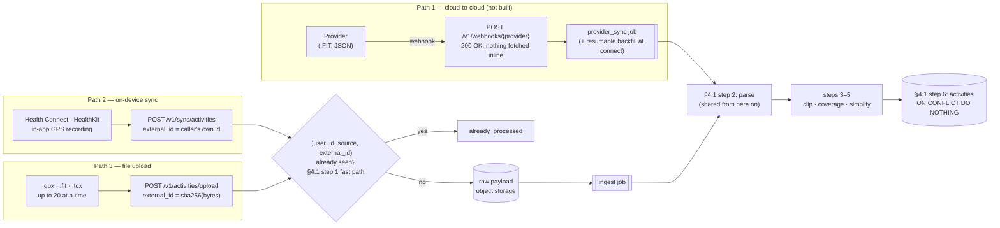
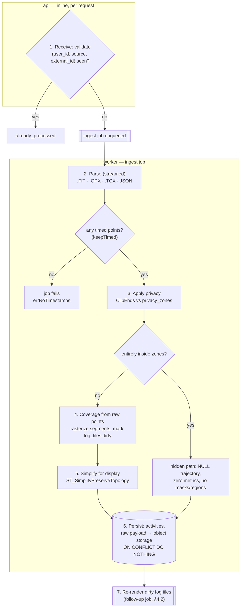

# HoldMyTrack: Implementation

> **Scope note.** Besides ingesting activities it didn't record, HoldMyTrack records casual GPS-only tracks in the Android app (FR-3.8), which submit through the same ingest pipeline as everything else. This document covers the database schema and each feature's own implementation detail (ingest, storage, analysis, fog rendering, tile serving) — see `docs/ARCHITECTURE.md` first for the system-level shape and the stack this all runs on.

---

## 3. Database Schema

The schema lives in `services/server/migrations/`, and the migrations are the authority on every table's columns; this section says what each table means and why its keys, constraints and indexes are the way they are. The base files are `0001_users_and_auth.sql` (§3.1, §3.9, §3.10, §3.16–§3.18), `0002_activities.sql` (§3.2, §3.3, §3.7), `0003_tiles.sql` (§3.6, §3.11), `0004_admin_boundaries.sql` (§3.12–§3.15), `0005_jobs.sql` (§3.8), `0006_demo_customer.sql` (the Demo Customer's row and Private locations, §4.10), `0007_map_version.sql` (`users.map_version`, §4.2.6) and `0008_stories.sql` (§3.19). **A schema change is a new numbered file, never an edit to an existing one**; each later file's header comment says which section it serves.

### 3.1 `users`

**No `tier` column.** There are no tiers; every account has every feature (`VISION.md` §6.2, ADR-0031). §4.10's no-signup demo is a real row in this same table, recognized by its fixed id (`httpapi.DemoCustomerUserID`) rather than a column. External sign-in identities live in §3.17's `user_identities`, not here (ADR-0015), so `password_hash` is NULL for an account that signs in only through one. `last_seen_at` is what counts an account as active (§4.32), written on its first authenticated request of each UTC day (§5.7). What NULL means: `country` unset (the first-run gate, §4.12), `locale` "automatic" (Accept-Language, §4.21). `map_version` is §4.2.6's tile cache key and only ever goes up, so a key once used never names different content. `is_admin` is written only by the `set-admin` subcommand (§4.20). `deleted_at` marks an account its owner deleted, for the few minutes until the worker's sweep removes the row and its cascade takes everything else (§4.28).

### 3.2 `connections` — Path 1 OAuth state

**`UNIQUE (provider, provider_user_id)` matters:** without it, two HoldMyTrack accounts could connect the same Wahoo account and each receive the same webhook, doubling both storage and fog. `last_record_at` is the watermark of the newest activity already ingested. Tokens are encrypted at rest with a key outside the database and never logged. Deauthorization deletion (§7) is a hard requirement of both activity providers, so disconnecting must delete the synced data, not merely this row.

### 3.3 `activities`

**Idempotency is `idx_activities_dedupe`**, a unique index on `(user_id, source, external_id) WHERE external_id IS NOT NULL`, with an upsert-on-conflict at persist time (§4.1); `external_id` is the provider's activity id or the HealthKit/Health Connect record UID. `activity_type` is whatever the source reports, verbatim, not a controlled vocabulary (§4.7.2).

**`trajectory` is display geometry only.** It is simplified for rendering, and coverage is never derived from it (§4.1). Its M dimension carries epoch seconds, which photos rely on (§3.22), and longitudes continue past ±180 across the antimeridian rather than jumping back (§4.1). **A NULL trajectory has one cause:** fewer than two points survived Private locations, an activity entirely inside them; every reader copes with it. The metric columns (distance, duration, moving time) are nullable for the same kind of reason: a file that carried no distance is not a zero-distance activity, so nothing coerces them to 0.

**Two references have no foreign key.** `split_group` is the id of the row first split, and the group outlives that row (§4.7.8); `origin_id` names the original a copied Story's activity descends from, which may be deleted while its copies stay (§3.25). The other columns are described in their migrations; the ones with a rule behind them are explained where it applies: `ingest_complete` (§4.1 step 6), `recorded_started_at`/`recorded_ended_at` (§4.6), `track_edit`/`edit_pending` (§4.7.7), `timezone` (§4.30), `raw_bytes` (§4.32).

**No bbox column.** `CREATE INDEX … USING GIST` on a `BOX2D` column fails, since PostGIS has no default GiST operator class for `box2d`, and one is redundant anyway: the GiST index on `trajectory` is a bounding-box index, so `trajectory && ST_TileEnvelope(...)` is already index-backed, and `ST_XMin` and friends read the box cached in the geometry's header. The same applies to adding one back.

### 3.6 `fog_tiles`

The cached "whole history, nothing hidden" composite per account and z14 tile, built by compositing §3.11's masks. `heatmap_object_key` (§4.2.2) shares the row rather than a separate table because both rasters go dirty from exactly the same events. `idx_fog_dirty` is partial on `dirty` so the render's scan touches only stale tiles. `bytes` and `heatmap_bytes` are the two objects' sizes, for §4.32.

**`dirty_gen` keeps a render from clearing a newer mark.** Every write that marks a tile dirty also increments it. A render reads `dirty_gen` before gathering what it draws, and clears `dirty` only if it is unchanged when the tile is stored (`fog.upsertTileRendered`): a change landing mid-render, such as an activity deleted while its mask was being composited in, leaves the tile dirty for the render that change enqueued rather than keeping the deleted track on the map.

### 3.7 `privacy_zones`

Shown to users as **Private locations** (FR-8.1); the table keeps its older name. `radius_m`'s 50–2000 range is enforced by the API (`private_locations.go`), not the schema. There is no fixed endpoint trim; see §7.

### 3.8 `jobs`

The Postgres queue that §4.1 and `ARCHITECTURE.md` §2 depend on; there is no broker. `jobs` keeps its finished history (`finished_at`, set on `done` or `failed`), so the indexes are what keep reads cheap: `idx_jobs_runnable`, partial on `state = 'pending'`, makes the `FOR UPDATE SKIP LOCKED` scan touch only runnable rows; `idx_jobs_user` serves every other read, which is always one account's (upload history, the Upload menu, a job's status); `idx_jobs_user_locked` serves the claim's fairness order. `last_error` is an English diagnostic; `error_code` is a failed ingest's reason, which the apps translate (§4.21). `raw` holds a pending ingest's raw payload so the request can answer at once, until the worker stores it (§4.1 step 1); it's a column of its own because the import queries read `payload` on every row.

**A running job is still `pending`; `locked_at` marks it taken** (`internal/worker/worker.go`). The claim takes a runnable row whose `locked_at` is unset or older than `claimLease` (30 minutes), stamps `locked_at` and increments `attempts` in one short transaction, then runs the job outside it. The row lock ends at that commit, so a fresh `locked_at` is what keeps a second worker off a running job, and a stale one means its worker died and the job is claimable again. Long jobs (renders, exports) refresh their claim (`keepClaimed`) so they aren't taken for abandoned.
- **Attempts count at claim**, so a job claimed `maxAttempts` (3) times without finishing is failed on its next claim rather than handed out first on every restart. A failed job is not retried.
- **A panic fails that job alone** (`runJobSafely`), including one inside `internal/parallel`'s `ForEach` goroutines, which `ForEach` returns as the call's error since no caller could recover it.
- **Shutdown releases a running job**: `locked_at` cleared and its attempt given back, so the next start picks it up at once. Outcomes are written on a context that outlives the shutdown.

**Three lanes** (`worker.Run`), each a list of kinds passed to `claimQuery` as a `text[]`. The render lane runs `render_fog` alone (`WORKER_RENDER_CONCURRENCY` loops, default 2), so a big import's minutes-long renders never hold up a new upload; the long lane runs `export` alone in one loop (§4.29); the main lane runs every other kind (`WORKER_CONCURRENCY`, default 4; `docs/DEPLOY.md` §4). The worker's pool is sized to match (`db.OpenSized`, 4 connections per main or render loop), since a job can render 16 tiles side by side (§4.2).

**The claim is fair across accounts, per lane** (`claimQuery`):
- Each claim considers one job per account, the account's next runnable job of that lane by `run_after` then `id`, and none from an account that already has one of that lane claimed. An account's jobs stay in order and one account can't hold every loop.
- Accounts go in order of when each was last served on that lane (its latest `locked_at`), never-served first, so a new user's single upload goes ahead of the thousandth file of someone else's import, and two queued accounts alternate.
- One account's jobs in different lanes run side by side (its render beside its own ingest). That's safe because a tile marked dirty mid-render stays dirty (`dirty_gen`, §3.6), `EnqueueRenderFog` queues a new render behind a claimed one, and a Pending activity stays out of composites (`edit_pending`, §4.7.7). Track edit and reprivacy render inline (`fog.RenderUser`), so one account's render passes take a Postgres advisory lock (`lockRenders`) and run one at a time: a stale pass storing its tile after a fresher one cleared the dirty flag would leave that tile stale.
- **Trap:** the outer query repeats the "pending, not freshly locked" checks on `jobs` itself, not only inside its CTEs. Under READ COMMITTED, `FOR UPDATE` re-checks only those against a row another loop claimed after the statement's snapshot, which is what keeps two loops off one job.
- A deleted account's jobs are never claimed (§4.28).

A claim stays at about 11 ms against a 5,000-job backlog (`PERFORMANCE.md`, 2026-10-09 dev). The fairness, ordering and lane rules are pinned by `worker_test.go`.

### 3.9 `sessions`

**The row's own primary key is the session cookie's value**, a `gen_random_uuid()`, with no separate hash-of-token layer. Judged sufficient for the current threat model (§4.9); revisit the day that changes. Expiry is enforced in SQL (`expires_at > NOW()`) at read time, not left to the browser dropping an expired cookie.

### 3.10 `password_resets`

§4.11's reset tokens: the same shape and reasoning as `sessions`, for a much shorter-lived token.

### 3.11 `activity_tile_masks`

One crisp, unblurred contribution mask per activity per z14 tile it touches, rendered once at ingest (§4.2.3). This is what lets Fog and Heatmap answer a date-range or hidden-activity filter by compositing a handful of small masks instead of re-parsing raw files per request. `zoom` is always 14, kept for symmetry with `fog_tiles`; `idx_activity_tile_masks_tile` answers "which activities touch this tile".

**A mask's PNG is in `activity_tile_mask_data`, not object storage** (`0030_activity_tile_mask_data.sql`). A table of its own keeps `activity_tile_masks` the narrow index a render scans, and lets the backups leave the bytes out (`scripts/backup.sh`, `docs/DEPLOY.md` §11), since `rerender-coverage --masks` redraws them from raw uploads. Its foreign key cascades from the mask row, so the bytes go with their activity (§4.7.5). Why not elsewhere:
- R2 left a render almost all round trip (`PERFORMANCE.md`, 2026-10-09 production), and a worker cache would still leave the cold render after an import or deploy paying it.
- Files on a volume: a 4 KB block for a few hundred bytes, no transaction shared with `activities`, one volume for `api`, `worker` and one-off containers, and a store outside the backups.

At 128 px a mask is about 600 bytes, under Postgres's ~2 KB inline threshold, so it stays out of TOAST; an activity's masks come to about 5 KB, some 5 GB at a million activities. Mask reads share Postgres's CPU and cache with the map's queries; SQLite on the worker is the fallback if they start competing.

### 3.12 `admin_countries`

Overture Maps' land-clipped countries and dependencies (OpenStreetMap's borders, ADR-0034), loaded by `seed-admin-boundaries` (§4.2.4) and never derived from user data. `code` is the ISO 3166-1 alpha-2 code, or Overture's own `X`-prefixed one for a disputed area (`XW` West Bank), unique across countries and dependencies alike.

**Each outline is kept twice.** `geom` is simplified, for the Country tiles that draw it on every request. The full detail is only in `admin_country_parts`, cut by `ST_Subdivide` into pieces of at most 256 vertices, and that is what matching tests (§4.2.4): a track crossing Norway's coast is an index lookup over a few small polygons rather than a test against the whole country.

### 3.13 `admin_regions`

Overture's land-clipped regions (its `region` subtype: a country's first level below the national one), kept the same two ways: `geom` simplified for the Region tiles, the full detail in `admin_region_parts`. **`overture_id` is the key, not `code`,** since not every region has an ISO 3166-2 code (Puerto Rico's municipalities have none); `code` holds one where it exists. A country or dependency with no region of its own (Aruba, Antarctica, a disputed area) gets one row that is the whole country, `overture_id` `country:<code>`, so the Region tier veils and reveals it too. `admin_boundaries_source` is one row naming the loaded extract, so re-running the seed with the same one skips the reload and the re-match of every activity.

### 3.14 `activity_country` / 3.15 `activity_region`

One row per (activity, country/region) its trajectory touches, computed once by `internal/geo.MatchActivity` from `ingest.Process` right after the activity is persisted, and redone for every activity whenever `seed-admin-boundaries` loads new outlines (§4.2.4). The Country/Region tile queries then do an indexed lookup instead of a geometry test per request.

**`ON DELETE CASCADE` on `activity_id` is the whole cleanup:** a deleted activity's rows go with it, and since the tiles read this table live rather than a cached aggregate, the country or region re-locks on the next request with nothing to invalidate.

**Matching reads `activities.trajectory`**, the simplified display geometry, not the raw points the masks use. Polygons are kilometers across, so `simplifyToleranceDeg`'s ~3 m tolerance can't plausibly change which one a segment intersects, and reading the persisted column saves a second geometry pass in Go. Any crossing, however brief, gets a row: a visit's size or duration doesn't matter, only whether it happened.

### 3.16 `email_verifications`

Email verification (FR-1.8, §4.9): the same shape and reasoning as `password_resets`, with a longer TTL (`auth.go`'s `emailVerificationTTL`), since confirming a signup is less time-sensitive than resetting a credential. **`email` is the address the link confirms**, not whatever the account's address is when it's clicked: an email change is pending on this row until then, and verifying applies it. `users.email_verified` is the flag; demo accounts never read it (`httpapi.requireVerified`).

### 3.17 `user_identities`

The external identities an account signs in with (§4.15's Google, §4.22's Facebook), a row per provider rather than a column (ADR-0015). **`subject` is the provider's stable account id** (Google's `sub`, Facebook's app-scoped user id), never the email, so either side can change its address without breaking the link. The primary key `(provider, subject)` maps one external account to one HoldMyTrack account; `UNIQUE (user_id, provider)` limits an account to one identity per provider and doubles as the index for "which identities does this account have" (`sendPasswordReset`, §4.11; §4.15's unverified-account case). Cascade-deleted with the user.

### 3.18 `auth_handoffs`

One-time sign-in codes for a native app. When the Android app runs §4.22's Facebook flow in a browser tab, the callback stores a row here instead of setting a cookie in that tab, and redirects to `holdmytrack://oauth?code=<id>`. `challenge` is the S256 hash of a verifier only the app holds; `POST /v1/auth/handoff` deletes the row in the same statement that reads it, so a code redeems once, and starts a session only if the verifier matches within `expires_at` (two minutes). Unredeemed rows are purged on the next insert (`createHandoff`), so there's no sweeper. Cascade-deleted with the user.

### 3.19 `stories` / `story_activities`

Stories (§4.23, FR-14). A Story is the account's own, cascade-deleted with the user; `name`'s 1–200 characters is a `CHECK` behind the handler's own validation. `updated_at` moves on a rename, a new description or a membership change. **`story_activities` cascades from both sides:** deleting an activity takes it out of every Story, a Story left empty stays, and deleting a Story deletes no activity. The primary key serves "a Story's activities"; `idx_story_activities_activity` serves the activity-delete cascade.

### 3.20 `spots`

Spots (§4.25, FR-15, ADR-0021): outdoor places from OpenStreetMap, the same for every account, filled by `import-spots` and **upserted on `(osm_type, osm_id)`**. The text columns are OSM's own tags, each NULL when the place has none (`address` built from `addr:*`, §4.25). `geom` is always a `MultiPolygon` in 4326, like `admin_countries.geom`: the OSM outline, or a 30 m circle around a place mapped as a single node. **A place a planet import no longer sees is retired (`retired_at`), never deleted**, so the captures that refer to it stay; `last_seen_import` is when the run that last had it started (`0017_spots_retired.sql`).

### 3.21 `spot_captures`

Spot captures (§4.25, FR-15.6): one row per account and place captured with the Android app's capture mode. The primary key keeps the first capture; a row goes with its account or its place.

### 3.22 `activity_photos`

Activity photos (§4.27, FR-16, ADR-0024). The images are in object storage at `image_key` and `image_key || '-thumb'`. **Several rows can name the same files:** an upload's key is `photos/{user_id}/{id}`, but a copied Story's photo (§4.23, ADR-0036) is a row of the recipient's that keeps the original's key, so a file is removed only with the last row naming it (`idx_activity_photos_image_key`). A row goes with its account or its activity.

**No position column.** `route_at` is a moment on the activity's `trajectory`, whose M dimension is epoch seconds (§3.3), and the position is worked out from the track on every read. A stored point would go stale when Edit track (§4.7.7) or a Private location change (§7) rebuilds the track, and would keep a position a Private location added later should hide. `taken_at` (EXIF, NULL when absent) is kept apart from `route_at` because moving a photo by hand changes where it sits, not when it was taken.

### 3.23 `exports`

Downloading your data (§4.29, FR-1.12): one row per request, its zip parts in object storage at `exports/{user_id}/{id}/{n}.zip`. A row goes with its account, or with the hourly sweep once `expires_at` passes; `job_id` is `ON DELETE SET NULL`. **No state column.** Until `ready_at` is set, where a request stands is its job's: pending is "preparing", failed (or gone) is "failed". Ready lasts until `expires_at`.

### 3.24 `tz_parts`

The world's timezone polygons from timezone-boundary-builder's `timezones-with-oceans` release (ADR-0035), loaded by `seed-timezones` (§4.30) and never derived from user data. Each is cut by `ST_Subdivide` into pieces of at most 256 vertices, as `admin_country_parts` is (§3.12), so a point's zone is an index lookup; at sea it's an `Etc/GMT±N` zone. `tz_boundaries_source` holds the loaded file's name, as `admin_boundaries_source` does, so a re-run with the same file is skipped. Until the seed has run every activity keeps its account's zone.

### 3.25 `story_sends` / `story_copies` / `received_origins`

Sending a copy of a Story (§4.23, FR-14.7, ADR-0036).
- `story_sends` is the recipient's inbox: a copy offered and not yet answered, **one row per Story and recipient however often it's sent** (`UNIQUE (story_id, recipient_id)`), gone with the Story or either account.
- `story_copies` records, per sent Story and recipient, the Story the copy made, so the next accepted send of the same Story adds to it; it goes with either Story.
- `activities.origin_id` is the original activity a copy descends from, however many copies removed, NULL on an original. **No foreign key**, since the original may be deleted while its copies stay.
- `received_origins` is every original an account has received a copy of, kept after the copy is deleted, so an account receives each original once, ever.

### 3.26 `admin_tile_geoms` / `admin_tiles_built`

The Country and Region tiles' outlines, each already transformed and clipped to one tile in `ST_AsMVTGeom`'s 4096-unit grid (§4.2.4, `0031_admin_tile_geoms.sql`), so serving a tile is a lookup rather than drawing every outline in it again. The same for every account (only which outlines a tile shows is the account's own), built on a tile's first request and emptied by `seed-admin-boundaries`. **`admin_tiles_built` marks a tile as built, including one with no outline in it**, so an empty tile isn't rebuilt on every request.

### 3.27 `bike_paths`

Bike paths, Shared paths and Mountain bike trails (§4.24, FR-4.13): OpenStreetMap's cycleways, bike-designated paths and singletrack, the same for every account, filled by `import-bike-paths` and **upserted on `osm_id`**, one row per OSM way. `kind` is `cycleway`, `shared` or `mtb`, as `bikepaths.Kind` sorts them. **The line is stored in Web Mercator (3857)**, the tiles' own projection, so a tile clips, simplifies and measures it with nothing to reproject per request. Nothing refers to a row, so a planet import deletes the ways it didn't see (by `last_seen_import`) rather than retiring them as Spots does (§3.20).

### 3.28 `daily_stats`

Service statistics (§4.32): one row per UTC day and stat, written once by the worker's daily snapshot and never updated. **No account id and no foreign key, by design**: every value is an aggregate across accounts. **A stat is a key, not a column** (`activities_by_source.upload`), so adding one needs no migration.

### 3.29 `r2_ops`

The daily R2 budget's count (§5.7, ADR-0044): one row per UTC day and billing class, which every process adds its own object store requests to. A day's spend is its two rows; nothing reads an older day but the daily statistics (§4.32), which keep a copy.

## 4. Core Technical Workflows

### 4.0 The three ingest paths

They differ only in how bytes arrive. All converge on §4.1 step 2.

**Path 1 — cloud-to-cloud. Not built or planned** (`VISION.md` §4.1, `docs/BRAINSTORM.md`); this is the design a connector would follow, and only its `connections` table (§3.2) exists. OAuth connect, then webhook-driven where the provider supports it, never polling on a schedule: a webhook returns `200 OK` in milliseconds and enqueues a `provider_sync` job, fetching nothing inline. Providers deliver a file (such as `.FIT`) or structured JSON, so the parse step is per-provider and everything after it is shared. Backfill of history at connect time is a separate, rate-limited, resumable job — the largest single fetch the system ever performs.

**Path 2 — on-device sync.** A native app reads the platform health store and uploads normalized points (§4.0.3).

* **iOS/HealthKit** exposes `HKWorkoutRoute`; full geometry is available to a native app.
* **Android/Health Connect** is constrained in three ways, each verified on a device rather than taken from documentation: `READ_EXERCISE_ROUTES` cannot be requested programmatically (the user grants it in Health Connect settings); **routes written by other apps cannot be read in the background** — `ExerciseRouteResult.ConsentRequired` comes back even with "Always allow" (on a Pixel 10a against a Fitbit-fed store, the same 46 sessions read as 23 routes in the foreground and none in the background, while the other 23, indoor workouts, read `NoData` both times, so "no route" and "not readable now" never have to be conflated); and **only the last 30 days are readable** unless `READ_HEALTH_DATA_HISTORY` is granted (a time window over data types already declared, not a further data type). Android sync is therefore **foreground-only**, and **Samsung Health exposes no route geometry at all**, so Galaxy Watch sync yields summary metrics and no map.

  Do not build a background route sync for Android; it cannot work. A sync that fetches everything except the map is worse than none: the routes it couldn't read would arrive as activities with nothing to draw.

**Path 3 — file upload.** `.GPX`, `.FIT` and `.TCX` files, up to 20 at a time; a `.zip` is refused (ADR-0039). Unconditional: it needs no API terms, licence or permission model.

**All three are idempotent on `(user_id, source, external_id)` — a hard invariant, not an optimization.** Retries are normal: mobile uploads get interrupted, providers redeliver webhooks, a file is uploaded twice. Whatever arrives twice must be processed at most once, under concurrent duplicates as well as sequential ones. The receive-time existence check (§4.1 step 1) is only a fast path; the guarantee is `idx_activities_dedupe` (§3.3) plus the upsert-on-conflict at persist time (§4.1 step 6), so two copies racing through two jobs still land as one row.

#### 4.0.1 Import UI: the header's Upload menu, the `/sync` page, and "View on map"

**Two halves, one per question**: the header's **Upload** menu is what's being imported right now, on every page, and `/sync` is what every finished import came to (SPEC FR-3.4, FR-3.9). Both read the `jobs` table directly (`kind = 'ingest'`) rather than a dedicated uploads table: every import, file or phone sync, already is an `ingest` job carrying its filename, external id, source, state, error and times, so a Health Connect sync and a file upload are one history, not two.

**Each file is its own `XMLHttpRequest`** (`static/upload.js`), for the upload-progress event `fetch` doesn't reliably have. The hourly upload limit is an in-memory limiter (`Server.uploadLimiter`, like the auth and Story-send limits), so a restart resets it.

**The map's refresh waits for the import to finish, not for the upload request.** The request resolving only means the job was *enqueued*; the worker hasn't inserted the row yet. So the Upload menu fires `hmt:imports-changed` both when an upload lands and when an import it follows finishes, and the map refreshes on each.

**Polling, deliberately not WebSockets or SSE**: the menu polls `GET /v1/uploads/active`. `GET /v1/activities/status/{external_id}` answers only from the caller's own jobs: an upload's `external_id` is its file's SHA-256, so anyone holding a file could otherwise learn whether someone had uploaded it.

**Imports in progress are grouped by batch** (`imports.go`). A request that enqueues several jobs at once stamps them with one random `ingest.Job.Batch`, and the active-imports query groups by it, so a phone sync of 34 activities stays one row across a reload. Unseen failures are those finished after `users.imports_seen_at`, which rendering `/sync` moves to now.

**A phone sync's title can't be its filename.** Its `source_detail` is `external_id + ".json"`, a UUID never meant to be read, so `importTitle` names such an import after its source instead, for the menu and `/sync` alike.

**The full history (`GET /v1/uploads`, the Android Sync screen) joins each finished job to its activity on `(user_id, source, external_id)`, with `source` read from the job's own payload** rather than assumed to be `upload`, so a phone sync's row finds its activity too.

**The Upload menu is one plain script both page shells load** (`layout.html`, `app/app.html`), so it works the same on the map and on every server-rendered page; files dropped on the map reach it as an `hmt:upload-files` event. The drop cover counts dragenter/dragleave, since each child the drag crosses fires its own.

**The `/sync` page** (`sync_page.go`) is server-rendered (§4.19) from finished jobs only, so it needs no polling and no script. Its **View on map** link carries the activity's local day (§4.30), computed in the query, so the map can narrow to it without a lookup.

**"View on map"** reuses the list's row focus (§4.7.3) rather than a second fly-to, after replacing the selected range with that one day: the activity is often outside the current range (an old upload, a Health Connect backfill). It must be the activity's own local day, which is how the server reads a bare `from`/`to` (§4.7); a UTC day would put an evening activity west of Greenwich a day late and the list would come back empty. Traps:
- The focus waits (`pendingFocusIdRef`) until the narrowed range's refetch has landed the id *and* the map has loaded: on arrival the list can come back before the map exists, and a fly then has nothing to move.
- The first list's usual fly to the most recent activity stands aside.
- Normal map mode is restored first if Fog or Heatmap was on, since neither has a per-track focus.

#### 4.0.3 `POST /v1/sync/activities` — Path 2's batched sync endpoint

`internal/httpapi/sync_activities.go`; the wire shape is `services/server/api/paths/sync.yaml`'s. A batch is not all-or-nothing: each activity gets its own result, so one bad entry doesn't abort the rest.

**Validation guards what the worker can't recover from cleanly.** `activity_type`, `name` and `description` are held to the same bounds `handleUpdateActivity` (§4.7.4) enforces, which matters for §4.0.4, the one client that can send an arbitrary type: an over-long type would otherwise fail as a column-width error deep in the worker instead of a clean rejection. `external_id` is restricted to a safe pattern because it goes into the raw payload's object key and two `VARCHAR(255)` columns: a `/` or `..` would nest or escape the key.

**No Path-2-specific branch in `ingest.Process`.** `parse.ParseJSON`, dispatched by extension like `.gpx`/`.tcx`/`.fit`, decodes the wire shape straight into the same `Activity`/`Point` structs, since the phone already read raw samples. Each activity is stored like a Path 3 file and read back through the same parse call, so §4.0's "converge on §4.1 step 2" holds literally.

**Idempotency uses the caller's own id, not a content hash.** A file upload hashes its bytes because it has no better identity. A synced activity carries its platform record's id (a Health Connect session UUID), which *is* its identity; hashing the JSON would mint a new activity on every retry that reserialized a field differently. The storage key is then scoped by source (`raw/{userID}/{source}/{externalID}{ext}`), since a caller's id is unique only within its source.

**Every bound is checked before the body is fully read** (§5.1). The 2-point minimum is a coarse pre-check only; the worker's deeper check can still fail an activity asynchronously, as for Path 3.

**`POST /v1/sync/known` makes the server the one record of what was sent.** The phone keeps no cursor (SPEC FR-3.6), so a reinstall or a second phone agrees with the server. An id counts as known when an `activities` row carries it in any state, or a `pending` job carries it in its payload, so a session sent a moment ago doesn't come back while the worker catches up. A failed job that made no row, or a deleted activity, isn't known, so the phone offers it again.

#### 4.0.4 In-app GPS recording (Android)

**No new endpoint and no schema change** ([ADR-0007](adr/0007-in-app-gps-recording-submits-directly.md)): a finished recording is posted to `POST /v1/sync/activities` (§4.0.3) under `source = "recorded"`. The client side is `apps/android/docs/IMPLEMENTATION.md` §7.

**`external_id` is a UUID the app mints at recording start**, since no platform store gives the activity an identity; a retried submit is recognized, not duplicated.

**The one ingest path that sets `name`/`description` at creation**, so the activity is titled from its first insert rather than through a later `PATCH` (§4.7.4). Its `activity_type` is free text, with no platform vocabulary to map from, which is why §4.0.3 bounds it.

### 4.1 Ingestion pipeline

The order of these steps matters.

1. **Receive** — via any of §4.0's paths. Validate, check `(user_id, source, external_id)` as a fast path (§4.0's invariant — an optimization, not the guarantee; see step 6), enqueue an `ingest` job, return. Nothing heavy happens inline: the raw payload travels inside the job, in `jobs.raw`, so a request makes one existence query and one multi-row insert and never writes to object storage, and a 100-activity sync batch answers as fast as a single file. The bytes get their own column rather than a place in `payload`, which the import history's queries read on every row. Before step 2 the worker writes them to object storage and clears the column (`ingest.PromoteRaw`); a retry after a failed write finds them still there.
2. **Parse** — stream `.FIT` binary or `.GPX`/`.TCX` XML, or map JSON. **Never load a whole file into memory**: a 100-mile ride at 1 Hz is 36,000+ points across a dozen channels. No parser checks ranges, so the pipeline filters what it gets:
   - `keepValid` drops points no place on Earth has (NaN or infinite, latitude beyond ±90, longitude beyond ±180). One such point broke the tracks tile query for every tile its bounding box covered, drew masks to the edge of the world, made the stats responses unencodable, and as an end point escaped Private-location clipping.
   - `keepTimed` drops untimed points and fails the job when none is left — otherwise a planned-route GPX was persisted as starting on 0001-01-01, outside every date range, so nothing could ever show it.
   - `ParseFIT` treats FIT's per-type "invalid" value (`0x7FFFFFFF` for a position before GPS lock) as absent, rather than placing a point near (180, 180).
   - `ParseGPX` reads only the recorded line, in time order, because step 3 clips from whichever points come first and last: waypoints are never points, route points are used only when there's no track, and track segments are ordered by first timestamp.
3. **Apply privacy** — clip the raw points against the account's `privacy_zones` (§7) **before anything is persisted or indexed**. Privacy applied at render time leaks through any bug in the render path; privacy applied at ingest cannot.
4. **Compute coverage from the raw points** — rasterize each *line segment*, not each point, into the coverage mask (§4.2), and mark touched `fog_tiles` dirty. A track touching more than `maxActivityTiles` z14 tiles fails the job, checked as it walks: a track zigzagging between far-apart points could otherwise reach millions of masks, held in memory and rendered one by one. A 10,000 km road trip is around 12,000.
5. **Simplify for display only** — `ST_SimplifyPreserveTopology`, stored in `activities.trajectory`.
6. **Persist** — summary metrics and the simplified `trajectory` to `activities`, the raw payload's key to `activities.raw_payload_key` and its size, which the job carries, to `raw_bytes` (§4.32). The raw payload is the only place full-resolution points survive this job, and what makes retroactive re-clipping possible (§7). The insert is `ON CONFLICT (user_id, source, external_id) DO NOTHING` against `idx_activities_dedupe` (§3.3) — this, not step 1, enforces §4.0's invariant under concurrent duplicates. **The row commits first and is completed after**: it's inserted with `ingest_complete = false`, the rest of the job (masks, region matching, dirty tiles) runs, and the flag goes `true` at the end. A conflict on a row still `false` is an earlier run of the same ingest cut off partway, not a repeat: the job carries on with that row, every step being safe to re-run, and step 1's fast path doesn't count such a row, so uploading the file again resumes it.
7. **Re-render dirty fog tiles** — a follow-up job (§4.2), one per account: none is added while the account already has a `render_fog` job waiting *unclaimed*, since that job reads the dirty flags only once claimed, after this ingest's marks have committed (a claimed one may have read them already, so it doesn't count). A bulk import queues one render behind its ingests, not one per activity.

**Step 3 is `ClipEnds` (`internal/ingest/clip.go`), and it's point-density-independent.** Zones are read when the job *runs*, not when it's enqueued, so a location saved while an upload waits still applies. Leading points inside any zone are replaced by one point on the zone's edge, found by bisecting the leaving segment against "inside any zone" (so overlapping circles need no special case), with time and elevation interpolated; trailing points likewise. Interpolating rather than snapping to the nearest real point matters for sparse recordings (a drive logged every 100+ m), which would otherwise leave far more than the radius unclipped. A track that only passes *through* a zone is left whole by design: it reveals neither end, which is what a zone protects, and splitting would force a multi-part trajectory on every consumer. A track entirely inside zones is persisted with a NULL `trajectory`, zero metrics, and no masks or region matches rather than dropped, which would lose it for good even after the hiding location is deleted.

**A track across the antimeridian is stored continuing past ±180.** Each longitude moves by whole turns to within 180° of the one before (`unwrapLons`), so 179.95 → −179.98 becomes 179.95 → 180.02. Otherwise the segment ran back across every longitude — drawn round the world, with masks in every one of z14's 16,384 columns. The stored trajectory keeps this form, so its plain bbox is the short one (§4.7) and both clients draw it the short way (§4.3.1). Everything that meets the world's own −180…180 must wrap it back:
- masks: `tilemath.SegmentTilesBuffered` wraps a column past the edge, and `fog.projectToTile` draws from the copy a world's width away when that's the one reaching the tile;
- tracks tiles (§4.3) and Country/Region matching (§4.2.4): `geo.WrappedSQL` (`ST_WrapX` twice, a part each side);
- written GPX (the data export, §4.29, and the demo's, §4.10): `parse.WrapLon` per point;
- track edits (§4.7.7): a moved point may come from either side, so `TrackEdit.Apply` unwraps again and `Validate` accepts longitudes up to ±540.

Haversine distances and a Private location's distance test already take the short way.

### 4.2 Fog of War — precomputed raster mask

**Storage.** Coverage is a **bitmap**, not a set of cells — a per-user, per-viewport `ST_Union()` of thousands of polygons on every tile request would be a hard scaling wall a bitmap avoids entirely. For each z14 tile the user has touched there is one single-channel PNG of `fog.TileSize` (128 px, ~19 m/px). Not 512 px: pixels were most of a render's work and of an account's stored bytes, and 512 px looks hardly different at the zooms people browse at. Not 64 px: from zoom 13 out it merges tracks a few hundred metres apart and draws a diagonal road as a staircase. Not 256 px: it would double the masks' bytes in Postgres (§3.11) for detail finer than a GPS track holds (`PERFORMANCE.md`, 2026-10-09). Masks and served tiles share the one size, so compositing stays a plain per-pixel max or sum with no resampling. Clients draw it as squares below z14 and smooth it from there: smoothing blurs the thin lines most coverage is at a distance, and squares close up grow into blocks as wide as a street.

**Rendering a tile.** Every trajectory is clipped to the tile and stroked at the reveal radius into the alpha channel, anti-aliased (`gg`); the anti-aliased edge is the soft edge, with no blur afterwards. Points within half a pixel of the last one drawn are skipped (`minStepPx`): GPS jitter while standing still makes segments a hundredth of a pixel long, and `gg`'s stroker then draws nothing for the whole track. The stroke needs the *raw* points, not `activities.trajectory`'s simplified display geometry (`ARCHITECTURE.md` §1.1), which is why masks are rendered per activity at ingest (§4.2.3) rather than per request.

**The radius is ~48 m either side**, wider than the references' road-hugging ~20–40 m (§4.2.1). The narrower reveal left a daily-walked neighbourhood still fogged between the streets walked, since blocks are often 100–150 m deep; much wider merges parallel streets into one blob. Changing the radius changes every stored mask, so it takes `rerender-coverage --masks` (below).

**Pyramid.** z13 down to z0 come from successive 2×2 downsampling of z14, each parent pixel the **brightest** of its four children, not their mean. A mean dimmed a track once it was thinner than a pixel, so a small place far from home read as a faint hair at the zoom that fits both; with the max, anywhere visited stays fully clear (Heatmap keeps its hottest pixel) at every level.

**Re-rendering after a drawing change.** A change to how tiles are drawn doesn't reach tiles already rendered or browsers that cached them, so such a deploy runs `rerender-coverage` once (`docs/DEPLOY.md`). It marks tiles dirty and queues one `render_fog` job per account rather than rendering in the command, so it never races the worker over the same tiles. A change to the stroke, to which tiles a track reaches, or to `TileSize` also needs `--masks`, which redraws every activity's masks from the points it's shown with (`DisplayedPoints`); masks are taken in tile order so activities redrawn together never deadlock on tiles they share. Until it has run, a tile or mask of the old size is refused when read, rather than read past its end or drawn squashed into a corner.

**Invalidation.** Ingest marks touched tiles `dirty`; storing a tile marks its parent dirty in the same transaction, and `RenderUser` renders every dirty tile at z14, then each level up to z0. A tile's dirty flag clears only if its `dirty_gen` is unchanged since the render read it (§3.6). The next level up starts only once a level's tiles are all stored, since it's built from them, and a pass cut off partway leaves the parents of what it rendered dirty, so the next one finishes the pyramid. **A render is mostly object-storage round trips, so it is fast by running them side by side, not by CPU** (`PERFORMANCE.md`, 2026-10-08 to 2026-10-10): tiles render in parallel within a level, a tile's Fog and Heatmap PUTs go together, a pyramid tile fetches its children together, and the object-store client keeps enough idle connections that none pays a fresh TLS handshake to R2. A new activity dirties a handful of z14 tiles, so incremental cost is near-constant regardless of history size.

**Touched-tile membership is buffered by the stroke's drawn width, not just where a bare coordinate floors to.** Ingest's touched tiles and the mask render (§4.2.3) both walk `tilemath.SegmentTilesBuffered`: a point or segment within the stroke radius of a tile boundary adds the neighbouring tile too. Without it, a route running along a z14 boundary had part of its stroke inside a tile no mask was rendered for, and `gg` silently clipped that overflow at the canvas edge. The walk goes a tile column at a time over exact pixel coordinates; a Bresenham line between tile indices skipped tiles a long slanted segment clips near a corner.

**Serving.** MapLibre cannot invert or colourise a raster at render time, so the tile route emits a **ready-to-draw PNG**: the veil's colour, `alpha = veil opacity × (255 - coverage)`. It does that without decoding the mask (`internal/fog/tint.go`): an 8-bit grayscale PNG and an 8-bit palette PNG store pixels the same way, so the route rewrites the stored bytes as a palette PNG — colour type changed, a `PLTE` and its `tRNS` alphas inserted, image data copied untouched. Decoding, colouring and encoding per request had saturated the API's CPUs; the rewrite costs under a microsecond a tile (`PERFORMANCE.md`, 2026-10-08). The veil is chosen by `?theme=`, in the URL so a cache keeps one variant per theme while storage holds only the single-channel master. The user comes from the session, never a parameter (§7).

**Two veils, each the opposite of its basemap** (`fog.LightVeil`, `fog.DarkVeil`): a veil close in lightness to its basemap barely reads as covered. The web map (`fog.ts`) and the Android app (`MapOverlays.kt`) pick the veil and draw the Country/Region fills (§4.2.4) in the same colour/opacity pairs, so the two must change together.

**Client compositing**, identical on MapLibre GL JS and MapLibre Native: the self-hosted Protomaps basemap in a **rich, saturated flavor** (a washed-out base leaves the least to reveal), the coverage raster **beneath the basemap's first symbol layer** so labels stay on top, and tracks over it in Normal mode only. Fog dims every symbol layer's opacity and resets it to unset on leaving, since the Protomaps style never sets it.

> **Why the inversion is server-side.** A full-viewport veil whose alpha is driven by the *inverse* of the coverage raster can't be expressed in MapLibre: there is no `raster-color` (Mapbox GL has it; MapLibre issue #4479 is open). Baking the inversion server-side keeps every client on a stock `raster` layer and avoids writing a shader twice against two bindings.

#### 4.2.1 Reference implementations — measured, and where we deviate

Three Fog of World screenshots (`reference/fog-of-war-example*.{webp,jpg}`) were sampled to pin these numbers down rather than guess them.

| Property | Measured | Decision |
| :--- | :--- | :--- |
| Fog colour | White. Fogged ≈ RGB (193, 192, 188); revealed ≈ (63, 66, 58) | Not white: a veil opposite to the basemap in lightness (§4.2) |
| Fog opacity | ~0.66, consistent to ±0.02 across all three | `0.82` for the dark veil, `0.6` for the cream one |
| Desaturation | Saturation falls 0.15 → 0.03 under fog | **Not a separate effect.** A 66% white blend produces exactly this arithmetically |
| Edge softness | 1–4 px transition at display resolution | Adopt — the anti-aliased stroke edge at 128 px, drawn larger by the client |
| Reveal radius | Hugs the road centreline, ~2–3 lane widths | Deviate — ~48 m either side (§4.2) |
| Label handling | Labels drawn **over** the fog | Adopt — fog below the first symbol layer |

**Where we deliberately deviate: vector by default.** All three references composite fog over *aerial* imagery, and that is where their impact comes from. Protomaps is vector-only, and metered imagery is a per-request bill a free product can't leave open-ended, so **the fog is designed over the vector basemap**, the fogged state reading as "the same map, drained of colour" rather than "the map, hidden". Satellite imagery is only the optional base map of §4.26.

#### 4.2.2 Heatmap mode

Heatmap reuses fog's raster pipeline rather than building a second one: both answer "how much of this tile's ground has this user's history touched," two different ways.

**Fog answers a binary question per pixel; heatmap a graded one, which is why heatmap can't recolour the fog mask.** Fog's composite is a max, so a well-travelled street and a once-ridden one look identical, which the reveal mechanic depends on. Heatmap needs additive accumulation. Each track renders to its own crisp mask (the same stroke as fog, so the two agree on how wide a route is), the masks sum into a float accumulator, and the sum is normalized against **`users.heatmap_cap`** and compressed with **sqrt** (not log, so a single pass already reads as warm) down to the 8-bit PNG stored.

**A second object key on the same row, not a second pipeline.** `fog_tiles.heatmap_object_key` (§3.6) shares the row, the `dirty` flag and the re-render job, since every event that dirties one raster dirties the other; a `heatmap_tiles` table would duplicate the whole dirty-tracking scheme. Unlike Fog's, it is built from a rolling window (§4.2.3) that has to move on a schedule, not just on ingest.

**Serving: a baked colour ramp, for the same reason fog's inversion is baked** (§4.2): it is the palette of the same byte rewrite. **The ramp has a visibility floor** because, with the cap at the account's busiest tile, a place crossed once stores a tiny intensity, which a ramp starting from transparent drew almost invisibly. Red through yellow stands off the cream land and yellow roads, which a rust-to-yellow ramp sat too close to.

**Privacy is unaffected.** Both rasters are computed from the same privacy-clipped points (§4.1 step 3 runs before step 4), and the `reprivacy` job (§7) re-renders both together.

**`heatmap_cap` is the account's own single most-touched z14 tile** (`fog.RecomputeHeatmapCap`), counted in distinct in-window, non-Pending activities. A percentile was rejected against the Demo Customer account: of its 1,140 touched z14 tiles, 1,100 are touched once and the two hot ones are under 0.2% of them, so any percentile up to the 99.7th lands in the once-touched mass. The count is per activity, not per point, so one activity idling in place can't inflate it. Two guards: with few touched tiles the cap is left alone, so two early activities sharing a tile can't set it to 2; and since the cap is baked into the stored PNGs, changing it means re-rendering every tile, so a small change is skipped.

**The cap sweep and the window's aging (§4.2.3) run independently**, daily and at worker start: whichever runs first, the other self-corrects on its next tick from the window state it finds, so there's no ordering between them. A changed cap marks every one of the account's tiles dirty; Fog's tiles get rebuilt alongside, the cost of the shared dirty flag.

#### 4.2.3 Per-activity masks: the ingest-time building block behind both rasters

**Both rasters are composited from a crisp mask per activity per z14 tile it touches** (`activity_tile_masks`, §3.11), rendered once at ingest from the points already in memory and upserted in one transaction. Ingest cost is then proportional to that activity's own tiles, however many other activities share them. A mask that can't be read (no bytes, as after a restore until `rerender-coverage --masks`) is left out of the tile rather than failing it, and the render logs how many it skipped. **So a delete is cheap and correct:** a dirty tile is always fully recomposited from whichever mask rows still reference non-Pending activities, never incrementally subtracted, so a delete is one fewer row feeding the composite — not a re-parse of every other activity sharing the tile, whose payloads may already have expired.

**Both tile routes are a plain lookup** of the stored tile, with no per-request compositing; they differ only in what the render fed each: Fog every non-Pending activity's mask, Heatmap only those `in_heatmap_window` as of that render. A map cancels in-flight tile requests as it's panned past them, so a request whose client has gone (`clientGone`) answers `499` without logging, keeping routine panning out of the error logs and the `5xx` metrics; every per-user tile handler does the same.

**Heatmap is a lookup because compositing the window live is too slow.** On the Demo Customer's home tile a per-request composite took ~12.6 s, ~56.5 s at low zoom, and no short-lived cache absorbs it: a window ending at `time.Now()` is a new key every request. The cost is that the window moves daily rather than continuously.

**Window membership is a stored fact, `activities.in_heatmap_window`, not computed against "now" at render time.** An activity entering the window is an upload, handled by ingest's ordinary dirty-marking; ingest sets the flag from `started_at`, so an import of years-old history starts outside it. One *leaving* is pure passage of time, which no event notices, so the worker's `ageOutHeatmapWindow` runs daily and once at worker start — a worker restarted on every deploy might never reach a ticker's first tick. It re-renders only the tiles of activities that just crossed the boundary, never a whole account, so the daily load is small and spread out.

**A Private location change re-renders masks from freshly clipped points.** Nothing reading the stored masks notices a location changed underneath them, so the `reprivacy` job (§7) runs each affected activity through the same reprocess Edit track uses (§4.7.7), which re-renders its masks and dirties the old and new tiles.

**Refreshing an open page.** Coverage tile URLs change only with the account's tile version (§4.2.6), so MapLibre never re-asks on its own; the client re-points every coverage source at the new version when coverage changed (`coverageVersion.ts`). The hard part is knowing *when*, since an upload or delete only enqueues the re-render. `GET /v1/coverage/status` answers `rendering: true` while the account has any job still `pending` whose outcome changes coverage (a claimed job stays `pending` until done). `ingest` counts because the client's watch starts as soon as an upload is accepted, before the render it will enqueue exists. Rules of the watch (`useCoverageRefresh.ts`):
- It polls until a read says done, slowing down after a few minutes but never giving up: a large import can keep the worker busy far longer.
- Every call restarts the watch rather than joining one in flight, so a second change landing just after a read came back "done" can't be missed.
- The client refetches whenever `version` moves, not only at the end: a reprocess renders twice inside its job (§4.2.5), and the first render is only ever shown if picked up mid-job.
- It also runs once when the map opens, so a page opened while jobs are still draining gets its final refetch too.

#### 4.2.4 Country/Region zoom tiers

Below a threshold zoom, Fog and Heatmap's per-pixel raster is replaced by a whole-polygon reveal (SPEC FR-4.2 behavior 4, FR-4.3 behavior 5, FR-4.15). **The tiers are switched purely by MapLibre `minzoom`/`maxzoom` on the layers, never layered together and never reconciled**: at country/region zoom there's no fine-grained detail visible to contradict, so the coarse reveal already is the whole truth at that scale. The web's `zoomTiers.ts` and Android's `MapOverlays.kt` hold the same constants and must change together; so must the level notice's `zoomTier`, which names the same bands.

**Boundary data** is Overture Maps' land-clipped countries, dependencies and regions — OpenStreetMap's borders, ADR-0034 for the choice. `scripts/boundaries-extract.sh` cuts them out of one pinned Overture release with DuckDB, off the server, leaving out the code-less second drawing of a disputed region; the file goes into the app bucket by hand (`docs/DEPLOY.md` §6); `seed-admin-boundaries` replaces every outline and membership row in one transaction, re-matches every activity and bumps every account's tile version (§4.2.6). It refuses a file with too few countries or regions, since a cut-short file would otherwise erase the rest of the world. Each outline is stored simplified for drawing and in full detail for matching (§3.12); the simplification is under a pixel where each tier draws, and a country it would erase whole, like Vatican City, keeps its full outline.

**Matching runs once per activity at ingest** (`geo.MatchActivity`), against the full-detail pieces, the trajectory wrapped into −180…180 first (§4.1) — never against the simplified outlines the tiles draw. On the 2026-09-23.0 extract the seed takes about 6 minutes, almost all in `ST_MakeValid` and `ST_Subdivide`, and re-matches 1,682 activities in under a second.

**Serving: vector tiles (MVT), not a precomputed raster.** The Fog/Heatmap raster is precomputed because its cost grows with an account's history; these tiers' doesn't, since the geometry test runs once per activity at ingest and a request only joins the account's membership rows against a fixed set of outlines, so there is no dirty-tile or pyramid machinery to keep current. A vector fill also keeps a border crisp at every zoom and takes its colour from MapLibre's own fill paint.

**Fog's query returns the locked set, Heatmap's the unlocked set.** Fog's is every country/region with no non-Pending membership row for the user, filled in the raster tier's own veil colour, so nothing shifts hue crossing the zoom boundary; unlocked polygons are absent, the same "no veil = revealed" semantic as the raster. Heatmap's is those with a matching row *and* `in_heatmap_window`, filled flat rather than graded — a whole-country intensity gradient would be a second scoring dimension nobody asked for.

**The outlines are clipped once per tile, for every account** (`admin_tile_geoms`, §3.26). Transforming and clipping the outlines is nearly all of a tile's cost and the same for every account (`PERFORMANCE.md`, 2026-10-09), so the first request for a tile stores its clipped outlines and later ones read them back. The built mark goes in first, in the same transaction, `ON CONFLICT DO NOTHING`, so a second request building the same tile waits for the first. Only tiles up to each tier's maxzoom are kept, so requests can't fill the table with tiles nothing draws. **Which outlines a tile shows is the account's own**, chosen per request from the account's own membership rows, so its cost is that account's history alone. `seed-admin-boundaries` empties the stored tiles last thing in its transaction; a tile built meanwhile is drawn from the new outlines, since the build reads them in a statement after its mark.

#### 4.2.5 Pending activities drop out of every map read (FR-5.15)

An activity is Pending (`activities.edit_pending`) while an Edit track (§4.7.7) or Private location (§7) reprocess is queued or running. Its geometry and masks are the pre-reprocess ones, or half-rewritten, so **every map read leaves it out with `AND NOT edit_pending`**: the tracks tile (§4.3), the Fog/Heatmap composite at every level, the heatmap cap, and the Country/Region queries (§4.2.4). A new map read must carry the same filter.

**Two renders per reprocess, in the job.** Enqueueing sets the flag and, in the same transaction, marks every tile the activities' current masks cover dirty. The job then renders (dropping them from Fog/Heatmap), reprocesses, clears the flag (not while a later `reprivacy` job still covers the activity), and renders again (bringing them back with their new masks). A failed track edit clears the flag and renders too, so the activity returns with its old masks. Both renders run inside the job rather than as `render_fog` jobs, so each is done before the next step; one account's render passes take an advisory lock (§3.8), so a `render_fog` job running beside it in the render lane can't race it over the same dirty flags.

**Pending clears a moment before the rasters are current**, so the badge clearing is not the client's signal to refetch Fog/Heatmap: `/v1/coverage/status` is (§4.2.3), since the reprocess job stays `pending` until its second render has finished.

**The web client hides a Pending track itself** the moment the list shows it, rather than waiting for a tracks refetch, so every fly-to fit skips it too. It is kept apart from the user's own hidden set, so an activity hidden before it went Pending stays hidden afterwards.

#### 4.2.6 Caching: one tile version per account

Every per-user tile route can be kept by the browser or the app for good, keyed on the account's **tile version** (SPEC FR-4.11). None goes through a shared cache: the app's origin isn't behind Cloudflare (`docs/ARCHITECTURE.md` §1.2), and a tile points at where its owner lives.

**The version is a counter, `users.map_version`, bumped by `fog.BumpMapVersion` whenever what any of those tiles would return may have changed.** Not a timestamp, because it must never repeat: the latest `rendered_at` goes backwards when an account's tiles are deleted (the Demo Customer's reset does), and a key once used for one tile's content must never return for different content. **Every change to tile content must be followed by a bump:**
- The worker bumps at the end of every render pass that stored anything, a failed one included, since its tiles are already overwritten. That covers ingest, delete, Edit track, Private locations, heatmap aging and the heatmap cap.
- What changes at request time without a render right behind it bumps itself: enqueueing a reprocess (Pending drops tracks at once), deleting or editing an activity (`activity_type` is in the tracks tile), a timezone change (a tracks URL's `from`/`to` then stand for different instants), a change to a Story's activities (§4.23), and the Demo Customer's reset.
- The Spots import (§4.25) and `seed-admin-boundaries` (§4.2.4) bump every account at once.

Every change happens before its bump, so a tile fetched between the two is just newer than its label, never older.

**On the wire**, the version is prefixed with the start of the account's id, so two accounts signed in one after the other on one device never share a key. The server doesn't check that `cv` is current: a stale one only caches what it asked for under that stale key. The web's app shell renders the version into the page, so the first tiles are cacheable with no status round trip. The tracks layer keeps its own per-page `v` beside it, so a refresh after a change the page hasn't read a new version for yet (a type edit) doesn't reuse the cached tile; `v` carries the page's load time ahead of its counter, or a second tab that had cached `v=2` before the change would serve that tile to the first tab's own `v=2` after it. Android attaches the overlays at the last version it read on a cold start, so what MapLibre Native already holds draws at once, then refetches only if the status says it moved.

What this doesn't remove is the first request for each tile per device and version, and one upload invalidates every tile the account has. A per-tile rather than per-account key is the next step if that shows up in measurements.

### 4.3 Track vector tiles

**Tracks — unlike fog — remain a live query**, because they must respond to filters that cannot be precomputed: `ST_AsMVT` over the account's non-Pending activities whose `trajectory` meets the tile's envelope, with zoom-dependent simplification inside `ST_AsMVTGeom` (`handleTracksTile`). **A track stored continuing past ±180 (§4.1) is drawn through `geo.WrappedSQL`**, a part each side of the antimeridian, since PROJ wraps a longitude past 180 when projecting to 3857 and would otherwise join the parts round the world again; a tile on the far side matches it through the tile's envelope moved 360° either way, each an index lookup.

**The filter is shared with the Activities list and must stay in step with it.** The tile applies the same parser as §4.7's list. An absent filter means "no restriction", so the tracks layer always sends `from`/`to` explicitly, or it would draw more than the list beside it. Type and Distance are applied client-side, as a layer filter.

**Every refresh gets a new tile URL** (a per-page `v` the handler ignores, §4.2.6). Beyond the source's maxzoom, MapLibre slices overzoomed tiles out of their z14 parent and caches each slice keyed on tile id and request URL; with an unchanged URL it fetched the new z14 tile and kept serving the old slices, so an edited track kept its pre-edit shape close in until a zoom change.

#### 4.3.1 Pace-colored segments

**A separate GeoJSON layer over the MVT tracks layer** (`trackBands.ts`), drawn for the single focused activity, since a vector-tile source can't carry the per-vertex colour this needs. `GET /v1/activities/track-metrics/{id}` computes speeds at read time from `trajectory`'s own simplified vertices and their M timestamps, and carries no heart rate (ADR-0017). The client draws one merged line per run of same-band vertex pairs, each with its resolved colour, so no `line-gradient` is needed. The Android app draws the same bands by the same rule (`map/TrackBands.kt`), so the two change together.

**One hit-test decides both select and click-away** (`tracks.ts`): a layer-scoped select listener plus a separate click-away listener would each run their own query and could disagree. The query is a small box around the click, not the bare pixel: with thin lines, a click a few pixels off a second track while a first is focused would otherwise miss it and clear the first instead.

**Known limitation: the bands are only as fine as the simplified line.** Douglas-Peucker keeps vertices by geometric deviation, not speed change, so a straight or short stretch can keep very few vertices however much its speed varied. The fix would be re-parsing the raw payload on request (as Edit track does, §4.7.7) and drawing the bands along the full-resolution line, for the focused activity only; not done, since only geometrically simple tracks show it.

#### 4.3.3 Interactive frame-and-capture map export

`VISION.md` §4.2's "Export" pillar, first slice; what the frame does is FR-4.10, and §5.5 says why it is client-side rather than a server render. `ExportFrame.tsx` is the frame, `exportMap.ts` the capture.

**The frame is anchored to the map, not the screen**: a map position for its center plus a CSS-pixel size that never changes with zoom. It re-projects the center on every `move` and `resize` and writes it onto its root element as CSS variables rather than through React state, so panning never re-renders the component. Capture doesn't depend on the frame being visible. The frame and its interior are `pointer-events: none`, so the map stays usable inside it; only the border, the corners and the toolbar take input.

**Capture renders a second, hidden map at the frame's size, not a crop of the live canvas:**
1. An off-screen container (positioned far off screen — not `display: none`, which leaves no layout box for WebGL to size a canvas against) *is* the frame: its CSS size, at the live map's zoom, bearing and pitch, so labels and line widths keep their on-screen proportions. Resolution comes from MapLibre's `pixelRatio`, output width ÷ frame width. Only this instance preserves its drawing buffer, keeping that cost off the live map.
2. On load it replays the same overlay calls the live map makes (`reattachOverlays`: fog, heatmap, tracks, mode, hidden tracks), so every mode and filter exports with no rendering logic of its own; **a change to how the live map attaches overlays has to reach both.** It then waits for `idle` plus a short settle (`docs/DEVELOPMENT.md`'s `isStyleLoaded()` gotcha). A hidden browser tab doesn't render, so a capture started in a background tab completes only once it is visible again.
3. It redraws onto a 2D canvas of the exact output size and bakes attribution (§5.6) and the watermark into that *final* canvas, since the scale to exact output size happens there and a mark drawn earlier could land a pixel off.
4. The PNG downloads through a blob URL: no server round trip and nothing to rate-limit.

**The watermark is always drawn, with no toggle, on purpose:** free brand exposure on images that get shared fits `VISION.md` §6's no-ad-budget model. Traps:
- Canvas `fillText` doesn't wait for a web font, so `document.fonts.load` is awaited first.
- Neither a font that won't load nor a logo that won't decode fails the export: the text falls back to `serif`, and the wordmark is drawn alone.
- The logo is a same-origin asset, so drawing it doesn't taint the canvas `toBlob()` reads.

### 4.5 Per-activity pace, and distance trends

Deliberately narrow: pace as route context on a single activity (§4.3.1's bands), and a plain distance/time rollup per period. Anything further is the fitness-advisor territory `VISION.md` §1.1 rules out.

**Moving time comes from ingest, in the one pass that sums distance** (`computeMetrics`), with no second scan.

**Trends** (SPEC FR-9.1) is drawn server-side on the Profile page (§4.8) by the same query `GET /v1/activities/trends` runs, so it needed no schema change. The query left-joins the per-bucket sums onto a `generate_series` of every bucket in the window, so empty periods come back as zeroes and the chart spans the whole window with its gaps visible, rather than stretching the active periods across the width.

### 4.6 Overlapping activities

The same ride can reach an account by more than one path — synced from a watch through Health Connect, then uploaded as the watch's own `.fit` — with a different `external_id` each time, so §3.3's unique index doesn't catch it. Nothing on ingest does either (ADR-0039): the user picks what comes in, and a hint says when a candidate would be a second copy (SPEC FR-3.7). Built in `internal/ingest/overlap.go`.

**The rule is time overlap, at least 80% of the *longer* one's duration.** One person isn't on two rides at once, so the stretch of time is the one thing every copy agrees on. Type and distance are deliberately not compared, since sources disagree on both for the same ride. The fraction absorbs start-time drift (a late GPS lock, trimmed auto-pause); measuring against the longer duration keeps back-to-back recordings with clock skew, or a short walk inside a long hike, apart.

**An activity is compared as recorded, not as shown.** `started_at` and `duration_seconds` describe the track after Private locations clip its ends, while another source's copy still covers those minutes, so a short walk from home could lose more than the 20% the rule allows. So each activity stores `recorded_started_at`/`recorded_ended_at`: the parsed upload's first and last point, narrowed to its split range (§4.7.8) but before clipping and track edits, refreshed on every reprocess. A row without them falls back to `started_at` and `duration_seconds`.

**The lookup stays a range scan** on `idx_activities_user_recorded_start` because the rule bounds the start difference: an overlap of at least f of the longer duration needs |Δstart| ≤ (1−f)/f · D for a span of duration D (a quarter of D at f = 0.8), and the exact test is then applied in SQL. **The Android Sync tab applies the same rule to its own rows** (`sync/Similar.kt`, tested against the same cases; `apps/android/docs/IMPLEMENTATION.md` §5.1) — change one, change both.

### 4.7 Activity listing and filtering

The Activities panel, the date slider and the header's badge read the list, the range's totals and the per-day histogram (`internal/httpapi/activities.go`); what each shows is FR-5 and FR-6.

**One filter parser for the list, the totals and the map** (`parseActivityFilter`), so what the panel lists, what its totals add up and what the map draws (§4.3) can't disagree. An absent filter means no restriction.

**No pagination.** The Type and Distance filters are computed client-side over the whole range, and the map draws every matching track regardless, so a page would save nothing. If it's ever needed, the cursor has to be `(started_at, id)`, not `started_at` alone: the same ride synced from two sources is two rows with one start time, and a timestamp-only cursor drops or repeats one at a page boundary.

**A row's `bbox` is computed, not stored, and goes the short way round.** PostGIS keeps a geometry's bounding box in its header, so reading it costs nothing like a scan (§3.3). A box wider than 180° is read again from `ST_ShiftLongitude(trajectory)` and the narrower one kept, so a track across the antimeridian is 179.9…180.1 rather than the whole globe — the form MapLibre and Android both take. The clients union a group's boxes the same way, so New Zealand and Hawaii frame the Pacific between them.

**Null means unknown; zero means zero.** A row's metrics stay null when the file carried none, while the summary's sums `COALESCE` to 0, since "these add up to nothing" is a real zero. `private` is `trajectory IS NULL` (§3.3), whose stored metrics are zeros from an empty point list, so nothing may read those as real.

**A name is only ever typed by a person.** No parser reads one from a file; it comes from the Edit window (§4.7.4) or a recording saved on the phone (§4.0.4). Sorting never reads it.

**Every day is the activity's own local day.** Every bucketing query — the histogram, the activity graph, streaks, trends — groups by `started_at AT TIME ZONE timezone` (§4.30), and every date bound is a local date compared against it. The account's own zone decides only what "today" is.

**The histogram pages by activity-day.** The date slider has one slot per day *with* activity, packed, so a page has to be "the N most recent activity-days before D", which a calendar window can't express without guessing a width and widening it over several round trips. A client starts at the newest end and only walks back, so there's no `after=`.

**The web keeps the selected range in one place** (`MapView`'s `selectedRange`). Three traps, each found live:
- Until the user picks a range, the default re-derives whenever new data lands — keyed on the days hook's reload generation, not on its visible days, which paging changes too. Guarding it on "a range is set" instead froze a new account's empty range through its first upload. It holds still while the Edit window is open, or a long upload slides the range past the activity being edited and the window closes itself.
- The camera flies once per range the user picks — keyed on the query the list was fetched for — not on every reload of the list, which happens on each Pending poll, upload and Private location change.
- Changing the range clears the selection, the focused row, hidden tracks and the Type/Distance filters, which could otherwise describe activities the new range doesn't list; a stale distance band could exclude everything.

**The slider is hand-rolled pointer handling, not two stacked range inputs**, which hand every drag to whichever input is on top, so with the knobs close together the wrong one moved. A drag renders a local draft and commits on release, so the list refetches once per gesture.

#### 4.7.1 TYPE and DISTANCE filters

Both are client-side (`activityFacets.ts`) over the list the panel already holds, so they need no endpoint and Reset filters no refetch. **The Distance slider's inputs use `step="any"`**: distances carry centimeters, and the default step of 1, counted from the minimum, can't land on the maximum, so a knob dragged back to the end kept the longest activity filtered out.

#### 4.7.2 `activity_type` is not a controlled vocabulary

`activity_type` is whatever the source reports, and "Gravel" next to "Ride" is real data, not an error. Nothing normalizes it: the Type filter and picker list the values an account's own activities contain, and display only humanizes them. **FIT's numeric enums are resolved by tables generated from python-fitparse's `profile.py`** (itself generated from Garmin's FIT SDK) rather than typed by hand (`internal/parse/fit_sport.go`), since a wrong mapping among ~110 values can't be caught by reading it.

#### 4.7.3 Selection and focus

**The checkbox group and the focused row are two separate pieces of state** (FR-5.12, FR-5.13): emphasizing a group or flying on every tick reads as N selections at once, so no checkbox action moves the camera, and every fly skips hidden tracks.

**Hover goes through one function** (`setHoveredTrack`), fed by both a row's hover and the map's own, so the two sources can't overwrite each other's idea of what is hovered.

**The panel's resize handle sits inside the panel's box**: the panel has `overflow: hidden` for its scrolling list, which clips — and makes unclickable — anything placed past its edge.

#### 4.7.4 Edit activity type, name, and description (FR-5.10)

**`PATCH /v1/activities/{id}` replaces all three fields at once.** A user-typed type is no different from what ingest writes (§4.7.2), and nothing reads it but the list and the tracks tile: Fog, Heatmap and trends never do, so a rename triggers no recompute. Uploading the same file again stays a no-op on the existing row (`ON CONFLICT … DO NOTHING`), so a re-sync can never overwrite an edit.

**A group edit is one request per activity, each resending that activity's own name and description**, since the endpoint is a full replace and they'd otherwise be cleared. A group whose types differ starts its Type field empty, meaning "keep each one's own" — seeded from the first activity instead, a Save made only for the Stories tab would retype the whole group.

**The Edit window isn't a modal dialog**: its Track tab (§4.7.7) edits on the map, and a modal makes the map inert. Instead the Activities panel is made inert while it's open, so the range or selection can't change underneath it. After a save the list is reloaded: it's small enough that refetching is simpler than patching it.

#### 4.7.5 Delete an activity — a full purge, not a soft delete (FR-5.11)

**The cascade does most of it.** Masks (bytes included, §3.11), region rows and photo rows all cascade from `activities.id`, and trends are aggregated live. Object storage has no foreign keys, so three things need explicit work:
- **The raw upload.** Two activities can share one — the same file in a copied Story, or both pieces of a split (§4.7.8) — so the blob is removed only when no other row references it.
- **The photos' images**, read before the `DELETE` and removed after it, keeping any key a copied Story still names (§3.22).
- **Fog and Heatmap.** The cascade removes the masks without telling the rendered tiles anything, which would keep showing the deleted track forever. So the activity's tiles are read from its masks *before* the cascade removes them, then marked dirty and a render enqueued, as an upload does. Rendering re-derives a tile from whatever masks remain (§4.2.3), so no delete-specific logic is needed.

**A group is deleted one request at a time, then refreshed once**, sequentially so several deletes don't each mark the same account's tiles at once.

#### 4.7.6 Filter row and header toolbar (FR-5.2, FR-5.7, FR-5.12, FR-5.13)

**The toolbar acts on the checked group when anything is checked, otherwise the focused row** (FR-5.12). Checked wins rather than the two being unioned, because a group is built one tick at a time while a row gets focused by looking at it, so a union would sweep whatever was last clicked into a Delete.

**Show/hide is a toggle over the target, not "show only these"**: an isolate would change unchecked rows too. Only the tracks layer reads the hidden set.

#### 4.7.7 Edit track — chop, cut, delete and move points (FR-5.14)

**The edit is a spec replayed over the raw payload, never a rewrite of it.** `activities.track_edit` holds what to keep, remove, drop and move, every point named by its unix-ms timestamp (`ingest.TrackEdit`). Moves apply after filtering, so moving a point the rest of the spec removes is inert rather than an error. The raw payload is untouched, so "Reset to original track" is a NULL spec and a reprocess.

**Timestamps, not indices**, because indices into the clipped point list shift whenever a Private location changes, and the `reprivacy` job (§7) replays the same stored edit over a differently clipped list. That needs timestamps that never run backwards and span some time: an untimed route or a clock that jumps backwards is refused rather than edited ambiguously.

**Reprocessing is ingest's own pipeline with an UPDATE at the end, not a second implementation.** The same point loading (§4.1 steps 2–3) and track preparation serve both ingest and `reprocessActivity`, which the `edit_track` and `reprivacy` jobs share. It clips the raw points against the owner's *current* Private locations, applies the spec, and **clips the ends again**: `ClipEnds` trims only the run inside a location at each end, so chopping away the first point outside one — a stray fix by the front door — would otherwise put the points behind it on show. It clears the activity's country and region rows before re-matching, since matching only inserts and would otherwise keep a region the edit removed. Masks are overwritten in place, so a tile the track still crosses never lacks one, and old ∪ new tiles go dirty; the callers render around it as §4.2.5 describes.

**`edit_pending` is set in the same transaction as the enqueue, and cleared on any failure**, guarded by `AND NOT edit_pending`, so an already-pending activity can't be edited twice at once. If the job fails, the flag clears and the previous track, spec and coverage stay. A job whose activity was deleted meanwhile succeeds as a no-op.

**The editor's points are clipped the way the job will clip them.** `GET /v1/activities/track-points/{id}` re-parses the raw payload and clips it against the current Private locations before returning full-resolution points — the raw payload still holds the hidden ends, and returning them would hand the client exactly what FR-8.1 hides. `trajectory` can't serve this: it's simplified. The routes are `/activities/track-*/{id}` rather than `/activities/{id}/…` because Go's `ServeMux` rejects the latter as conflicting with `/activities/track-metrics/{id}`.

**The web's editing session is a stack of ops replayed over the original points** (`editTrackOps.ts`). What's drawn is always the folded spec applied to the points, the same predicate as the server's, so Undo is popping an op and nothing is snapshotted. A drag ends on the document's `pointerup`, `pointercancel` or the window's `blur`, not only the map's own events, as the Private locations handle does (§7).

**Noticing that a reprocess finished.** A reprocess counts as finished when a row seen Pending no longer is, *or* when an activity saved from this window first appears not Pending in a list fetched after the Save — usually the second: the job often finishes before the reload Save triggers comes back, so the row is never seen Pending at all, and detecting only the first left a focused activity's bands drawing its old shape.

#### 4.7.8 Split an activity, and merge it back (FR-5.17)

**A piece is a row over the same raw payload, narrowed to a stretch of it — not a copy of its points.** `split_group`, `split_from` and `split_to` give each piece its stretch, inclusive at both ends so the pieces share the point they meet at and the track has no gap. **Everything that turns the raw payload into points narrows through `LoadPiecePoints`**, right after the Private location clip and before the track edit: the reprocess, `DisplayedPoints` (the data export, the demo export, `rerender-coverage`) and the editor's points. It clips the narrowed ends again, since a split made at home leaves a new end inside a Private location the way a Chop does. The range sits outside `track_edit`, so Reset returns a piece to its own stretch and a later reprivacy pass keeps it.

**Split rides on the track edit**: the same request and job, so the new piece is Pending from its insert and one job clears both rows. Each side is worked out the way the job will (narrowed, clipped, edited, clipped again) before anything is written. The new piece's `external_id` is the original's with `#split:<ms>` appended, so a re-import still matches the original row and stays a no-op, and pieces never collide. If the job fails, the new piece is left with no geometry, which Merge can always fold back in.

**Merge is one transaction** (`ingest.MergePieces`). The earliest piece survives — the group's first row whenever it's included, so the original `external_id` stays — and takes the others' photos and Story memberships. Every piece's tiles are marked dirty while their masks still exist, before the others are deleted. Neither client has a control for Merge.

**`MergeEdits` folds the pieces' specs into one that shows exactly what they showed.** A split copies the whole spec onto both pieces, and each piece's spec only ever acted inside its own range, so each part is narrowed to its piece's range first. A piece's Keep becomes Remove ranges over the stretch it cut away, except at the merged range's outer ends; an open end becomes 2⁵³−1, JavaScript's largest exact integer, since the browser replays the stored spec. `split_test.go` checks the fold by comparing each piece's spec over its range with the merged spec over the whole track.

**The overlap hint (§4.6) knows nothing about splits**: a whole copy of a split ride synced again overlaps neither piece by 80% of the longer one (`KNOWN_ISSUES.md`).

### 4.8 Activity graph — a private, per-user contribution grid

The Profile page at `/profile` (FR-7): a retrospective, not a control — unlike §4.7's date slider, nothing here filters the map.

**Shading is count or distance, never a composite "effort" score.** A blended score would mean inventing a "load" formula to pick a color, for a training-load concept that isn't built or planned. Distance's levels are quantiles over that year's own active days, so a walker's busy day and a cyclist's both read as busy.

**The page is server-rendered from three queries however many years it shows** (`profile_page.go`, ADR-0012): the histogram's calendar-window query once over the whole history, with every year's cards and the all-time ones derived in Go; the earliest activity, which bounds how many year blocks render; and Trends. A bucket is exactly the local day the SQL stat queries group by (§4.30), so the Go sums give the same answers. Numbers go through `internal/web/format.go`, a port of the web app's `format.ts`/`units.ts`, which has to change with them.

**`GET /v1/activities/graph-stats` stays for API clients**, though the page doesn't call it. Its longest streak is a gaps-and-islands query: `day` minus its own `ROW_NUMBER() OVER (ORDER BY day)` is constant across a run of consecutive dates and changes at every gap, so grouping by it groups exactly the runs.

**No avatar, "Account since", sources count or Edit profile here**: profile chrome with nothing real behind it would be the same dishonesty already rejected for Donate and the account menu.

### 4.9 Real accounts — simple email+password

**Email+password with server-side sessions, owned end to end by this server**, for the same reason Path 3 avoids a vendor who can revoke it (§4.0). Google and Facebook (§4.15, §4.22) are optional second ways into the same accounts and sessions, never a dependency. `internal/httpapi/auth.go` holds this with §4.10's demo and §4.11's recovery; what each endpoint does is FR-1.

**`requireAuth` puts the user id in the request context** rather than into every handler's signature, and `requireVerified` wraps every route that needs a confirmed email. Resend-verification and change-email are only `requireAuth`: they exist to help an account that hasn't verified.

**Sessions are an opaque cookie, not a JWT** (§3.9). Expiry is checked in SQL, not trusted from the cookie, and logout deletes the row, so a captured unexpired token dies at once.

**An email change is pending until the new address is proven.** The verification row carries the new address, and verifying applies it in one transaction with the account row locked. Applying it at once let any account take an address nobody had proven — blocking its real owner's signup and, after that owner's password reset, handing them an account whose Google or Facebook link still belonged to whoever made the change — and a link sent to the old address could race a change and verify the new one. Verification links mint a fresh session like a reset does (§4.11), so they work from any browser.

**Sign-in counts only failures, checked before the password is compared**, per email and per address: guessing one account's password from many addresses stays slow, while its owner keeps Forgot password and Google/Facebook for the short time password sign-in is locked.

**Credentialed CORS needs an explicit allow-list.** Credentials forbid `Access-Control-Allow-Origin: *`, so `corsAllowedOrigins` (`server.go`) reflects specific origins — the dev server and the ports the web test suites spawn. A deployment needs no entry: it serves app and API from one origin (§5.8).

**MapLibre's tile fetches bypass `api.ts`, so they get credentials separately** (`map/requestCredentials.ts`): only requests to the API's own origin include them, compared as origins since a production build's API base is `""`. The basemap CDN and satellite imagery send no `Access-Control-Allow-Credentials`, and the browser refuses a credentialed request to them.

**Test suites sign in a fixture account, which needs two concessions.** `SKIP_EMAIL_VERIFICATION` defaults `true` in dev's `compose.yaml` because CI has no mailbox to fetch a token from; `compose.prod.yml` never sets it. Docker trap: reaching `api` as `http://api:8080` is *cross-site* from the test's `http://localhost:5180` for `SameSite=Lax`, so the browser silently drops the session cookie and the suite hangs on a map that never authenticates. `test` therefore runs with `network_mode: "service:api"`, both on `localhost` at different ports.

### 4.10 The no-signup demo

**A real, read-only account behind §4.9's ordinary sessions, not a client-side imitation.** `VISION.md` §8.2's demo (FR-2) reuses the whole auth, upload, ingest and fog pipeline; a from-scratch in-browser parse-and-render path would mean a second parser and fog rasterizer, in another language, kept in sync forever.

**One shared account, recognized by its fixed id** (`DemoCustomerUserID`), never a fresh row per visitor. That id makes an account the demo: the session lookup compares against it, which makes it read-only and exempt from verification, and every query that must skip the demo — password reset, Google's email match, a Story's recipient, `set-admin` — excludes the same id. Its email is a synthetic `.invalid` placeholder that never reaches a client.

**`requireNotDemo` is the enforcement; the disabled controls are a courtesy.** It rejects every write for a demo session whatever a client sends.

**The history is seeded once at deploy, out of band, through the real ingest** (`seed-demo-customer`, SPEC FR-2.2): each file in the embedded `demo_data/` runs through `ingest.Process`, so a re-run is a no-op that only fills gaps (§4.1). Seeding per visitor was rejected: hundreds of sequential parse, write and fog-render steps would make "Try Demo" take minutes. `demo_data/manifest.json` carries what a raw file can't — names and types, photos, Stories, captures — and the seed applies it on every run, after every `Process` call including a no-op, so re-runs keep it. Keys are chosen to be stable across runs and deployments: a photo's id is derived from the file name, so a re-run updates it rather than adding another, and a capture names its place by OSM type and id, which every deployment that loaded the place shares where `spots.id` doesn't. Stories are dated the day after their last activity, since Stories list newest first and would otherwise read in reverse manifest order.

**Changing the history needs `--reset`, since the skip that makes re-runs safe also makes them blind to edits.** The reset first quiesces the worker for the account: a `render_fog` job left queued by a previous seed, or one already running, rewrote `fog_tiles` right after they'd been deleted. It then deletes the account's stored files and, in one transaction, its jobs, activities, Stories, captures and `fog_tiles` rows — per user, not per activity, so they'd otherwise keep tiles only the old history reached — and resets `users.heatmap_cap`, or the old history's cap would scale the new heatmap until the daily sweep.

**The history is real activities exported from a live deployment, and the export must leave nothing private in the file.** `export-demo-activities` (`demo_export.go`) writes `ingest.DisplayedPoints` (the raw upload clipped by the owner's Private locations, with their track edit applied), never the original upload, because `demo_data/` is committed to a public repository: what zones and edits removed must be absent from the file, not hidden. The GPX keeps only position, elevation and time. Photos are copied as the stored, EXIF-stripped resizes (§4.27). Captures belong to the account, not an activity, so the export takes every capture between the run's first and last exported point (so export a trip in one run), leaving out any place that reaches into one of the owner's Private locations. Traps when choosing what to export:
- The demo account's own Private locations clip again at ingest, so check no exported track ends inside one.
- Two people's recordings of one outing both stay when seeded together (§4.6), so export only one.

**The account's profile is preset in `migrations/0006_demo_customer.sql`**, matching where the history was recorded, with three Private locations where it starts and ends.

**The demo start is rate-limited per address because it needs no credentials at all**, keyed by `clientIP`, not `r.RemoteAddr`: behind Caddy every request's peer is Caddy, so a limit on the peer was one limit for the whole site. `clientIP` takes the last `X-Forwarded-For` entry — Caddy, trusting no proxy ahead of it, replaces a client's own value — but believes the header only from a private or loopback peer, so a direct caller can't claim another's address. Every per-address limit keys the same way.

**`SessionUser` is `AuthUser | DemoUser` (`api.ts`), not `AuthUser` plus an `isDemo` flag.** `DemoUser` is empty, so `'email' in user` narrows it with no tag. A demo session lands on a bare `/` like every sign-in, so it never inherits a camera position from the URL (§4.13).

### 4.11 Password recovery

What the flow does is FR-1.5/FR-1.6.

**`internal/mail` is a generic SMTP client, not a vendor's HTTP API**: any SMTP service works from env vars alone, and the standard library adds no dependency. `SMTP_HOST` unset is a deliberate dev mode that logs the message, so the emailed link can be read back out of `docker compose logs api`. On a real deployment (an `https://` `APP_BASE_URL`) it logs only that a message wasn't sent, never the body — a live reset or verification link in the logs opens the account to anyone who can read them — and `serve` warns at start that mail is off.

**The token is the `password_resets` row's own random UUID**, like `sessions` (§3.9), with a TTL much shorter than a session's because the link usually sits somewhere less secure than the cookie it stands in for.

**`forgot-password` never reveals whether an account exists**, as login never says which half of a credential was wrong. It matches accounts with a password or a linked identity, so a Google- or Facebook-only account can set a first password this way, while the demo account stays excluded. It is rate-limited per address because it is the other credential-free endpoint with a real-world side effect: mail-bombing an arbitrary address through the app.

**`reset-password` retires everything the old password might have handed out**: every outstanding reset row and every session — a reset is when an already-compromised session should stop working — then starts one fresh session for the browser completing it.

### 4.12 Account settings (Avatar, Name, Country, Timezone, Language)

What the page shows is FR-1.7. Language is `users.locale`, written by the header's language menu and the Android app (§4.21) and left untouched by the web's Settings form.

**One core per action, two front doors.** The JSON API and the server-rendered Settings page (§4.19) call the same `saveSettings`, `setAvatar` and `removeAvatar` (`account.go`), so validation and storage can't drift. The Android app reads the page's lists from the same functions the page renders them with, so it can only offer what saving accepts.

**One builder for the account's response** (`loadAuthResponse`), used by every handler that returns the account. Hand-built from whatever each handler had at hand, a fresh signup reported Go zero values instead of the real column defaults, which read as settings that had been cleared.

**The first-run gate is derived, not stored.** Saving refuses an empty Country, so an empty one can only mean Settings has never been saved. No "onboarded" column to keep in step.

**Timezone decides what "today" is** for the day queries (§4.7) and is the fallback for an activity whose own zone isn't known (§4.30). `requireAuth` loads it into the request context with the session, so no handler queries `users` for it again. It's taken from the browser at signup and falls back to UTC rather than refusing a signup over a browser quirk. Three traps:
- `time/tzdata` is blank-imported in `cmd/holdmytrack/main.go`, so `time.LoadLocation` works on an image with no `/usr/share/zoneinfo`.
- Go can load zones but not list them, so the Settings list is generated (`internal/web/gentimezones`) from CLDR's list, the zones browsers know.
- Browsers report the first spelling CLDR adopted (`Europe/Kiev`, `Asia/Calcutta`), so `normalizeTimezone` passes every zone, from every entry path, through IANA's current names before storing it. The rename table comes from only the two sections of tzdata's `backward` file that rename one location: the others merge distinct places with identical clocks into a neighbour (`Europe/Vaduz` → `Europe/Zurich`), which would relabel a country.

**The avatar's content type is sniffed, never trusted**, since it is served back as whatever type was stored. It lives at a fixed key per account, so a new upload overwrites the old, and its URL carries the upload time, so it can be cached for a week.

**Units follow Country.** On the web the formatters return their own unit suffix rather than a bare number callers append to, so the map's scale bar and every number on screen always agree, and change together when Country is saved.

**The Settings page's pickers are a second copy of the map app's**: `static/search-picker.js` is a plain-script port of `SearchPicker.tsx`, layered over native `<select>`s so the page works without script. A change to the ranking or keys has to be made in both.

### 4.13 Map opening view and camera position (FR-4.5)

`MapView.tsx` resolves the opening camera in FR-4.5's order, each step a one-shot effect guarded by its own ref.

**The URL hash is read once per mount, not once per page load.** A module-level read would let a fresh session remounting `MapView` in the same tab inherit the previous session's camera and skip its own fly-to, since "a URL position wins." The other half is structural: every sign-in, sign-up, demo start and sign-out is a server-rendered page or form that redirects to a bare `/` (§4.19), so there's no hash to inherit — which matters most for the shared demo account (§4.10).

**"No history at all" is the days hook's `earliest`, not an empty list**: the list is scoped to the selected range, which is today for a new account whether or not it has history (§4.7's same trap).

**`countryView.ts` is a generated table, with hand overrides.** It was built once, offline, from Natural Earth's Admin-0 polygons, with `ST_PointOnSurface` per code (not `ST_Centroid`, which can land outside a concave or archipelago shape) and a zoom from the bbox. Overridden by hand: every antimeridian-crossing country, whose bbox breaks at ±180°, and France, the Netherlands and Norway, whose polygons bundle a far-flung dependency. It covers exactly the codes the Settings Country list can store.

**Signed-out, there is no map.** Anonymous browsing is not offered in favor of the one-tap demo (`VISION.md` §8.2), which shows the product rather than a bare basemap.

---

### 4.14 Public About, Help, Contacts and Privacy policy pages, and the Android test suite (FR-10)

Server-rendered pages (§4.19) with no script, so a crawler reads them as served and a visitor doesn't download the map bundle to read text. What each page says is FR-10.

**About is also the front page** for a visitor with no session: `/` is the URL people type and share and the one search engines weigh most, and a sign-in form is the wrong thing for it to rank as. `/about`'s canonical link points at `/`, so the two are one page to a search engine.

**"Try the demo" links to `/signin`; it doesn't start a demo.** A link that opened a demo session on page load would be followed by any crawler that runs JavaScript and spend the demo's per-address budget (§4.10) for nothing.

**Pages that quote other parts of the system, and have to change with them:**
- Help's numbers are the product's own — the Heatmap window, the zoom tiers (described by what's on screen, since users never see a zoom number), the upload limits, the Private-location radius range, the photo limit.
- The privacy policy restates the processors (`DEPLOY.md`), the cookies (§4.19), the session lifetimes, the backup window (`DEPLOY.md` §11) and what the Android app reads. A new third party the browser loads from, a new cookie or a moved region is a change to both `privacy` templates, with their "Last updated" date.
- The Android test suite (`testing.html`) quotes the app's `res/values/strings.xml` and the server's catalog word for word.

**The export guides' screenshots ship in a public repository**, so anything identifying is painted over before they're saved: the account photo, the account menu's name and email, and any file list. Retaking one means doing the same again, and looking at the result before committing it.

**The test suite's sample files are generated and checked.** `cmd/make-testing-files` writes `static/testing/` from the Demo Customer's `demo_data/` (§4.10), re-encoding its tracks as TCX and FIT and its photos as JPEG with only the capture-time EXIF. Its test regenerates everything and fails if a byte differs from what's committed, and checks each file fails, or doesn't, the way the page says.

### 4.15 Sign in with Google (FR-1.9)

**The authorization-code flow with PKCE, run entirely server-side** (`google_auth.go`), sharing the round-trip cookie, the callback's checks and the session start with §4.22's Facebook flow in `oauth.go`. It ends in the same `startSession` as every other sign-in, so nothing downstream knows how the account signed in. Why server-side rather than Google's JS button, and why no library: ADR-0009. The button is a plain link with no Google script on the page.

**Empty config turns it off**: with no `GOOGLE_CLIENT_ID` the routes `404` and no button renders, the same "empty is a working default" as `SMTP_HOST` (§4.11). The redirect URL defaults to `APP_BASE_URL`'s callback, right wherever app and API share an origin (§5.8); dev overrides it to the API's own port, and the session cookie still reaches the app, since cookies are scoped by host, not port.

**Round-trip state is one cookie, not a table.** It holds the random `state`, the PKCE verifier, the browser's timezone for a new account, and a native app's challenge (§4.22). It is `SameSite=Lax`, because the callback is a top-level cross-site navigation from Google that `Strict` would strip it from. The callback deletes it before anything else — with `MaxAge: -1`; a `-1ns` duration rounds to 0 and overwrites the cookie with an empty value instead — and compares `state` in constant time.

**The web flow's `id_token` needs no signature check.** It comes straight from Google's token endpoint over TLS, which OpenID Connect Core §3.1.3.7 accepts in place of verifying it, so there's no JWKS or JWT library; the claims are still checked.

**Account resolution (`resolveGoogleUser`) is one transaction, in this order:**
1. A `('google', sub)` identity (§3.17) → that account. By sub, not email, since either side can change its address without breaking the link.
2. A non-demo account with the same email → linked. If its email was unverified, the same transaction marks it verified, clears its password, and deletes its other identities, sessions, reset and verification rows. This closes pre-account takeover: someone who registered the victim's address with a password, or a Facebook-linked account (§4.22 creates those unverified), before the victim arrived proved nothing about the mailbox and must not keep a way in. An account already linked to a *different* sub is refused, never relinked.
3. Otherwise a new, verified account.

Two simultaneous first callbacks for one Google account lose on the unique index; one gets the generic error and works on retry. Every failure is the same generic error, the cause only in the log.

**Android uses Credential Manager and `POST /v1/auth/google/token`** rather than §4.22's browser-tab handoff, since Credential Manager is the platform's own one-tap picker. The app requests an ID token for the *web* client id, so `aud` is what the web flow already checks. Google Cloud also needs an Android OAuth client (package plus signing-key SHA-1), or Credential Manager fails with a generic error (`docs/DEPLOY.md`).

**That token comes from a client, so its signature is checked** (`google_idtoken.go`, standard library only): `alg` must be `RS256` (never `none` or `HS256`), and `kid` must name a key from Google's certs endpoint. Keys are cached for the response's `max-age`; an unknown `kid` refetches, since Google publishes a key before signing with it, but at most once a minute, so forged tokens can't make every request cost a fetch. If Google's keys can't be fetched, Android sign-in fails; the web flow doesn't depend on them.

### 4.16 Donate button — Open Collective (FR-11)

**A link out, not a payment integration.** Open Collective handles amounts, recurrence, payment and receipts and publishes every contribution and expense on its public ledger — the verifiable accounting `VISION.md` §6.1 asks for — so there is no endpoint, webhook, schema or payment data anywhere in this system.

**The slug is a code constant, `web.OpenCollectiveSlug`, not config**: which collective funds the project is a fact about the project, not a deployment. While it's `""`, Donate links to About's funding section instead of a 404. Launching means setting it and, by hand, editing About's "donations are not open yet" line.

### 4.17 Icons — Lucide

**Every UI icon is Lucide**, so they share one geometry. **CSS never sets `stroke`, `stroke-width` or `fill` on an icon** — that is what made the old hand-drawn set drift apart — and color comes from the element's `color`. The exceptions are Google's sign-in mark, which Google's branding rules require unmodified, and MapLibre's own controls. The Android app converts the same set at the same version (`apps/android/docs/IMPLEMENTATION.md` §1.3), so a Lucide upgrade is both.

### 4.18 Design tokens — spacing, radius, type, weight, elevation

**`tokens.css` (`internal/web/static/`) is the source of every value**: the palette and a scale each for spacing, radius, type, weight and elevation. A value not on a scale is a design decision — add a step or take the nearest — not a literal to drop in.

**One copy, for every page.** The server's page layout and the map's shell both load `tokens.css` first, and no other stylesheet defines tokens, so the React app takes its tokens from the Go server's shell it mounts into, in dev (through Vite's proxy) as in production (§4.19). The Android theme carries the same palette, fonts and scales (`apps/android/docs/IMPLEMENTATION.md` §1.3), so a change here needs the matching change in its `res/values`.

**Every color is a token with two values, light and dark (FR-4.12); a literal color in a stylesheet or drawable is a bug in one of the two themes.** The dark palette is defined twice with identical values — for a chosen dark theme and for System under `prefers-color-scheme: dark` — and Android's `res/values-night/colors.xml` carries it under the same names. Shadows use a color that stays dark in both palettes, since a light shadow would glow.

**The theme choice is per device, applied by a script before paint** (`templates/theme.html`, in `<head>` ahead of the stylesheets so a dark choice never flashes light). Per device, because the right theme depends on the screen and the room; a script, not a server-rendered cookie, because the public pages are one cached copy for everyone. While the map is open it follows the OS and swaps the basemap flavor with `setStyle(…, { diff: false })`, overlays coming back through the `styledata` reattach.

### 4.19 Server-rendered pages (ADR-0012)

Every page is Go `html/template` output with one shared header; React is the map page alone.

**Rendering is its own package, session lookup is not.** `internal/web` parses every page into one template set at startup, so a template error fails `serve` on start rather than a request later, and renders into a buffer first, so a template error is a clean 500 rather than half a page. Which page, user and language is `httpapi`'s job: `pageAccount` (`auth_pages.go`) is an optional-auth lookup that returns nil instead of a 401, and `pageLang` turns it into the page's language (§4.21).

**Signed-out pages are cached** (`RenderPublic`), rendered once per page, path and language per deploy and sent with `Vary: Cookie, Accept-Language`. `Vary: Cookie` stops a browser reusing its signed-out copy after signing in; `Accept-Language` stops a shared cache handing one language's copy to another. Every other page is `no-store`, since the header names the signed-in account.

**One header for every page, the app's shell included.** `header.css` holds only rules under the header's own class names, because the shell loads it above the React app and it mustn't restyle anything below. The menus are `
` dropdowns, so they work with no script — and so don't close on an outside click.

**Sign out is a form POST**, not a link: a GET that ended a session could be triggered from any other site.

**Every `/v1/` request body is bounded** unless its handler sets a larger limit. Handlers decode JSON straight from the body and check lengths afterwards, so without the cap one huge field was held whole in memory first.

**No page may be framed** (`frame-ancestors 'none'`, `X-Frame-Options: DENY`): framed invisibly by another site, a signed-in page's buttons could be clicked through, and that click is same-origin, so neither `SameSite` nor the origin checks below would stop it. Caddy adds HSTS, since it terminates TLS.

**Forms are checked for same origin.** A plain form POST is exactly what a hostile page can send, so every page form requires `Origin` — or, from a browser that omits it, `Referer` — to match `APP_BASE_URL`'s origin. The JSON API's writes get a looser check: a foreign `Origin` is refused, and none at all passes, since the native apps send none. `SameSite=Lax` keeps the session cookie off a cross-site request but not off its response: an auto-submitted `enctype="text/plain"` form shaped into a JSON body could sign a victim's browser into an attacker's account through `/v1/auth/login`. For the same reason the emailed `/verify` link doesn't replace a session the browser already holds for another account.

**The auth pages share their behavior with the JSON endpoints by calling the same account cores** (`auth.go`). A core returns an `accountError` (a status plus a catalog key, §4.21) for anything the person should see and a plain error for infrastructure failures, so the JSON side and the page side each present the same outcome their own way. `GET /verify` has an effect, being the link people click in their inbox, so it is idempotent and its token single-use. The only script on these pages fills in the browser's timezone, which the server can't know.

**The React app's shell** (`templates/app/app.html`) is `/` for a signed-in account. The handler redirects before rendering — no session to `/signin`, an unverified account to `/verify-pending`, a real account with no Country to `/settings` (§4.12) — so the first-run gate is the server's; the app keeps its session checks only as a fallback for a session that ends while the page is open.

**The shell loads the app without the build's manifest.** The Go image never sees `apps/web`'s build, so it can't read Vite's manifest for hashed names. Instead `vite.config.ts` names the entry and its stylesheet fixed (everything they pull in stays hashed), the shell links them with the build version, and Caddy serves those two `no-cache`, so a deploy is never masked by a cached copy. In dev the shell loads the app from Vite's dev server instead, when the request carries a header only Vite's dev proxy adds and only a dev server honours; `vite preview` doesn't add it, so `tests/build.mjs` exercises the bundle exactly as production loads it.

**Nothing inside the app knows about the header.** Its links are ordinary navigations, so a change in Settings reaches the app the only way back to it, a page load.

**A page for the Android app is the same page, marked by a cookie** (SPEC FR-10.8, ADR-0042): no header or footer, and none of what the app keeps as screens of its own. The marker is the `hmt_app` cookie, which the app writes into its WebView's cookie store with the session (`apps/android/docs/IMPLEMENTATION.md` §2.5), not a header or a query parameter: a header reaches only the first request the app makes, and a parameter would have to survive every link, form and redirect on the page. Traps:
- `RenderPublic`'s cache key includes it, or whichever of a signed-out page's two copies was rendered first after a deploy would be sent to everyone.
- A form POST from the WebView carries the API's origin, so the app's `API_BASE_URL` has to be `APP_BASE_URL`'s origin, as it is in production, or every in-app form is a 403 (`docs/DEVELOPMENT.md`).
- Settings for an app leaves out the web's Theme control: what it writes to the WebView's `localStorage` would override the app's own Theme.

**Static files** are referenced through the `asset` template func, which appends the build version, so they're cached for a year and still change on every deploy.

**Serving.** In production Caddy serves the build's static files itself and sends everything else to `api` (§5.8). In dev, Vite proxies the page paths to Go so pages and app share one origin, as the same-origin check expects (`docs/DEVELOPMENT.md`). Keep in step:
- A new page path goes in both `registerPages` and `vite.config.ts`'s `pageRoutes`; a path missing from the latter gets Vite's own 404 in dev.
- `pageRoutes` patterns end in `(\?|$)`, because Vite matches them against the URL *with* its query string: a plain `$` sent `/reset?token=…` to the React app.

### 4.20 Admin panel (FR-12)

**In the app, not a separate service or an off-the-shelf database UI.** It reuses the sessions, header, renderer and formatting, and shows the product's own view of an account rather than raw tables with write access to everything. It can still move behind its own hostname in Caddy with no code change. What the pages show is FR-12.

**The role is one column, written only from the shell** (`holdmytrack set-admin`). No HTTP route writes it, so the web is never an escalation path, and granting the first admin needs shell access, which is the trust boundary anyway. Rejected: an email allowlist in config, which silently makes admin whoever registers that address first, and a promotion page, which turns a stolen admin session into an escalation. If every admin loses access there's no self-service recovery, by design.

**Access is checked per page from the session, and fails as a 404**, so a probe can't tell the panel exists. Read on every request, a revoked flag takes effect on the next page load with no session invalidation.

**Its lists are unpaged or offset-paged for today's sizes**: search or keyset paging once accounts number in the thousands. Unlike every user-facing list it includes activities with no trajectory, since the point is to see what's stored.

### 4.21 Localization (FR-13)

English and Russian, on every surface: the server's pages, emails and user-facing errors, the map app, and the Android app. What a person gets is FR-13.

**No i18n library anywhere.** i18next or react-intl on the web and go-i18n on the server would be three dependencies, two message formats and a larger client bundle for two languages and a few hundred strings. A language whose grammar outgrows `{name}` plus plural forms (gender agreement, nested selects) is when to swap one in. Each surface has flat `key → message` catalogs, `{name}` placeholders, and a count's plural forms as sibling keys. English is the source of truth, and a test on each surface checks every other catalog against it: same keys, the plural forms its language needs, the same placeholders.

**The language is decided once, by the server** (`i18n.Resolve`: the account's setting, else the `hmt_lang` cookie, else `Accept-Language`, else English). Everything else — the map app, its style, the emails — takes it from the page or request rather than working it out again, so no two parts of a page can disagree.

**One URL per page, in every language.** A `?lang=` would split each public page into several for search engines and need `hreflang`. So crawlers index the English pages only — acceptable while search traffic isn't a goal (`BRAINSTORM.md`).

**The header's language menu is the web's only language control** (`language.go`), so Settings and the menu can't disagree. It sets the cookie and, for a signed-in real account, the account's setting too, since the setting outranks the cookie. Three reasons behind it:
- **A cookie, not `localStorage`**, because the server picks the language before sending the page, so the choice must arrive with the request.
- **No consent banner**: the ePrivacy Directive's Art. 5(3) exempts storage strictly necessary for a service the user asked for, and the Article 29 Working Party's Opinion 04/2012 names a cookie remembering a chosen language as an example.
- **Sign-up doesn't copy the cookie into the account**: it keeps applying on that browser, and copying it would turn a browser preference into an account setting the person never chose.

**Automatic is never shown checked**, because a signed-out page is cached per language, not per cookie (§4.19), so the header can't know whether its language came from a choice or the browser.

**Pages** are parsed once per language, each binding that language's catalog. About and Help have whole-page translations beside them (`about.ru.html`), since their prose would otherwise be hundreds of single-use keys: **a change to an English section needs the same change in the Russian file.** Number formatting matches browsers' `Intl.NumberFormat`, so the server's and the app's numbers look alike.

**Errors and emails.** `accountError` holds a catalog key, not an English string, for the errors a person can cause; internal errors and developer diagnostics stay English. An email goes in the account's language, else the language of the request that caused it. A subject is RFC 2047-encoded, since a header may only carry ASCII.

**Messages written before their reader is known.** An import's failure is written by the worker long before anyone reads it, so `jobs.last_error` can only be an English diagnostic for the logs. The worker also stores `jobs.error_code`, classified from the parse and ingest sentinel errors, and the reader's language renders it at read time. **A new user-visible failure needs its own code and an `ingest_error.<code>` message in every catalog.**

**The map app** (`apps/web/src/i18n`): `ru.ts` is typed over `en.ts`'s keys, so a missing translation fails `tsc`. The language is read from `<html lang>`, which the server wrote into the shell, and is a constant for the page's lifetime — a choice in the menu is a form POST and a fresh page load — so the header and the app always agree. Activity types are free-form, so only the common ones are translated.

**Map labels** come from the basemap's own `name:<lang>` tags, so no tile changes. The served style has one document per language and flavor, picked by a `?lang=` query parameter rather than `Accept-Language`, so that MapLibre's cache, keyed by URL, never answers one language with another. Adding a language means building its style documents too; a test holds the two lists together.

**Russian headings.** Fraunces, the heading font, has no Cyrillic, so `tokens.css` switches the heading font to Source Serif 4 under `:root:lang(ru)` — the whole heading, so one with a Latin word in it stays in one typeface. The wordmark is Latin in every language, so it keeps Fraunces through its own token. A browser downloads a font file only when a rendered rule uses it, so English pages download no Source Serif.

**Android** keeps its text in resources (`apps/android/docs/IMPLEMENTATION.md`) and sends the app's locale as `Accept-Language` on API requests, so sign-in and sync errors come back in the app's language.

### 4.22 Sign in with Facebook (FR-1.10, ADR-0015)

**Facebook Login's manual code flow, server-side like §4.15's and sharing `oauth.go` with it** (`facebook_auth.go`), with no Facebook JS SDK and no library, for ADR-0009's reasons. The dialog re-requests email, so someone who once unticked it is asked again rather than refused forever. The Graph API version is one constant; Meta retires each about two years after release, so bumping it is periodic maintenance. The Meta app setup is `docs/DEPLOY.md`'s.

**No PKCE, since Facebook's manual web flow doesn't document `code_challenge`.** The code can only be redeemed with the app secret, which never leaves the server, and `state` still binds the callback to the browser that started it.

**A profile call, not an ID token.** The code is exchanged for an access token, then `/me` is called with the token in the `Authorization` header, never the URL, plus `appsecret_proof`, so it keeps working if "Require App Secret" is switched on. The token is discarded after `/me`.

**Never linked by email** (`resolveFacebookUser`, one transaction). Facebook's `/me` carries no `email_verified`, and Meta doesn't document that the email is confirmed, so §4.15's auto-link would let anyone who can get an unconfirmed address onto a Facebook account into the HoldMyTrack account with that address. So an existing identity signs in; no usable email, or an email that already has an account, is refused with nothing written; otherwise a new account is created *unverified* and sent the verification email. Someone creating a Facebook-linked account under a victim's address first is handled on Google's side: §4.15's unverified-account branch drops every non-Google identity.

**Failures are generic, except the two a person can act on**: no email, and an email already in use. The second reveals that the address has an account, which signup already does.

**Android runs the same flow in a Chrome Custom Tab, handed back to the app with a one-time code — RFC 8252's pattern: external browser, PKCE, redirect into the app.** The app opens the start URL with the S256 hash of a verifier it keeps; the callback stores a single-use code (`auth_handoffs`, §3.18) and redirects the tab to `holdmytrack://oauth?code=…` instead of setting a cookie, and the app redeems the code with its verifier at `POST /v1/auth/handoff`.
- The redirect carries a code, not the session token, because any app registered for `holdmytrack://` can read the redirect and the browser's history keeps it; without the verifier an intercepted code is worthless. An `https://` App Link would keep other apps from receiving it at all, but needs `assetlinks.json` per domain and can't work against a local stack.
- Redeeming deletes the row in the same statement that reads it, so the code is single-use whatever happens next and a wrong guess burns it.
- Failures go back to the app as `holdmytrack://oauth?error=…` whenever the round-trip cookie was readable; without it, nothing says an app started the round trip.
- Nothing changes on Meta's side: the callback URL is the web's.

**Meta's Facebook Login SDK was rejected**: it logs app events and collects the advertising ID by default, at odds with a product that promises no tracking; it needs each signing key registered with Meta, a second server path checking a client-supplied token, and Meta's iOS SDK for an iOS app, where the tab works unchanged. The cost is that Android signs in through Chrome, not the Facebook app.

**Meta's data-deletion requirement** is met with a deletion-instructions URL, Help's `#delete-account` section.

**`resolveFacebookUser`, `resolveGoogleUser` and the handoff SQL have no automated test**, since this package's OAuth tests have no database harness; they were checked by hand against Postgres.

### 4.23 Stories (FR-14)

`internal/httpapi/stories.go`, over §3.19's two tables; the Android app's side is `apps/android/docs/IMPLEMENTATION.md` §3.2.

**Ownership is the `user_id` scope, and a Story only ever holds its owner's activities.** Adding activities reads the caller's own rows `FOR KEY SHARE` and fails unless it found every one, so nothing is added from a request naming someone else's activity; the row lock also makes a concurrent activity delete wait for the commit rather than fail the insert's foreign key. Reading is three queries however many Stories there are, and every write reads back through it inside its own transaction.

**The `story` filter needs no ownership check.** It narrows the list, the summary and the tracks tiles (§4.3, §4.7), and every one of those queries is already scoped to the caller's activities, so another account's Story matches nothing, like an empty one. The condition is written out in each query rather than built, so the queries stay constants.

**Every membership change bumps the tile version** (§4.2.6) in its own transaction, since a `?story=` tracks tile's content depends on it — deleting a Story included, read before the cascade. A rename doesn't.

**Add to story's menu is anchored to the toolbar, not the icon**: the panel is `overflow: hidden` and can be narrow, so a menu hanging off a mid-toolbar icon would be clipped.

**The open Story is `MapView` state kept in the URL** (`?story=`), not a second page. Things to keep:
- An effect opens the newest Story whenever the tab shows and nothing is open, which keeps exactly one open. So a delete drops the Story from the list in hand rather than refetching: a refetch would leave the old list, deleted Story included, ready for a render, and the effect would open it again.
- While a Story is open, the activity query is the Story alone, with no dates, so the list, totals, tracks tiles and an export are the whole Story's. The selected range is never touched, so leaving the tab finds it as it was.
- Opening and leaving a Story reset the selection and filters, as a range change does (§4.7).

**Sending a copy** (FR-14.7, ADR-0036, `story_sends.go`) **never reveals whether an address has an account.** The inbox row is inserted by an `INSERT … SELECT` matching only a verified, non-demo, non-deleted account other than the caller's, so an address with no such account inserts nothing and the answer is the same either way; a failed notification email is logged and still the same answer. The send limit counts only once the Story is known to be the caller's. Accepting enqueues the `story_copy` job in the same transaction.

**The copy is the recipient's own data, made the way an upload is — not a view of the sender's** (ADR-0036). `internal/storycopy` is its own package because it writes with `export.WriteGPX` and reads back through `ingest.Process`, and `export` imports `ingest`. Each activity's points as the sender sees them (`DisplayedPoints`) are written as a GPX under the recipient's raw prefix and ingested as the recipient's (`source = 'story'`, `external_id` = the origin), so the recipient's own Private locations, masks, tiles and region matching run as for an upload. The photo rows are the recipient's own, sharing the original's files (§3.22), read `FOR KEY SHARE` so a racing photo delete finds the copy's row naming them. Rules it keeps:
- **Each original arrives once, ever**: an activity is left out when the recipient has received, recorded or holds a copy of its original.
- **Every step is idempotent**, so a job cut off partway finishes on its next run.
- An activity whose owner has an edit pending is skipped and the job retries later.

**The web's inbox polls only while a copy is on its way**, and reloads the Stories and the coverage when one arrives.

**The web's Stories tab has no automated suite**: the Playwright suites check the basemap only and have no activities.

### 4.24 Trails and bike paths (FR-4.13)

Two sources: trails and dirt tracks are already in the basemap and only need styling; the three bike kinds come from an OSM import of their own, served as tiles. What each draws, and from which zoom, is FR-4.13.

**Trails and tracks are in the basemap; only the stock style hides them.** Protomaps puts every OSM path in its `roads` layer, and `@protomaps/basemaps` draws them all as one faint line. `buildStyle` (`style.ts`) splices `PATH_LAYER_IDS` in right after that stock layer, so bridges, casings and labels keep stacking over them, and leaves the stock layer alone, so there's no filter to undo. Sidewalks, crossings, steps and pedestrian areas are left out, since in a city they outnumber real paths. These layers are always on, with no `visibility` set, so the served style documents draw them too; **their layer ids are part of the served style's contract**, since both clients find them by id to lift them over Fog's veil (below).

**The bike kinds come from an OSM import, not the basemap.** The basemap has no paths below z13, and the point of the bike entries is seeing a region's worth at once. `import-bike-paths` (`internal/bikepaths`, `docs/DEPLOY.md` §6) loads `bike_paths` (§3.27) from what `scripts/bike-paths-extract.sh` cuts with osmium off the server. `Kind` sorts a way into mountain-bike, cycleway or shared: singletrack is often mapped as a cycleway with a rough surface, so surface decides `mtb`, while gravel, compacted stone and boardwalk stay out of the rough list, since rail-trails and towpaths are made of them. **The extract keeps every way with one of the tags and `Kind` narrows it, so a new kind needs the script's filter and `Kind` changed together.** A planet run deletes the rows it didn't see, with the same too-many guard as Spots' (§4.25), and any change bumps every account's tile version.

**The tiles** are empty below z9 (a minimum zoom the web and Android must match). Below z13 a way shorter than a pixel is left out: a connector or a stub to a bike rack draws as a dot at best, and a city has thousands. Storing the lines already in Web Mercator keeps a z9 tile cheap, with nothing reprojected per request (`PERFORMANCE.md`, 2026-10-10).

**The overlay on the web** (`bikePaths.ts`) draws all three kinds solid, since zoomed out to a region a dash breaks a thin line into noise and hue alone tells them apart; only the monochrome flavors, with no hue to spare, dash two of them. Visibility is diffed against the current value before it's set, because `reattachOverlays` runs on every `styledata` (`docs/DEVELOPMENT.md`'s `setLayoutProperty` gotcha). The choice lives with the Spots categories and Satellite in one stored `Overlays` value; Android keeps the same choice and applies it to its own copies of the layers (`map/MapPaths.kt`).

**Every path paints over Fog and Heatmap.** The trail and track layers are basemap layers, so the overlays' insertion point would put the veil over them, and unridden paths, the ones a rider opens Fog to find, came through at under a fifth of their color. `raisePathLayers` moves them above the coverage raster after it's added, then the bike layers and the activity tracks go in after them, in every mode, the export's included. It moves only a layer still below the raster, since it runs on every `styledata` and a needless `moveLayer` would fire another. The cost is that a path now paints over a road bridge crossing it.

### 4.25 Spots (FR-15, ADR-0021)

Outdoor places from OpenStreetMap, on the web and in the Android app over the same tiles and endpoints; what each place shows and when is FR-15.

**The import** (`internal/spots`, `import-spots`) reads osmium's GeoJSON Text Sequence export. Its area ids are osmium's — a way's id times two, a relation's times two plus one — which the import maps back, so the upsert key `(osm_type, osm_id)` is OSM's own and a re-run on a newer extract updates places in place. The extract is made off-box (`docs/DEPLOY.md` §6): the server's disk can't filter the planet. A batch is deduplicated on the key, so one statement never upserts a row twice. An area is made valid and kept as polygons; anything else becomes a small circle around a point on it.

**Refresh: retire, never delete.** Each run stamps every row it writes with `clock_timestamp()` — not `now()`, which is the transaction's start, so two runs in one transaction would share it — and clears its retirement, so a place back in OSM is live again. A planet run retires the places it didn't stamp, unless they're more than 1% of the live ones: then it retires none and fails. **No row is ever deleted, so captures' `ON DELETE CASCADE` never fires on a refresh**: a gone place must stop sending people to it without taking anyone's capture with it. It's hidden from everyone else rather than shown as gone, because a greyed badge for a demolished playground is noise on a map for finding places to go.

**A refresh with nothing new costs the clients nothing.** The upsert counts what it changed in the same statement, a CTE comparing the batch to the stored rows with `IS DISTINCT FROM` over every column, geometry included. Every part of one statement sees the same snapshot, so the CTE reads the rows as they were before the `INSERT` beside it. Every account's tile version (§4.2.6) is bumped only if something changed or was retired.

**The tiles are the same for every account**, so nothing per-account goes in them. A retired place stays in, flagged, and each map hides it unless the account captured it; the captured badge is styled client-side from the account's capture list rather than baked in, which would need a tile version bump per capture. An account's list is its own few places, small enough for a `literal` in a style expression. Each spot gets one badge, at its `ST_PointOnSurface`, however many tiles it spans.

**The web map** (`spots.ts`) adds its layers last in `reattachOverlays` — over everything, basemap labels included, since a spot is there to be found — and leaves them out of Fog's label dimming. Traps:
- Each layer is inserted under whichever of those above it already exists, so one missing after a style swap comes back in its place.
- The badge images are kept module-level and re-added after a theme swap, which drops a style's images. Their drawing starts on a microtask: it runs inside a React effect, where `flushSync` can't render, and the first icon came out blank.
- Captures are made on the phone, often while a desktop browser stays open beside it, so the web reads them again on every return to the tab: the whole list on the page's first read, then only `since` the newest it has. The Android app does the same on every `onResume`.
- One map-wide click handler decides the popup: a click on a spot opens it, anywhere else closes it. The popup's own `closeOnClick` is off — with it, a second spot clicked while a popup was open opened and closed in one go — and the tracks' click handler asks for a spot first, so a click on a spot doesn't select or clear a track underneath.

**Show in this area** (FR-15.5) turns the view into one box, or two when it crosses the antimeridian, whether the bounds come unwrapped (east past 180, as MapLibre's web bounds give them) or wrapped (west past east, as Android's do). Each box is its own `&&` test, since one envelope around both would span the world. Results are ordered named places first, then by `md5(id)`, which is stable and spread evenly over the area, so the cut at the result limit leaves a thinner map rather than an empty corner.

**Captures** (`spot_captures.go`, FR-15.6). The web doesn't capture: a desktop browser's position is too coarse, and a phone's browser can't be relied on to keep reading it. The server checks the phone's last position against the place's whole outline with a few metres' slack — the phone counts only fixes inside, but a fix is a few metres off either way — so a capture can't be sent from across town. **A capture is never changed or removed while its account exists**, so both maps can keep their list and ask only `since` its newest: nothing updates or deletes one, and its place is retired rather than deleted. A change that could remove or re-date a capture has to make the clients read the whole list again. The query takes `captured_at` at or after `since`, not after, so a capture sharing the newest one's instant isn't missed; the clients merge by place.

### 4.26 Satellite mode (FR-4.14)

**The imagery belongs to the deployment, not the style.** It is an XYZ template with the provider's key in it, a tile size, a max zoom and a credit: the web reads them at build time and the API at run time, and `compose.prod.yml` feeds both from the same `.env.prod` lines, so the two can't disagree in production. holdmytrack.com uses MapTiler Satellite on a free plan that pauses rather than bills (`docs/DEPLOY.md` §5): a month without imagery after heavy use is the accepted price of a bill that can't grow (§5.4). Sentinel-2 cloudless is free and keyless, but at 10 m a pixel it is a blur at street level, which is where people look at a track.

**Hybrid over our own style, one style with a layer switch.** The imagery is a raster layer right after `background`, so every basemap layer and every overlay draws over it. A second style on the OpenMapTiles schema would take a second planet archive or a third-party vector host, and the trail and bike-path layers rewritten for another schema, all for roads and labels already drawn — and imagery alone, without them, is hard to find your way in. A layer switch rather than a style per mode, since `setStyle` would reload every overlay on each switch.

**What satellite hides and dims is derived, and published in the style's metadata.** The hidden list is `background` plus every basemap `fill`, derived from layer type so a basemap upgrade that adds a fill doesn't cover the imagery. Roads are dimmed because the flavors' road colors are made for a flat background; only road lines that set no opacity of their own are dimmed, so switching back is a reset to the default. Android and the web's own switch read the lists from the metadata. **A client must take the dimmed list from the metadata, not derive it over a live style** — a road already dimmed has an opacity, so the derivation leaves it out.

**The served document** (`internal/mapstyle`) is rendered at build time with placeholder source values, and the server edits the JSON structurally — substituting the configured source, encoded so quotes and ampersands in a URL or credit survive, or deleting source, layer and metadata when no imagery is configured. The ETag is over the result, so it changes with the imagery config.

**Web**: switching costs no `setStyle`, and the initial style and a theme's `setStyle` are built with the current choice, so neither flashes the vector map first. Satellite counts as a dark base for the fog veil and the export's colors. Imagery tiles never taint the export canvas: MapLibre CORS-fetches them anyway, since WebGL can't draw a tainted image.

**Android.** The imagery key is restricted to the deployment's origin (`docs/DEPLOY.md` §5), so the app sends `Origin: <API origin>` on every request leaving the API, as a browser would (`OriginInterceptor`, `apps/android/docs/IMPLEMENTATION.md` §2.2); without it MapTiler answers `403`.

### 4.27 Photos (FR-16, ADR-0024)

**Server** — `internal/httpapi/photos.go`, over §3.22's `activity_photos`; what each route does is FR-16. The routes live under `/v1/photos`, not `/v1/activities/{id}/photos`: the mux would refuse that pattern as conflicting with `/v1/activities/track-points/{id}` and the other fixed segments there.
- **Upload: the row never points at a missing image.** Each image's type is sniffed and its dimensions checked, enough to refuse an original. The row goes in first, in a transaction, for its id and key; both images are stored; only then does the transaction commit.
- **Placement is one function, run before upload too.** `POST /v1/photos/place` runs the same placement and stores nothing, so the Edit window settles each new photo's place as it's picked and uploads them all on Save, each with the moment the check gave. A time without a zone is read in the activity's own zone (§4.30). No photo exists without a place.
- **A photo's position is computed on every read, never stored** (§3.22): `ST_LocateAlong` at its moment, clamped to the trajectory's first and last M, so a moment Edit track or a Private location has since cut away sits at the visible track's nearest end, and the photo returns to its moment if the track does. No Private location check is needed: cut ends are gone from the trajectory, and a track merely passing through one is drawn whole (§7), so a photo on it shows nothing the track doesn't.
- **Delete** removes both images only if no other row names them — a copied Story's photos share files (§3.22).

**Web — preparing a photo** (`photoPrep.ts`). The original never leaves the browser; it's resized there (ADR-0024).
- The EXIF reader is a small one of our own rather than a library, since four tags are all it needs. With no zone offset but a GPS clock (UTC), the camera's wall clock minus the GPS time, rounded to 15 minutes, is its zone — keeping the camera's own seconds, since a phone can leave the fix a minute or two stale.
- The picture is drawn upright per its EXIF orientation (the redraw drops that tag) and encoded as WebP, or JPEG where `toBlob` hands back something else — Safari returns a PNG for WebP, which the server refuses.
- **A large photo must not be decoded at full size**: a 100–200 MP panorama needs 400–800 MB, enough to kill a phone's tab and the unsaved Edit window with it. `createImageBitmap` decodes the whole picture in every engine even with `resizeWidth`, so it isn't used. The file loads into an ``, which reads its size without decoding. Over the target size, WebCodecs' `ImageDecoder` is asked for the target size and the frame kept only if it comes back exactly that size (Firefox decodes straight at it; Chromium treats it as a hint); otherwise the `` is drawn straight onto the target-size canvas, which Chromium decodes a JPEG for at a reduced scale and Safari subsamples. `img.decode()` isn't called first: it decodes at full size in Safari. A large PNG still decodes whole in Chromium (`KNOWN_ISSUES.md`).

**Web — the Photos tab edits a draft written by the Edit window's one Save** (`photoDraft.ts`), as the window owns the pending track edit.
- **Save is resumable**: one request at a time — uploads, then changes, then deletes — each removed from the draft as it lands, so a retry after a failure picks up where it stopped.
- **Escape's confirmation calls `preventDefault` on that keydown** — otherwise the browser's own Escape handling runs after the listener and closes the confirmation, by then the topmost dialog, the moment it opens. A `beforeunload` listener is attached only while there's something to lose.
- While photos are still being prepared, Save, Cancel and Escape are disabled, so a batch isn't cut off halfway.
- **The slider walks the track by distance**, so a stop takes up none of it.
- The list's order is frozen while a row is open: re-sorting under a slider being dragged would move the row out from under the pointer.

**Web — markers, popup and viewer.**
- **HTML markers rather than a symbol layer**: each shows its own image, which a symbol layer would need added to the style as an icon, again after every `setStyle`; markers live outside the style, so `reattachOverlays` has nothing to restore.
- **Grouping** runs over screen positions after every `moveend`, since what overlaps depends on the zoom: greedy, in route order, each point joining the first group whose first point is near enough. Anchoring on a real point rather than a centroid keeps the marker on the route and stops a long run of close photos chaining into one group.
- The tracks' click handler ignores a click inside a photo marker, as it does a spot, so opening a photo doesn't clear the selected track.
- **The popup** is a MapLibre `Popup` with React portaled into it. MapLibre picks its side from its size when placed, which is empty before the portal renders, so it is placed again once the content is in and when the picture loads; otherwise one opened near the top of the map went off it.
- **The viewer** is a `<dialog>` opened with `showModal()` for Escape and a focus trap, portaled to `document.body` so no event reaches the map. Focus goes to Close, not the first button, where Enter would step to the next photo. Wheel input needs a non-passive listener, since React's `onWheel` is passive and can't stop the page scrolling.

**Android** — the same endpoints and rules: `apps/android/docs/IMPLEMENTATION.md` §3.4.

### 4.28 Account deletion (FR-1.11)

**Two steps: close at once, purge in the worker.** `closeAccount` (`account_delete.go`) deletes, in one transaction, every way back in — sessions, identities, reset and verification rows, handoffs — clears the password, renames the email to a placeholder and stamps `users.deleted_at`. From then on no sign-in path can reach the row without each of them having to check `deleted_at`, and the address can sign up again straight away. It's behind `requireAuth` alone, so an unverified account can delete itself.

**The purge** (`internal/worker/account_purge.go`) runs on a ticker beside the job loop rather than in it, so a queue that never empties can't hold it back, and the job claim passes over a deleted account's jobs. Per account:
- Drop its unclaimed jobs; if one is still running, wait for the next tick — a running ingest or render could write a raw file, tile or mask after the purge had listed them.
- Remove its objects by prefix, except photo files another account's rows still name (a copy of its Story, §3.22).
- `DELETE FROM users`, whose cascade takes every other row; then the files of photos the account itself received in copies, if no remaining row names them.
- A failed removal is logged and the row deleted anyway, as an activity delete does.

**Keep in step: a new per-account object prefix needs adding to the purge, or it outlives the account.** Backups still hold the account for up to 8 weeks (`docs/DEPLOY.md` §11), which the privacy policy says.

### 4.29 Downloading your data (FR-1.12)

**A request is an `exports` row and an `export` job** (§3.23), made under a lock on the account's `users` row so repeated taps while one is being prepared return that one. The archive is built and the email sent by the worker (`internal/export`); the API only takes the request and serves the parts.

**Exports run in a worker lane of their own** (§3.8). Building an archive takes minutes for a large account, so nobody's file upload or phone sync waits behind one. A long job refreshes its claim; without that, a build running past the claim lease would be taken for abandoned and handed to a second worker.

**Building the archive.** It first waits briefly for the account's pending track edits, since a track can't be rebuilt mid-edit. Each activity's track is written from `ingest.DisplayedPoints`, the points its map shows, and its original is written once per raw payload, since several activities can share one. **Each part is written to a temporary file and uploaded with its size known**: given an unknown length, minio-go buffers about 537 MB per part in memory. A retried build first removes what an earlier attempt left.

**The archive is never reachable by a link alone.** The ready email links to the Settings page, which needs a session, and a part is served only to its own account, ready and unexpired. It streams with `http.ServeContent` over a seekable object, so a dropped download of a large part resumes with a Range request. A failed email is logged, not retried: the archive is on the Settings page either way.

**Once a week counts from `users.last_export_ready_at`, not from `exports`.** The worker stamps it in the same statement that marks an export ready, so a failed build never starts the week, and the request reads it under the lock it already takes. It can't be read back from `exports`: a new request expires the earlier row at once and the sweep deletes it.

### 4.30 Each activity's own timezone (ADR-0035)

**Stored as a zone name, never an offset.** `activities.timezone` is an IANA name: the tz database keeps each zone's history, so `started_at AT TIME ZONE timezone` gives the offset in force on the activity's own date (Moscow: UTC+4 in summer 2010 and 2013, UTC+3 in 2015).

**Looked up at ingest, from the first recorded point, before Private locations clip it**, so a track they hide entirely still has one; the account's zone where no polygon contains the point. A reprocess looks it up again, which only changes anything for a piece of a split (§4.7.8).

**The polygons** are timezone-boundary-builder's `timezones-with-oceans` set: its ocean zones give a point at sea a zone, and its `-now` variant would merge zones whose clocks agree only today, giving an older activity the wrong offset. `seed-timezones` loads a release from the app bucket (`docs/DEPLOY.md` §6), refuses a file with too few zones, and re-matches every activity in the same transaction. Until it has run, every activity has its account's zone. **A zone the database's own tz data doesn't know is left out and logged**, since any query converting to it would fail; it takes the account's zone until the database image's `tzdata` is updated.

**Every grouping and filter reads it through `localStartedAt`**, computed per row (§4.7, §4.8, §4.5). No local-time column is stored — one would freeze each offset at write time — and none is needed: an account's rows are already narrowed by its index. `ORDER BY started_at` stays: the list is in the order things happened, which a trip across zones can make differ from the order of their local times.

**Shown in the same zone.** Every activity, photo and upload-history row carries `timezone` for the clients to format with. The web passes a zone only when the browser's tz data knows it, so a zone newer than the browser shows the browser's time rather than throwing.

### 4.31 The API contract (`services/server/api/`)

**One contract states the JSON the server and its clients exchange, and the server's tests hold the server to it.** The web's `api.ts` and Android's `HoldMyTrackApi.kt` each parse responses by hand, so nothing else notices when a handler renames a field, drops one or starts sending `null` where a client expects an array. It describes every `/v1` route, and `TestContractCoversEveryRoute` keeps it that way: it reads every `route(method, path)` call in the package's source and fails on one the contract lacks, or an operation no route registers, so a new endpoint can't go unchecked. A change to an endpoint's request or response changes the contract in the same change.

**Split by area, with `openapi.yaml` as the index.** The root file lists every path, each a `$ref` into the file in `paths/` for its area (named after the handlers' own: `stories.yaml`, `photos.yaml`), and the shapes several areas share live in `components/`. As one file it runs past 2,000 lines, where a single endpoint is hard to find; split, each area's file is a few hundred lines and the index lists every endpoint on one screen.

**Enforced by tests, not by generating handlers from it.** Every exchange a database test makes is matched to the contract (`contract_test.go`, kin-openapi), as is one a handler test makes through `serveChecked`, and a mismatch fails the test. That checks the bytes sent, which generated Go types can't: a nil slice encoded as `null`, an `omitempty` dropping a required field, a time in another format. It also leaves the handlers as they are. The cost is that only exchanges some test makes are checked. kin-openapi is imported only by test files, so it isn't in the server binary. Traps:
- The request is checked only when the server accepted it: a test that sends a bad body to get its 400 isn't a contract violation.
- The file has to describe what the Go decoder actually accepts, not what the clients happen to send. `encoding/json` takes a missing field, or `null`, as its zero value, so a field the handler doesn't insist on is optional in the file, and an optional array is `nullable` too.
- `format: uuid` is the handlers' own pattern, any hex UUID, not kin-openapi's RFC 4122 one, which would refuse ids with other version bits.
- A `$ref` is relative to the file it's written in: from a path file a shared shape is `../components/schemas.yaml#/Name`, inside `components/schemas.yaml` it's `#/Name`. The loader only follows one into another file when told to (`newContractLoader`).
- The cross-origin guard's 403 (§4.19) answers before any operation and isn't in the contract, so a test of it can't go through the check.
- `openapi.yaml`'s `servers` entry is for readers; the router can't match a relative one, so the check cuts the `/v1` prefix itself. A path outside `/v1` (tiles, pages) is never checked.

### 4.32 Service statistics

**A daily snapshot, because what it measures can't be rebuilt later.** How many accounts existed on a past day, or were active in the 30 days before it, isn't in the data afterwards: `users.last_seen_at` holds only the latest visit, and a deleted account's row is gone. So once per UTC day the worker (`internal/stats`, from `runSweeps`) runs a catalogue of queries for the day that just ended and stores each value in §3.28's `daily_stats`. Grafana's metrics (§5.8) cover requests and jobs for operations but keep about 14 days, so Postgres is the record and Grafana a recent view of it.

**When.** The worker checks hourly, and once at start, whether the newest stored day is older than yesterday (UTC); if so it takes yesterday. A missed day isn't backfilled, since its state values can't be read after the fact: the gap stays in the data. Everything for a day is written in one transaction, under a try-advisory lock, with `ON CONFLICT DO NOTHING`, so a second worker process skips it, a retry can't write twice, and a failed query leaves nothing for the next hourly run to trip over.

**State and flow.** A state value (`accounts`, `activities`, `storage_bytes.*`, the percentiles) is read as it stands when the snapshot runs, normally in the first hour after midnight, which stands for the end of the day closely enough. A flow value (`signups`, `activities_added`, `story_sends`) counts rows whose timestamp falls in the day, so it's exact as long as the row still exists the next day. Finished jobs count by `finished_at`; pending ones as they stand. **Active** for `active_Nd` means `last_seen_at` on or after the start of the day N−1 days before; a first visit in the minutes between midnight and the snapshot counts for the day before too, a small overcount accepted.

**Deletions are derived, not stored.** A deleted account's row is purged within minutes (§4.28), so a count taken the next day would miss it. When read, `deletions(D) = accounts(D−1) + signups(D) − accounts(D)`, exact whenever both days have a snapshot: an account created and deleted within D is missing from both.

**Aggregates only, and small groups folded.** No value names or follows an account, and the demo account is left out of all of them. A value grouped by country (Settings' country, or the countries an activity crosses) whose group stands for fewer than 5 accounts is added into that stat's `other` key before it's stored, so no stored number describes one person; it's the accounts behind a value that decide, not the value itself (`activities_by_country` folds by its accounts, not its activities). Source, locale and sign-in method aren't folded: their groups are few and fixed. A photo's files are shared by every copy of the Story it was sent in (§4.23), so photo bytes count each `image_key` once.

**Read back two ways.** `api` reports the newest day as one `holdmytrack_stat` gauge per key, for the dashboard (`docs/DEPLOY.md` §13); only `api` registers it, so the series isn't sent twice, and the keys are the catalogue's, folded, so the series stay a bounded set. Anything older, such as a month of `active_30d` for cost per active user, is read with the `stats` subcommand (`docs/DEVELOPMENT.md`), which prints a day's values or a key's series as a table.

**Object sizes are recorded as each object is written, not asked of the bucket.** Asking R2 per object would cost a request each, and summing a listing daily would be a thousand objects per request across every account. So the size goes in the row that names the object: whoever enqueues an ingest job knows the original's size as it writes it, and the job carries it to `activities.raw_bytes`, which a split piece copies; a render stores each tile's PNG size beside its key in `fog_tiles`. Activity masks need no column: their PNGs are in `activity_tile_mask_data`, and `pg_column_size` reads each one's stored size from its header without fetching it. A row from before the columns existed is NULL until `backfill-object-bytes` lists the bucket once (`docs/DEPLOY.md`).

**What the storage values count.** Each original once, however many split pieces share it. `storage_bytes_per_account` sums everything one account stores, over accounts storing anything, which is what a per-account quota would bound; there a photo shared into a Story copy counts for every account holding it, since each could keep it alone. `storage_bytes_unmeasured_rows` counts rows naming an object whose size isn't recorded: after the backfill it should stay 0, and a row whose object is missing from the bucket stays in it, which is worth knowing too.

## 5. Engineering Risks & Mitigations

### 5.1 Ingest path risk, per path

Three paths means three different failure modes, and the mitigation is that they are independent (`VISION.md` §4.1, ADR-0001).

**Path 1 — provider terms.** No connector is built yet. The engineering rules any connector must keep: webhook receivers only, never polling, answering at once and enqueuing; a rate limiter per provider shared across workers, since a backfill on connect is thousands of activities; deletion on deauthorization built with the connector, not after (§7); and everything working with zero providers connected.

**Path 2 — platform route access.** The constraints are verified, not assumed (§4.0). **Degrade honestly**: routes Health Connect wouldn't hand over are counted and explained, so a user expecting 400 activities never sees an empty list with no explanation.

**Path 3 — malformed input.** The unconditional path is also the one fed arbitrary user files, so assume hostile input: cap size before reading the body fully, reject non-conforming files gracefully, refuse archives outright (ADR-0039), and never let one bad file in a batch abort the rest.

### 5.2 Parsing overhead

* **Stream, don't buffer the whole file** (§4.1 step 2).
* **Bound concurrency by memory, not CPU count.** The worker's jobs mostly wait on object storage, and the constraint is the point buffer, not the decode. A fog render's own parallelism is bounded for the same reason: each tile in flight holds a few decoded masks.
* **Many jobs from one account are the stress case** — a first sync of three months, a Story copied in, a connector's backfill. The claim takes accounts in turn (§3.8), so one account's backlog can't starve everyone else's uploads.

### 5.3 Tile payload at low zoom

**Solved by construction, not by rollup jobs.** Fog is a downsampled raster pyramid, so a z3 fog tile is the same handful of KB as a z14 one. Track MVTs stay bounded because `ST_AsMVTGeom` snaps every track to the tile's 4096-unit grid, so a zoomed-out tile carries no more vertices per track than a zoomed-in one — there is no separate simplification step. Measured with 611 activities and no date filter, the track tile over Cleveland is 40KB at z4 and 44KB at z8.

**So tracks draw from z4**, not from the zoom where Fog/Heatmap turn per-pixel: Normal mode has no fog to show instead, so hiding them would leave an empty map, and focusing a road trip too long to fit would fly to a view with nothing on it. The web's and Android's minimum zooms must match.

### 5.4 Basemap cost and build

**Self-hosted Protomaps, the planet build served unmodified.** Metered tile providers charge per request, and an exploration product exists to provoke pan and zoom. A regional extract would leave every user outside the region a blank map; the full planet build (~138 GB) costs a couple of dollars a month on R2 with no egress charge, which retires the coverage problem rather than managing it.

**Pin a dated build, never "latest".** Protomaps keeps roughly the past week of daily builds, so a pinned key ages out and must be refreshed deliberately.

**Serving needs range requests and CORS, nothing else**; the client reads the archive directly, with no proxy or tile server. Behind Cloudflare the bucket's per-origin CORS answer isn't enough, since one cached copy of each file serves every origin, so a response header rule sets `Access-Control-Allow-Origin: *` on every basemap response (`docs/DEPLOY.md` §5).

**Each build lives under its own dated prefix**, with its own fonts and sprites, rather than overwriting in place, so in-flight clients are never served a half-swapped archive. The file name is fixed, so moving to a new build changes only the basemap origin setting, never code. The Playwright suites use a small Ohio extract under the same name, so CI never makes production R2 requests.

**Every tile read is a separately billed GET** — that, not storage, is the cost that scales. Cloudflare's free plan doesn't edge-cache objects as large as the archive, so range reads still reach R2 every time. **So the archive is guarded at Cloudflare's edge rather than by the app**, which never sees these requests: a rule refuses any `Origin` but the site's and local dev's, a missing one included, and a per-IP rate rule caps bursts (`docs/DEPLOY.md` §5). Matching on `Origin` works for every real client because browsers send it on these cross-origin reads and the Android app sets it on every request outside the API; it keeps other sites from using the archive as a free basemap, not a determined script, which the rate rule and a budget alert are for.

**Satellite imagery is the one metered tile source**, optional and quota-capped rather than billed (§4.26).

### 5.5 Export rendering

**The map image export (§4.3.3) renders in the browser, not on a server.** The map is already drawn by MapLibre in the visitor's browser, so a headless server-side renderer would be new infrastructure built to reproduce it, and every per-export server cost is one a free, community-funded product keeps paying (`VISION.md` §4.3). It costs the server nothing, so there's nothing to rate-limit.

**Its ceiling:** it can only export what one browser tab's canvas, GPU and memory can hold — larger than a screenshot, but not a calibrated print DPI. If a print product ever needs it, the design to build is a headless MapLibre render at print DPI in the worker pool, not the API process, delivered asynchronously and driven by the shared style document (`ARCHITECTURE.md` §2.1). It would be the most expensive thing one user can trigger on demand with no payment step in front: rate-limit it per user.

### 5.6 Attribution

**OSM credit is a license requirement on everything that shows the map, exports included.** The Protomaps basemap is an ODbL "Produced Work": OSM attribution is mandatory and must be visible, and an exported image is a distributed Produced Work too. The bundled Noto Sans glyphs are SIL Open Font License, shipped with `OFL.txt`. Satellite imagery carries its provider's credit as its source's attribution, which MapLibre's control lists while the imagery is on.

**Android adds no attribution code and must not disable the control**: MapLibre Native doesn't show it in every configuration, so it was checked on a device.

**The web export bakes its own copy, since the DOM control never reaches it** (§4.3.3). The baked text is derived from the style's attribution by stripping its HTML, so the two can't drift.

### 5.7 Cost control — an engineering requirement, not an ops concern

Being free means costs scale with users while donations scale with goodwill (`VISION.md` §4.3, §6.3), so the system has to bound itself; the remaining tasks are under Milestone 2's Cost control in `docs/ROADMAP.md`. The constraints they work within:

* **Per-point streams aren't stored.** No feature reads per-point time, elevation or distance, and ingest can derive them from the raw payload when one does. Storage still only grows, since an account keeps what it brought until its owner deletes it (`VISION.md` §4.3); the photo cap (§4.27) bounds the line that grows with use, so one account can't become a material share of the bill.
* **Raw payloads are needed, and the most sensitive thing held (§7).** They are what a `reprivacy` job and a track edit re-parse from, since `activities` keeps only the simplified track, so they're kept as long as their activity. How long that should be is reviewed after the public launch (`docs/ROADMAP.md`'s "Ongoing"): an expired payload would leave its activity unable to be re-clipped or edited.
* **Rate limits and a spend cap are required.** A free product has no natural throttle, and a front-page day is a cost event with no matching revenue event. The app's limits (`httpapi/rate_limits.go`) are per account, except on the demo account, which every visitor shares and which is counted per address instead, or the first heavy visitor would use up everyone's demo. Tiles are counted per minute, not per hour, with a ceiling far above use: a pan, and still more a high-resolution export, fetches tiles in bursts, and one refused tile fails a whole export. Phone sync counts activities as well as requests, since a request carries up to 100: the per-account limits below bound what's kept, not an account syncing, deleting and syncing again, which renders each time and stores nothing. Signup is limited per address, and counts only accounts created: each one mails whatever address was typed, and many accounts would sidestep every per-account limit. Google and Facebook sign-in aren't counted, their providers gating account creation themselves. Being in memory, the counts are per `api` process and restart with it, which suits a ceiling against abuse.
* **Per-account limits bound what one account keeps** (ADR-0043, `httpapi/account_limits.go`): 50,000 activities and 5 GB of originals, where the rate limits only bound how fast. The usage they're checked against counts the account's waiting ingest jobs, by the size each carries (§4.32), so a queued import can't slip under; an original shared by split pieces counts once. The check runs before the jobs are queued and takes no lock, unlike the photo cap's (§4.27): a slight overshoot from racing requests is harmless at limits this far above use, and a lock would serialize every upload of an import. A Story copy is checked when accepted, not as the worker copies it, so an accepted copy is never left half made. The deciding is `fitWithinLimits`, which a sync batch uses to take what fits and reject the rest one by one, so the phone keeps those.
* **A daily R2 budget bounds what every account together costs** (ADR-0044, `internal/budget`). Requests are counted in `internal/storage`'s HTTP transport, not at the call sites, because the bill counts what the client library sends underneath: each page of a listing, each part of a multipart upload, each range read of a resumed download. Each process keeps its count in memory and adds it to §3.29's row for the day every 30 seconds, giving it back to try again if the write fails; a Gate reads the day's total at most every 30 seconds, and keeps its last answer when the read fails, so a database hiccup never stops the service. What a stage stops is decided where it's served: the API wraps the routes that write or read the bucket (`httpapi/budget.go`), and the account cores shared with a page form (an avatar, a data download) return the refusal as their error so both say it the same way; the worker stops claiming from the render lane, then the export lane, and their jobs wait as pending. The basemap is outside it, since browsers read it straight from its own bucket.
* **Cost per active user is measured from day one**: Milestone 2's exit gate is judged by it (`VISION.md` §5), and it can't be reconstructed afterwards, so the active count is kept in §4.32's daily snapshot. An account is active when it makes any authenticated request; `users.last_seen_at` is written on an account's first authenticated request of each UTC day, so the count costs one write per account per day and no daily visitor is missed. The demo account is never stamped, being shared by every visitor.

### 5.8 Minimal deployment topology

**One small VPS, `compose.prod.yml`.** `docs/DEPLOY.md` is the runbook; this is the architecture behind it. Four long-running containers — Postgres+PostGIS, `api`, `worker`, and Caddy in front of the built frontend — plus `rclone` and `alloy` in opt-in profiles. `compose.prod.yml` is a standalone file, not an overlay on `compose.yaml`: the topology differs enough that layered edits would confuse more than a clean second file. Object storage is Cloudflare R2 (`ARCHITECTURE.md` §2, no egress fee).

**One Caddy container proxies and serves static files, from one origin.** Caddy, not nginx, because a minimal deployment shouldn't need a hand-run certbot. It serves the React build's static files and proxies everything else to `api`; `www` and any retired domains redirect permanently to the one origin, so only one origin ever serves the app or holds a session cookie. That single origin is why the production build's API base is relative and why `corsAllowedOrigins` has no production entry.

**The session cookie's `Secure` flag is derived from `APP_BASE_URL`**, the one config value that already names the frontend's real origin, rather than a second env var that could disagree with it.

**The basemap archive is never baked into an image**: every `*.pmtiles` is excluded from every build context, so a production build has no local archive to fall back to.

**Backups** (`scripts/backup.sh`, `scripts/restore-drill.sh`; `docs/DEPLOY.md` §11):
- `rclone` has no config file: its environment defines the remotes, so the scripts never name a bucket and the keys never appear on a command line. The scripts read only plain values from `.env.prod`, since the file isn't valid shell.
- `pg_dump` and `pg_restore --list` run inside the live `db` container, so the client always matches the server's version.
- The object sync uses `--backup-dir`; without it, a deletion or overwrite in the app bucket would reach the backup the next night. The deleted-objects folder is pruned by its folders' stamps, not `--min-age`, because a moved object keeps its own modification time: an avatar uploaded a year ago and replaced last night would otherwise be pruned on the next run. Fog, heatmap and masks are left out: they're most of the objects and churn with every edit, for what `rerender-coverage --masks` rebuilds.
- **Keep in step**: the drill builds its expected keys from the restored database with the server's own key expressions. A new kind of stored object needs adding there and to `backup.sh`'s filter.
- **What they don't cover**: losing the Cloudflare account, which holds both buckets; up to a day of writes, with no continuous WAL archiving. Droplet snapshots aren't the backup: a snapshot of a running Postgres is only crash-consistent, doesn't cover R2, and can't be restored beside the live database to drill.

**Metrics** (`internal/metrics`) are served on a listener of their own, because Caddy sends every path it doesn't serve to the API, so a route on the API's listener would be public. Rules and traps:
- Requests are labelled by the `ServeMux` pattern that matched and by status class, so the series count stays bounded; **a metric label only ever takes values from a fixed set, never an id**, to stay inside the free tier's series limit.
- The same middleware recovers a handler's panic, logs it with its stack and answers `500`; otherwise `net/http` drops the connection and writes a plain-text line the log shipping can't parse.
- The queue gauges are collected in `serve`, not `work`, so they keep reporting while the worker is down, which is when the queue grows. They report nothing when the query fails, so a failed read doesn't look like an empty queue.

**Log and metric shipping** (`ops/alloy/config.alloy`, `docs/DEPLOY.md` §13) goes to Grafana Cloud rather than a monitoring stack on the droplet, which would take about a quarter of the memory Postgres needs and couldn't report the box itself going down.
- **Scrubbing is a list of known leaks**, from the log audit: mail lines, Postgres `DETAIL:` lines and client IPs in Caddy's logs. A new log line must keep to ids, job kinds and errors, or it ships as it is.
- The Postgres exporter is limited to database-wide collectors: the per-table ones were most of the series.
- The external label is `deployment`, not `instance`: every scraped series already has an `instance`, so an external label of that name would never apply.
- Alloy mounts the Docker socket, which makes it as trusted as root on the host, so its image is pinned and its own UI listens on loopback only.

**Alert rules and the dashboard** live in `ops/grafana/`, pushed by `apply.py`, which keeps the files the source of truth while leaving the rules editable in the UI. Every rule names its contact point directly, bypassing the notification policy tree, so a later change to the stack's default policy can't redirect alerts. Traps:
- `noDataState` is `OK` where an empty result is healthy (no 5xx series exists until the first 5xx) and `Alerting` where the series must always exist.
- Grafana doesn't expand a summary's template for an alert in the no-data state; it mails the raw template. So the backup-age rules never go no-data: each falls back to a huge value, and the summary reads that as no record of a successful run.
- The uptime rule averages over every probe location, so one location's network trouble doesn't page.

### 5.9 Mobile browser support

What a phone gets is `SPEC.md`'s. The Activities panel becomes a collapsible bottom sheet rather than a separate list screen, and core flows are fully touch-usable without parity for hover-only behavior.

**One `@media (max-width: 768px)` layer, isolated at the end of `index.css`** (and a phone block in `pages.css`). Every rule above it is the desktop layout; keep phone rules inside it so desktop stays untouched.

**The sheet is an overlay, so the map never resizes.** Under the breakpoint the Activities panel is `position: fixed`, out of the flex row, so the map's container never changes size with the sheet open or closed, no `map.resize()` is ever needed and a drag can't thrash it. The sheet's open state has no visible effect at desktop width, so JS needs no media query.

**Fixed elements reserve their own space.** The collapsed sheet is fixed to the bottom, so a normal-flow element's position says nothing about what the sheet draws over it. The app body reserves the sheet's peek height in its own padding (via `:has`), so the map and its bottom controls end above the sheet.

**The date slider leaves the sheet but stays the panel's own element.** Its wrapper is `position: fixed`, which escapes the sheet's `overflow: hidden` only because the sheet has no transform (one would make it the containing block).

**The sheet collapses while the Edit window is open**, in CSS alone: the window makes the sheet inert, so it couldn't be collapsed again, and it drew over the window.

**The panel's width is a custom property** rather than an inline `style.width`, so the phone layer can override it: an inline style beats any stylesheet rule short of `!important`.

**Anything wider than the phone widens the whole page**: the layout viewport grows, and the sheet's `width: 100%` resolves against it. Fix the overflowing element at its source; `overflow-x: hidden` on `html`/`body` is only a backstop.

**What phone emulation can't show.** Playwright's emulation has a fixed viewport, no browser toolbar, no iOS focus-zoom and a pointer-precise "tap", so the first pass verified clean there and was unusable on a phone. Four causes, each fixed at its source:
1. **iOS zooms in on any text field under 16px** and doesn't zoom back out, pushing the fixed sheet off-screen, so text fields are 16px on phones.
2. **`height: 100%` and `vh` can resolve to the toolbar-hidden viewport**, putting the bottom-anchored slider under the toolbar; the phone layout uses `dvh`.
3. **The page rubber-banded and pulled to refresh** when a drag ran past its own scroll area: `overscroll-behavior: none`.
4. **A fingertip misses a thin line**, and a miss clears the focus, so a touch click uses a wider hit box. A tap that did hit exposed a second trap: `scrollIntoView()` scrolls every scrollable ancestor, including the collapsed sheet, whose `overflow: hidden` clips but still scrolls programmatically, so its content slid out of its own box with no gesture able to bring it back. The focused row is scrolled on the list alone.

---

## 7. Privacy & Security Implementation

Privacy is enforced at **ingest**, not at render (ADR-0002). Once a point is excluded at step 3 of §4.1, no downstream bug can leak it, and no cached raster or exported image can contain it.

* **Private locations** (`privacy_zones`, §3.7; FR-8.1) — the leading and trailing points inside one are dropped and each end moved onto the circle's edge (§4.1 step 3). A track passing *through* a circle is deliberately left whole: it reveals neither end of the track, so it isn't worth a multi-part `trajectory` every track consumer would have to handle, and bridging the gap with a straight line would still draw a chord through the circle. There is no blanket endpoint trim (`VISION.md` §7).
* **The web editor** is the Activities panel's Privacy tab. Its overlay exists only while the tab is mounted, so the circles are never in an Export, which renders its own offscreen map. Traps: its `case` conditions wrap `['get', 'selected']` in `['boolean', …]`, since MapLibre rejects an untyped value there; the center drag ends on the document's `pointerup`, not only the map's `mouseup`, so a release over the panel doesn't leave it dragging.
* **Retroactive application** — every mutation runs in one transaction with enqueueing its reprocessing. The affected activities are those whose `trajectory` comes within the old or new circle's radius plus a margin (the stored trajectory is simplified, and an end already clipped sits exactly on the edge), plus every fully hidden activity, which has nothing to search by. They go Pending and one `reprivacy` job reprocesses the batch (§4.7.7, with each stored track edit), rendering once before and once after for the whole batch rather than per activity, since a circle at home can touch hundreds of activities over the same few tiles (§4.2.5). One activity failing doesn't stop the rest. **Re-clipping is why privacy is applied on the server, not before upload**: the server has to hold raw points it can clip again.
* **Raw payload handling** — payloads from all three paths keep unclipped data, points inside Private locations included. They must be private, server-side-encrypted and never publicly addressable; how long they're kept is §5.7's. This is the most sensitive artifact in the system.
* **Provider tokens** — encrypted at rest with a key outside the database, never logged, never returned by an API.
* **Deauthorization deletion** — disconnecting a provider must delete the data synced from it, not merely the `connections` row. Required by Wahoo and COROS.
* **Sensitive personal data** — a precise location history is sensitive under GDPR even with no health data in it (`VISION.md` §7, `docs/DPIA.md`). **Being free changes none of this.**
* **Tile authorization** — `/tiles/…?user_id=` is an IDOR. Derive the user from the session; never accept a user ID as a tile parameter. Signed, expiring URLs for any shared map.
* **Operator access** — the admin panel (§4.20) is the one place an account sees another's data, and not its tracks. It takes the account id in the path by design, so it is gated on a flag only the server's own CLI can set, and answers 404 to everyone else. Anything that later lets an admin see a track, or act on one, should come with an audit log of who looked at or changed what.