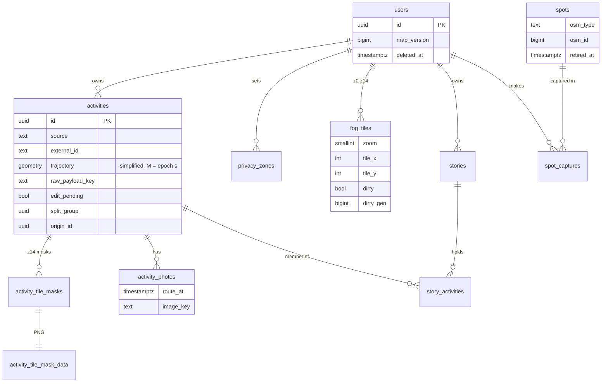
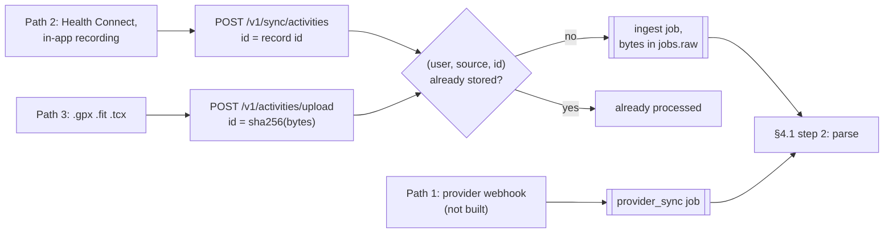
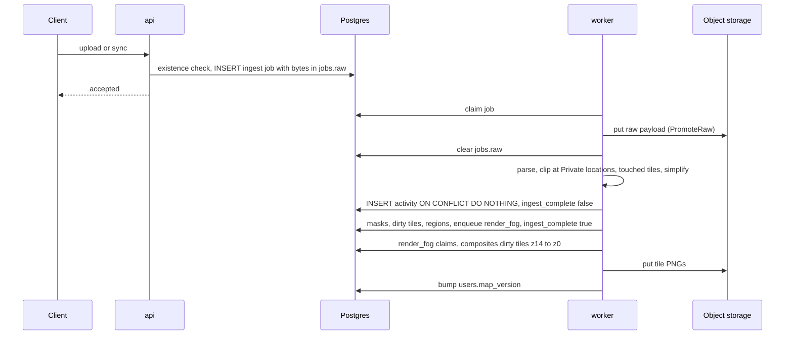
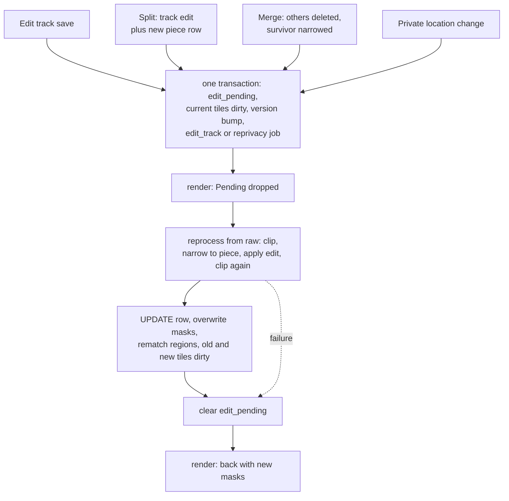
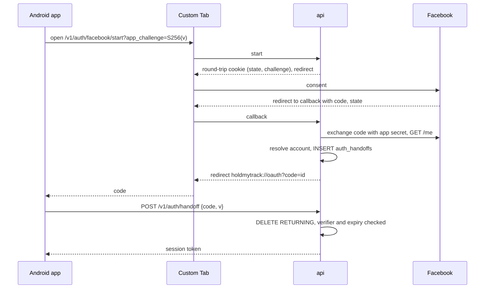
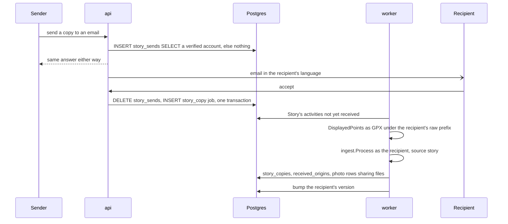
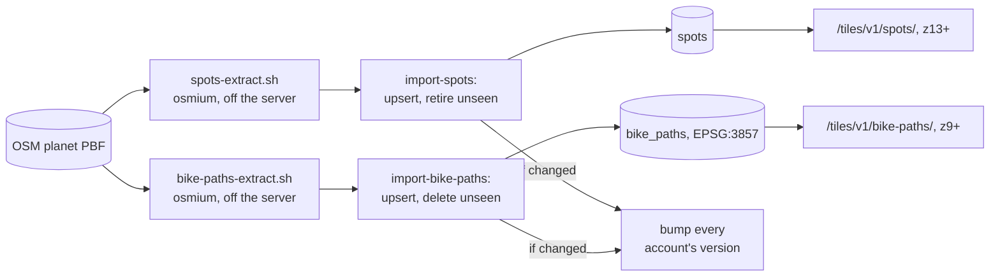
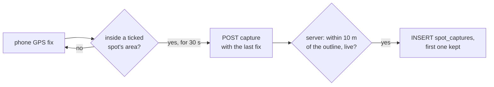

# HoldMyTrack: Implementation

> **Scope note.** How the server and web app are built where the code can't say it: flows that cross files, packages or apps, invariants every change must keep, reasons for designs that aren't the obvious one, and traps. The system-level shape and stack are `ARCHITECTURE.md`, observable behavior is `SPEC.md`, and the Android app's own side is `apps/android/docs/IMPLEMENTATION.md`.

---

## 3. Database Schema

The migrations in `services/server/migrations/` are the authority on columns, keys and indexes. A schema change is a new numbered file, never an edit to an existing one, and each file's header names the section it serves. Each entry below is what the migration doesn't show.

### 3.1 `users`

No `tier` column (ADR-0031). The demo account is a row recognized by its fixed id (§4.10). `password_hash` is NULL for an account that signs in only through `user_identities`. `map_version` only goes up (§4.2.6). `is_admin` is written only by `set-admin` (§4.20). `deleted_at` marks a closed account until the purge deletes the row (§4.28). A NULL `country` means Settings was never saved, which is the first-run gate (FR-1.7); a NULL `locale` means automatic.

### 3.2 `connections`

Path 1's OAuth state; nothing writes it yet. `UNIQUE (provider, provider_user_id)` keeps two accounts from connecting one provider account and both ingesting its webhooks. Disconnecting must delete the synced data, not only this row (§7).

### 3.3 `activities`

Idempotency is `idx_activities_dedupe` on `(user_id, source, external_id)` plus the persist step's `ON CONFLICT` (§4.0). `trajectory` is simplified display geometry, and coverage never comes from it. Its M is epoch seconds, which photos are placed by (§3.22), and its longitudes continue past ±180 (§4.1). A NULL `trajectory` has one cause: the track lies entirely inside Private locations. `split_group` and `origin_id` have no foreign key: a split group outlives its first row (§4.7.8) and a copy outlives its original (§3.25). No bbox column: PostGIS has no default GiST operator class for `box2d`, and the GiST index on `trajectory` already serves `&&`.

### 3.6 `fog_tiles`

One row per account and tile, z0–z14, naming Fog's coverage PNG and Heatmap's count PNG (`heatmap_object_key`), which share the row because the same events dirty both. Every dirty mark increments `dirty_gen`; a render clears `dirty` only if `dirty_gen` is unchanged since it read the tile (`fog.upsertTileRendered`), so a change landing mid-render leaves the tile dirty.

### 3.7 `privacy_zones`

Private locations (FR-8.1). `salt` seeds each clipped end's stretch (§4.1); only ingest reads it, and no response or export carries it. The radius range is enforced by the API, not the schema.

### 3.8 `jobs`

The queue (§4.1); there is no broker. A running job stays `pending`, with `locked_at` marking it taken. Finished rows are kept as the import history (§4.0), so partial indexes keep the claim and per-account reads cheap. `raw` holds an ingest's payload until the worker stores it. `error_code` is a failed ingest's reason, translated when read (§4.21); `last_error` is an English diagnostic.

### 3.9 `sessions`

The primary key, a `gen_random_uuid()`, is the cookie value, with no hashed-token layer, which is judged enough for the current threat model. Expiry is checked in SQL on every read.

### 3.10 `password_resets`

Same shape as `sessions`, much shorter-lived (§4.9).

### 3.11 `activity_tile_masks`

One unblurred mask per activity per z14 tile it touches, drawn at ingest (§4.2.3). The PNG is in `activity_tile_mask_data`, cascading from the mask row: a separate table keeps this one narrow for render scans and lets backups skip the bytes, which `rerender-coverage --masks` rebuilds. Masks live in Postgres because R2 round trips were most of a render (`PERFORMANCE.md`, 2026-10-09); at ~600 bytes a mask stays under the TOAST threshold. SQLite on the worker is the fallback if mask reads compete with map queries.

### 3.12 `admin_countries`

Overture's land-clipped countries (ADR-0034). `geom` is simplified for drawing; matching uses the full outline cut into ≤256-vertex pieces in `admin_country_parts`, so a coastline crossing is an index lookup (§4.2.4).

### 3.13 `admin_regions`

The same two forms, the pieces in `admin_region_parts`. Keyed by `overture_id`, since not every region has an ISO code. A country without regions gets one row covering it. `admin_boundaries_source` names the loaded extract, so seeding the same file again is skipped.

### 3.14 `activity_country` / 3.15 `activity_region`

Which countries and regions each trajectory touches, matched once at ingest and redone on every reseed. The cascade on `activity_id` is the whole cleanup, since the tiles read these rows live. Matching reads the simplified `trajectory`: a ~3 m tolerance can't change a kilometre-scale intersection.

### 3.16 `email_verifications`

Same shape as `password_resets`. `email` is the address the link confirms; a change of address waits on this row until verified (§4.9).

### 3.17 `user_identities`

Google and Facebook links (ADR-0015), keyed by the provider's stable `subject`, never the email. `UNIQUE (user_id, provider)` allows one identity per provider.

### 3.18 `auth_handoffs`

One-time codes for a native app's browser sign-in (§4.9). Redeeming deletes the row in the statement that reads it; expired rows are purged on the next insert, so there is no sweeper.

### 3.19 `stories` / `story_activities`

`story_activities` cascades from both sides: deleting an activity removes it from every Story, an emptied Story stays, and deleting a Story deletes no activity.

### 3.20 `spots`

Upserted on `(osm_type, osm_id)`. A place a planet import no longer sees is retired (`retired_at`), never deleted, so its captures stay (§4.25).

### 3.21 `spot_captures`

The primary key keeps the first capture, and no row is ever updated (§4.25).

### 3.22 `activity_photos`

Several rows can name one image: a Story copy's photo keeps the original's `image_key`, so the files go only with the last row naming them. No position column: `route_at` is a moment on the trajectory's M axis, located on every read, so track edits and Private locations apply to the photo (§4.27).

### 3.23 `exports`

No state column: until `ready_at` is set, a request's state is its job's. Parts live at `exports/{user_id}/{id}/{n}.zip` until `expires_at` (§4.29).

### 3.24 `tz_parts`

timezone-boundary-builder's polygons in ≤256-vertex pieces (ADR-0035, §4.30); `tz_boundaries_source` skips reloading the same file.

### 3.25 `story_sends` / `story_copies` / `received_origins`

`story_sends` is the inbox, one row per Story and recipient however often it's sent. `story_copies` maps a sent Story and recipient to the Story the copy made, so a later copy adds to it. `received_origins` keeps every original an account has received, after the copy is deleted, so each arrives once ever (§4.23).

### 3.26 `admin_tile_geoms` / `admin_tiles_built`

Country and Region outlines already clipped to each tile, shared by every account and emptied by a reseed. `admin_tiles_built` marks a built tile, an empty one included, so an empty tile isn't rebuilt on every request (§4.2.4).

### 3.27 `bike_paths`

One row per OSM way, upserted on `osm_id` and stored in Web Mercator, so a tile reprojects nothing. Nothing refers to a row, so a planet import deletes the ways it didn't see instead of retiring them (§4.24).

### 3.28 `daily_stats`

One row per UTC day and stat key, written once and never updated. No account id, by design (§4.32).

### 3.29 `r2_ops`

Object-store requests per UTC day and billing class, which every process adds to (§5.7).

## 4. Core Technical Workflows

### 4.0 The three ingest paths

They differ only in how bytes arrive; from §4.1 step 2 on the code is shared (ADR-0001).

- **Path 1** is a design only (`VISION.md` §4.1): webhook receivers answer at once and enqueue, and the backfill at connect is a separate, resumable, rate-limited job (§5.1).
- **Path 2** on Android: Health Connect routes written by other apps can't be read in the background (`ConsentRequired` even with "Always allow", checked on a device), so sync is foreground-only. Don't build a background route sync: it would bring in activities with nothing to draw. Samsung Health exposes no routes at all.
- **Path 3** needs no provider's permission, which makes it the unconditional path.

**All three are idempotent on `(user_id, source, external_id)`**, under concurrent duplicates too. The check at receive time is a fast path; the guarantee is `idx_activities_dedupe` plus the persist step's `ON CONFLICT DO NOTHING` (§4.1 step 6).

**The import history is the `jobs` table** (`kind = 'ingest'`): every file and synced activity is a job carrying its file name, source, state and error, so the Upload menu, `/sync` and the Android Sync history read one history with no uploads table (`imports.go`, `uploads.go`). `GET /v1/activities/status/{external_id}` answers only from the caller's own jobs: an upload's id is its file's hash, which would otherwise tell anyone holding a file whether someone uploaded it. Clients refresh the map when an import finishes, not when its request returns, since the request only enqueued it.

#### 4.0.3 `POST /v1/sync/activities`

Path 2's endpoint (`sync_activities.go`); each activity gets its own result. It is idempotent on the caller's record id, not a content hash, since a retry may serialize the JSON differently, and the raw key is scoped by source (`raw/{user}/{source}/{id}`) because that id is unique only within its source. `external_id` is pattern-checked because it goes into an object key, and type, name and description are held to the activity edit's bounds, so a bad value is refused here instead of failing in the worker. `parse.ParseJSON` decodes the body into the same structs the file parsers produce, so the pipeline has no Path 2 branch.

`POST /v1/sync/known` makes the server the one record of what was sent: an id is known if an `activities` row or a `pending` job carries it, so a reinstall or a second phone agrees, and a deleted activity is offered again.

#### 4.0.4 In-app GPS recording (Android)

A stopped recording posts to §4.0.3 with `source = "recorded"` and a UUID minted at recording start, so a retried submit is recognized (ADR-0007). It is the one path that sets `name` and `description` at ingest. Its `activity_type` is free text, which is why §4.0.3 bounds it. The app side is `apps/android/docs/IMPLEMENTATION.md` §5.

### 4.1 Ingestion pipeline

The order matters:
1. **Receive.** Validate, check `(user_id, source, external_id)`, and enqueue with the bytes in `jobs.raw`, a column of its own because the import history reads `payload` on every row. A request writes nothing to object storage, so a 100-activity sync answers as fast as one file. The worker stores the bytes before parsing (`ingest.PromoteRaw`); a retry after a failed write finds them still in the row.
2. **Parse**, streamed: a 100-mile ride at 1 Hz is 36,000+ points. Parsers don't check ranges, so `keepValid` and `keepTimed` filter what they return, and `ParseGPX` reads only the recorded line in time order, since step 3 clips from whichever points come first and last.
3. **Clip** against the account's Private locations, read when the job runs, before anything is stored (§7).
4. **Coverage** from the raw points: the touched z14 tiles, by segment. A track past `maxActivityTiles` fails, since a zigzag between far points could reach millions; a 10,000 km trip is about 12,000.
5. **Simplify** for display into `trajectory` (`ST_SimplifyPreserveTopology`).
6. **Persist** with `ON CONFLICT DO NOTHING`, then draw masks, mark tiles dirty and match regions. The row commits with `ingest_complete = false` and is flagged complete at the end. A conflict on an incomplete row is an earlier run cut off, so the job carries on with it (every step is safe to repeat) and step 1 doesn't count it as stored.
7. **Render** in a `render_fog` job (§4.2), not added while the account has one waiting unclaimed, since that job reads the dirty flags only once claimed. A bulk import queues one render.

**Clipping** (`ingest.ClipEnds`) drops the leading points inside any zone and then a further stretch past the edge, and the same at the end. Ends exactly on the edge would give the place away: three of them fix the circle and its center. The stretch is between 0 and the radius, drawn from a hash of the last hidden point and the salts of the zones it lies in, and the cut falls on a recorded point, so ends scatter over a band. The draw must be:
- fixed per end, since fresh draws over several reprocesses would average back to the edge;
- secret, since with the code public the hidden point alone would let someone try candidate times;
- within a radius past the edge, the bound `reprivacy`'s search relies on (§7). So a point farther out is passed over for the one before it, and a sparse recording's long first segment is cut on the segment.

The edge is found by bisecting the leaving segment against "inside any zone", so overlapping circles need no special case. Clipping a clipped track changes nothing, which a track edit's second clip relies on (§4.7.7). A track entirely inside zones is stored with a NULL `trajectory`, zero metrics and no masks instead of being dropped, so it comes back when the zone goes.

**Antimeridian.** Each longitude moves by whole turns to within 180° of the one before (`unwrapLons`), so 179.95 → −179.98 is stored as 179.95 → 180.02; otherwise the segment ran round the world, with masks in every z14 column. Everything that meets −180…180 wraps back: masks (`tilemath.SegmentTilesBuffered`, `fog.projectToTile`), tracks tiles and region matching (`geo.WrappedSQL`), written GPX (`parse.WrapLon`) and track edits (`TrackEdit.Apply` unwraps again, and `Validate` accepts ±540).

**The queue** (`internal/worker`, whose comments cover the claim, attempts, panics and shutdown). A claim stamps `locked_at` in one short transaction and runs the job outside it, so a fresh `locked_at` keeps other loops off and a stale one (past `claimLease`) means its worker died; long jobs refresh it (`keepClaimed`).
- **Three lanes**: render (`render_fog`, `WORKER_RENDER_CONCURRENCY` loops), long (`export`, one loop) and main (every other kind, `WORKER_CONCURRENCY`), so a minutes-long render or export never holds up an upload. The pool is sized to the loops (`db.OpenSized`).
- **Fair per lane** (`claimQuery`): one job per account is considered, none from an account that has one of that lane claimed, and accounts go in order of when that lane last served them, never-served first. A new user's upload goes ahead of someone's thousandth file.
- One account's lanes run side by side. That is safe because of `dirty_gen` (§3.6), `EnqueueRenderFog` queuing behind a claimed render, and Pending activities staying out of composites (§4.2.5). Renders inside a job (track edit, reprivacy) take a per-account advisory lock (`lockRenders`), since a stale pass storing after a fresher one would leave its tile stale.
- A deleted account's jobs are never claimed (§4.28). `worker_test.go` pins the fairness and lane rules.

### 4.2 Fog of War — precomputed raster mask

**Storage.** Coverage is a bitmap, one single-channel 128 px PNG (~19 m a pixel) per touched z14 tile, because a per-request `ST_Union` of thousands of polygons is the scaling wall (ADR-0003). At 512 px pixels were most of a render's work and bytes for little visible gain; 64 px merges nearby tracks from z13 out; 256 px doubles the mask bytes for detail finer than GPS. Masks and tiles share the size, so compositing needs no resampling.

**Stroke.** Each track is stroked about 48 m either side: wide enough that a walked neighbourhood clears between its streets (blocks are often 100–150 m deep), narrow enough not to merge parallel streets. The stroke needs the raw points, which is why masks are drawn per activity at ingest (§4.2.3). A tile counts as touched when the stroke reaches it, not only the line (`tilemath.SegmentTilesBuffered`, walked a column at a time over exact pixel coordinates); otherwise `gg` clipped the overflow without a sign.

**Pyramid.** Each level up takes the brightest of four children, not their mean, so a place visited once stays clear at every zoom. Storing a tile marks its parent dirty in the same transaction. `RenderUser` renders z14 and then each level up, starting a level only once the one below is stored, so a pass cut off leaves parents dirty for the next. A render is mostly object-store round trips, so it runs them side by side (`PERFORMANCE.md`, 2026-10-08). A new activity dirties a few tiles, so the cost doesn't grow with history.

**After a drawing change** a deploy runs `rerender-coverage` (`DEPLOY.md`), which marks tiles dirty and queues a render per account instead of rendering, so it never races the worker. A change to the stroke, the tiles a track reaches or `TileSize` also needs `--masks`, which redraws masks from `DisplayedPoints` in tile order so concurrent redraws don't deadlock. Until then a tile of the wrong size is refused when read.

**Serving.** `/tiles/v1/fog-vector/` (`fogvector.go`) traces the stored PNG per request into veil polygons and edge lines (~0.2 ms a tile), which clients draw as a fill and a blurred line: a crisp outline at every zoom, where a 128 px raster shown at 512 px was blocky or blurred. Neighbouring tiles' outlines meet within a fraction of a pixel only because no point within a pixel of the side moves, and the clients draw the edge with butt caps so the overlap doesn't double.

The raster route (`tint.go`) remains for Android builds from before the vector veil (`ROADMAP.md`). Either way the inversion is the server's because MapLibre can't invert a raster (no `raster-color`), and a shader would otherwise be written twice.

**Veils** (`fog.LightVeil`, `fog.DarkVeil`) are each opposite in lightness to their basemap, at 0.82 opacity: at 0.6 the cream veil left satellite imagery too clear to tell fogged ground from revealed. The fog is designed over the vector basemap, with imagery optional (§4.26). The clients draw the veil, the Country/Region fills and Heatmap as the served style's overlays (`ARCHITECTURE.md` §2.1), beneath the first symbol layer, so labels stay on top.

#### 4.2.2 Heatmap mode

Heatmap shares Fog's masks, `fog_tiles` row, dirty flag and render; the server stores pass counts and the clients draw them (ADR-0046).

**Stored**: per z14 tile, a 16-bit PNG counting the in-window, non-Pending activities whose stroke covers each pixel (`fog.heatCounts`). The stroke is narrowed by a pixel, to about 60 m, since Fog's width reads as smeared heat, and narrowed within its tile with edge pixels repeated so a track isn't cut short at a tile edge. Counted per activity, so a loop or an idle stop counts once. The pyramid keeps each block's busiest pixel. A tile with no passes stores nothing and its old object is removed (`storeTilePair`), so a deleted or aged-out activity doesn't linger.

**Served** as MapLibre heatmap circles from `/tiles/v1/heat-points/`: a point per non-empty cell, 64 to a tile side, weighted `log1p(count) / log1p(scale)`, log because most ground is crossed once or twice and a few places a hundred times. Up to z8 (`fog.HeatActivityMaxZoom`) a cell is a z14 tile or larger and counts distinct activities, read live from the mask rows; from z9 it counts the busiest pixel of the count tile one zoom up, since per-pixel counts can't be added up into a larger area's activities. Zooms up to z8 scale against their own busiest cell (`users.heat_point_caps`, stored by every render), never below `heatmap_cap`; finer zooms against `heatmap_cap`.

**Each point is weighted for its neighbours** (`weighNeighbours`). MapLibre adds overlapping circles and its kernel peaks at about 0.4 of a weight, so a lone place read faint and a route hot. Dividing by what the neighbours add under MapLibre's kernel, `exp(-½ (3d/r)²)` at the clients' radius of 1.6 cells, with the clients' intensity of 2.5, makes each circle peak at its own weight. **The radius and intensity are the served style's (`coverageStyle.ts`), and a test in `internal/fog` holds the radius to `heatRadiusCells`.**

**One query a tile**: up to z8 a grouped read of the account's own mask rows; from z9 the row and one object read, counted against the R2 budget. The MVT is encoded in Go, saving a round trip on the database the load tests found to be the bottleneck. The old `/heatmap/` raster route answers a transparent tile for old Android builds, since a stored raster would keep showing deleted or newly private activity.

**`heatmap_cap`** is the account's most-touched z14 tile in distinct in-window activities (`fog.RecomputeHeatmapCap`). A changed cap re-renders nothing, it only bumps the tile version. The cap sweep and the window aging run daily and at worker start, independently; each corrects from the state it finds.

#### 4.2.3 Per-activity masks

Both rasters are composited from per-activity masks (§3.11), drawn at ingest from points already in memory, so ingest costs the activity's own tiles. **A dirty tile is always recomposited whole from the masks of non-Pending activities, never decremented**, so a delete is one fewer row feeding it, with no re-parse of the activities sharing the tile. An unreadable mask is skipped and counted. Tile routes are a plain lookup, and a request whose client has gone answers `499` without logging (`clientGone`).

**Window membership is stored** (`activities.in_heatmap_window`, set from `started_at` at ingest), because compositing a window ending now took ~12.6 s on the demo account's home tile and is a new cache key on every request. Leaving the window is passage of time, so `ageOutHeatmapWindow` runs daily and at worker start (a worker restarted on every deploy might never reach a ticker's first tick), re-rendering only the tiles of activities that crossed.

**Refreshing an open page.** Coverage URLs change only with the tile version (§4.2.6). `GET /v1/coverage/status` reports `rendering` while any coverage-changing job is still `pending` (a claimed job stays `pending`), `ingest` included, since the watch starts before the render exists. The client's watch (`useCoverageRefresh.ts`) refetches whenever `version` moves, not only when done, since a reprocess renders twice (§4.2.5).

#### 4.2.4 Country/Region zoom tiers

Below exact coverage, Fog reveals whole countries, then regions (FR-4.2). The tiers switch only by layer `minzoom`/`maxzoom`, never blended. The served style's overlays carry the bands, for the layers and the level notice alike.

**Boundaries**: `scripts/boundaries-extract.sh` cuts countries, dependencies and regions from a pinned Overture release with DuckDB, off the server, dropping the code-less duplicate drawing of a disputed region. `seed-admin-boundaries` replaces them in one transaction, re-matches every activity and bumps every account's tile version. It refuses a file with too few countries or regions, which would erase the rest of the world. Simplification stays under a pixel at each tier, and a country it would erase (Vatican City) keeps its full outline. Matching runs once per activity at ingest (`geo.MatchActivity`) against the full-detail pieces, the trajectory wrapped into −180…180.

**Served as live MVT, not a precomputed pyramid**: the cost scales with a fixed boundary set, not with history, so there's no dirty machinery to keep. Fog's query returns the locked set (no non-Pending membership row), filled in the veil's colour so nothing shifts crossing the zoom boundary. A tile's clipped outlines are stored on its first request (§3.26), the built mark inserted first with `ON CONFLICT DO NOTHING` so a concurrent build waits; only tiles up to each tier's maxzoom are kept, and the seed empties them last in its transaction. The Heatmap country and region routes remain only for old Android builds.

#### 4.2.5 Pending activities drop out of every map read (FR-5.15)

An activity is Pending (`edit_pending`) while an Edit track or Private location reprocess is queued or running, its geometry and masks stale or half-rewritten. **Every map read filters `AND NOT edit_pending`**: tracks tiles, Fog and Heatmap composites at every level, the heatmap cap and Country/Region. A new map read needs it too.

**Two renders per reprocess, inside the job**: enqueueing sets the flag and dirties the activities' current tiles in one transaction; the job renders (dropping them), reprocesses, clears the flag (unless a later `reprivacy` still covers the activity) and renders again. A failed edit clears the flag and renders, restoring the old masks. Pending clears before the rasters are current, so clients refetch on `/v1/coverage/status`, not on the badge (§4.2.3). The web hides a Pending track itself as soon as the list shows it, apart from the user's hidden set.

#### 4.2.6 Caching: one tile version per account

Every per-user tile is cacheable for good under the account's **tile version** (`tile_version` from `/v1/coverage/status`): `private, max-age=31536000, immutable` when asked with the account's own version, `private, no-cache` otherwise. None passes a shared cache: the origin isn't behind Cloudflare (`ARCHITECTURE.md` §1.2), and a tile points at where its owner lives.

**The version is a counter, `users.map_version`**, not a timestamp: the latest `rendered_at` goes backwards when tiles are deleted, and a key must never return for different content. **Every change to tile content is followed by a bump**, the change first, so a tile fetched in between is newer than its label, never older:
- the worker, after every render pass that stored anything, a failed one included;
- changes with no render behind them: enqueueing a reprocess, deleting or editing an activity, a timezone change, a Story membership change, the demo reset;
- the Spots and bike-path imports and `seed-admin-boundaries`, for every account.

On the wire the version is prefixed with the start of the account id, so two accounts on one device never share a key. The tracks layer adds a per-page `v` (load time, then a counter), so a change the page made before a new version arrives isn't served from cache, not even another tab's. One upload invalidates every tile of the account; a per-tile key is the next step if measurements call for it.

### 4.3 Track vector tiles

**Tracks are a live query** (`handleTracksTile`), `ST_AsMVT` over the account's non-Pending activities, because they follow filters that can't be precomputed. A track stored past ±180 is drawn through `geo.WrappedSQL`, a part each side, since PROJ would rejoin the parts round the world; a tile on the far side matches it through its envelope shifted 360°.

**The filter is the list's** (`parseActivityFilter`, §4.7), and the layer always sends `from`/`to`, since an absent bound means unrestricted. Type and Distance are layer filters in the client. **Every refresh gets a new URL** (the per-page `v`): MapLibre caches overzoomed slices by URL, and an unchanged one kept a track's pre-edit shape past z14.

#### 4.3.1 Pace-colored segments

A GeoJSON layer over the tracks for the focused activity, since a vector tile can't carry per-vertex colour; `GET /v1/activities/track-metrics/{id}` computes speeds from `trajectory`'s vertices and their M times. The web (`trackBands.ts`) and Android (`TrackBands.kt`) apply the same band rule and change together. Douglas-Peucker keeps vertices by shape, not speed, so a straight stretch shows coarse bands; the fix would be re-parsing the raw payload for the focused activity, as Edit track does.

#### 4.3.3 Map image export

Client-side (§5.5); Android follows the same design (`apps/android/docs/IMPLEMENTATION.md` §3.5). The output's pixel size is chosen apart from the viewfinder, so a phone exports as large an image as a desktop. The largest size offered is the smaller of the GPU's render-buffer limit and MapLibre's 4096 px canvas cap (`maxExportSide`), since past either MapLibre draws smaller without saying so.

**Capture renders a second, hidden map** at the window's CSS size and the live camera, with the resolution from `pixelRatio`, so labels and lines keep their on-screen proportions. It replays the live map's overlay calls (`reattachOverlays`), so **a change to how the live map attaches overlays reaches the export too**. Attribution (§5.6) and the watermark are drawn into the final canvas at the exact output size.

### 4.5 Per-activity pace, and distance trends

Pace is route context on one activity (§4.3.1) and trends a plain rollup per period; nothing further (`VISION.md` §1.1). Moving time is summed in ingest's distance pass (`computeMetrics`). The trends query left-joins its sums onto a `generate_series` of every bucket, so empty periods are zeroes and the chart shows its gaps; the Profile page renders it with the query `GET /v1/activities/trends` runs.

### 4.6 Overlapping activities

One ride synced from a watch and uploaded as its `.fit` has two `external_id`s, and nothing on ingest matches them (ADR-0039); the hint is FR-3.7 (`ingest/overlap.go`). Time is compared because it is what every copy agrees on, and measuring against the longer duration keeps a short walk inside a long hike apart. Each activity is compared by `recorded_started_at`/`recorded_ended_at`, its parsed first and last point narrowed to its split range but before clipping and edits, since Private locations shorten the shown span. The lookup stays a range scan on `idx_activities_user_recorded_start`: an 80% overlap bounds the start difference to a quarter of the span. **Android's Sync tab applies the same rule** (`sync/Similar.kt`, tested against the same cases); change both. Splits are unknown to it (`KNOWN_ISSUES.md`).

### 4.7 Activity listing and filtering

**One filter parser** (`parseActivityFilter`) serves the list, its totals, the day histogram and the tracks tiles, so the panel and the map can't disagree. **No pagination**: Type and Distance filter client-side over the whole range, and the map draws every match anyway; a future cursor must be `(started_at, id)`, since two sources' copies of a ride share a start time. **`bbox` is computed, the short way round**: PostGIS keeps the box in the geometry header, and one wider than 180° is recomputed from `ST_ShiftLongitude` with the narrower kept. **Every day is the activity's local day** (§4.30); the account's zone decides only what "today" is. The histogram pages by activity-day, since the slider packs only days with activity. `activity_type` is the source's free text, never normalized. A name is only ever typed by a person, and sorting never reads it.

**The map's state rules are one set on every client**: the web's `map/session.ts` and Android's `MapSession` (range or Story, selection, the camera's next flight) and their pure rules run the same cases in `testdata/map-session`, so a rule can't change on one platform alone.

#### 4.7.5 Delete an activity — a full purge (FR-5.11)

The cascade takes masks with their bytes, region rows, Story memberships and photo rows. Object storage has no foreign keys, so `handleDeleteActivity`:
- removes the raw payload only when no other row (a split piece, a Story copy) names it;
- reads the photo keys before the `DELETE` and removes them after, keeping any a copy still names (§3.22);
- reads the activity's tiles from its masks **before** the cascade, marks them dirty and enqueues a render; recompositing (§4.2.3) does the rest.

A group delete runs one request at a time, so several don't mark the same tiles at once.

#### 4.7.7 Edit track, and the recompute flow

**The edit is a spec replayed over the raw payload** (`activities.track_edit`, `ingest.TrackEdit`): keep, remove, drop and move, every point named by its unix-ms timestamp. The original is untouched, so Reset is a NULL spec. Timestamps rather than indices, since indices into the clipped list shift when a Private location changes and `reprivacy` replays the stored edit over a differently clipped list; so a track without forward-running timestamps can't be edited.

**Reprocessing is ingest's own pipeline ending in an UPDATE** (`reprocessActivity`, shared by the `edit_track` and `reprivacy` jobs): the same load and clip (§4.1 steps 2–3), the edit, and **a second clip**, because chopping away the first point outside a zone would otherwise expose the points behind it. It clears region rows before re-matching, since matching only inserts, and overwrites masks in place so a tile the track still crosses never lacks one. `edit_pending` is set with the enqueue, guarded by `AND NOT edit_pending` so an activity can't be edited twice at once, and cleared on any failure, leaving the previous track. A job whose activity was deleted succeeds as a no-op.

**The editor's points** (`GET /v1/activities/track-points/{id}`) are re-parsed from the raw payload and clipped as the job will clip them, since the raw payload still holds the hidden ends. The routes are `/activities/track-*/{id}` because `ServeMux` rejects `/activities/{id}/…` beside `/activities/track-metrics/{id}`. The web's editing session folds its ops with the server's predicate (`editTrackOps.ts`).

#### 4.7.8 Split an activity, and merge it back (FR-5.17)

**A piece is a row over the same raw payload, narrowed to a stretch** (`split_group`, `split_from`, `split_to`, inclusive, so pieces share the point they meet at). Everything that turns a raw payload into points narrows through `LoadPiecePoints`, after the Private location clip and before the edit (the reprocess, `DisplayedPoints`, the editor), and clips the narrowed ends again, since a split made at home leaves an end inside a zone. The range sits outside `track_edit`, so Reset returns a piece to its own stretch.

**Split rides on the track edit**: one request and job, with the new piece Pending from its insert. Its `external_id` is the original's plus `#split:<ms>`, so a re-import still matches the original row and pieces never collide. If the job fails the new piece has no geometry, which Merge can fold back in.

**Merge** (`ingest.MergePieces`, one transaction) keeps the earliest piece (the original row when included, which keeps its `external_id`), moves the others' photos and Story memberships to it, marks every piece's tiles dirty while their masks still exist, deletes the others and queues an `edit_track`. `MergeEdits` folds the specs into one that shows what the pieces showed: each is narrowed to its piece's range, a piece's Keep becomes Remove over what it cut away, and an open end is 2⁵³−1, since the browser replays the spec; Neither client offers Merge.

### 4.8 Activity graph — a private, per-user contribution grid

`/profile` (FR-7) is server-rendered from three queries however many years it shows (`profile_page.go`): the day histogram over the whole history, the earliest activity and Trends. Every year's cards are derived in Go from local-day buckets (§4.30), so they match the SQL stats. `internal/web/format.go` ports the web's `format.ts`/`units.ts` and changes with them. Shading is a count or distance quantiles of that year's active days, never a composite effort score, which would need a training-load formula. `GET /v1/activities/graph-stats` remains for API clients; its streak is a gaps-and-islands query.

### 4.9 Accounts and sign-in

Email and password with server-side sessions, owned end to end, so no vendor can revoke sign-in (§4.0). Google and Facebook are optional extra ways into the same accounts, and every sign-in ends in one `startSession`, so nothing downstream knows how an account signed in. What each flow does is FR-1.

**Sessions** are an opaque cookie (§3.9) checked in SQL on every request; sign-out deletes the row. `requireAuth` puts the user and its timezone in the request context, `requireVerified` wraps every route that needs a confirmed email, and resend and change-email are only `requireAuth`. Sign-in counts failures only, per email and per address, before the password is compared. A reset ends every session and reset row, then starts one session. A verification link starts a session like a reset, so it works from any browser, but never replaces a session the browser holds for another account (§4.19).

**An email change waits for proof**: the verification row carries the new address, and verifying applies it with the account row locked. Applying it at once let anyone take an unproven address, blocking its owner's signup and, after a reset, handing them an account whose provider link belonged to someone else.

**Mail** (`internal/mail`) is plain SMTP. With `SMTP_HOST` unset it logs messages in dev, but on an `https://` deployment only that a message wasn't sent, since a logged link opens the account.

**The web flow** (`oauth.go`, shared by `google_auth.go` and `facebook_auth.go`) is the authorization-code flow run server-side with no provider script or library (ADR-0009); in a browser the callback sets the session cookie instead of the handoff. Round-trip state is one `SameSite=Lax` cookie. Every failure shows one generic message, the cause only in the log.

**Google** adds PKCE. `resolveGoogleUser`, in one transaction: the `('google', sub)` identity; else a non-demo account with that email, linked, and if it was unverified also marked verified with its password, other identities, sessions and links removed, which closes pre-account takeover; else a new verified account. Android posts a Credential Manager ID token to `POST /v1/auth/google/token`, whose signature is checked since a client sent it (`google_idtoken.go`).

**Facebook** is **never linked by email**, since Facebook doesn't say the email is verified: an email already in use is refused and a new account starts unverified. A Facebook account made under a victim's address first is cleaned up by Google's unverified branch. On Android the redirect carries a code, not a session (RFC 8252), because any app can register `holdmytrack://`: without the verifier a code is worthless, and a wrong guess burns it. Meta's SDK was rejected for its default event logging and advertising-ID collection. `resolveFacebookUser`, `resolveGoogleUser` and the handoff SQL have no automated test, since the OAuth tests have no database harness.

**Credentials**: a deployment serves app and API from one origin, so `corsAllowedOrigins` lists only dev and test origins. MapLibre's tile fetches bypass `api.ts`, so `requestCredentials.ts` adds credentials only for the API's own origin; the basemap CDN and imagery would refuse a credentialed request. The test suites' cookie trap is in `DEVELOPMENT.md`.

**Settings**: the JSON API and the page call the same cores in `account.go`, and Android reads the page's option lists from the same functions, so what a client offers is what saving accepts. `loadAuthResponse` builds every account response.

### 4.10 The no-signup demo

**A real, read-only account**, so the demo runs the real auth, ingest and fog pipeline instead of a second one in the browser. **One shared account, recognized by its fixed id** (`DemoCustomerUserID`): the session lookup compares against it, which makes it read-only and exempt from verification, and every query that must skip the demo (password reset, Google's email match, Story recipients, `set-admin`) excludes the same id. `requireNotDemo` enforces read-only; disabled controls are a courtesy.

**Seeded at deploy through the real ingest** (`seed-demo-customer`), since seeding per visitor would take minutes. `demo_data/manifest.json` carries what a file can't (names, photos, Stories, captures) and is applied on every run. Its keys are stable across deployments: a capture names its place by OSM type and id, not `spots.id`. `--reset` exists because the idempotent skip is blind to edits; it quiesces the worker for the account first, since a queued render rewrote tiles just deleted.

**The export** (`export-demo-activities`) writes `DisplayedPoints`, never the original, because `demo_data/` is in a public repository: what zones and edits removed must be absent from the file. Captures are those between the run's first and last point, except places reaching into the owner's Private locations. Traps: the demo's own Private locations clip again when seeding, and two people's recordings of one outing both stay (§4.6), so export one.

**Per-address limits key on `clientIP`**: the last `X-Forwarded-For` entry, believed only from a private or loopback peer, since Caddy replaces a client's own value. Keying on the peer behind Caddy was one limit for the whole site.

### 4.19 Server-rendered pages (ADR-0012)

`internal/web` renders; `httpapi` decides the page, the user (`pageAccount`, an optional-auth lookup) and the language. Signed-out pages are cached per page, path, language and `hmt_app` cookie (`RenderPublic`) and sent with `Vary: Cookie, Accept-Language`; the rest are `no-store`.

**Security.** No page may be framed (`frame-ancestors 'none'`), since a framed signed-in page's clicks are same-origin. Page forms require `Origin`, or `Referer` when the browser omits it, to match `APP_BASE_URL`; `/v1` writes refuse a foreign `Origin` and accept none, as the native apps send none. This stops an auto-submitted `text/plain` form from signing a victim's browser into an attacker's account through `/v1/auth/login`, which `SameSite=Lax` doesn't. Auth pages and JSON endpoints call the same cores, which return an `accountError` (a status and a catalog key) for what a person should see.

**The React shell** (`templates/app/app.html`) is `/` for a signed-in account. The handler redirects first (no session, unverified, no Country), so the first-run gate is the server's. Every sign-in, demo start and sign-out redirects to a bare `/`, so no session inherits another's camera. The Go image never sees Vite's manifest, so `vite.config.ts` gives the entry and its stylesheet fixed names, which the shell links with the build version and Caddy serves `no-cache`.

**For the Android app** a page is the same page marked by the `hmt_app` cookie (FR-10.8, ADR-0042), set in the WebView's cookie store, because a header reaches only the first request and a query parameter wouldn't survive links and redirects. Traps: the public cache key includes it, and a WebView form POST carries the API's origin, so the app's `API_BASE_URL` must be `APP_BASE_URL`'s origin.

**Keep in step:**
- A new page path goes in `registerPages` and `vite.config.ts`'s `pageRoutes`, whose patterns end `(\?|$)` because Vite matches them with the query string.
- Pages that quote the system change with it: Help's numbers; the privacy policy's processors, cookies, session lifetimes and backup window, in both language files with their date; `testing.html`, which quotes `strings.xml` and the server catalog word for word (FR-10.7). `cmd/make-testing-files` generates its sample files from `demo_data/`, and its test fails on any byte of drift.
- Screenshots committed to the public repository have the account photo, name, email and file lists painted over.
- `tokens.css` is the one source of the palette and the spacing, radius, type and elevation scales, loaded first by the page layout and the map shell alike; every colour has a light and a dark value. The Android theme carries the same palette, fonts, scales and Lucide icon set (`apps/android/docs/IMPLEMENTATION.md` §6), so a change to either needs the matching change there.

### 4.20 Admin panel (FR-12)

In the app, reusing sessions, renderer and formatting, and showing the product's view of an account instead of raw tables. `is_admin` is written only by `set-admin`, so the web is never an escalation path; an email allowlist (admin is whoever registers the address first) and a promotion page (a stolen admin session escalates) were rejected. Access is read per page and fails as a 404, so a revoke applies on the next load.

### 4.21 Localization (FR-13)

No i18n library: each surface has flat `key → message` catalogs with `{name}` placeholders and plural forms as sibling keys, and a test per surface checks every catalog against English for keys, plural forms and placeholders. A language needing gender agreement or nested selects is when to adopt one. **The language is decided once, by the server** (`i18n.Resolve`); the map app reads `<html lang>`, and the style, emails and errors take the request's, so no two parts of a page disagree. The menu's choice is a cookie because the server needs it with the request (exempt from consent under ePrivacy Art. 5(3)), and signup doesn't copy it into the account. Automatic is never shown checked, since a cached signed-out page can't tell a choice from the browser's language. One URL serves every language, so crawlers index English (`BRAINSTORM.md`).
- About and Help have whole-page Russian files: **a change to an English section needs the same change in its `.ru.html`**.
- The worker stores `jobs.error_code` from ingest's sentinel errors, rendered in the reader's language. **A new user-visible failure needs a code and an `ingest_error.<code>` message in every catalog.**
- `ru.ts` is typed over `en.ts`'s keys, so a missing translation fails `tsc`.
- The served style is one document per language and flavor, picked by `?lang=` rather than `Accept-Language`, so MapLibre's URL-keyed cache never mixes languages; a test holds the two language lists together.
- Android sends its locale as `Accept-Language`.

### 4.23 Stories (FR-14)

**A Story holds only its owner's activities**: adding reads the caller's rows `FOR KEY SHARE` and fails unless it found every one; the lock makes a concurrent delete wait instead of failing the foreign key. The `story` filter needs no ownership check, since every query it narrows is already the caller's. Every membership change bumps the tile version, since a `?story=` tracks tile depends on it; a rename doesn't.

**Sending never reveals an account**: the inbox row comes from an `INSERT … SELECT` matching only a verified, non-demo, non-deleted account other than the sender's. **The copy is the recipient's own data, made like an upload** (ADR-0036, `internal/storycopy`), so the recipient's Private locations, masks and region matching apply. Photo rows share the original's files (§3.22), read `FOR KEY SHARE` so a racing photo delete sees the copy's row. Each original arrives once ever, every step is idempotent, and an activity whose owner has an edit pending is retried later.

**The web** keeps the open Story in its map session and `?story=`; with one open, the activity query is the Story alone and the selected range is left as it was.

### 4.24 Trails and bike paths (FR-4.13)

**Trails and dirt tracks are in the basemap's `roads` layer**, which the stock Protomaps style draws faintly. `buildStyle` splices `PATH_LAYER_IDS` right after that layer, always on, so the served documents carry them; **their ids are part of the served style's contract**, since both clients find them to lift them over the veil.

**The bike kinds come from their own import** because the basemap has no paths below z13. **The extract keeps every way with one of the tags and `Kind` narrows it, so a new kind changes both.** A planet run deletes unseen rows behind the same too-many guard as Spots. Below z13 a way shorter than a pixel is dropped. The web and Android share the z9 minimum.

**Every path paints over Fog and Heatmap**: `raisePathLayers` moves the basemap path layers above the coverage layer, and the bike layers and tracks go on top, in every mode and in the export; under the veil, unridden paths showed at a fifth of their colour. It moves only a layer still below, and visibility is diffed before it's set, because both run on every `styledata` and each change fires another (`DEVELOPMENT.md`).

### 4.25 Spots (FR-15, ADR-0021)

**The import** (`internal/spots`) maps osmium's area ids back to OSM's, so the upsert key is OSM's own. Each run stamps the rows it writes with `clock_timestamp()` (`now()` is shared within a transaction) and clears their retirement; a planet run retires unstamped places unless they are over 1% of the live ones, and then fails. **No row is ever deleted, so captures' cascade never fires on a refresh.** The version is bumped only if the upsert changed something, counted in the same statement.

**The tiles are the same for every account.** A retired place is flagged and hidden unless captured, and the captured badge is styled from the account's capture list rather than baked in, which would need a bump per capture. **Show in this area** splits a view across the antimeridian into two boxes, whether its bounds come unwrapped (web) or wrapped (Android), and orders results named first, then by `md5(id)`, so the result limit thins the map evenly.

**Captures** (`spot_captures.go`): only the phone captures, since a desktop browser's position is too coarse. The server checks the last fix against the whole outline with a few metres' slack, because a fix is a few metres off either way. **A capture is never changed or removed while its account exists**, so both clients keep their list and ask only `since` their newest (inclusive, merged by place) on every return to the app. A change that could remove or re-date a capture has to make the clients reload the whole list.

### 4.26 Satellite mode (FR-4.14)

**The imagery belongs to the deployment**: an XYZ template with its key, a tile size, a max zoom and a credit, read by the web at build time and by the API at run time from the same `.env.prod` lines. holdmytrack.com uses MapTiler on a free plan that pauses instead of billing (§5.4); Sentinel-2 cloudless is free, but at 10 m a pixel it blurs at street level.

**Hybrid over our own style**, a raster layer right after `background`, switched as a layer since `setStyle` reloads every overlay; a second style on another schema would need a second planet archive and rewritten path layers. **What satellite hides and dims is derived at build time and published in the style's metadata**: hidden, `background` and every fill; dimmed, road lines with no opacity of their own; and every `roads_*` layer, hidden over imagery in Fog and Heatmap. **Clients read the lists from the metadata**: a derivation over a live style misses roads already dimmed. The server fills in the configured source, or deletes source, layer and metadata, and computes the ETag over the result. Android sends `Origin: <API origin>` on requests outside the API (`OriginInterceptor`), since the key is restricted by origin.

### 4.27 Photos (FR-16, ADR-0024)

The routes are under `/v1/photos` because the mux rejects `/v1/activities/{id}/photos` beside the fixed segments there.
- **A row never points at a missing image**: inserted in a transaction, both images stored, then committed. Types are sniffed and dimensions checked.
- **Placement is one function**, also behind `POST /v1/photos/place`, which stores nothing; the web settles each photo's moment as it's picked and uploads on Save. No photo exists without a place.
- **The position is computed on every read** (`ST_LocateAlong`, clamped to the trajectory's M range), so a moment cut away sits at the nearest end and returns with the track. No Private location check is needed: cut ends are gone from the trajectory and a pass-through is drawn whole.
- **Delete** removes the files only when no other row names them (§3.22).

**Preparing a photo in the browser** (`photoPrep.ts`): the original never leaves it. A large photo must never be decoded at full size, since a 200 MP panorama takes about 800 MB and kills a phone's tab; the file's comments say which decode paths each engine honours. A large PNG still decodes whole in Chromium (`KNOWN_ISSUES.md`).

### 4.28 Account deletion (FR-1.11)

**Close at once, purge in the worker.** `closeAccount` deletes, in one transaction, every way back in (sessions, identities, reset and verification rows, handoffs), clears the password, renames the email to a placeholder and stamps `deleted_at`, so no sign-in path needs a check of its own and the address is free at once. It is behind `requireAuth` alone, so an unverified account can delete itself. The purge (`worker/account_purge.go`) runs on its own ticker, so a busy queue can't delay it:
- drop unclaimed jobs, and wait while one runs, since it could write after the listing;
- remove objects by prefix, except photo files another account's rows name;
- `DELETE FROM users`, whose cascade takes the rest, then remove received-copy photo files nothing names.

**A new per-account object prefix must be added to the purge.** Backups keep the data up to 8 weeks (`DEPLOY.md` §11).

### 4.29 Downloading your data (FR-1.12)

A request is an `exports` row and an `export` job, made under a lock on the `users` row, so repeated taps return the one being prepared. The worker's long lane builds it (§4.1). Each track is written from `DisplayedPoints` and each raw payload once. **Each part goes to a temporary file and uploads with its size known**: given an unknown length, minio-go buffers about 537 MB per part. The archive is never reachable by a link alone: the email links to Settings, and a part is served only to its account, through `http.ServeContent` so a Range request resumes it. The weekly limit counts from `users.last_export_ready_at`, stamped in the statement that marks an export ready, because a new request expires the earlier row and the sweep deletes it.

### 4.30 Each activity's own timezone (ADR-0035)

`activities.timezone` is an IANA name, never an offset, so `AT TIME ZONE` gives the offset in force on the activity's date. It is looked up at ingest from the first recorded point, before clipping, with the account's zone where no polygon contains it; a reprocess looks again, which changes only split pieces. The `timezones-with-oceans` set gives a point at sea a zone, where the `-now` variant would merge zones whose clocks agree only today. `seed-timezones` re-matches every activity in its transaction; a zone the database's tzdata doesn't know is skipped and logged, since converting to it would fail. Grouping reads `localStartedAt` per row, and no local-time column is stored, since one would freeze each offset. `ORDER BY started_at` stays: across zones, local times can disagree with the order things happened.

### 4.31 The API contract (`services/server/api/`)

`openapi.yaml` indexes every path, each a `$ref` into its area's file in `paths/`, with shared shapes in `components/`. **The server's tests hold the handlers to it**: every exchange a database test makes, and a handler test makes through `serveChecked`, is validated (`contract_test.go`, kin-openapi, test-only). That checks the bytes sent (a nil slice encoded as `null`, an `omitempty` dropping a required field), which generated Go types can't. `TestContractCoversEveryRoute` fails on a route the contract lacks or an operation no route registers. The web reads responses through `apiSchema.ts`, generated by `openapi-typescript` and committed (CI's `verify:api-types` catches a stale one); Android's `WireContractTest` checks `net/Wire.kt`. Traps:
- The file describes what `encoding/json` accepts: a field the handler doesn't insist on is optional, and an optional array also `nullable`.
- An error code is its message key (`api_errors.go`, ADR-0045), pinned by enums, so renaming a key a client branches on fails a test.
- The cross-origin 403 and the 426 (§4.33) answer before any operation and aren't in the contract; paths outside `/v1` aren't checked.

### 4.32 Service statistics

**A daily snapshot, because past state can't be rebuilt**: `last_seen_at` holds only the latest visit, and a deleted account's row is gone. Once per UTC day the worker (`internal/stats`) stores each value in `daily_stats`; Grafana keeps about 14 days, so Postgres is the record. It takes only yesterday, so a missed day stays a gap. **Aggregates only**: the demo account is left out, and a country group standing for fewer than 5 accounts folds into `other`, judged by the accounts behind a value, not the value. Photo bytes count each `image_key` once. Object sizes are recorded as each object is written (`activities.raw_bytes`, `fog_tiles.bytes`), since asking R2 costs a request per object; mask sizes come from `pg_column_size`.

### 4.33 Turning away old Android builds

`MIN_ANDROID_BUILD` lets a route kept for old installs be retired: builds below it get `426 app_outdated` on every `/v1` request before any handler (`app_outdated.go`). The build is the `versionCode` (the commit count) in the app's User-Agent; one with no number counts as 0, which is exactly the builds from before the gate. Play's in-app updates would miss sideloaded APKs and leave the decision on the phone. Tiles and pages keep answering, so an old build's map doesn't blank out. Nothing else is ever refused, since anyone could claim to be an old build.

## 5. Engineering Risks & Mitigations

### 5.1 Ingest path risk, per path

The paths' independence is the mitigation (ADR-0001). **Path 1** connectors: webhooks only, answering at once and enqueuing; a per-provider rate limiter shared across workers; deletion on deauthorization built with the connector (§7); and everything working with no connector. **Path 2**: degrade honestly, counting and explaining the routes Health Connect withholds. **Path 3** is fed arbitrary files: cap the size before reading the body, refuse archives (ADR-0039), and never let one bad file abort a batch.

### 5.2 Parsing overhead

Stream (§4.1). Bound concurrency by memory, not CPU: jobs mostly wait on object storage, and each render tile in flight holds decoded masks. One account's backlog is the stress case, and the fair claim (§4.1) keeps it from starving others.

### 5.3 Tile payload at low zoom

Fog's pyramid makes a z3 tile the size of a z14 one, and `ST_AsMVTGeom`'s 4096-unit grid caps a track's vertices per tile (611 activities over Cleveland: 40 KB at z4, 44 KB at z8). So tracks draw from z4: Normal mode has nothing else to show, and a fit to a long trip would otherwise land on an empty map. The web and Android share the minimum zoom.

### 5.4 Basemap cost and build

Self-hosted Protomaps, the planet build unmodified (~138 GB, a couple of dollars a month on R2, no egress), because metered tiles charge per pan and a regional extract blanks the map everywhere else. Pin a dated build, since Protomaps keeps about a week of them; each has its own prefix with its fonts and sprites, so a client never sees a half-swap. Serving needs range requests and CORS; behind Cloudflare a response rule sets `Access-Control-Allow-Origin: *`, since one cached copy serves every origin. **Every range read is a billed R2 GET**, as the free plan doesn't edge-cache the archive, so Cloudflare refuses any `Origin` but the site's and local dev's and rate-limits per IP (`DEPLOY.md` §5). That stops other sites; a determined script is what the rate rule and a budget alert are for. The Playwright suites use a small Ohio extract under the same name.

### 5.5 Export rendering

The export renders in the browser (§4.3.3): the map is already drawn there, and a server renderer would be new infrastructure and a cost per export. Its ceiling is one tab's canvas and GPU. A print product would need a headless MapLibre render at print DPI in the worker pool, asynchronous, driven by the shared style (`ARCHITECTURE.md` §2.1) and rate-limited per user.

### 5.6 Attribution

The basemap is an ODbL Produced Work, so the OSM credit shows on the map and in every export; the Noto Sans glyphs ship with `OFL.txt`; imagery carries its provider's credit. Android must not disable MapLibre's attribution control. The web export bakes text derived from the style's attribution, so the two can't drift.

### 5.7 Cost control

Costs scale with users and donations with goodwill (`VISION.md` §4.3), so the system bounds itself; the open tasks are in `ROADMAP.md`.
- **Per-point streams aren't stored**; ingest can derive them from the raw payload when a feature needs them. The photo cap bounds the line that grows with use.
- **Raw payloads are kept as long as their activity**, since `reprivacy` and track edits re-parse them; how long is reviewed after launch.
- **Rate limits** (`httpapi/rate_limits.go`) are per account, except on the shared demo account, which counts per address. Tiles count per minute with a high ceiling, since pans and exports burst and one refused tile fails an export. Phone sync counts activities as well as requests, which bounds a sync-delete-sync loop that renders each time. The counts are in memory, per `api` process.
- **Per-account limits** (ADR-0043, `account_limits.go`) count waiting ingest jobs by their size, so a queued import can't slip under, and count an original shared by split pieces once. The check takes no lock: a slight overshoot is harmless, and a lock would serialize an import. A Story copy is checked when accepted. `fitWithinLimits` lets a sync batch take what fits.
- **The daily R2 budget** (ADR-0044, `internal/budget`) counts requests in `internal/storage`'s HTTP transport, since the bill counts what the client library sends underneath (listing pages, multipart parts, range reads). Each process adds its count to `r2_ops` every 30 s; the gate keeps its last answer when a read fails, so a database hiccup never stops the service. The API wraps the routes that touch the bucket (`httpapi/budget.go`), shared account cores return the refusal as their error, and the worker stops claiming the render lane, then the long lane. The basemap is outside it.
- **Cost per active user** is measured from day one (`VISION.md` §5): `last_seen_at` is written on an account's first authenticated request of each UTC day, never for the demo account.

### 5.8 Minimal deployment topology

The topology is `ARCHITECTURE.md` §1.2's diagram and the steps are `DEPLOY.md`. What the files don't say:
- `compose.prod.yml` stands alone instead of overlaying `compose.yaml`, since the two topologies differ too much.
- Caddy is the one origin, with automatic TLS; `www` and retired domains redirect to it, so one origin holds the session cookie. That is why the production API base is relative and `corsAllowedOrigins` has no production entry. The cookie's `Secure` flag derives from `APP_BASE_URL`.
- No `*.pmtiles` enters a build context.
- **Backups** (`scripts/backup.sh`, `restore-drill.sh`, `DEPLOY.md` §11): `rclone` is configured by environment, so the scripts never name a bucket; `pg_dump` runs in the `db` container to match its version; the object sync uses `--backup-dir`, pruned by folder stamps because a moved object keeps its old modification time; fog, heatmap and masks are skipped. **A new kind of stored object needs adding to the drill's expected keys and `backup.sh`'s filter.** Not covered: losing the Cloudflare account, and up to a day of writes.
- **Metrics** (`internal/metrics`) listen on their own port, since Caddy forwards every path it doesn't serve to the API. **A label takes values only from a fixed set, never an id**, for the free tier's series limit. Queue gauges run in `serve`, so they report while the worker is down.
- **Logs** ship to Grafana Cloud through Alloy (`ops/alloy/`), scrubbed by a list of known leaks, so **a new log line keeps to ids, job kinds and errors**. Every line carries `version`. Alert rules in `ops/grafana/` name their contact point directly, and the backup-age rules never go no-data, because Grafana mails a no-data summary's raw template.

---

## 7. Privacy & Security Implementation

Privacy is applied at ingest (ADR-0002): once §4.1 step 3 drops a point, no render bug, cached raster or export can contain it.
- **Private locations** (§3.7, FR-8.1): ends are clipped with a secret random stretch (§4.1). A pass-through stays whole: it reveals neither end, splitting would force a multi-part `trajectory` on every consumer, and a bridging line would still draw a chord through the circle.
- **Retroactive application**: each change enqueues its reprocessing in the same transaction. The affected activities are those whose `trajectory` comes within twice the old or new radius plus a margin (an end lies up to a radius past the edge, and the trajectory is simplified), and every fully hidden one. One `reprivacy` job reprocesses the batch with each stored edit, rendering once before and once after for the whole batch (§4.2.5). **Re-clipping is why privacy is applied on the server, not before upload.**
- **The web editor**'s circles exist only while the Privacy tab is mounted, so they never reach an export.
- **Raw payloads** keep the unclipped points: private, encrypted server-side, never publicly addressable, and the most sensitive thing held (§5.7).
- **Provider tokens** are encrypted at rest and never logged or returned; **deauthorization deletes the synced data**, as Wahoo and COROS require.
- **Tile authorization**: the user comes from the session, never a parameter (`?user_id=` would be an IDOR). Any shared map needs signed, expiring URLs.
- **Operator access**: the admin panel is the one place an account sees another's data, and not its tracks; it is gated on a flag only the CLI sets and answers 404 to everyone else. Anything letting an admin see or change a track should come with an audit log.