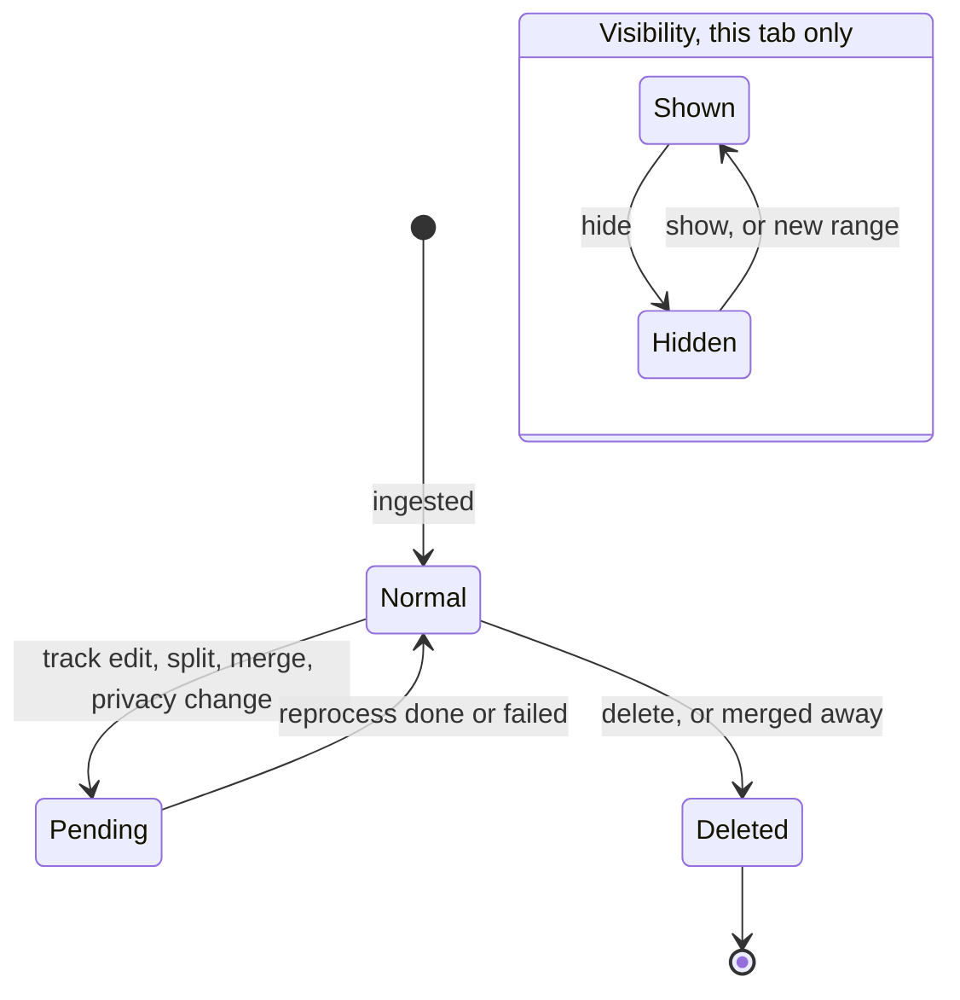
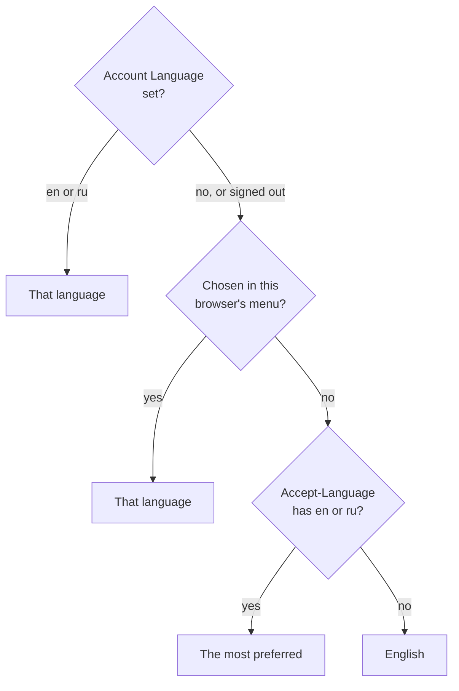

# HoldMyTrack: Spec

| | |
| :-- | :-- |
| **Status** | Current: Milestone 1 as built |
| **Last updated** | 2026-10-16 |
| **Related documents** | `VISION.md` (what ships and why), `IMPLEMENTATION.md` (how it's built), `services/server/api/` (the JSON contract), `apps/android/docs/SPEC.md` (the Android app) |

## 1. Introduction

### 1.1 Purpose

What HoldMyTrack does, as a user or an API client can rely on it: limits, privacy guarantees, what is kept and deleted, and the rules that cross features. Screen wording and layout live in the UI code, endpoint parameters and status codes in `services/server/api/`, reasons in `VISION.md` and the ADRs, and how each piece is built in `IMPLEMENTATION.md`.

### 1.2 Scope

Every built feature of the server and the web app; the Android app's own behavior is in `apps/android/docs/SPEC.md`. What won't be built is in §20; what isn't built yet is in `ROADMAP.md`.

### 1.4 Definitions

| Term | Meaning |
| :-- | :-- |
| **Activity** | One recorded outing with a start time and usually a GPS track. Never any heart rate or other health data (ADR-0017). |
| **Original** | The file uploaded or the record synced, kept as it arrived so the activity can be rebuilt from it. |
| **Registered user** | An account with an email and password, a linked Google or Facebook identity, or both. |
| **Demo user** | A visitor in a session on the shared, read-only Demo Customer account (FR-2). |
| **Fog of War** | A map mode that veils everywhere the account has never recorded an activity. |
| **Heatmap** | A map mode that shades each place by how often the account crossed it in the last 365 days. |
| **Ingest** | Turning an original into a stored activity: parsing, clipping against Private locations (FR-8.1), simplifying, storing. |

### 1.5 API errors

Every error from `/v1` and `/tiles/v1` is JSON `{"error": code, "message": text}`: the code is stable and never changes with language, and the message is a sentence in the request's language (FR-13.1); ADR-0045 and `services/server/api/` list the codes and the exceptions. With `MIN_ANDROID_BUILD` set, an older Android build gets `426` `app_outdated` from every `/v1` request before anything else is checked (`apps/android/docs/SPEC.md` FR-1.8); no other client is ever refused for its version.

## 2. Actors

| Actor | Can |
| :-- | :-- |
| **Anonymous visitor** | Read the public pages (FR-10), sign up, sign in, start a demo. Sees no activity data. |
| **Demo user** | Read everything the Demo Customer account holds and change nothing (FR-2.1). |
| **Registered user** | Everything in this document, for their own account. |
| **Admin** | A registered user made admin from the command line, who can also read every account (FR-12). |

The admin panel is the only place an account sees another account's data (FR-8.2).

## 3. FR-1 — Authentication & Account Management

On the web, sign-in, sign-up, password reset and verification are server-rendered pages sharing the JSON endpoints' behavior. A page form, and any `POST`, `PATCH` or `DELETE` under `/v1/` that carries an `Origin`, is refused unless that `Origin` (for a form without one, its `Referer`) is the app's own. A request with no `Origin`, as the Android app sends, is not refused.

### FR-1.1 Sign up

- The email must be a bare address: a display name or comment (`Name <a@b.c>`) is refused. An email another real account has is refused.
- The password is 8 characters to 72 bytes (bcrypt's limit), stored as a bcrypt hash, never stored or logged in plain text.
- The browser's IANA timezone comes with the form; a missing or invalid one starts the account on UTC and never refuses the signup.
- At most 5 accounts from one address in an hour. Failed signups and Google or Facebook sign-ins don't count; the count restarts with the server.
- Signing up always makes a new account, also from a demo session (FR-2.3), starts a 30-day session and sends a verification email (FR-1.8).

### FR-1.2 Sign in

- An unknown email, an account with no password and a wrong password get the same error, so sign-in can't reveal which emails have accounts.
- After 10 failed sign-ins for one email, or 50 from one address, within 15 minutes, sign-in is refused before the password is checked, even the right one, until the window passes.

### FR-1.3 Sign out

Signing out deletes the session on the server; its cookie or token stops working at once.

### FR-1.4 Session check / persistence

- Every request checks the session in the database, so a session ended on the server (sign-out, password reset, account deletion) stops at once. A session lasts 30 days from creation, a demo session 24 hours.
- `GET /v1/auth/me` returns the account and whether its email is verified (always true for a demo session).
- When the check gets no answer (the server unreachable or failing), the map says it couldn't load the account and offers to retry; it doesn't treat the visitor as signed out.

### FR-1.5 Forgot password

- A reset link goes to a real, claimed account, including a Google- or Facebook-only one, which is how such an account gets its first password. It is valid for 1 hour and works once.
- The answer is the same whether or not the email has an account.
- At most 5 requests an hour from one address.

### FR-1.6 Reset password

- The password rules are FR-1.1's. A missing, used and expired token get the same error.
- A reset ends every session and every outstanding reset link of the account, then signs in the browser that made it.
- A reset link opens the reset page whatever session the browser holds.

### FR-1.7 Account settings

- **Avatar**: PNG, JPEG or WebP up to 5 MB, applied on upload.
- **Name**: an optional label; not unique, and nothing signs in with it.
- **Country** (required in every save) decides the units everywhere: imperial for the United States, Liberia and Myanmar, metric for every other country and for an account that has never saved one.
- **Timezone** (IANA, UTC until changed, a former name stored under its current one) decides "today": where the date slider's and Trends' default windows end and the activity graph's current year. It stands in for an activity's zone where that isn't known (FR-3.11).
- **Language**: automatic (the default), English or Russian (FR-13).
- Name, Country and Timezone (and Language, over the API) save together: one invalid value and nothing is saved.
- **First run**: a real, verified account that has never saved Country is sent to Settings from the map, Profile and sign-in until it saves Country and Timezone once.
- A demo account's settings are read-only. The theme belongs to the browser or phone (FR-4.12).

### FR-1.8 Email verification

A real account must confirm its email before using anything else. Why: a mistyped email strands an account's imported data where nobody can get it back.

- Until verified, every route except `GET /v1/auth/me`, sign-out, resend and change of address is refused with a distinguishable error. A demo account is never gated.
- A link is valid for 24 hours, works once and confirms only the address it was sent to. It works from any device and signs that browser in, unless the browser is signed in to another account.
- Verifying ends every other verification link, and, when the address changed, every reset link.
- A change of address before verifying waits for the new address's link: until then the account keeps its address and state, the new address stays free for anyone else, and earlier links stop working. If another account takes the address meanwhile, verifying is refused.
- A change to an address another account has is refused. A resend goes to the newest link's address. Resends and changes together: at most 5 an hour per account; a demo account can do neither.

### FR-1.9 Sign in with Google

- Offered only where the deployment configures Google; otherwise its endpoints don't exist.
- A Google account whose email Google reports unverified is refused.
- The account is, in order: the one linked to this Google account, even if its email changed; else a real account with the same email, which is linked and counts as verified from then on; else a new verified account, named from the Google profile, on the browser's timezone (UTC if none).
- Linking an unverified account also removes its password and Facebook link and ends its sessions and links: whoever set them never proved they own the address.
- An account linked to a different Google account isn't relinked; the sign-in fails. Every failure gets one generic message, the cause logged on the server only.
- Kept from Google: the stable id, email and name. The Android app sends a Google ID token for the same checks.

### FR-1.10 Sign in with Facebook

- Offered only where the deployment configures Facebook.
- Never linked to an existing account by email, because Facebook doesn't say whether the email is verified: an email another account has is refused, pointing to the usual sign-in or a password reset. There is no way to link Facebook to an existing account.
- A Facebook account that shares no email is refused.
- An account linked to the Facebook account signs in even if its email changed; otherwise a new, unverified account is made and sent a verification email (FR-1.8).
- Kept from Facebook: the app-scoped id, email and name. The Android app runs the flow in a browser tab and gets its session with a one-time code valid for 2 minutes and tied to the app's S256 challenge; a wrong verifier uses it up.

Both providers: a provider-only account has no password and can set one through FR-1.5; changing the email keeps the links; a Facebook-made account still unverified when its email signs in with Google loses its Facebook link.

### FR-1.11 Delete account

- A real account, verified or not, confirms by typing its email (case and surrounding spaces ignored). A demo session can't.
- At once: every session ends, the provider links and every unused reset, verification or app sign-in link stop working, nothing can sign in, and the email is free for a new account.
- Within minutes: activities and originals, tiles, photos, Stories, Private locations, captures, import history, data downloads, avatar and settings are deleted. A file being processed finishes first.
- Backups keep the data for up to 8 weeks. Story copies others accepted stay theirs (FR-14.8).
- The Android app also clears the account's unsynced recordings on that phone. An unverified account deletes on the web by verifying first, or by email (FR-10.2).

### FR-1.12 Download your data

- For a real, verified account. One copy is prepared at a time; a new request ends the earlier one's downloads.
- Once every 7 days from when the last was ready; a failed copy doesn't count. A refusal says when the next is allowed, in the account's timezone.
- When ready, an email in the request's language links to Settings, which needs signing in.
- Archives of about 2 GB, downloadable only by the account, resumable. Together: `README.txt`; `originals/`, every original as it arrived, before Private locations; `tracks/`, every activity as GPX as the map shows it; `photos/`, the stored copies; `account.json`, the account, settings, activity details, Stories, Private locations and captured places.
- Downloadable for 7 days, then deleted; deleted with the account.

### FR-1.13 Account limits

Every account can keep up to 50,000 activities and 5 GB of originals, the same for everyone, to stop a runaway import (ADR-0043).

- An activity counts from the moment it's sent. An original shared by a split's parts (FR-5.17) counts once.
- At a limit only adding stops: an upload (FR-3.1), a phone sync (FR-3.6) and accepting a Story copy (FR-14.7) are refused naming the limit. Nothing is deleted or hidden to make room.
- Simultaneous requests are checked each on its own, so together they can go a little over. A Story copy accepted below the limits is made whole.
- Settings shows the account's use of both limits.

## 4. FR-2 — No-Signup Demo

### FR-2.1 Start a demo

- At most 5 demo starts an hour from one address.
- Every demo session is on the one persistent Demo Customer account, so every visitor sees the same data. A demo session lasts 24 hours.
- Every write (upload, sync, edit, delete, settings, avatar, Private locations, Stories, photos, captures, data download, account deletion) is refused with `demo_read_only`, whatever the client sends. On Android a demo session can record on the phone but not sync.
- It holds a real history from a live deployment: 43 activities from 2026 around Cleveland, OH and on trips to Niagara Falls, Rome, Tallinn and Vietnam, with photos, Stories and captures; a preset profile (Demo User, United States, America/New_York); three 305 m Private locations where the history starts and ends.

### FR-2.2 Demo account seeding and lifetime

- Seeded at deploy time by `seed-demo-customer`, never by a request. A re-run fills in what's missing and holds the Stories to the manifest; `--reset` deletes its activities (with tiles, photos and files), Stories and captures and seeds again to match the shipped history exactly.
- The shipped history is GPX files and a manifest in the repository, written by `export-demo-activities <out-dir> <activity-id>...`: each track as its owner sees it after Private locations and edits, never the original; photos as stored; names, types, descriptions, Stories, and captures between the first and last exported point except places reaching into a Private location.
- The account is recognized by its fixed id, which keeps it read-only, and is never deleted.

### FR-2.3 Create a registered account from a demo session

Signing up from a demo session makes an ordinary new account (FR-1.1). Nothing carries over and the shared account is unchanged. Leaving without signing up keeps the demo session.

## 5. FR-3 — Activity Upload & Ingestion

Every ingest path needs a session and goes through one pipeline; a demo session can't add anything. Health measurements in an original are never read (ADR-0017). Only what the user picks comes in, and nothing is changed or hidden on their behalf (ADR-0039).

### FR-3.1 Upload individual files

- `.gpx`, `.fit` or `.tcx`, at most 16 MiB. A `.zip` isn't imported: the clients refuse it by name and the server with its own message.
- The clients send at most 20 files at a time and refuse a larger selection whole.
- Each file is processed on its own; one failing doesn't affect the others.
- At most 100 files an hour per account, refused and duplicate ones included, checked before the file is read; the count restarts with the server.
- An empty file, another type, a file too large or one past the account's limits (FR-1.13) is refused at once.
- A file that can't be read, has no timestamps (a planned route), has no positioned point or has fewer than 2 points fails in processing, with the reason on the Sync page. Untimed points inside a timed track are dropped.
- The activity reaches the list, map and totals without a reload; Fog and Heatmap follow once redrawn (FR-4.2).

### FR-3.4 Import status

- Files, Health Connect sessions and recordings are one history: the web's Upload menu shows what's in progress, the Sync page (FR-3.9) and the Android app's Sync history what finished.
- A phone sync of several activities is one import. The web can't start a phone sync.

### FR-3.5 Duplicate detection

- An original identical to one the account has makes no new activity or job, and the client says so. Two identical uploads at once still make one activity.
- A split activity's original is still recognized (FR-5.17). A deleted activity's original can be uploaded again.
- The same outing from two sources is two activities if both are sent (FR-3.7).

### FR-3.6 Mobile sync (Android / Health Connect)

The Android app sends the Health Connect sessions and recordings (FR-3.8) the user ticks: nothing is ticked by default, and nothing unticked reaches the server. The app side is `apps/android/docs/SPEC.md` FR-3.

- Only a session with a route is offered (not an indoor workout, nor any Samsung Galaxy Watch session). Routes can only be read in the foreground, a Health Connect constraint. Only the session and its positions, times and altitudes are read; no other health permission is requested.
- The server says which Health Connect records the account already has (in any state, or queued) and which are still processing. The phone keeps no record of what it sent, so a reinstall or second phone agrees, and a record whose activity was deleted is offered again.
- Each activity is idempotent on its source and id. Types map onto HoldMyTrack's names (`biking` becomes `cycling`).
- Per account: at most 60 sync requests and 1,000 activities sent an hour (every activity sent counts, taken or not; a refused request counts none). The counts restart with the server.
- Activities past the account's limits are refused one by one in the order sent; what fits is taken.

### FR-3.7 Overlap hint

A candidate on the phone covering the same time as an account activity, or another candidate, is marked so the user can leave one unticked. A hint only: nothing is matched or hidden on ingest (ADR-0039).

- Two overlap when their times overlap for at least 80% of the longer one. Type and distance aren't compared, since sources disagree. Touching, a small part of the other, and no duration don't overlap.
- An activity is compared by the time it was recorded over, even where Private locations hide its ends or all of it. A split part covers only its own stretch.
- `POST /v1/activities/overlaps` takes up to 5,000 spans and answers each with the account's own activity it overlaps most.

### FR-3.8 In-app GPS recording (Android)

The Android app records GPS-only activities on the phone; nothing reaches the server until the user ticks a recording and sends it (ADR-0007; app side `apps/android/docs/SPEC.md` FR-5).

- Each recording is sent on its own under source `recorded`, with an id made at recording start: 1–200 letters, digits, `.`, `_` or `-`, not starting with `.`. A type over 50 characters is refused with the reason.
- It is the only path that sets a name and description at ingest.
- A recording the server takes is deleted from the phone; a refused one stays. It isn't on the map until synced.

### FR-3.9 The Sync page

- `/sync` lists finished imports from every source, newest first, in the account's timezone: ready ones with a link to the activity, failed ones with the reason in the reader's language (FR-13.1). Imports still processing aren't listed.
- An unseen failed import marks the header's Sync item until the page is opened.

### FR-3.11 An activity's own timezone

An activity's times and dates are the wall clock where it was recorded, whatever the account's or viewer's zone.

- The zone is the one the first recorded point lies in, before Private locations clip it; at sea, the nautical zone. A split part takes its own first point's. With no zone known, the account's at ingest.
- Every time of the activity, its points and photos is shown in that zone, on the web and Android; a browser or phone that doesn't know the zone shows its own.
- An activity counts on its local date everywhere days are counted: the date slider, date filtering, totals, drawn tracks, the activity graph and Trends.
- The offset is the one in force on the activity's date.

## 6. FR-4 — Map Visualization

### FR-4.1 Track rendering (Normal mode)

- Normal mode draws every activity in the date range (FR-6) passing the Type and Distance filters that isn't Hidden or Pending (FR-5.15); with a Story open, its activities (FR-14.6).
- Tracks are drawn from zoom 4 in.
- The focused activity (FR-5.1) is emphasized, with its pace (FR-4.8).
- A track across the 180° meridian is drawn the short way and counts in Fog and Heatmap on both sides.

### FR-4.2 Fog of War mode

- Fog is all-time: everywhere any activity went is clear, whatever the date range, filters, hidden set or Stories. Only Pending activities drop out.
- Zoomed out it clears a whole country once any activity is inside it (zoom 0–2), then a whole state or region (3–6), then exact coverage; the levels never blend. Boundaries are OpenStreetMap's on land (ADR-0034): a track on the water counts in no country, and a country without regions is one region.
- The edge of cleared ground is a smooth outline, traced to about 19 m at zoom 14 and twice that per zoom out, with no seams between tiles, on the web and Android.
- While a coverage change is still being worked on, the map says Fog and Heatmap may be incomplete; the veil then updates without a reload.
- Switching modes never moves the camera; returning to Normal restores the panel's state.

### FR-4.3 Heatmap mode

- Heatmap counts the last 365 days, a fixed rolling window, so a route not taken any more cools off. It ignores the filters, hidden set and Stories, like Fog.
- Out to a region, a place is as hot as the activities through it; closer in, as the times it was crossed. A route passed once is green at every zoom.
- What reads hottest adapts to the account's own history, recomputed daily. No country or region levels.

### FR-4.4 Mode is mutually exclusive

Exactly one of Normal, Fog of War and Heatmap shows at a time.

### FR-4.5 Base map, theming, and the opening view

- A self-hosted vector base map covering the whole planet at every zoom, light or dark with the theme (FR-4.12). A URL can pin `white`, `black` or `grayscale` until the theme changes.
- The camera is kept in the URL (`#map=<zoom>/<lat>/<lon>`); an incomplete or out-of-range one is ignored.
- The opening view: the URL's camera; else the most recent activity; else the account's Country; else a world view. It never asks for the browser's location, and a new session doesn't inherit an earlier one's camera.
- The web map is a globe out to zoom 3 and flat from 4; Android's is flat.

### FR-4.7 Find my location

A one-shot move to the device's location; nothing about it is recorded or sent to the server.

### FR-4.8 Pace-colored segments

- The focused activity's track is drawn in five bands, slowest blue to fastest red, scaled to its own slowest and fastest speed. No legend, no values, no heart-rate alternative (ADR-0017).
- Bands follow the simplified line, so a straight stretch can read coarser than its data (`IMPLEMENTATION.md` §4.3.1).
- Not in Fog, Heatmap or an export.

### FR-4.10 Map image export

- Any framed view as a PNG, on the web and Android: Custom with a long side of 1920, 2560 or 3840 px, or an Instagram, Facebook or X preset. A size the browser can't draw isn't offered.
- The image is what's in the frame at the current zoom, theme and mode: Normal's filters or open Story, Fog's all-time coverage, Heatmap's window. Private location circles and pace bands are never drawn.
- OpenStreetMap's attribution, the imagery credit with Satellite on, and a HoldMyTrack watermark are drawn in and can't be removed: the basemap is an ODbL Produced Work (`IMPLEMENTATION.md` §5.6).

### FR-4.12 Light and dark theme

- Pages and the Android app follow the device's setting, or a Light or Dark choice kept by that browser or phone, never on the account.
- The base map and Fog's veil follow the theme. A saved dark choice never flashes light first.

### FR-4.13 Trails and bike paths

- Trails and dirt tracks come from the base map and are always drawn, dirt tracks from zoom 12, trails from 13.
- Bike paths, shared paths and mountain-bike trails come from an OSM import of their own (FR-4.16), are off until ticked in Layers, drawn from zoom 9; the choice is kept by the browser or phone.
- From OSM tags, the first that fits: **mountain-bike trail**, a cycleway, path, footway or bridleway with `mtb:scale`, or a cycleway or shared path of rough ground (`surface=ground`, `dirt`, `earth`, `mud`, `sand`, `grass`, `rock`, `woodchips`, `unpaved`); **bike path**, `highway=cycleway`; **shared path**, `highway=path`, `footway` or `bridleway` with `bicycle=designated`. Separately, **trail**: `highway=path`, `footway` or `bridleway`; **dirt track**: `highway=track`.
- A street's painted bike lane and untagged singletrack are none of these. Sidewalks, crossings, steps and named route networks aren't drawn.
- Paths draw over Fog and Heatmap at full strength, under the tracks, in every mode and in exports. One switch hides every ticked path and place (FR-15.2) and keeps the picks.

### FR-4.14 Satellite mode

- Only where the deployment configures imagery (`IMPLEMENTATION.md` §4.26); otherwise no option, and a saved choice shows the map. The choice is kept by the browser or phone.
- Roads stay over the imagery at 40% opacity, and go altogether in Fog and Heatmap. Over imagery Fog uses the light veil.
- The provider's credit shows while it's on and is drawn into exports.
- On a quota-capped plan such as MapTiler's Free plan, imagery stops for the rest of the month once the quota is used; roads and labels still draw.

### FR-4.15 What the map draws

| Zoom | Tracks | Fog | Heatmap | Bike kinds | Trails, dirt tracks | Spots | Photos |
| :-- | :-- | :-- | :-- | :-- | :-- | :-- | :-- |
| 0–2 | — | Countries | Circles | — | — | — | — |
| 3 | — | Regions | Circles | — | — | — | — |
| 4–6 | Drawn | Regions | Circles | — | — | — | Small |
| 7–8 | Drawn | Exact | Lines | — | — | — | Small |
| 9 | Drawn | Exact | Lines | Drawn | — | — | Small |
| 10–11 | Drawn | Exact | Lines | Drawn | — | On request | Drawn |
| 12 | Drawn | Exact | Lines | Drawn | Dirt tracks | On request | Drawn |
| 13+ | Drawn | Exact | Lines | Drawn | Drawn | Drawn | Drawn |

- Each band runs up to the next band's first zoom. The Android app follows the same bands.
- Bottom to top: base map or imagery, Fog or Heatmap, paths, tracks and pace bands, labels, Spots, photos.
- Past the deepest stored level the map enlarges it: tracks, Fog, bike kinds and Spots past zoom 14, Heatmap and the base map past 15, imagery past the deployment's deepest level (18 on holdmytrack.com).
- At most 1,200 tile requests a minute per account across every layer (per address for the demo account); past that a tile is refused for the minute and an export that meets one fails. The count restarts with the server. Caching is `IMPLEMENTATION.md` §4.2.6.

### FR-4.16 Bike-path tiles

The same paths for every account, behind the session and cached like every map tile; a load that changes them moves every account's tile version. Empty below zoom 9; below 13 a path shorter than a pixel is left out.

## 7. FR-5 — Activities Panel

### FR-5.1 Activity list

- Lists every activity in the date range (FR-6) passing the Type and Distance filters, always newest first by start time, not paginated. Count and total distance cover the whole range.
- A row shows the activity's name, which exists only once a person types one (FR-5.10), else its local start time.
- Badges: Pending and Hidden (FR-5.15); Story, naming its Stories; Private, for an activity entirely inside Private locations (FR-8.1), which has no track, distance or duration and can't have its track or photos edited.
- One activity is focused at a time, by clicking its row or track; any number can be checked. The toolbar's actions act on the checked activities when any are, else on the focused one, never both. Checking never moves the camera, and camera fits skip Hidden activities.

### FR-5.2 TYPE filter

Lists the types present in the date range; types are free text, not a fixed vocabulary. It filters in the client and narrows the list, the tracks and the count.

### FR-5.3 DISTANCE filter

- Bounded by the range's shortest and longest activity; both knobs at the ends means no filter.
- Not offered while the range's activities don't span distances, and a filter set before is cleared.
- A Private activity sets no bound and is left out once a filter is on.

### FR-5.8 Hide/show a track

- Hiding is per browser tab, never stored, and only affects Normal mode's tracks.
- Over several activities, show/hide shows them all if any is hidden, else hides them all.
- A new date range clears it (FR-6.6).

### FR-5.10 Edit activity type, name, and description

- Type is required, 1–50 characters; name up to 200; description up to 2,000. Type is free text; the picker's list is only a convenience.
- Editing several activities sets only their type, never their names or descriptions.
- An edit doesn't change distance, coverage, Trends or the list's order.
- When a save over several fails partway, what was written stays written.
- Another account's activity can't be told apart from a missing one.

### FR-5.11 Delete an activity

- A full purge with no undo: the activity, track, coverage, photos (FR-16.5), and its original once no other activity (a split part, a Story copy) shares it. It leaves every Story; copies others accepted stay theirs (FR-14.8).
- Fog and Heatmap revert where it was the only source, without a reload once redrawn.
- When one of several deletes fails, the others stay deleted.

### FR-5.14 Edit track

Chop (keep the part between two points), Cut (remove it and join the ends), Delete point and Move point. The original is never changed, so Reset always returns the track as recorded.

- Needs a real account and one non-Pending activity with a stored original and a track whose timestamps exist and run forward.
- The editor gets the points already clipped against Private locations, so hidden ends never reach the client; an activity entirely inside them can't be edited.
- A moved point keeps its time and elevation. No edit can leave fewer than two points.
- Saving reprocesses the activity from its original: distance, duration, moving time, elevation gain, start time, track, coverage, country and region matches. A Cut's join counts toward distance, and its time toward elapsed but not moving time.
- The result is clipped against Private locations again, so an edit can't uncover an end inside one; the editor's preview doesn't show that clip.
- Pending until reprocessed; on failure it keeps its previous track and numbers.
- An edit is stored by recording time, so it keeps meaning the same points when a Private location changes.
- At most 120 editor openings an hour per account; the count restarts with the server.

### FR-5.15 Activity states

| State | Track | Fog and Heatmap | Row | Survives reload |
| :-- | :-- | :-- | :-- | :-- |
| Normal | Drawn | Counted | Plain | Yes |
| Pending | Not drawn | Not counted, at any zoom | Badge, old numbers; can't be focused, checked, edited or deleted | Yes |
| Hidden | Not drawn | Counted | Dimmed, badge | No |

- Pending wins over Hidden, and reprocessing never changes visibility: a hidden activity stays hidden after Pending clears.
- Entering or leaving Pending never moves the camera; leaving it brings the track back at once and Fog and Heatmap once redrawn.
- An activity entirely inside Private locations is Normal with no geometry.

### FR-5.17 Split an activity

An activity is split in two at a point on its track; the parts can be merged back. Each part is a full activity, and the original is never changed.

- A split needs what Edit track needs (FR-5.14). The split point belongs to both parts, each needing at least two points. One split per edit session, whose edit applies to both.
- The activity keeps the part before the point. A new activity gets the rest with the same type, name, description and edit, joins the original's Stories, and takes the photos after the point.
- Both parts are Pending until reprocessed; each starts at its first point.
- A split point inside a Private location leaves both parts ending outside it. A split leaving a part entirely inside Private locations is refused unless the client confirms; that part is then kept with no track (FR-8.1).
- A part is edited like any activity, split again included; Reset returns its own stretch.
- Merging (API only) takes two or more parts of one split that meet end to end, none Pending: the earliest is kept, the others deleted, their photos, Stories and edits combined into it. Merging every part gives back an unsplit activity.
- The original is still recognized on re-import (FR-3.5) and counts once against the limits.

## 8. FR-6 — Date Range Slider

The date range filters the Activities tab only, not Stories, the Privacy tab, Fog or Heatmap. The slider counts only days with an activity, by local date (FR-3.11), in a window of 15 such days, the most recent on load.

### FR-6.1 Default selection

The 5 most recent days with an activity (today for an account with none), recalculated as activities arrive until the user picks a range, and held still while the Edit window is open.

### FR-6.6 Changing the selection resets dependent state

- A new range clears the focus, checked activities, hidden set and Type and Distance filters.
- The camera fits the new range once. Only a range the user picked moves it, never an upload landing, a Pending activity clearing or a Private location change.

## 9. FR-7 — Activity Graph (Profile)

### FR-7.1 Contribution grid

A private page, `/profile`: one cell per calendar day by local date, one block per year back to the first activity, shaded by count (none, one, two, three or more) or by distance in quantiles of the account's own active days that year.

### FR-7.2 All-time and per-year stat cards

Activities, Distance, Active Days and Longest Streak (consecutive days with an activity), all-time and per year.

## 10. FR-8 — Privacy Controls

### FR-8.1 Private locations

Circles a user marks so tracks don't reveal where they start and end. The part of an activity that starts or ends inside one is hidden everywhere, the user's own map included. A track that only passes through one is shown whole, since that reveals neither end.

- A center, a radius of 50–2,000 m (200 by default) and an optional name up to 100 characters; at most 20 per account. The demo account's are read-only.
- Applied at ingest, before anything is stored: the leading points inside any Private location are dropped, and so is a further stretch past the edge, between 0 and the radius long along the track. The track starts at the first point that stretch reaches, or the one before when that lies more than a radius past the edge; only a recording with no point in that first radius is cut at the stretch's end itself. The trailing points likewise.
- Each end's stretch is random but fixed per activity, so the ends of many tracks scatter over a band outside the circle instead of outlining it, and reprocessing doesn't move them.
- An end the stretch carries back inside a Private location is cut again where the track next leaves it. The same clip runs on an edited track (FR-5.14).
- Distance, duration, elevation gain, pace, coverage and country and region matches come from the visible part.
- An activity left with fewer than two points is kept with no geometry and a Private badge (FR-5.1); moving or deleting the location brings it back.
- Every change is retroactive: activities whose track comes within twice the radius of the old or new center go Pending and are reprocessed from their originals.
- Circles are drawn only on the Privacy tab, from zoom 4, and never in an export.
- Originals stay unclipped and are in the data download (FR-1.12). A Story copy carries the sender's clipped track (FR-14.8).
- An activity ingested before Private locations existed keeps its fixed 100 m endpoint trim until reprocessed.

### FR-8.2 Data isolation

An account only sees its own data. Every endpoint takes the account from the session, and none accepts an account id that could stand for another's, except the admin panel (FR-12), shown only to an admin.

## 11. FR-9 — Trends

### FR-9.1 Trends

- Weekly (Monday to Sunday) or monthly totals of count, distance, moving time and elevation gain by local date (FR-3.11), for a window defaulting to the trailing 12 months, every bucket returned, empty ones as zeroes.
- An activity with no moving time counts its elapsed time. Shown on the Profile page. Best efforts and personal bests are out of scope (§20).

## 12. FR-10 — Public pages: About, Help, Contacts, privacy policy, Android test suite

Server-rendered pages that need no JavaScript, with the shared header (FR-10.4).

### FR-10.1 About page

- `/about` says what HoldMyTrack is, isn't and how it's funded. Without a session `/` is the same page, with `/` as canonical; with one, `/` is the map. It never starts a demo itself.
- `/robots.txt` disallows `/v1/` and `/tiles/`; `/sitemap.xml` lists `/`, `/help`, `/contacts` and `/privacy`.

### FR-10.2 Help page

- `/help` explains every feature. Its facts are this document's: changing a limit, a mode's window or a zoom tier it describes changes Help too.
- It tells someone who can't sign in how to have their account deleted by email, and how to revoke Google's or Facebook's access. Its `#delete-account` anchor is the deployment's data-deletion instructions URL for Facebook (FR-1.10).

### FR-10.3 Contacts page

`/contacts` gives `hello@holdmytrack.com` and `https://github.com/HoldMyTrack/platform`.

### FR-10.4 Page header and footer

- One header on every page, one footer on every page but the map and Profile; menus work without JavaScript.
- With a session pages are `Cache-Control: no-store`, since the header names the account; without, public pages are `public, max-age=300` with `Vary: Cookie`, so a copy cached signed out is never reused signed in.
- An unknown address gets a "Page not found" page, or a JSON error under `/v1/` and `/tiles/` (§1.5).
- Indexable pages carry Open Graph and Twitter card tags with a 1200×630 share image.

### FR-10.6 Privacy policy

`/privacy`, in English and Russian, is the policy the Play Store listing and the Android app's Health Connect rationale point to. Its text is the page itself (`services/server/internal/web/templates/pages/privacy.html`, `privacy.ru.html`), which must agree with `DPIA.md` and this document: a change to what is kept, who processes it or for how long changes all three.

### FR-10.7 Android test suite

- `/testing`: the Android closed test's steps and expected results, with sample files under `/static/testing/`. English only, `noindex`, not in the sitemap, linked from nowhere.
- Its expected results quote the app, so a change to what the Android app shows or says, or to a server message it shows, changes this page too.

### FR-10.8 Pages inside the Android app

- The Android app shows Settings, Profile, the Sync page and About as web pages; the `hmt_app` cookie drops their header and footer.
- For the app, Settings leaves out Theme, Download your data and Delete account, which the app has natively, and About has no demo link. Signed out, the app's About is cached apart from the browser's.

## 13. FR-11 — Donations

### FR-11.1 Donate

Donate opens the configured Open Collective's donation page in a new tab (`VISION.md` §6.1), or About's funding section when none is configured. HoldMyTrack takes no payment and stores nothing about a donation.

## 14. FR-12 — Admin panel

A read-only view of every account and its activities for the operators, at `/admin` and `/admin/users/{id}`, `noindex`.

### FR-12.1 Access

- Admin is granted or revoked only from the command line: `holdmytrack set-admin <email> true|false`, which fails for an unknown email or the demo account.
- To anyone else, signed out or in a demo session, both pages answer the ordinary "Page not found".
- An admin still goes through verification and first-run Settings. Revoking applies on the next page load without ending the session.

### FR-12.2 Accounts

`/admin` lists every account, demo included, newest first: email, name, admin, demo and unverified badges, signup date, country, timezone, activity count, first and last activity dates and total distance.

### FR-12.3 An account's activities

- `/admin/users/{id}` lists the account's activities, newest first, 100 per page: id, local start time and zone, type, name, distance, duration, source, countries and regions.
- Activities entirely inside a Private location are included and badged; edited tracks are badged. Nothing on either page changes anything.

## 15. FR-13 — Language

### FR-13.1 Which language a person gets

Pages, the map, emails and error messages come in English or Russian, one language per request.

- `ru-RU` and the like count as Russian. URLs don't change with language.
- Numbers, dates and plurals follow the language; units follow Country (FR-1.7).
- Verification and reset emails use the account's language, else the request's; a Story copy's email the recipient's, else English.
- Error codes never change; messages follow the request reading them, so an old import failure reads in today's language.
- Map labels use the language where OpenStreetMap has it, else English, with the local name beneath when it's in another script.
- The Android app follows its per-app language, else the phone's; its Language setting sets that and the account's together, signing in applies the account's, and it sends `Accept-Language`.
- Not translated: names and descriptions people type, place names OSM lacks in either language, uncommon activity types.

### FR-13.2 The language menu

- On every page, signed in or not; the browser keeps the choice for a year (`hmt_lang`).
- For a real account it is also saved as the account's Language, on every device; a demo session's stays in the browser.
- Automatic forgets the browser's choice and sets the account back to automatic.
- It applies from that page's reload; other open pages change on their next load.

## 16. FR-14 — Stories

A Story is a hand-picked, private set of the account's activities with a name, an optional description and joint totals (`VISION.md` §4.2). An activity can be in any number. Activities go in with the Activities toolbar's Add to story, into a new or existing Story, and come out on the Stories tab.

### FR-14.1 A Story

- Totals (count, distance, moving and elapsed time, and per activity type) cover all its activities with no date bound; an activity with no moving time counts its elapsed time.
- A Story copied from someone else's (FR-14.8) names them while the original Story exists.

### FR-14.2 Create, rename and delete

- Name required, up to 200 characters; description up to 2,000; both trimmed.
- A Story can be created with its first activities; if any isn't the account's own, nothing is created.
- Deleting a Story keeps its activities.

### FR-14.3 Add and remove activities

- Adding a member, or removing a non-member, changes nothing. At most 10,000 ids per request; if any isn't the account's own, none is added.
- Removing an activity from a Story keeps the activity. Deleting an activity removes it from every Story; an emptied Story stays.
- An activity is in a Story only once added, never by its dates.

### FR-14.4 The `story` filter

- The activity list, its totals, the day histogram and the tracks tiles take `story`, narrowing them to its activities; inside a Story the histogram counts only its days.
- Another account's Story, or an empty one, matches nothing.
- A change to a Story's activities moves the tile version; renaming doesn't.

### FR-14.5 Privacy and the demo

- A Story is visible only to its account; another account's can't be told apart from a missing one.
- A demo session reads the Demo Customer's Stories; every write is refused.

### FR-14.6 The Stories tab

- One Story is open at a time. While open, the tracks, rows, photos and exports are its activities, whatever the date range. Normal mode only: Fog and Heatmap stay all-time.
- The URL carries it (`/?story=<id>`); `/?tab=stories` opens the tab. Leaving the tab restores the Activities tab's range.

### FR-14.7 Send a copy

A Story's owner sends a copy to another account by email address; the recipient accepts or declines (ADR-0036).

- The answer is the same whether or not the address has an account. Only a verified real account, not the sender's and not being deleted, receives it; otherwise nothing is stored. The address is trimmed and compared without case.
- Any owned Story can be sent, a received copy included. Sending again while one waits refreshes it.
- The recipient is emailed in their language (English if none); an address that receives nothing gets no email.
- Declining copies nothing, and the sender isn't told. Deleting the Story withdraws waiting copies; copies from an account being deleted leave the inbox.
- At most 30 sends an hour per account. Accepting at the account's limits (FR-1.13) is refused and the copy keeps waiting.
- A demo session's inbox is empty, and it can't send, accept or decline.

### FR-14.8 The copy

Accepting puts a Story and activities in the recipient's account that are theirs from then on (ADR-0036).

- The Story is copied as it is when the copy is made, not when sent.
- The first accepted copy makes a new Story with its name and description; a later one adds to it, or, if the recipient deleted it, makes a new one with only what they haven't received.
- Each activity is made from its track as the sender sees it, with the sender's Private locations and edits applied, then treated as the recipient's upload: their Private locations apply too, and it counts in their Fog, Heatmap, totals, regions and Trends. Type, name, description and photos come with it.
- An account receives each original activity once, ever: one it already received, recorded or holds is left out, so a deleted copy doesn't return and a copy sent back to its recorder adds nothing. With nothing to add, no Story is made unless the Story is empty.
- An activity with no track, or hidden entirely by the sender's Private locations, isn't copied; one being reprocessed is copied once that finishes.
- Neither side's later changes, deletions or account deletion reach the other.
- A Story deleted, or whose owner is being deleted, before the copy is made adds nothing.

## 17. FR-15 — Spots

Outdoor places from OpenStreetMap in five categories, with what OSM says about each (`VISION.md` §4.2, ADR-0021), on the web and Android (`apps/android/docs/SPEC.md` FR-2.8). The operator loads them; a place's only mark is a capture.

### FR-15.1 Places

- **History** (`historic=castle`, `ruins`, `fort`, `archaeological_site`), **Monument** (`historic=monument`, `memorial`), **Mesmerizing view** (`tourism=viewpoint`), **Dog park** (`leisure=dog_park`), **Playground** (`leisure=playground`); a feature tagged for two takes the first.
- A place keeps what OSM has of its name, address, description, inscription, memorial type, start date and Wikipedia article (`language:Title` only). Its area is its outline, or a 30 m circle for a point.
- The operator loads places with `holdmytrack import-spots [--planet] <file>` (`DEPLOY.md` §6); loading again updates.
- A place is never deleted. A `--planet` load retires places missing from the file: only accounts that captured one still see it, and nobody can capture it. A later load that has it brings it back. A `--planet` load that would retire over 1% of live places retires none and stops with an error, after updating what it read.
- A load moves every account's tile version only if a place changed.

### FR-15.2 Points of interest

- One Layers toggle per category, off by default, kept by the browser or phone.
- From zoom 13 ticked places show as badges with their areas; from 10 to 13 only on request (FR-15.5); below 10 none. A captured place's badge is filled.
- Drawn over Fog and labels, undimmed; hidden during Edit track. A retired place shows only to an account that captured it.

### FR-15.3 The popup

Shows what OSM has about the place, a way to copy its address or coordinates, its Wikipedia link, and when the account captured it.

### FR-15.5 Show in this area

From zoom 10 to 13, the ticked categories' places in the visible map load when asked: at most 2,000, named first, spread evenly, with the area's total. A view across the antimeridian works either way round.

### FR-15.4 The tiles

The same places for every account, behind the session and cached like every map tile, retired ones flagged for the map to hide. Empty below zoom 13.

### FR-15.6 Captures

A place is captured by staying inside it for 30 seconds with the Android app's capture mode on (`apps/android/docs/SPEC.md` FR-2.8). Only the app captures; both clients show captures.

- The position sent must be inside the area or within 10 m of it. It is checked and not stored: a capture is the place and the time.
- The first capture is kept and never changed or removed, except with the account.
- A retired place keeps its captures, answers its details only to them, and can't be captured.
- A demo session can read captures but not capture.

## 18. Non-Functional Requirements (summary)

| Concern | Behavior |
| :-- | :-- |
| **Password storage** | bcrypt; plain text never stored or logged (FR-1.1). |
| **Sessions** | Server-side, revocable, checked on every request (FR-1.4). |
| **Rate limits** | Per address: signup, sign-in, password reset, demo (FR-1.1, FR-1.2, FR-1.5, FR-2.1). Per account: uploads, syncs, track editor, tiles, Story sends (FR-3.1, FR-3.6, FR-5.14, FR-4.15, FR-14.7). Counts restart with the server. |
| **Non-blocking uploads** | The app stays usable while files are processed (FR-3.1). |
| **No reload required** | Lists, totals and the map update as processing finishes. |
| **Idempotency** | The same original (FR-3.5), sync record (FR-3.6) or reset token (FR-1.6) has no effect beyond the first. |

## 19. Mobile Browser Support

The web app works in a phone browser. Below about 768 px the Activities panel is a bottom sheet over the map, collapsed to its tab row, and the date slider sits at the bottom of the screen. Taps stand in for hover on Trends and the activity grid, and a tap within about 14 px of a track focuses it. Hovering a track to underline its row stays mouse-only. Everything else works as on a desktop.

## 20. Deliberate limits

Not built by design, and not planned:

- Performance analysis (best-effort curves, personal bests, power curves, training load) and recovery data (sleep, HRV, readiness): `VISION.md` §1.1. Pace stays per-activity route context (FR-4.8), and health measurements are never read, stored or shown (ADR-0017).
- Explorer-tile scoring: Fog of War is the exploration mechanic (`VISION.md` §3.3).
- Splitting a track that passes through a Private location mid-way: FR-8.1 hides only the ends.

What is planned is in `docs/ROADMAP.md`.

## 21. FR-16 — Activity photos

The user's own photos on an activity, each at a moment on its route, so an activity or Story shows its pictures on the map (`VISION.md` §4.2, ADR-0024). Each is stored as a resized copy and thumbnail without EXIF, visible only to the account. The web and Android add and show them (`apps/android/docs/SPEC.md` FR-2.10).

### FR-16.1 Upload

- The client resizes first: the copy at most 2,560 px a side and 3 MiB, the thumbnail 640 px and 256 KiB, JPEG or WebP (the web sends 2,048 px and 320 px). Larger is refused; the type is read from the bytes.
- EXIF capture time and position are sent for placement only. Captions are up to 500 characters.
- At most 2,000 photos per account, on the account's own activities that have a track.
- A photo that can't be placed is refused with `photo_needs_place`, nothing stored, for the client to ask the user. A placement check answers where a photo would go without storing anything.
- A demo session can't add photos.

### FR-16.2 Placement

- A photo's place is a moment on the track, never a stored position; its position is worked out on every read.
- A moment the user chose places it there, clamped to the track.
- Otherwise its capture time does, on the track or within 5 minutes of either end (placing it at that end).
- A capture time without a zone is read in the activity's zone (FR-3.11), else in the UTC offset nearest it, in 15-minute steps from −12:00 to +14:00, that puts it on the track.
- Else an EXIF position within 500 m of the track places it at the nearest point. Else the upload is refused for the user to choose.
- A moment outside the drawn track (cut off by Edit track or a Private location) shows at the nearest end, and is kept so the photo returns if the track does. A photo on a stretch passing through a Private location shows nothing the track doesn't (FR-8.1).

### FR-16.3 Listing and images

Photos are listed per activity or Story in route order. Images are served only to their owner and never change, so they're cacheable for good.

### FR-16.4 Editing

The caption and the moment can change; the moment is clamped to the track, and a photo can't leave it.

### FR-16.5 Deleting

Deleting a photo deletes both images. Deleting an activity deletes its photos (FR-5.11), except images a copied Story's photo still uses.

## 22. FR-17 — Daily capacity

### FR-17.1 What the day's spend stops

The service spends up to `R2_DAILY_BUDGET_USD` a day ($2 by default) on object-store requests, across every account, reset at midnight UTC. Nearing it, the service gives things up in stages, keeping what everyone sees for last (ADR-0044).

- **At 70%**, Fog and Heatmap stop being redrawn: new and edited activities reach the tracks, and their coverage follows after midnight UTC, the map saying it's updating.
- **At 85%**, everything that adds to storage is refused: uploads, phone syncs, photos, avatars, accepting a Story copy and asking for a data download. A download already asked for is built after midnight. Refusals carry `Retry-After` until midnight UTC and say nothing stored is affected; the Android app keeps what it didn't send.
- **At 100%**, reads of stored files are refused the same way: Fog and Heatmap tiles, photos, avatars, download archives and the track editor's points. Tracks, lists, Stories, totals, Spots and pages keep working.
- The stages lift at midnight UTC, or when the budget is raised past the day's spend. A stage can start up to a minute after the spend that crosses it.